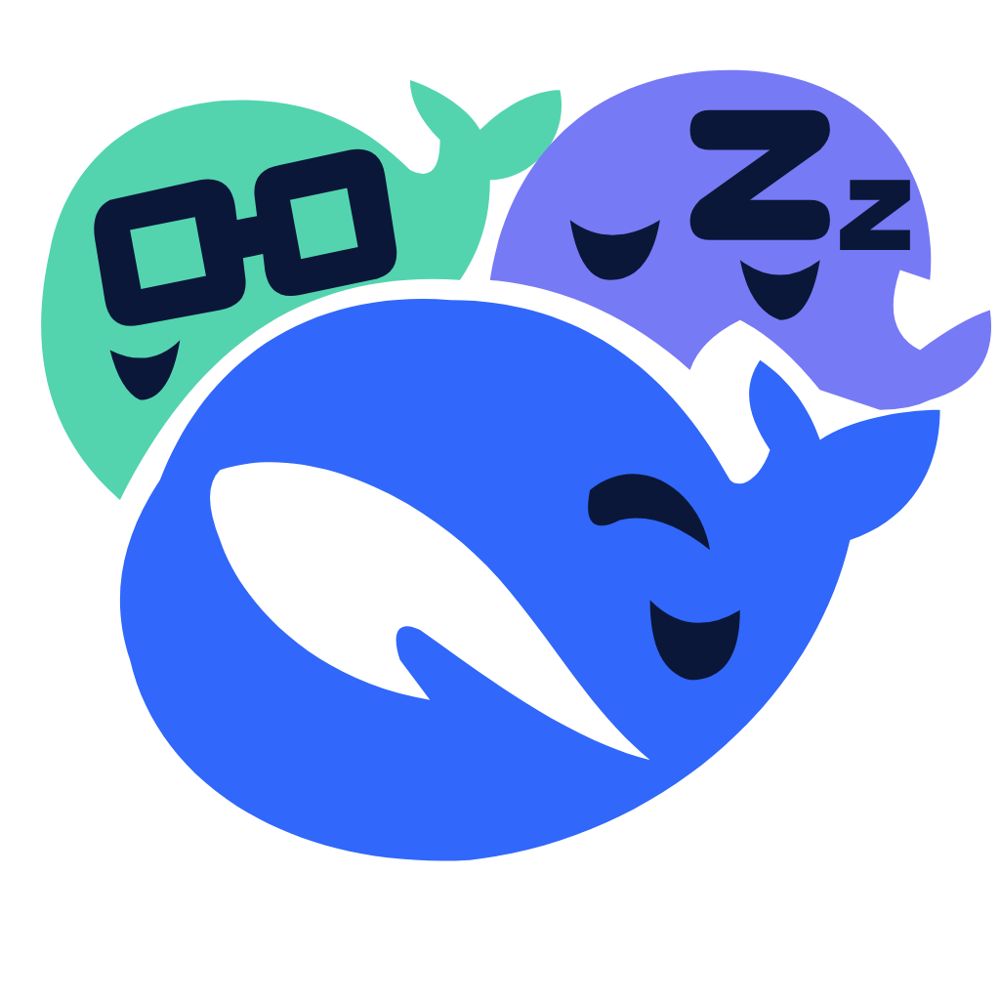

<p align="center">
  
</p>

# DSH-Bot

English · [中文](README.md)

**Your personal agent workspace.** Create Bots with their own roles and memory in DeepSeek Harness. Keep working with them in ongoing conversations, follow up on work, or bring them together to collaborate in a group chat.

**[0.6.6 is available](https://github.com/MJ-CJM/DSH-Bot/releases/tag/v0.6.6)** with unscheduled follow-up for personal Bots and groups, plus source-backed group-work recall. [See what changed](CHANGELOG.md).


The screenshots below show basic workflows from an earlier version in a real, isolated DSH environment, with fictional data and scripted replies. New 0.6.6 entry points are described below; screenshots do not establish real-model task quality.

## What you can do

| Capability | How it helps |
| --- | --- |
| Personal Bots | Give research, review and writing assistants their own roles, models, tools, skills and persistent main conversations. |
| Memory and group-work recall | Manage private memories and find group work the Bot participated in and can still access. Open the source or draft a saved conclusion. Sharing requires explicit user publication. |
| Multi-Bot groups | Mention a member or let members discuss concurrently. Inspect their execution, add input, or stop one member. |
| Background work and result review | Delegate native subtasks, inspect evidence and usage, and review, supplement or rework supported tasks. Ordinary schedules use DSH's native facilities. |
| Proactive follow-up | Enable it separately for a Bot or group to track pending reviews, failures, explicit input requests and registered commitments. No GitHub account or external credentials are required. |
| Documents and working methods | Analyze document text and acceptance criteria you provide. Evaluate method candidates in Feedback and improvements and explicitly adopt them after review. |

### Follow local work and explicit commitments

Personal Bots and groups have separate switches. You do not need to connect GitHub or configure an additional global switch first.

| Scope | Where to enable it |
| --- | --- |
| Personal Bot | Tasks in the Bot profile, or Tasks & messages in full settings → Turn on follow-up |
| One group | Open the group chat → Manage group → Activity → Turn on follow-up |

Enabling applies only to that Bot or group. Viewing and refreshing makes no model requests. Use Open original task to review a result, supply missing information or continue processing. For an eligible failed group item, continue with one selected member using that member's effective group model and the group budget.

To track a commitment, choose Add a watch item and specify what to track and what counts as completion. You can also say, “Track this proposal until I confirm that it meets the acceptance criteria.” Personal registration uses native tool approval. Group chat creates a proposal that takes effect only after Confirm watch item in Activity. Registration itself does not start work or send a message. You can stop an item or pause its scope.

**Proactive follow-up in 0.6.6 does not include timed reminders.** Ordinary DSH schedules remain available; local follow-up requires a running DSH Host.

### Continue group work in a direct chat

Enable the Bot's memory, then open Memory → Group work this Bot joined to search, inspect Source excerpts or Open original group turn. You can also ask in the Bot's main conversation: “What did you work on in the project group last time? Please cite the original records.”

The Bot retrieves work it actually participated in and can still access. **Finding a group record does not mean it has been saved as long-term memory.** To keep a conclusion, choose Draft a request to remember this conclusion, review and send the draft, and use the existing memory and approval flow.

For a Bot with memory enabled and an available participation record, open Manage group → Members and use Ask in direct chat in its menu. This prepares a draft referencing that member's most recent available group work. To find an earlier item, search Group work this Bot joined. Drafts are not sent automatically. Searches have a read limit: missing or empty results do not prove the Bot never participated, and unverifiable sources are not returned as reliable recollections.

### Analyze documents and evaluate working methods when needed

Analyze a document snapshot appears in Tasks & messages when advanced task execution is enabled, its model is configured and execution is unpaused. Provide authorized text, your question and acceptance criteria, then inspect the result in the task list. It does not fetch external links or treat instructions in the document as authorization.

Feedback and improvements supports evaluating, reviewing and explicitly adopting method candidates. Standalone evaluation currently accepts structured text without tool calls; it does not automatically change working methods or establish real-model improvement.

### Divide the work and inspect each member's progress

Ask a research assistant to organize comparison criteria and a review assistant to check assumptions and evidence. Group chats support replies, attachments, per-member models and expandable execution details below each question. The composer offers a `/` command menu, the statistics bar shows usage for one question or the whole group, and a failed member run shows its actual cause, such as an exhausted quota.


Explicit requests can drive follow-up work; members stop when nothing remains to do. Ordinary progress does not endlessly wake other members. Automatic follow-ups pause at the configured allowance and can be explicitly continued.

### Keep roles and memory with each Bot

A research assistant can keep responsibility for comparing sources, while a writing assistant follows your style preferences. Roles and memories have visible management surfaces, so you need not repeat all context in every question.


### Inspect work outside the conversation

Open a Bot's Tasks & messages page for native background subtasks, ordinary schedules and teammate messages. For tasks with review support, inspect results, evidence and usage, supply missing information or request rework. Messages between Bots also appear in both conversations as expandable markers.

The screenshot below shows native subtasks and ordinary schedules with scripted demo output; it does not show proactive follow-up.


## Install

Current version: **0.6.6**, licensed under **MIT**. Download and verify the package from the [v0.6.6 Release](https://github.com/MJ-CJM/DSH-Bot/releases/tag/v0.6.6). Enabling and inspecting local follow-up needs no model configuration; chat and explicitly accepted model tasks require a working DSH model configuration.

### Option 1: Search the community market

If the community **dshmarket** plugin is installed, open **Plugins → Plugin Market**, search for `DSH-Bot`, check that the author is **MJ-CJM**, and install. The market synchronizes the community catalog; a newly listed or updated entry may take time to appear. Use direct installation below if it is not yet available.

On DSH versions with the native Discover tab, you can also add this community index under **Plugins → Discover → Index sources**, then search:

```text
https://cdn.jsdelivr.net/npm/dsh-plugin-catalog/index.json
```

See the [dsh-market guide](https://github.com/dsh-market/dsh-market#install) for setup. This is a community market, not an official built-in DSH plugin.

### Option 2: Install directly in Desktop

1. Open the [latest stable Release](https://github.com/MJ-CJM/DSH-Bot/releases/latest). Download `dsh-bot.tgz` and `dsh-bot.tgz.sha256` from the same release, not GitHub's generated Source code archives.
2. Verify in the download directory with the command below on macOS, or `sha256sum -c dsh-bot.tgz.sha256` on Linux.
3. In DSH, open **Plugins → Add plugin → Install third-party plugin**, select the downloaded `.tgz`, install and enable it.
4. Fully quit and reopen DSH, then open **Bots** from the sidebar.

```sh
shasum -a 256 -c dsh-bot.tgz.sha256
```

Stable URL: [download dsh-bot.tgz](https://github.com/MJ-CJM/DSH-Bot/releases/latest/download/dsh-bot.tgz). For a reproducible version, use that release's versioned archive and `SHA256SUMS`.

### Option 3: Install in a Web profile

This command targets an instance running in the `web` profile. It does not install into Desktop's profile. Substitute your actual profile name for a custom instance.

```sh
dsh plugin --profile web add "https://github.com/MJ-CJM/DSH-Bot/releases/latest/download/dsh-bot.tgz"
```

Follow your Host's restart instructions. Use the prebuilt release package; the source-install command automatically generated by the community website is not a verified installation route for this project.

## Your first session

1. **Create a Bot:** open Bots in the sidebar, choose New, name it “Research assistant”, and start chatting.
2. **Define its role:** try “Help me research technical topics over time. Separate conclusions, evidence and open questions.” Confirm lasting role changes through native approval.
3. **Manage memory:** open Memory in the Bot's profile and add a preference such as “Compare implementation cost and validation methods.” Confirm that it appears in the list.
4. **Create a group:** add a “Review assistant”, select both members for a new group, and ask “How should we compare two technical approaches? Please discuss together.”
5. **Inspect and direct the work:** expand execution below the question. Use a member's menu to inspect details, add input or stop that member.

When you need ongoing follow-up, enable it for that Bot or group using the paths above. You can continue discussing past group work in a member's personal main conversation. Actual responses depend on your model, tools, permissions and supplied evidence.

## FAQ

**Do I need a separate DSH-Bot model account?**

No. The plugin uses DSH's model configuration and supports per-Bot and per-member model selection. Chat and model execution require an available model in the Host. Enabling, viewing and refreshing local follow-up makes no model requests; model services may charge for actual execution.

**Are group memories automatically copied to every Bot?**

No. 0.6.6 can recall work the Bot actually participated in and can still access, with source references, without copying the whole group conversation into each Bot's long-term memory. Saving a conclusion uses the existing memory and approval flow. Private memories are not automatically shared between Bots either.

**Is proactive follow-up limited to GitHub CI?**

No. Both personal Bots and groups can follow local work and explicit commitments without a GitHub account or token. Environments with an existing GitHub CI configuration can continue using that source; personal and group local follow-up does not depend on it.

**Will a group discuss forever?**

No. It becomes idle when no work remains. Defaults allow four concurrent members per group and 32 automatic follow-ups. These are configurable; you can stop a member or the whole task. Native model and tool deadlines still apply.

**How do I upgrade and retain data?**

Back up the original profile and complete data first. Keep the same profile and storage location, install the newer package through the same entry point, then fully reopen DSH. Do not delete Bots or reset data as an upgrade step. A changing latest URL does not automatically upgrade existing installations. Older versions cannot write migrated data; rollback requires a pre-upgrade backup.

**Do background tasks keep running after my computer shuts down?**

No such guarantee is provided. Tasks depend on the local DSH Host running; cloud hosting and continuous operation after shutdown are not provided.

## Compatibility and limits

Development dependencies are pinned to DSH `0.2.1-rc.2`. The final 0.6.6 archive passed installation, cold-start and group-work recall boundary checks on isolated macOS hosts `0.2.1-rc.2` and `0.2.2-rc.1`, plus eight Web layouts and local desktop installation checks. The declared range `>=0.2.1-rc.2 <0.3.0` does not mean every version or platform has been tested. Managed Bot forks remain restricted on rc.2; real-model quality has not been verified. See [release verification](docs/releases/v0.6.6.md).

The published 0.6.6 archive retains the bytes accepted locally, including the bundled README's candidate wording. This page and the Release notes provide current publication and usage information.

Bot working directories are not filesystem isolation; Host permissions, approvals and sandboxing still apply. Local event follow-up requires a running DSH Host. Zero-model scheduled follow-up, external IM ingress/egress, OS/mobile push and cloud hosting are outside this release. Automatic sharing is unavailable. Synthetic checks do not establish real-model quality, and uncertain background results after forced crashes are not automatically replayed.

## Updates and feedback

[Community page](https://awesome-dsh-plugin.com/p/MJ-CJM/DSH-Bot--packages-dsh-bot/) · [Releases and changes](https://github.com/MJ-CJM/DSH-Bot/releases) · [Report an issue](https://github.com/MJ-CJM/DSH-Bot/issues) · [Security reports](https://github.com/MJ-CJM/DSH-Bot/blob/main/SECURITY.md)

Include your DSH/plugin versions, reproduction steps and redacted screenshots or errors. Do not publish model keys, private conversations or a complete profile.

MIT · Copyright © 2026 MJ-CJM. Third-party notices are included in the package.

## Local development

Requirements: Git, Node.js `^22.19.0 || >=24.0.0` and pnpm `11.28.5`. Use repository wrappers for tools; a global installation is not required. DSH CLI is needed only for Host validation.

```sh
scripts/pnpm install --frozen-lockfile
scripts/pnpm check
scripts/pnpm check:docs
scripts/pnpm pack:plugin
```

For Host work, use only the repository-isolated directory:

```sh
DSH_HOME="$PWD/.dsh-dev" scripts/dev-profile.sh
# For another compatible 0.2.x CLI, explicitly select a run that records its actual version:
DSH_HOME="$PWD/.dsh-dev" scripts/dev-profile.sh --compatible
scripts/grok-dev-host.sh --help
```

`check` is self-contained for the current source. Historical package regressions use the separate `scripts/pnpm test:release`; see [Contributing](CONTRIBUTING.md) for prerequisites. `dev-profile.sh` checks installation and dump-config only; it does not start a Host. Full runtime and browser checks need additional setup and must run serially. Preserve existing `.dsh-dev` data and evidence instead of clearing the directory to retry. Local evidence shown as code paths is not included in a clone.

Use the [issue templates](https://github.com/MJ-CJM/DSH-Bot/issues/new/choose) for bugs and suggestions, read [Contributing](CONTRIBUTING.md) before submitting changes, and consult the [security policy](SECURITY.md) before reporting sensitive issues.
