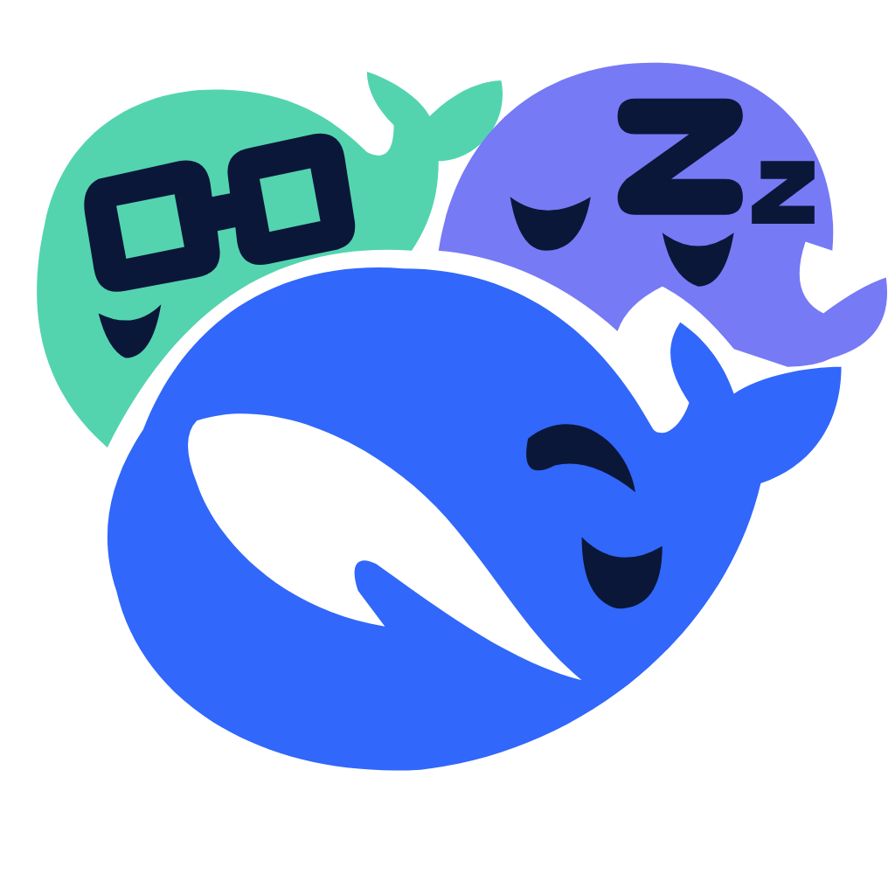

<p align="center">
  
</p>

# DSH-Bot

[English](README.en.md) · 中文

**你的个人智能体工作区。** 在 DeepSeek Harness 中创建各有职责与记忆的 Bot，持续对话、跟进工作，也可以把它们组成群聊，分工处理同一个任务。

**[0.6.6 已发布](https://github.com/MJ-CJM/DSH-Bot/releases/tag/v0.6.6)**：新增个人与群的非定时主动跟进，以及有原文引用的群工作召回。[查看本版变化](CHANGELOG.md)。


下列截图是此前版本的基础功能演示，来自真实 DSH 隔离环境，使用虚构资料和脚本化回复。0.6.6 的新增入口见下文；截图不代表真实模型的任务质量。

## 可以做什么

| 能力 | 用法 |
| --- | --- |
| 个人 Bot | 为研究、审阅、写作等工作分别设置职责、模型、工具与技能，保留各自的主会话。 |
| 持久记忆与群工作召回 | 管理 Bot 的私有记忆；按需查找本人参与且仍可访问的群工作，打开原文或起草保存结论。共享内容由用户明确发布。 |
| 多 Bot 群聊 | 用 @ 指定成员，或让多个成员并发讨论；查看各自的执行过程，补充或停止单个成员。 |
| 后台任务与结果验收 | 通过原生子任务委派工作，查看证据和用量，对支持的任务验收、补充或返工；普通日程沿用 DSH 原生能力。 |
| 主动跟进 | 为个人 Bot 或群独立开启，查看待验收、失败、明确等待及手工登记的事项；无需 GitHub 或外部凭据。 |
| 文档与工作方法 | 分析你提交的文档正文及验收要求；在“反馈与改进”中评估方法候选，由你审阅后明确采用。 |

### 主动跟进本地任务和明确事项

个人 Bot 和群各有自己的开关，不需要先连接 GitHub，也不需要另外配置全局开关。

| 要跟进的范围 | 开启入口 |
| --- | --- |
| 个人 Bot | Bot 资料的“任务”页；完整设置中为“任务与消息” → “开启主动跟进” |
| 一个群 | 打开群聊 → “管理群聊” → “活动” → “开启主动跟进” |

开启只作用于所选 Bot 或群。查看和刷新不调用模型；卡片上的“查看原任务”可带你回去验收结果、补充信息或继续处理。对可续办的群失败事项，可“选择一位成员继续”，沿用这位成员在群内的有效模型和群预算。

需要持续关注一件事时，可以点击“添加关注事项”，填清要关注什么、怎样算完成。也可以在正常聊天中说：“帮我跟进这份方案，等我确认验收后再标记完成。”个人登记按原生工具审批确认；群聊天先形成提案，在活动页“确认关注”后才生效。登记本身不会启动任务或发送消息；可随时停止单项或暂停该范围。

**0.6.6 的主动跟进不包含定时提醒。** 原生普通日程仍可使用；本地跟进依赖 DSH Host 运行。

### 在单聊中接着讨论群里的工作

先开启该 Bot 的记忆，再打开“记忆 → 参与的群工作”，搜索关键词、查看原群记录摘录，或点击“打开原群轮次”。也可以直接在这个 Bot 的主会话中问：“你上次在项目群负责了什么？请引用原始记录。”

Bot 按需查找自己实际参与、当前仍可访问的群工作。**查到群记录不等于已经保存为长期记忆**：要保留一项结论，点击“起草记住这项结论的请求”，检查草稿后发送，并沿用原有记忆与审批流程。

如果该 Bot 已开启记忆且有可用参与记录，也可在“管理群聊 → 成员”的成员菜单选择“在单聊中追问”，将它最近一项可用群工作的引用带到单聊草稿。要查找更早的工作，可在“参与的群工作”中搜索。草稿不会自动发送。查询有读取上限；“部分结果缺失”或空结果不表示它从未参与，无法核对的来源不会作为可靠回忆返回。

### 按需使用文档分析与方法评估

已启用高级任务执行、为它配置模型且执行未暂停时，“任务与消息”中会显示“分析文档快照”。提交你授权分析的正文、问题和验收要求，再到任务列表检查结果。它不会自动抓取外部链接或把文档里的指令当作授权。

“反馈与改进”支持方法候选的评估、审阅和明确采用。当前独立评估只支持不调用工具的结构化文本；不会自动修改工作方法，也不代表已经验证真实模型的改进效果。

### 分工讨论，看清每个成员的过程

例如：让研究助手整理比较维度，让审阅助手检查假设和证据。群聊支持引用、附件、逐成员模型，以及每个问题下可展开的成员过程。输入框提供 `/` 命令菜单；统计栏可查看单个问题或整个群聊的用量；成员运行失败时显示具体原因，例如额度用尽。


成员可以通过明确请求继续协作；没有待处理工作时停止。普通进展不会无限唤醒其他成员，达到配置的后续执行额度时会暂停，并可明确继续。

### 让职责和记忆跟随 Bot

研究助手可以长期负责对照来源，写作助手可以遵循你的表达偏好。职责与记忆都有管理入口，不必把所有信息反复粘贴到每个问题里。


### 对话之外，也能查看任务

打开 Bot 的“任务与消息”页，查看后台子任务、普通日程和队友消息。对支持验收的任务，可以核对结果、证据和用量，补充缺失信息或提出返工要求。Bot 之间的消息也会在双方对话中显示为可展开的标记。

下面展示原生子任务和普通日程，使用脚本化演示输出；它不展示主动跟进。


## 安装

当前版本 **0.6.6**，采用 **MIT** 许可证。安装包与下载校验见 [v0.6.6 Release](https://github.com/MJ-CJM/DSH-Bot/releases/tag/v0.6.6)。启用和查看本地跟进无需配置模型；聊天和明确接受的模型任务需要 DSH 中可用的模型配置。

### 方式一：在社区市场中搜索

如果已安装社区插件 **dshmarket**，打开 **插件 → 插件市场**，搜索 `DSH-Bot`，核对作者为 **MJ-CJM** 后安装。市场从社区目录同步，刚收录或更新时可能暂时搜不到；这时可用下面的直接安装方式。

支持原生“发现”页的 DSH 版本，也可以在 **插件 → 发现 → 索引源** 添加社区索引，再搜索：

```text
https://cdn.jsdelivr.net/npm/dsh-plugin-catalog/index.json
```

市场与索引的配置说明见 [dsh-market 使用指南](https://github.com/dsh-market/dsh-market/blob/main/README.zh.md)。社区市场不是 DSH 官方内置插件。

### 方式二：桌面版直接安装

1. 打开 [最新稳定 Release](https://github.com/MJ-CJM/DSH-Bot/releases/latest)，下载同一 Release 的 `dsh-bot.tgz` 和 `dsh-bot.tgz.sha256`。不要选择自动生成的 Source code 压缩包。
2. 在下载目录校验文件：macOS 用下面的命令，Linux 用 `sha256sum -c dsh-bot.tgz.sha256`。
3. 在 DSH 打开 **插件 → 添加插件 → 安装第三方插件**，选择下载的 `.tgz` 文件，安装并启用。
4. 完全退出并重新打开 DSH，在侧栏进入 **Bots**。

```sh
shasum -a 256 -c dsh-bot.tgz.sha256
```

固定安装地址：[下载 dsh-bot.tgz](https://github.com/MJ-CJM/DSH-Bot/releases/latest/download/dsh-bot.tgz)。复现特定版本时，使用对应 Release 的版本包及 `SHA256SUMS`。

### 方式三：Web 版命令行

下面只适用于运行在 `web` profile 的实例；不会把插件装入桌面版使用的 profile。自定义实例请改用自己的 profile 名称。

```sh
dsh plugin --profile web add "https://github.com/MJ-CJM/DSH-Bot/releases/latest/download/dsh-bot.tgz"
```

安装后按宿主提示重启。当前推荐预构建 Release 包；社区页面自动生成的 GitHub 源码安装命令不是本项目已验证的安装路线。

## 第一次使用

1. **创建一个 Bot**：侧栏打开 Bots，点击新建，输入“研究助手”，开始对话。
2. **说明职责**：例如“请长期帮助我整理技术资料，回答时区分结论、依据和待验证项。”长期职责修改按原生审批确认。
3. **管理记忆**：在 Bot 资料的“记忆”页添加一条偏好，例如“比较方案时关注实施成本和验证方法”，确认它出现在列表中。
4. **组成群聊**：再创建“审阅助手”，选两个成员新建群聊，发送“请一起讨论：我们应该怎样比较两个技术方案？”
5. **查看并控制过程**：展开问题下的执行入口；用成员菜单查看详情、补充任务或停止某个成员。

需要持续关注时，按上面的入口为该 Bot 或群开启主动跟进；群里做过的工作，可在成员的个人主会话中继续追问。实际回答取决于所选模型、工具、权限和提供的资料。

## 常见问题

**需要另外申请 DSH-Bot 的模型账号吗？**

不需要。插件沿用 DSH 的模型配置，也支持每个 Bot 和群成员选择模型。聊天和模型执行需要宿主中已有可用模型；启用、查看和刷新本地跟进不调用模型。模型服务可能产生费用。

**群里的记忆会自动同步给每个 Bot 吗？**

不会复制整段群聊到各 Bot 的长期记忆。0.6.6 支持按需召回该 Bot 实际参与且仍有权限的群工作，并保留原文引用；长期保存仍需按原有记忆与审批流程确认。Bot 之间的私有记忆也不会自动共享。

**主动跟进只能监控 GitHub CI 吗？**

不是。个人 Bot 和群都能跟进本地任务与明确事项，不需要 GitHub 账号或令牌。已有 GitHub CI 配置的环境可继续使用该来源；个人与群的本地跟进不依赖它。

**多人讨论会一直运行吗？**

没有待处理工作时会停止。默认同群最多并发 4 个成员，自动后续执行额度为 32 次；可配置，并可停止成员或整项任务。原生模型和工具的时限仍适用。

**怎么升级，会丢数据吗？**

升级前备份原 profile 和完整数据，保留原 profile 与存储位置，通过同一安装入口添加新版包，再完全退出重开。不要以删除 Bot 或重置数据作为升级步骤。`latest` 地址更新不等于已安装插件会自动升级。迁移后的数据不能直接交给旧版本写入，回退需要升级前备份。

**关闭电脑后，后台任务还能执行吗？**

不能据此承诺。任务依赖本地 DSH Host 运行；当前不提供云端常驻或系统退出后的持续运行。

## 兼容性与功能边界

开发依赖锁定 DSH `0.2.1-rc.2`。0.6.6 最终包已在 macOS 的 `0.2.1-rc.2`、`0.2.2-rc.1` 两种隔离宿主完成安装、冷启动与群工作召回边界验证，并完成八组 Web 布局和日常桌面安装检查。声明范围 `>=0.2.1-rc.2 <0.3.0` 不表示每个版本、平台都已实测；原生 rc.2 仍有受管 Bot 分叉限制，真实模型质量未验证。详见 [发布验证](docs/releases/v0.6.6.md)。

已发布的 0.6.6 安装包保持本地验收时的原字节，随包 README 保留了当时的候选说明；当前发布状态与使用说明以本页及 Release notes 为准。

Bot 的工作目录不是文件隔离边界；沿用宿主权限、审批和沙箱。本地非定时跟进依赖 DSH Host 运行；零模型定时跟进、外部 IM 收发、系统/手机推送和云托管不在本版交付范围；自动共享不可用。合成模型检查不代表真实模型质量，强杀后不确定的后台结果不会自动重放。

## 更新与反馈

[社区详情页](https://awesome-dsh-plugin.com/zh/p/MJ-CJM/DSH-Bot--packages-dsh-bot/) · [版本与更新记录](https://github.com/MJ-CJM/DSH-Bot/releases) · [问题反馈](https://github.com/MJ-CJM/DSH-Bot/issues) · [安全反馈](https://github.com/MJ-CJM/DSH-Bot/blob/main/SECURITY.md)

反馈时请提供 DSH / 插件版本、操作步骤和已脱敏的截图或错误。不要公开模型密钥、私人会话或完整 profile。

MIT · Copyright © 2026 MJ-CJM。第三方告知随安装包提供。

## 本地开发

需要 Git、Node.js `^22.19.0 || >=24.0.0` 和 pnpm `11.28.5`。始终通过仓库包装脚本调用工具，不要求全局安装；DSH CLI 仅在 Host 验证时需要。

```sh
scripts/pnpm install --frozen-lockfile
scripts/pnpm check
scripts/pnpm check:docs
scripts/pnpm pack:plugin
```

需要 Host 时仅使用仓库隔离目录：

```sh
DSH_HOME="$PWD/.dsh-dev" scripts/dev-profile.sh
# 使用其他兼容 0.2.x CLI 时显式选择兼容验证，并记录实际版本：
DSH_HOME="$PWD/.dsh-dev" scripts/dev-profile.sh --compatible
scripts/grok-dev-host.sh --help
```

`check` 是当前源码的自包含检查；旧包升级回归单独使用 `scripts/pnpm test:release`，前置包要求见[贡献指南](CONTRIBUTING.md)。`dev-profile.sh` 只检查安装与 dump-config，不启动 Host。完整运行与浏览器验证需要额外环境并须串行执行。保留 `.dsh-dev` 中已有数据与证据，不清空目录重试；本地证据 code 路径不会随 clone 下载。

问题与建议请使用[Issue 模板](https://github.com/MJ-CJM/DSH-Bot/issues/new/choose)，提交改动前阅读[贡献指南](CONTRIBUTING.md)；敏感问题先阅读[安全说明](SECURITY.md)。
