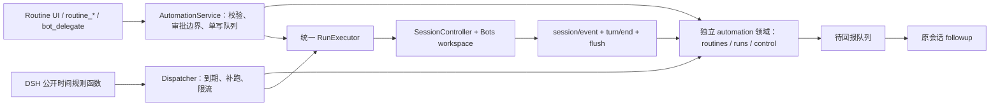

# P2 设计提案：Bot 委派与定时 Routine

日期：2026-10-20。性质：调研与设计，**不是 P2 功能交付或运行验收**。

建议采用“**复用 DSH 的时间规则函数、会话及审批能力，自建薄 Host 调度层和运行记录**”。Routine 与 `bot_delegate` 共用一个普通新会话执行器；原生“自动化任务”继续管理原会话提醒。锁定版没有把自定义执行器或第三方任务目录接入原生自动化页面的公开入口，不宜通过占位会话、提示词转发或替换内部组件强行接入。

本提案对应 [任务单](../tasks/P2/P2-proposal.md) 与 [PLAN 的 P2 范围](PLAN.md#p2后台任务--定时-routine全新会话)。现状以 [P1 架构](architecture.md) 和 [API 核实记录](dsh-api-notes.md) 为准，原计划中的早期示例不直接作为可运行代码。

## 1. 核实基线与证据边界

| 项目 | 本轮结果 |
| --- | --- |
| DSH-Bot | 分支 `phase/p1`，HEAD `c605d414f41ca6d6877644c95d1becff213c38df`，包版本 `0.1.6` |
| 起始工作区 | 已有未跟踪 `.codex/`、`tasks/P2/`；保留，不覆盖 |
| 参考源码 | `/Users/youzihui/ai-workspace/deepseek-harness`，HEAD 与 `dsh-v0.2.1-rc.2^{commit}` 均为 `687f282e8625c6b8d11ff58211a90524be2e4317`，工作树干净；只读 |
| 已安装版本 | `DSH_HOME="$PWD/.dsh-dev" scripts/dsh --version` 与应用 `Info.plist` 均为 `0.2.1-rc.2`；CLI 另输出 macOS codesign 诊断，退出码 0 |
| 桌面 UI | Computer Use 能枚举正在运行的应用；读取已安装 DeepSeek Harness 界面时自动审批拒绝，消息为 `Computer Use was not approved to use DeepSeek Harness`，无更具体原因。没有成功读取“自动化任务”页，也没有更改应用/profile |
| 当前项目检查 | `scripts/pnpm check` 退出 0：36 个测试文件、535 项测试通过，Host/Client build、strict typecheck、116 文件 lint 通过；[日志](../.dsh-dev/p2-proposal/check.log) |
| P2 运行 | 本轮没有创建 Routine、委派、mock 会话或真实模型会话。后文标为“源码确认”的行为不能计作桌面或 P2 e2e 通过 |

下文 `packages/...`、`apps/...`、`docs/...` 的源码引用默认相对 **DSH 参考仓库**；明确注明“本仓库”的引用才属于 DSH-Bot。行号固定在上述 commit。线上锁定 tag 页面读取未成功，结论以本地已验证的只读 tag 为依据。

### 1.1 左侧“自动化任务”实际是什么

源码结论是：**Host 全局持久提醒目录，执行目标仍是创建时绑定的原会话**，并非任意任务执行框架。

| 核实项 | 锁定源码及含义 |
| --- | --- |
| 默认组合 | `apps/desktop/src/project-manager.ts:32,167,174-175` 采用 Web profile 模板；`packages/boot/app-boot/src/profile.ts:183-185` 为 base + web-app；`apps/desktop-host/src/index.ts:23-30` 启动 desktop profile。`packages/bundle/web-app/cordis.patch.yml:135-140,396-399` 启用 schedule 与 ui-schedule |
| 文档冲突 | `apps/desktop/README.zh.md:77` 的“默认未开启定时任务”不能覆盖当前组合实现；同样不能把源码默认启用当作用户已安装 profile 当前启用的证明。后者仍需 T11 实测 |
| Host 服务 | `packages/schedule/schedule/src/index.ts:64-100` 声明 `ctx.schedule`，注入 agents、sessions、storageDomain、sessionController、sessionPersistence；`:109-112` 的 runtime 是私有成员 |
| 管理 API | 同文件 `:228-262` 为 Host `create(sessionId,request,signal?)`，没有 create Remote；`:270-373` 提供 list/catalog/history/delete/update Remote。update 的 expected 用于冲突检查，不改变原 sessionId；Config `:72-105` 只有投递历史保留设置 |
| 目标绑定 | `packages/schedule/schedule/src/types.ts:212-220` 的 catalog entry 带固定 `sessionId`；执行恢复该会话并投递 followup，不按每次 occurrence 创建新会话 |
| 到期执行 | `packages/schedule/schedule/src/index.ts:154-163` 内部构造 runtime；`src/runtime.ts:101-140` 使用 resolveAgent→followup→flush，再记录回执/推进。`src/index.ts:376-390` 的 schedule/changed 只是失效通知，不是 due trigger |
| “运行记录”含义 | `packages/schedule/schedule/src/types.ts:196-209` 明确是持久 Inbox 投递回执及当时 prompt，**不是模型执行完成、成功或工具副作用结果** |
| 原生启停/立即运行 | `packages/client/ui-schedule/README.zh.md:95-98` 明确不提供暂停或立即执行。catalog 的 `active/inactive` 不能直接等同于 P2 的用户可切换 `enabled` |
| 页面扩展 | `packages/client/ui-schedule/src/client/index.ts:92-147` 固定读取 schedule 目录、编辑、删除及投递历史；`:168-184` 注册 main/sidebar 页面。根及 client 插件入口未导出内部表单/页面组件，也没有 Routine provider、执行策略注册或第三方行渲染插槽 |
| 模型工具 | `tool-schedule` 管原会话提醒；标准模板已有工具配置，见 `packages/bundle/web-app/presets/standard.patch.yml:35-36`。保留这套能力，与新 `routine_*` 清楚区分 |

因此，用户看到的“自动化任务”名称比其执行契约宽。它适合“稍后在这段对话继续处理”，P2 则要求“每次在目标 Bot 的普通新会话执行，并保留独立运行历史”。

原生 runtime 启动/变更会扫描到期任务，循环规则对每个任务取最新一次，同原会话的多条循环提醒可合批；有进程内串行与一个 timer，但无 P2 的全局 run 配额或跨进程所有权（`packages/schedule/schedule/src/runtime.ts:19-24,44-69,85-117,155-163`）。它能恢复未加载的原会话，不能沿用旧 README 的“只对已加载会话触发”。`workspace/session-stop` 会清理相关活动提醒（`src/index.ts:184-206`），因此用长期 carrier 会话桥接还有归档/停止依赖。

### 1.2 规则解析可以直接复用

`@deepseek-ai/dsh-schedule` 的公开根入口确实导出以下函数，不需要复制内部 `domain.ts`：

| 用途 | 根出口与边界 |
| --- | --- |
| 创建并校验规则 | `createAtScheduleRecord`、`createEveryScheduleRecord`、`createDailyScheduleRecord`、`createWeeklyScheduleRecord`、`createCronScheduleRecord` |
| 计算到期及后继 | `resolveEveryOccurrence`、`resolveDailyOccurrence`、`resolveWeeklyOccurrence`、`resolveCronOccurrence`、`resolveRecurringOccurrence`，返回最新已到期 occurrence 与下一次时间 |
| 规范化 | `canonicalizeCronExpression`、`parseCronInput`、`parseWeeklyInput`、`normalizeWeekdays`、`decodeScheduleRecord` |
| 公共类型/限制 | `ScheduleRecord`、`RecurringOccurrence`、`ScheduleInputError`、`MIN_EVERY_INTERVAL_SECONDS=60` |

依据：`packages/schedule/schedule/src/index.ts:25-61`，manifest 根出口 `package.json:16-20`。具体算法在 `src/domain.ts:791-819,909-917,945-955,1104-1141,1294-1507`。

注意：`domain.ts` 中的 `parseAtInput`、`parseDailyInput`、时区内部校验函数不等于根出口公开函数；适配器通过已公开的 create 函数校验这些输入。manifest 的 `./src/*` 声明也不构成本项目深导入许可，发布 files 本身不包含 src（`package.json:25,37-45`）。

规则边界应直接写入工具说明和 UI：

- `at` 接受带偏移的绝对时间或 `{date,time,time_zone}`。归一为 UTC；目标时间必须严格晚于接受创建时的 now。本地不存在的时点拒绝，重叠时点取较早者（`packages/schedule/schedule/src/domain.ts:421-433,1294-1345`）；不能用 JS `Date` 静默修正。原生 AtRecord 不保留输入时区，Routine 另存显示/输入时区。
- `every` 是固定间隔，安全整数且至少 60 秒；以创建/最近一次间隔修改为锚，不是“上次执行完成再等 N 秒”。
- `daily/weekly` 使用显式 IANA 时区或 `UTC`；weekly 为 ISO 周一 1 至周日 7。原始规则时间格式为 `HH:mm:ss[.SSS]`，UI 可将 `09:00` 转为 `09:00:00`。
- 循环墙钟规则遇 DST 缺失时间跳过，重复时间取较早的瞬间，每个本地 occurrence 只执行一次。`every` 按绝对时间经过，不做 DST 墙钟修正。
- `cron` 为五字段 `minute hour day-of-month month day-of-week`；不是六字段秒级 cron。DOM/DOW 两字段均不以 `*` 开头时为 OR，否则 AND，`*/n` 也属星号字段。支持数字、星号、列表、范围及 `*/n`、`a-b/n`，不支持名称、宏、L/W/# 或单值/n（`packages/schedule/schedule/src/domain.ts:969-981,1547-1646,1754-1760,1785-1823`）。
- `RecurringOccurrence` 本身就是 latest-only 决策，不需要从关机以来逐条枚举积压。调用前仍须检查 `scheduledAt <= now`，并由本包决定补跑、跳过及推进游标。

字段/DST 依据：`packages/schedule/schedule/src/types.ts:46-155`；cron 日期规则 `src/domain.ts:974-981`。P2 建立一个 Host-only `RuleAdapter`，对外只暴露本包 schema 与预览结果；不让浏览器导入完整 Host schedule 模块。

**依赖方案：**新增 schedule 根入口运行时引用时，按含共享服务定义的包处理，先采用精确 dev `0.2.1-rc.2` + 兼容 peer `>=0.2.1-rc.2 <0.3.0`，T11 验证实际发布产物、peer 解析及 package 安装。这个包虽然有纯函数，根入口仍引用 Cordis/DSH 服务，不能未经检查就当作独立无状态小库内联。源码 manifest 为 `packages/schedule/schedule/package.json:48-66`。本轮不增加依赖。

## 2. 复用清单与架构选择

### 2.1 能复用什么

| 能力 | 决定 | 理由 |
| --- | --- | --- |
| 时间规则与 DST/cron 计算 | 直接复用公开函数 | 已覆盖所需五类规则，避免维护另一套时间语义 |
| 原生 schedule 服务/存储 | 不作为 Routine 权威库 | 固定原会话投递，缺启停、run_now、Bot 配额与模型完成记录；不写它的表或伪造 delivery |
| 原生自动化任务页 | 保留；P2 自有 Routine 视图 | 没有公开目录/执行器扩展点，不导入内部组件、不替换原导航注册 |
| SessionController、WorkspaceRegistry | 直接复用 | 普通会话、preset 选择、Bots 工作区及原生日志 |
| session/event、turn/end、inspect、flush | 复用并加运行关联 | 区分投递、执行和持久化；运行终态不能用活动预览推断 |
| jobs-local/tool-jobs | 保留原用途 | 原生后台 job 的状态、输出与取消；不将它视为持久 Routine 队列 |
| subagent/tool-subagent | 保留；作为委派备选 | 已支持独立 activation 与 preset，但父生命周期、子会话 UI/权限语义不同 |
| followup / Inbox | 复用 | 能向原会话排下一轮；需本包保存待回报记录、去重及不可达状态 |
| P1 registry、Bot 绑定、审批、Remote、watch | 扩展复用 | 使用 Host 返回的 presetId；工具闭包固定发起 Bot 身份；统一 UI/模型服务与刷新 |
| Routine/RunRecord、配额、调度游标、回报状态 | 自建 | 属于 P2 业务语义，原生服务没有相应持久契约 |

### 2.2 三种可选架构

| 方案 | 优点 | 缺点/可交付性 |
| --- | --- | --- |
| **A. 本包 Host 调度器 + 原生规则函数 + 普通会话执行器（推荐）** | 满足每次新会话、启停、run_now、历史及统一护栏；无需改 DSH；Routine/委派共用执行路径 | 需实现持久运行状态、崩溃协调、单 Host 所有权与专用 UI |
| **B. 挂接原生 schedule/自动化任务** | 原生页面和提醒持久机制现成，用户入口统一 | 锁定版无执行器/目录贡献接口。若用“调度员会话收到提醒后再调用工具”，会增加模型请求、提示词依赖及重复创建窗口，且运行历史仍只是投递历史；不满足可靠执行要求 |
| **C. 原生 subagent 负责委派，自建 Routine 调度** | 子代理已有 result、超时/取消和完成通知；委派代码较少 | 两套执行/恢复/权限/历史语义；普通新会话与子会话不能混同；父失活、重启回报仍需自建持久层 |

推荐 A；C 留作 T11 对照探针。B 只有在上游增加公开“任务 provider + dispatcher + catalog 扩展”后才值得重新评估。可以整理上游需求，但本轮不发 issue、不修改或 fork 宿主。

推荐的职责关系：

Host 拥有 timer、队列、领域句柄与监听器；Client 仅展示/提交，不调度。所有资源纳入所属 `ctx.effect`，异步注册等待完成，卸载先关 admission、排空已接受写入，再清理监听/定时器/领域。不能把唯一持久写入放在退出 hook。

## 3. 统一执行器与 bot_delegate

### 3.1 Routine 的新会话流程

1. 在单写队列中确认 Routine revision、enabled、目标 Bot 的 `id + createdAt`、preset 健康、配额、并发和同一 Routine 不重叠。先持久化 Run reservation，保存固定 `sessionId`、`requestId`、occurrence key 与执行快照，再产生会话副作用。
2. 调用现有 `ensureHome(botId)` 与 `ensureBotsWorkspace()`，用 Host `status().presetId`。默认虽为 `bot-<id>`，不得硬编码可配置前缀。
3. 推荐 `sessionController.create({workspaceId, agentPreset, sessionId})`，令实际 `cwd` 等于 Bots 根并完成成员登记。任务单的 `create({cwd: Bots根, ...})` 能设置 cwd，却**不会自动 attach 工作区**；若坚持该签名，必须另行公开 `workspace.attachSession`。两种参数不能同时传。依据：`packages/api/session-controller/src/commands.ts:111-149`。
4. 验证返回 ID、工作区成员与真实 cwd；如果创建已完成但 attach 失败，记录 orphan/待协调会话，不盲目创建第二个。显式 flush 会话头，要求返回 true。
5. 在 prompt 前通过公开 `sessionController.rename` 设置 `[Routine] 标题 · YYYY-MM-DD HH:mm TZ`。日期使用 occurrence 在 Routine 时区中的日期，补跑另在运行详情标注实际开始时间；重试或恢复不覆盖用户后改的标题。`run_now` 用人工触发时间。
6. 先安装运行观察器，再调用 `sessionController.prompt(request, signal)`，request 为 `{sessionId,requestId,mode:'queue',content}`；accepted 后检查持久化。Controller 将来源写成 `kind:'user'` 并保存 `rpcId`（`packages/api/session-controller/src/index.ts:462-485`），这是原生契约，不代表人工已授权；模型发起身份和审批记录另存 RunRecord。
7. 根据与该 request/message 及其后台后代/回报关联的执行链写终态，记录 session event seq/turn；先经过第 3.3 节的完成屏障，flush 失败保持待协调状态，不报成功。

Bot 代际须再加一道门禁：reservation 后、create 前可能发生 Bot 更新/删除，稳定 presetId 不等于冻结配置。T13 应扩展本包 BotBinding，让 Agent 创建时携带该代际捕获的 `botCreatedAt` 与配置指纹，与 reservation 核对后才 prompt；不一致停止并明确重试，不把计划快照称为实际使用配置。当前 binding 仅有 botId，不能声称此门禁已存在（本仓库 `packages/dsh-bot/src/host/bot-context.ts:30-49,76`）。不要持有会被 Agent 初始化反向调用的 registry 队列等待 create，以免死锁；T11 验证这一协调方式。

本仓库现有依据：`packages/dsh-bot/src/host/registry.ts:451-487`，`docs/architecture.md` 的共享 Bots 工作区章节。P2 Routine 固定共享根，**不沿用 Bot.defaultCwd 改变 Routine cwd**；这样兑现任务范围并保证归组。委派默认同样使用共享根，其他目录支持留待决策，不由模型任意传入路径。

### 3.2 为什么不直接把 bot_delegate 包成一个 job

原生 jobs 面向 driver 管理的后台工作；“后台”不是持久业务运行的同义词。原生 subagent 已有自己的 activation runtime，不能简单描述成 jobs-local 的一个 job。子代理的独立 preset 值得复用，但其父 Agent 绑定、权限继承、子会话展示和结束回调语义与普通新会话不同。

| 机制 | 公开能力与已核实限制 |
| --- | --- |
| jobs | `packages/jobs/jobs/src/index.ts:17-47` 导出 JobSpec/JobOutcome/JobEvent 与 ctx.jobs；`packages/jobs/jobs-local/src/index.ts:207-224` 的并发上限按精确 owner，`:640-686` owner/service dispose 会取消并清理 job。状态/输出不能替代可重启的 P2 Run |
| tool-jobs 回报 | `packages/jobs/tool-jobs/src/index.ts:263-308`：owner 不在则不通知；idle followup，running/quiet inject；跳过 awaited、模型主动 kill 与 teardown。可参考格式，不继承其不持久的通知保证 |
| subagent 启动 | `packages/subagent/tool-subagent/src/index.ts:319-337` 调用 startActivation；`packages/subagent/subagent-spawn-in-process/src/index.ts:40-53` 支持独立 preset；fork 继承上下文，不能与 spawn 的独立 preset 混为一谈 |
| subagent 结果 | `packages/subagent/subagent/src/types.ts:30-58,233-277` 的 activation.result/stopReason/output/dispose；`src/index.ts:149-166` 的 subagent/start/end 可观察结束 |
| 子会话身份与权限 | `packages/subagent/subagent/src/child-agent.ts:135-153` 写 parentSession/origin/delegationDepth；`:220-253,270-277` 捕获权限且 approval policy 为 never。不是普通新会话沿用原生审批交互的语义 |
| 父通知边界 | `packages/subagent/subagent/src/manager.ts:1186-1204` 要求同一个 live parent Agent；父消失/被替换不送，正常 idle queue/running steer，teardown inject，不是持久父邮箱 |

相关消费者入口为 `@deepseek-ai/dsh-jobs`、`@deepseek-ai/dsh-subagent` 根出口；内部文件仅用于查证，不能成为生产 import。P1 Bot 历史列表排除 subagent，若采用方案 C 必须显式重新设计展示与权限，不能声称与方案 A 等价。

推荐工具形态为 `bot_delegate({targetBotId, task, title?}) → {runId, sessionId?, status}`：立即返回已持久接收/排队回执，不阻塞发起工具直到子任务完成。发起身份来自工具所属 Agent 的 Bot binding 和 sessionId，不接收模型伪造 `originBotId`、`originSessionId`、配额或权限字段。

目标 Bot 可以是自己；不复制父对话历史，默认仅发送明确的 task。跨 Bot 执行会使用目标 Bot 的人设、记忆及工具能力，属于一次有成本、有能力变化的执行，应在审批中展示目标 Bot、任务和目录。批准委派不等于批准子会话后续所有敏感工具。

### 3.3 完成判定

`assistant/message` 可能只是中间模型步骤；`whenIdle()` 表示整个 Agent 静止，不标识特定消息完成；`prompt.accepted` 只表示接收。正式判定必须关联输入 request/message → 实际进入模型步骤 → turn → `turn/end.reason`。pre-step 把输入改空时也可能出现 completed 空轮，不能据此成功；公开 `foldConsumedWork` 可辅助识别 consumed/dropped，但不能替代本包按输入关联（`packages/core/agent/src/index.ts:20-23`、`src/consumed-work.ts:33-58,69-108`）。

原生终态含 `completed`、`aborted`、`blocked`、`error`、`max-tokens`、冷恢复的 `interrupted` 等，见 `packages/core/session/src/types.ts:189-229,298`。建议：

| 证据 | Run 状态 |
| --- | --- |
| 输入确已执行、受跟踪执行链 completed、完成屏障通过且结果已 flush | `succeeded`；确有执行但无文本时显示“已完成，无文本结果”，不编造摘要 |
| error / max-tokens | `failed`，结构化原因和是否有部分文本 |
| 用户/插件取消并确认终止 | `cancelled`；超时取消则 `timed_out` |
| 等待审批/输入 | `waiting_approval` / `waiting_input`，仍占并发名额，不当作完成 |
| blocked turn | `blocked`，需人工处理；不自动补一个 prompt |
| interrupted、缺少关键证据、flush 不确定 | `recovery_needed`，保留原会话，不自动重执行 |

**后台完成屏障是 T11 阻断门槛。** standard 的原生 subagent/jobs 可以在初始 turn 结束后继续工作并回报，因此初始 turn completed 仍不够。候选方案用公开 `ctx.subagents.waitForChildren(parent)`（`packages/subagent/subagent/src/index.ts:286-294`）、jobs.events 与 `jobs.list(sessionId)`（`packages/jobs/jobs/src/index.ts:102-103,116-129`），跟踪精确 owner 的后代、settlement 和来源为其结果的后续 turn，再确认父 Agent 静止、无关联 pending 工作并 flush。`waitForChildren` 只等待 progressing descendants、会跳过 parked Inbox（`packages/subagent/subagent/src/manager.ts:247-286`），不能单独当完成证明；jobs.list 也包含 unowned jobs，必须过滤实际 owner。

原生 jobs 在运行中通过 inject 回报可能留下不自动唤醒的工作，必须显示 waiting/recovery_needed，不能用额外假输入启动。若 T11 不能通过公开接口建立完整关联，自动化运行只允许经验证可等待完成的能力，对可脱离执行链的后台生产工具必须明确限制或阻断 P2 实现；仅隐藏 job 控制工具无效。不得把“一个初始 turn 成功”降格包装成“委派任务完成”。

原生事件与消息的精确关联由 T11 mock 探针验证；不得简化成“第一条 assistant 回复即完成”。属于该 run 的后台结果轮次可更新结果，用户独立追加的人工 turn 则不覆盖 Run。新增用例必须覆盖“发起后台工作→初轮结束→迟到结果→最终汇总”，以及空 completed、取消和 parked 工作。

### 3.4 摘要怎样回到发起会话

成功后取**该运行最终完成消息的文本**，清洗/限长后作为确定性摘要；默认不额外调用模型做二次总结。回报包括 runId、目标 Bot、成功/失败状态、有限摘要和子 sessionId。通过原生导航 API 打开子会话，不猜测 URL。错误同样回报，原始异常/密钥/完整工具输出不进入通知。

RunRecord 内嵌持久 `report`，构成待回报队列，避免终态与另一张 outbox 表之间额外的跨表事务窗口。流程为“生成一次消息并保存终态和 report.pending → 找到原 Agent → 投递已保存的同一消息 → flush → report.enqueued_durable”。使用公开 `@deepseek-ai/dsh-llm` 根出口的 `createUserMessage` 与扩展 MessageSource（建议 kind=`dsh-bot-delegate`、form=`notice`），以及 `agent.followup`。工厂自己生成新 id，**不接受 caller 提供 id**，因此必须持久保存完整消息及其生成的 messageId，恢复时复用，不重新调用工厂生成第二条（`packages/llm/llm/src/message.ts:221-227,241-253`）。自定义来源在 T11 验证，不能伪造人工输入。

followup 的 next-turn+wake 与 inject 的不唤醒语义见 `packages/core/agent/src/runtime-types.ts:204-241`。followup 会触发原会话后续模型轮次，因此有额外成本，也可能再次请求工具；这不是仅在 UI 插入一条静态通知。`report.enqueued_durable` 仅承诺曾持久入箱，后续可能被取消或拒绝，不能显示“原 Bot 已处理”；另记录 claimed/committed/processed/discarded/recovery_needed。committed 指进入 user/message，processed 还需要相应处理终态。

| 发起会话状态 | 建议行为 |
| --- | --- |
| 只是 UI 切走/关闭窗口，Host 与 Agent 仍存活 | 正常排入 followup，不抢焦点；通过已有活动/未读展示 |
| Agent 正忙 | 使用 followup 排下一轮，不使用 steer 打断；同一回报仅排一次 |
| Agent 已释放，但持久会话、preset 可恢复 | 默认允许受控恢复原 sessionId 后回报；调用前后检查归属，不能另建“替代原会话” |
| 已归档/删除、原 Bot 已删除或同 ID 重建、preset 不可恢复 | 不擅自取消归档或绑定新 Bot；保留 `report.blocked`，Routine/运行历史提供查看与人工重试 |
| Host 已关闭 | 等下次启动协调 Run 和 report；不承诺关机期间执行或送达 |
| 已投递但持久回执不确定 | 重建当前 Inbox，并核对固定 messageId 的 user/message、claim、cancel 与 turn 结果；历史中有一条插入记录不等于当前仍待执行或已处理，证据不足标 report.recovery_needed，不无限重发 |

`agent.followup` 本身没有本包 runId 去重或端到端回执；固定 messageId 也不自动获得 exactly-once。所有投递由本包串行队列协调，冷恢复期间若发现持久 Inbox 中已有消息但 Agent 没被唤醒，不追加“空消息”或重复任务强行启动，列为待恢复，T11 决定是否存在可安全使用的公开续行路径。已经 claim 却未提交模型输入的消息同样不能盲重发（`packages/core/agent-loop/src/inbox.ts:103-113,227-240`、`packages/core/agent/src/runtime-types.ts:289-299`）。

### 3.5 权限与递归

`routine_create/update/delete/run_now` 及 `bot_delegate` 的模型写操作沿用 P1 `tools/pre-execute` 审批；读取无需写审批。Routine 创建审批应明确频率、时区、目标 Bot、共享根及未来后台执行授权。每次自动触发不重复询问“是否创建会话”，但执行中的原生文件/网络/提权审批继续适用，不自动批准。

初版建议 `delegateMaxDepth=1`，允许普通交互会话发起一次自身/跨 Bot 委派，后台 run 默认不得再链式委派或修改 Routine。用 Host 的运行/父运行关联和消息来源判断，不能靠提示词中的“我是后台任务”。回报引发的 turn 也须携带可追踪关联，防止“收到回报 → 再委派 → 再回报”的循环。Bot deny 仍生效；minimal 模板是否含原生工具不影响本包按 Agent 注册的明确能力。

## 4. 数据模型与升级

以下为设计字段，不是已存在的 TypeScript API。所有可调上限进入导出 Config + Schemastery，输入和持久记录均用 strict schema 验证。

### 4.1 独立领域

建议新增 **`dsh_bot_automation` version 1**，保留 P1 `dsh_bot` version 1 及四表原样。默认 JSON 后端会各有独立领域文件；不得将路径误认为由技能 `dataDir` 控制。

原因：

- P1 的实际领域是 `dsh_bot`，不是旧 PLAN 写的 `dsh-bot`（本仓库 `packages/dsh-bot/src/host/store.ts:36-40`）。
- rc.2 `DomainSpec` 没有自动 migration 回调；默认 single 布局要求精确版本，不能只把 version 从 1 改为 2 后期待自动升级。
- 在原领域同版本增加表虽可供新代码读取，降级到旧 P1 后写库可能丢失未声明表，不能因此承诺可安全降级。
- 独立领域保留旧数据，P1 降级可忽略 P2；恢复 P2 时再核验 Bot 身份和禁用期间的规则。它不提供与 Bot 删除之间的原子事务。

存储依据：`packages/storage/storage-domain/README.zh.md:146-148` 明确不提供事务、迁移和跨进程变更可见性；`packages/storage/storage-json/src/format.ts:65-89` 检查 single version 并只加载声明表；`packages/storage/storage-domain/src/spec.ts:34-71` 的 compatibleVersions 属于 per-record 机制，不是通用迁移。JSON 的 temp/fsync/rename 保障单次文件替换，不能扩张为跨资源事务（`packages/storage/storage-json/src/atomic.ts:18-51`）。

### 4.2 RoutineRecord

| 字段组 | 设计 |
| --- | --- |
| 身份 | `id`（UUID，不复用）、`schemaVersion:1`、`revision`、`botId`、`botCreatedAt` |
| 内容 | `title`、`prompt`、`createdBy:{kind:'user'|'model',sessionId?}`；普通运行只存一次 prompt 快照，不把秘密写入日志 |
| 时间 | `rule` 为 at/every/daily/weekly/cron 联合；规范化参数、UTC anchor/目标、显式 `timeZone`；`ruleRevision` 单独递增 |
| 控制 | `enabled`、`misfirePolicy:'latest'|'skip'`、`deletedAt?`；at 完成后自然耗尽，与用户暂停区分 |
| 调度游标 | `nextRunAt?`、`lastDecidedOccurrenceAt?`、`lastDecisionKey?`；`nextRunAt` 为可修复的索引，不是唯一去重事实 |
| 元信息 | `createdAt/updatedAt`；可选 `lastRunId` 为展示缓存，权威历史仍从 runs 读 |
| 位置 | `workspacePolicy:'bots'`；不持久化机器绝对 cwd 作为永远有效的目标，每次从 ensureBotsWorkspace 解析 |

时间/规则改动产生新 ruleRevision，重新计算未来目标；标题/prompt 改动只增加普通 revision，避免同一 occurrence 因改名又执行。已 reservation 的 Run 保留不可变执行快照；尚未 admission 的队列项按暂停/删除取消，不能静默改成新 prompt。

### 4.3 RunRecord

| 字段组 | 设计 |
| --- | --- |
| 身份与去重 | `id/runId`、`schemaVersion:1`、`dedupeKey`、`trigger:'scheduled'|'manual'|'delegate'`、`routineId?`、`routineRevision?`、`ruleRevision?` |
| 归属与快照 | `botId/botCreatedAt`、当次 `presetId`、Bot 配置 revision/updatedAt、title/prompt/时区快照；冷恢复未必能重现历史 preset 定义，须标明 |
| 调度 | `scheduledAt?`、`requestedAt`、`admittedAt?`、`startedAt?`、`endedAt?`、`decision:'run'|'skip'`、skipReason（quota/overlap/disabled/coalesced 等） |
| 会话 | 预分配 `sessionId`、最终确认的 `workspaceId/cwd`、`requestId`、已识别 `inputMessageId?`、`inputTurn?`、`lastEventSeq?` |
| 执行链 | 关联的 `turns/jobIds/activationIds/childSessionIds`、各自终态及待处理结果消息身份；限制数量，超过上限停止新增后台工作。重启若无法恢复子任务状态则 recovery_needed，不用初轮终态覆盖 |
| 状态 | `queued/reserved/creating/submitting/running/waiting_approval/waiting_input/succeeded/failed/blocked/cancelled/timed_out/recovery_needed/skipped`；合法转移由服务验证 |
| 成本护栏 | `quotaDate`、`quotaTimeZone`、`quotaCharged`、owner instance；计数从 admission 记录重建，失败/超时不返还每日额度 |
| 结果 | 限长脱敏 `summary?`、结构化 `errorCode?`；完整对话留在原生日志 |
| 委派来源 | `originSessionId?`、`originBotId/originBotCreatedAt?`、`originRunId?`、`depth`、工具 invocation/request 幂等标识 |
| 回报 | `report:{state,messageId,message,originSessionId,attempts,lastAttemptAt?,durableAt?,processedAt?,reason?}`；state 为 pending/enqueued_durable/claimed/committed/processed/discarded/blocked/recovery_needed，保存完整已生成消息，与终态在同一 Run 行提交 |

定时 dedupeKey = `(routineId, ruleRevision, scheduledAt)`；manual/delegate 使用客户端操作 UUID 或宿主工具 invocation 身份，重试同一次请求复用 key，用户明确“再运行”产生新 key。工具是否提供可跨重放关联的公开 invocation 标识，须在 T11 验证，不能从 task 文本 hash 猜测一次操作。

`control` 表仅存格式版本、调度水位、配额桶/保留策略等可重建控制信息，不把它当跨进程锁。运行历史清理不能提前删除当前配额窗口、未完成 run、待回报、recovery_needed 或仍用于去重的记录；长期去重使用压缩水位/墓碑，不只依赖展示的最近 N 条历史。

### 4.4 迁移与删除

首装 P2 创建空 automation 域，不自动把原生 schedule 提醒搬成 Routine，两者执行语义不同。未来需要迁移时先离线备份，在新领域/新版本副本执行显式转换与校验，记录 migration marker，验证恢复后再切换；保留原文件，不现场覆写损坏数据。

删除 Routine 先软删除并停止新 admission，保留历史；已运行会话默认继续，可单独申请取消。删除 Bot 时先禁用其 Routine、拒绝新的委派；执行器每次 admission 再验 `botCreatedAt`，防止跨领域清理失败或旧 P1 删除/重建后串到新身份。已有运行默认保留其会话与历史，取消策略需在 UI 明确。删除 Bot 不保证其旧 preset 日后可冷恢复。

## 5. 调度正确性与可承诺的保证

### 5.1 调度循环

只有 Host 有一个 dispatcher。启动先取得所有权、打开/核验领域、协调未完成 Run、重建配额和去重索引，再扫描 enabled 规则。按最早 nextRunAt 安排可取消 timer，同时用有上限的周期检查应对长休眠/时钟变化。timer 只是唤醒提示，每次都重新读取 UTC wall clock 与持久游标。

规则判定、`run_now`、委派统一经过同一 admission 队列。队列内只做有限校验和 reservation，不能一直持锁等待模型/审批；执行器在队列外运行，终态再回队列提交。唤醒与原生系统 sleep/resume 事件即使可用，也只作为加速，不作为唯一正确性来源。

| 场景 | 建议语义 |
| --- | --- |
| 正常到点 | 每 occurrence 最多一次 admission；一个普通新会话承载一次运行 |
| 关机/休眠跨过多个点 | 每个 enabled Routine 最多补最新一次；`skip` 则推进到未来；记录被合并的时间范围，仅可准确计算时附数量。公开 occurrence 函数不返回 missedCount，不为计数展开长期积压 |
| catch-up 限制 | 默认 `latest`；可配置最大补跑年龄，建议 24 小时，超过记 skipped。此默认是待确认产品决策，非原生强制值 |
| paused → enabled | 循环规则默认从恢复启用时计算未来时间，暂停期间不补跑；过期 at 不平移原绝对时间，显示已过期并要求重新设时间或显式 run_now |
| run_now | 暂停的 Routine 也可显式运行；经过相同配额/并发/审批，不改变定时 anchor 或 nextRunAt；已删除 Routine 拒绝 |
| 一次性 at | 正常运行/明确跳过后耗尽；崩溃状态不明保留 recovery_needed，不重建 at 再跑 |
| 系统时钟前跳 | 按相同 misfire 策略压缩，不产生触发风暴 |
| 时钟后退 | 去重水位不倒退；未到旧 nextRunAt 不触发，已收费 quotaDate 不因回拨返还 |
| DST/tzdata 变化 | 使用锁定规则函数；保留已提交的 pending UTC nextRunAt 及历史，消费后按当前 tzdata 计算后继。可重算更远期预览并说明差异，不能在重启时静默改写已提交目标（`packages/schedule/schedule/README.zh.md:160`） |
| 同一 Routine 仍运行 | 默认不重叠；到期记 skipped/overlap，下一未来点照常，避免无限排队 |
| 全局名额已满 | 有界公平队列；每 Routine 最多一个待执行 occurrence，过期项按 latest 合并；manual/delegate 按 FIFO，满队列返回明确 busy |

“启动补跑最多最近一次”指 **每个 Routine**，并非所有 Routine 中只挑一个。多个 Routine 的补跑仍受全局名额和目标 Bot 当日额度约束。

### 5.2 并发与每日额度

建议初始配置：`maxConcurrentRuns=2`、`maxRunsPerBotPerDay=20`、`maxQueuedRuns=64`、`runTimeoutMs=15min`、`catchUp='latest'`、`catchUpMaxAge=24h`、`delegateMaxDepth=1`。均是建议默认值，T12 实现正整数/范围校验与配置说明。

全局指**该 automation 存储域/Host 的 P2 run**，不声称限制原生人工会话、原生 schedule、shell jobs 或所有第三方插件。定时、补跑、run_now、delegate 同池；从 reservation 成功即占名额，包括 `reserved/creating/submitting/running/waiting_*`，直到确认执行链终止才释放。计时超限先取消并等待收敛，取消未确认或 recovery_needed 仍可能执行时保守占槽，不能立刻释放后再开多个可能仍执行的会话。

每日限额按统一配置 `quotaTimeZone` 的自然日，而不是每个 Routine 各自时区。建议首次启用明确选择时区并保存，之后不跟随 OS 设置静默变动；配置变更不得清空当天已扣额度。quota 在 admission reservation 时扣除，失败/取消仍计数；尚未 admission 的 queued 项不计。实际晚到的运行按 admission 日收费，scheduledAt 另留历史。

control 保存配额日期水位；明显时钟回退或时区修改导致日桶倒退时，不开启一个空桶重新放额度，而是停止新的 admission 并提示协调时间策略。日桶聚合是 Run reservation 的投影，写聚合失败时从保留的 Run 重建，不能绕过 reservation 的扣额事实。

预留额度先于任何 prompt，崩溃后宁可保留一次未使用 reservation，也不重复返还造成超发。回报 followup 可能额外调用原 Bot 模型；run 次数上限不是 token/金额硬预算，需在 UI 说明并限制每个 Run 最多一次自动回报轮次。

### 5.3 重启与副作用窗口

**承诺目标是单所有者下的 occurrence 去重、可审计恢复和遇不确定性停止自动重放，不是模型/外部副作用 exactly-once。**

| 崩溃位置 | 重启协调 |
| --- | --- |
| reservation 写入前 | 未产生外部副作用，可重新判定 |
| reservation 已写、Routine cursor 未推进 | 先按 dedupeKey 找到 Run，再补游标；不创建第二个 Run |
| cursor 已推进、未创建会话 | reservation 是权威待执行意图；确认 session 不存在后才进入 create |
| create 成功但 Run 未记完成 | 用预存 sessionId inspect，核对 cwd/preset/归属；存在则采用已有会话，禁止重试 create 作为“恢复” |
| create 返回其他 ID / attach 失败 | 保存实际 ID 和错误，停止 prompt；不默默接受多建会话 |
| prompt accepted、持久化未知 | inspect Inbox 与 user/message 的 requestId；存在则不再提交，缺失且能证明未启动才重试；无法证明则 recovery_needed |
| 已开始 turn，未留下终态 | 保留 interrupted/recovery_needed，不自动重新执行可能已产生副作用的 task |
| turn/end 已落盘，Run 未写终态 | 从原生日志及已记录后代关系核实整个执行链终止，再补终态/摘要/待回报；进程内 job 状态丢失且无法确认时保留 recovery_needed |
| 回报投递后未保存 enqueued_durable | 重建当前 Inbox、user/message、claim/cancel/turn 证据，区分持久入箱、提交输入和已处理；不确定则待恢复 |

公开 `create({sessionId})` 是“复用符合条件的空白会话，否则可能新建”，不是幂等键：`packages/api/session-controller/src/agent.ts:458-505`。公开 `inspect` 不激活 Agent：`src/index.ts:247-267`。prompt 去重检查在异步 admission 之前且 accepted 不等待 flush：`src/commands.ts:319-362,584-595`，故插件仍须串行化相同请求。

Inbox 本身有持久 `agent/inbox/spliced` 事件，不应称为纯内存队列：`packages/core/agent-loop/src/inbox.ts:226-240`、`src/agent.ts:154-165`。但冷恢复初始化为 idle（`:122-137`），重复 requestId 的 prompt 可直接返回 accepted 而不再次唤醒（Controller `commands.ts:319-321`）。**持久 Inbox ≠ 自动续跑**。这一点是 T11 必须给出真实 mock 证据的关口；若公开接口不足，产品显示待恢复，由用户决定继续，不追加新输入绕过。

`sessions.flush(session)` 要求返回 true 才说明有持久监听参与，见 `packages/core/session/src/index.ts:1306-1335`。它仍不能给外部工具副作用提供原子事务。

### 5.4 多窗口与多实例

同一 Host 的多个窗口只是客户端，共享一份 dispatcher；UI 不能以浏览器计时器触发任务。写操作使用 revision/CAS 和操作 UUID，避免双击与两个窗口同时 run_now 重复提交同一次操作。

**同一数据存储只支持一个 active Host。** 默认 JSON 后端无跨进程写锁，领域 API 的进程内队列/CAS 不能当分布式锁；换 SQLite 也不能自动解决领域缓存、跨表事务及原子 claim 缺口。DSH 会话日志的 writer 锁只保护单会话，不保护两个进程各建一个不同 session。

依据：`packages/storage/storage-json/README.zh.md:140-142`、`packages/storage/storage-domain/README.zh.md:146-148`、`packages/session/session-persistence-jsonl/README.zh.md:168-171`。新空 Session 还存在延迟落盘语义，flush 才可只发布 header（后者 `:75-81`）。

P2 实现前要求 T11 验证一个本机互斥所有权方案，锁范围须对应真实共享存储身份，且在本包可写服务启动前取得；拿不到锁时整个本包进入不可写/不调度状态。不能只锁 timer 而继续写共享 P1 域。失去所有权立即停止 admission；进程挂起不能仅凭 heartbeat TTL 被另一进程抢锁。未知 owner 不自动删锁。

对于不同 DSH_HOME 指向同一自定义后端、网络文件系统、多机 HA、旧 P1 不遵守新锁的并发运行，本期明确不支持。若必须支持，需另立任务采用具备事务/唯一约束/所有权 fencing 的共享运行存储，不能宣称以一张 KV lease 表已解决。独立 profile 的独立存储则视为两个独立系统，各自配额不合并。

## 6. UI、风险和待确认决策

### 6.1 Routine UI

优先在现有 Bots 页面增加 Routine 页签/详情区，另以公开 main/导航 slot 提供全局 Routine 列表，入口文案为“Bot 定时任务”，与原生“自动化任务（原会话提醒）”区别清楚。若只保留一个入口，建议先保留 Bots 页内入口，避免侧栏拥挤。

列表显示目标 Bot、规则和时区、启停、下次执行、上次运行状态；详情显示不可变执行快照、scheduled/started 时间、跳过原因、审批等待、历史、回报状态及原生会话链接。提供 create/edit/pause/resume/run_now/delete，删除二次确认；关闭编辑器不停止 Host 调度。

中英 locale 同键，全部样式使用 `--dsw-alias-*`；loading/error/empty/blocked 必须区分。结果通过本包 Remote 严格输入/输出 codec 和现有 watch 失效通知刷新，Client 重读权威数据；watch revision 仍不是持久运行日志。不 import 原生 ui-schedule 内部组件，不覆盖其页面。

### 6.2 风险清单

| 风险 | 应对与门槛 |
| --- | --- |
| tag 与已安装桌面构建/profile 不完全相同 | T11 在隔离 profile 验证实际 package exports、Host 注入、Remote 与 UI，不只看版本号 |
| 原生自动化 UI 名称造成错误期待 | 明确原会话提醒和新会话 Routine；不把 inbox delivery history 当模型完成 |
| 重启中重复工具副作用 | 先 reservation、固定 ID、日志核对；未知状态停止重放，保留人工恢复 |
| 关闭/卸载期间丢写或重复 listener | 双 owner/effect 清理、停止 admission、drain；业务写入当场 await，不靠退出 hook |
| Bot 更新/删除/同 ID 重建 | 存 botCreatedAt 与配置快照；每次执行复核，冷恢复采用当前 preset 的差异显式显示 |
| 跨 Bot 权限扩大与审批无人响应 | 审批展示目标能力和目录，仍用原生权限；waiting 状态、超时、有限并发 |
| 自委派或回报触发无限链 | Host 来源关联、深度上限、后台 turn 工具限制，不能仅靠提示词 |
| 多 Host 写坏 JSON、重复执行 | 单所有者门禁；不支持的共享后端拒绝启用，T11 两进程故障探针 |
| 时间变动/DST/配额绕过 | 规则统一函数、持久 UTC occurrence、固定 quotaTimeZone、日桶不因配置变动清零 |
| 历史增长/秘密进入摘要 | 有界历史和摘要、保留必要去重/配额墓碑、复用秘密筛查；不宣称筛查完备或已加密 |
| UI 以静态成功冒充运行成功 | 分开构建/单测、真实 Host+mock、真实桌面亮暗验证；所有未测项明确 FAIL |

### 6.3 实现前需要确认的产品选择

这些是下一阶段的决策清单，本轮不为此暂停文档交付，也不擅自实施。

1. **架构/入口：**建议 A，自有 Bot Routine UI；接受原生自动化页继续显示原会话提醒。
2. **补跑：**建议 latest、每 Routine 最多一次、默认最多追溯 24 小时；暂停期间不补跑。
3. **配额：**建议全局并发 2、每 Bot 每日 20、15 分钟超时；启用时选择 quotaTimeZone。
4. **回报：**建议允许恢复未归档的原会话并用 followup 主动回报；这会带来原 Bot 的额外模型轮次。若不接受，改为持久通知，待用户打开后手动继续，属于体验调整。
5. **目录：**建议 Routine 与委派都固定共享 Bots 根；Bot.defaultCwd 继续只影响既有人工聊天路径。
6. **递归与取消：**建议委派深度 1，同 Routine 不重叠；暂停/删除停止未来调度，已有运行默认继续，单独取消。
7. **部署：**建议 P2 只支持同一存储单 Host。若需多机/共享存储 HA，扩大存储设计后再开工。

## 7. 从 T11 开始的任务拆分

顺序为 **T11 证实接口 → T12 存储/契约 → T13 执行器 → T14 调度 → T15 委派回报 → T16 工具/UI → T17 集成**。不在 spike 失败时直接把后续猜测落为产品代码。

| 任务 | 目标 | 验收要求 | mock / e2e 方案 |
| --- | --- | --- | --- |
| **T11 公开 API 与恢复 spike** | 验证 schedule 根 exports、实际 desktop/Web 组合；对比 subagent 与普通 session；验证完成链、标题、Bot 代际、固定 ID、Inbox 恢复和所有权锁 | 正反 codec；五类规则/DST；create 返回实际 ID；requestId 重入；空 completed/后台后代/错误/取消；原会话冷恢复；两进程竞争；形成可实施决策和 API notes | 新隔离 profile，loopback mock；原生 schedule 一次到期只回原 session，候选执行器一次产生普通新 session；后台任务迟到回报和重启 pending Inbox 明确 PASS/FAIL。真实桌面 UI 单独记录，不能以 Web Host 代替 |
| **T12 Automation 存储与服务契约** | 独立领域、Routine/Run schema、状态机、reservation、去重/配额、版本与删除策略、Remote | 旧 P1 Bot/记忆逐字节/语义保留；空域初始化、坏记录拒绝、同 key 并发、跨表中断修复、降级/回升；输出严格 codec；生命周期关闭 | 真 JSON 后端 + 公开 Domain；故障注入每个持久边界，Host 重启重建索引；此项不需要模型请求 |
| **T13 普通会话 RunExecutor** | Bots workspace、preset 代际回执、命名、prompt、执行链完成屏障、取消/超时、持久恢复 | cwd/归组/准确 preset；每 Run 一个主会话；后代有明确关联；accepted 与完成分开；中间 assistant/初轮结束不提前成功；归属/attach/flush 失败可审计 | mock 先文本/工具步骤后最终回复，以及后台工作→初轮结束→迟到回报→最终汇总；error、延迟、max-tokens、取消；关闭 Client 后仍运行；每请求/结果/终态可关联 |
| **T14 Routine Dispatcher** | 五规则、timer、latest/skip、启停/run_now、公平有界队列与统一护栏 | every 59 拒绝/60 接受；sleep/clock jump、DST、cron、暂停恢复、编辑 revision、重入、quota 日期边界；所有入口共用额度 | 单元层虚拟时钟覆盖年份/DST；真实 Host 至少一轮 every 60s 产生新会话并完成，再禁用观察下一到期无请求；SIGTERM/重启和暂停进程恢复分别测试，模拟暂停不能冒称实际 macOS 睡眠实测 |
| **T15 bot_delegate 与回报** | 固定发起身份、自身/跨 Bot 委派、持久 report、来源关联、防循环 | 立即返回 runId；目标 preset 正确；成功/失败摘要返回准确原会话；切走 UI、释放 Agent、归档、删除、重建 Bot、重启、重复回执均覆盖 | mock 发起工具→目标 Bot 独立会话→目标终态→原会话收到一次回报；检查完整请求序列、来源与去重；证明无隐式父历史复制，无真实模型 |
| **T16 routine_* 工具与 Routine UI** | 五个必需工具、审批、list/编辑/启停/run_now/历史/会话导航、中英亮暗 | 拒绝审批不落库/不建会话；deny 生效；乐观冲突；下一运行/等待/未知状态；多窗口同操作幂等；effect/locale/theme 合规 | 正式 Client factory + Gateway + Host + mock 数据，浏览器真实操作创建 every60→新会话→历史→暂停/run_now；中英亮暗截图与 DOM 证据单列 |
| **T17 集成与 P2 验收** | frozen-lockfile 复现、全量 check、既有数据备份升级/恢复、包安装、文档收口 | 新包安装并实际激活；开/关插件和重启保留数据；并发/配额/崩溃矩阵；任务范围每项 PASS/FAIL，未运行一律 FAIL | 从 UI 或正式工具调用链发起（模型用 mock）走完整闭环；审计所有模型 HTTP 只到 loopback，真实 provider 请求数 0；包与源码测试分层 |

统一测试约束：

- 只在仓库根使用 `DSH_HOME="$PWD/.dsh-dev"`；每次新 profile、独立 storage 和 session-persistence root，证据放 `.dsh-dev/p2/<task>/<run>/`，避免串用历史日志。
- 复用已有 `spikes/test-tools/src/mock-profile.ts` 和 `packages/dsh-bot/tests/composer-profile.mjs` 的隔离方式；它们此前的成功仅为参考，不能充作新 P2 e2e 结果。
- provider 明确指向 `127.0.0.1` 动态端口，使用专用 mock key；停用真实 provider、标题 LLM、遥测/远程日志和非本场景重试。工具场景用脚本化 mock 调用，不只返回固定“OK”。
- 记录 Host 版本、启动/退出、profile、会话/Run/request/turn/message 关联、mock 请求数及 outcome、持久文件校验和。token/cookie/原始秘密不进日志。
- mock e2e 必须等到预期 `turn/end`、flush 和 Run 终态，不能仅验 prompt accepted、HTTP 200、dump-config 或 ready。
- 常规失败至少覆盖：create 已成功但 attach 失败、prompt 前后崩溃、tool 副作用之后崩溃、终态之后回报之前崩溃、重复 timer、两 Client 并发、第二 Host、卸载中迟到回调。
- T11 证实不了冷恢复唤醒或互斥锁时，交付明确的降级/阻塞决策，不能依赖私有字段、深导入、绕审批或调用真实模型“试试”。

## 8. 本轮交付与验收

改动文件：仅新增本提案 `docs/P2-codex-proposal.md`；检查日志在被忽略的 `.dsh-dev/p2-proposal/check.log`，例行 check 重建了被忽略的构建产物。未修改产品源码、依赖、lockfile、任务单、版本或已有 tgz，未 commit/push。

执行命令摘要：`git status/branch/rev-parse` 核对本仓库及参考 tag；`rg`、`sed`、`nl` 只读核实源码；`scripts/dsh --version` 与只读 Info.plist 核对安装版本；`scripts/pnpm check` 全量通过。对新文档另检查源码路径/行号范围及本地链接，并使用 `git diff --check` 与 `git diff --no-index --check /dev/null docs/P2-codex-proposal.md` 检查空白错误；后者因新文件差异返回 1、无错误输出，不是功能测试失败。

| 验收项 | 结果 |
| --- | --- |
| 核实锁定源码及公开接口，给出来源和原生自动化复用结论 | **PASS（源码层）** |
| 实际读取桌面“自动化任务”页、验证该安装当前行为 | **FAIL（受阻）**：应用读取被自动审批拒绝；源码默认配置不能替代实际 profile/UI |
| 复用/自研清单、规则导出调查、至少两种架构与推荐 | **PASS（文档）** |
| bot_delegate、摘要回报与原会话关闭处理 | **PASS（设计）**；运行行为仍属 T11/T15 验证范围 |
| 数据模型、迁移、时间/重启/多实例正确性与风险 | **PASS（设计）**；不承诺 exactly-once 或分布式安全 |
| 待决策点、T11 起目标/验收/mock e2e 拆分 | **PASS（文档）** |
| `scripts/pnpm check` | **PASS**：535/535 tests，build/typecheck/lint 通过 |
| P2 Routine/委派、真实桌面亮暗与 mock e2e | **FAIL（未执行）**：本轮为文档调研，产品尚未实现 |

建议下一步先审定第 6.3 节默认策略并执行 T11，尤其解决公开完成关联、持久 Inbox 冷恢复和单 Host 所有权三个门槛，再派发实现任务。
