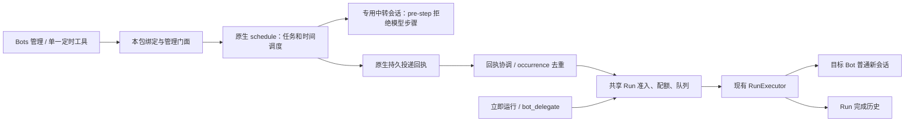

# P2 复用复审：以原生自动化为基础收敛 Bot 能力

日期：2026-10-20。对应任务：[P2-reuse-proposal](../tasks/P2/P2-reuse-proposal.md)。本轮只调研、写文档；以下新增架构和字段均为建议，没有修改产品实现或迁移任何数据。

**建议：立即收敛 Bot 的定时工具为一条路径；下一步优先验证“原生 schedule 触发 + 无模型中转会话 + 现有 Run 执行器”，通过后移除本包重复的时间调度。** 若用户接受每个任务复用固定 Bot 会话，则直接采用“完全原生 + Bots 聚合”更简单。0.2.0 暂作兼容实现，不能以“已经做了”为继续自建调度的理由，也不能在桥接未验证前删除已有执行保障。

旧结论需精确修正：**原生投递目标固定，但 Host 可以选择目标会话；没有专用执行器接口，不等于没有公开桥接路径；原生已有目录、编辑、删除、投递历史与变更事件，可直接复用。** 暂停、立即运行、每次新会话、Bot 配额和执行完成历史仍不是原生 schedule 直接提供的业务契约。

## 1. 基线与证据等级

| 项目 | 本轮核实 |
| --- | --- |
| DSH-Bot | `phase/p2-reuse`，HEAD `9fb7d77f9543a1e5959822dd9fed963eb76fb479`，包版本 0.2.0 |
| 起始改动 | 未跟踪 `.codex/`、`scripts/p2-e2e`，保留原状 |
| 参考源码 | `~/ai-workspace/deepseek-harness`，HEAD 与 `dsh-v0.2.1-rc.2^{commit}` 均为 `687f282e8625c6b8d11ff58211a90524be2e4317`，工作树干净，只读 |
| 已读设计 | [P2-design](P2-design.md)、[前次提案](P2-codex-proposal.md)、[T17 验收](acceptance/P2.md)、[API notes](dsh-api-notes.md)、[PLAN](PLAN.md) 的 P1–P4；旧文档保留为历史，本稿指出需修订之处 |
| 本轮运行 | `scripts/pnpm check` 退出 0：45 个文件、643 项测试通过，build/typecheck/lint 通过；[日志](../.dsh-dev/p2-reuse-20261020/check.log) |
| 验证边界 | 未运行新桥接 mock 探针、桌面 UI 或真实模型会话；现有测试通过不证明新桥接可运行。T17 的 Host/mock 成功是既有验收记录，本轮未复跑其 profile/e2e |

下文源码引用用 **H/** 表示锁定的 DSH 参考仓库，**B/** 表示本仓库。`路径:行号` 为本轮核实的定位；范围仅帮助阅读，不构成可深导入的许可。私有实现文件只用于说明行为，设计依赖只来自公开包入口、服务和事件。

## 2. 原生自动化重新核实

### 2.1 存储、触发与目标

| 核实项 | 结论及源码证据 |
| --- | --- |
| 权威存储 | Host `schedule` domain v1 的 `tasks` 表，一行含 `sessionId / record / status / lastDelivery / deliveryHistory`；不是每个活 Agent 的内存计时器。schema 严格，无第三方 metadata 字段。`H/packages/schedule/schedule/src/storage.ts:22-60`；服务开域 `H/packages/schedule/schedule/src/index.ts:125-163` |
| 持久化位置 | 使用宿主 storageDomain 后端，不能把默认 JSON 路径当成固定接口；不要重开/直写 schedule 域。历史 Session 的 `schedule/change` 不会自动迁入 Host 表。`H/packages/schedule/schedule/src/index.ts:166-181`；`H/packages/storage/storage-domain/README.zh.md:146-148` |
| 规则 | 原生支持 after、at、every、daily、weekly、cron；本包五类规则可用公开 create/resolve 函数规范化。every≥60 秒、显式 IANA 时区、五字段 cron、DST 和 latest-only 已有实现。根出口 `H/packages/schedule/schedule/src/index.ts:25-61`；算法 `H/packages/schedule/schedule/src/domain.ts:791-819`、`:1104-1141`、`:1294-1507` |
| 目标选择 | Host `create(sessionId, request, signal?)` 接受调用方选择的普通会话；原生工具才固定使用调用者会话。记录中不保存 `botId`、`botCreatedAt`、`agentPreset` 或每次创建新会话的策略。`H/packages/schedule/schedule/src/index.ts:213-262`；`H/packages/schedule/schedule/src/types.ts:193-220` |
| 到期行为 | Host timer 到期后 `resolveAgent(task.sessionId)`，向该会话 `followup`，`sessions.flush` 后提交投递回执及后继目标。冷会话可恢复；不需要 Client 打开。`H/packages/schedule/schedule/src/runtime.ts:85-143` |
| 合批、补发 | 同一会话的到期循环任务可合批，共享 messageId；每任务选择最近一次 occurrence。没有本包 24h 上限、Bot 每日额度或统一 Run 并发池。`H/packages/schedule/schedule/src/runtime.ts:89-120`；`H/packages/schedule/schedule/src/types.ts:196-209` |
| 失败语义 | Inbox 已投递但任务提交失败时可能再次投递；投递失败任务被排除于本次下一 timer 选择，不能假定有可靠周期重试 SLA。`H/packages/schedule/schedule/src/runtime.ts:122-163` |
| 生命周期 | 有活动任务参与 workspace 归档检查；归档停止会清理相关任务，不能把中转会话当成不受用户操作影响的隐藏队列。`H/packages/schedule/schedule/src/index.ts:184-206` |
| 历史含义 | `ScheduleDeliveryReceipt` 是持久 Inbox 投递确认，绝不是模型执行成功。默认保留 30 天/200 条，最近回执保留，较早部分可能不可用。`H/packages/schedule/schedule/src/types.ts:196-209`；`H/packages/schedule/schedule/src/index.ts:72-104` |

### 2.2 Host / Remote / 工具 / UI 的不同 API 面

| 入口 | 支持与限制 |
| --- | --- |
| Host `ctx.schedule.create(sessionId, request, signal?)` | 创建；不是 `@Remote` 方法。内部随机生成 task ID，无 caller operationId。创建时不能指定旧 every anchor。`H/packages/schedule/schedule/src/index.ts:228-262` |
| `list({sessionId})` | Host + Remote，仅该会话的 active 任务；不能用它代替全局目录。`H/packages/schedule/schedule/src/index.ts:270-275` |
| `catalog()` | Host + Remote，全 Host active/inactive 任务，含 sessionId、lastDelivery；不激活会话、不读取其历史。`H/packages/schedule/schedule/src/index.ts:278-292` |
| `history({sessionId,id,limit,before?})` | Host + Remote，按 message cursor 查询保存的投递历史，limit 为 1–100；必须处理缺失任务/游标与裁剪。`H/packages/schedule/schedule/src/index.ts:295-311` |
| `update({sessionId,id,expected,title?,prompt?,change?})` | Host + Remote，完整 expected record 比较；可改标题、指令、规则种类/时间，不能换 sessionId，不能改 status。inactive 返回 schedule_ended。`H/packages/schedule/schedule/src/index.ts:341-372` |
| `delete({sessionId,id})` | Host + Remote，删除任务及其投递历史，不撤回已经排进 Inbox 的消息。不是 pause，也不是 cancel。`H/packages/schedule/schedule/src/index.ts:314-337` |
| `schedule_create/list/update/delete` | 模型四工具，作用于当前 Agent 会话。工具清单及语义：`H/docs/tool-catalog.md:36`、`:1439`、`:1724`。没有 schedule_pause / schedule_run_now |
| 原生页面 | 读取 catalog、调用 update/delete/history，支持原会话导航；“新建”打开会话，没有页面创建表单或暂停/立即运行。`H/packages/client/ui-schedule/src/client/index.ts:92-146`；`H/packages/client/ui-schedule/README.zh.md:95-98` |

Client 可复用公开 schedule Remote 与类型，而不是导入 ui-schedule 内部 React 页面。若 Bots 页要直接创建原生任务，增加本包严格 Host 门面，由其检查 Bot 身份、会话绑定并调用 `ctx.schedule.create`；不能发明 `remote.schedule.create`。Remote 挂载和依赖注入按锁定公开契约验证。

### 2.3 有哪些扩展点

- **目录/刷新扩展已存在。** `schedule/changed` 是提交后的失效通知，不携带 due payload，也不是能 veto 的事务钩子；原生 runtime 提交投递回执同样发通知。Client 转发白名单明确包含它。可订阅后重新 catalog/history，并在 connection reset 重读。证据：`H/packages/schedule/schedule/src/index.ts:155-160`、`:376-389`；`H/packages/api/remotes/src/remote-events.ts:53`；`H/packages/client/ui-schedule/src/client/index.ts:92-100`。
- **没有专用调度执行器替换接口。** ScheduleService 私有持有 runtime，公开 Config 只有历史保留设置；原生页面没有第三方任务 provider。不能 monkey patch runtime、注册同名 schedule 服务或向其表写新字段。证据：`H/packages/schedule/schedule/src/index.ts:72-112`；`H/packages/client/ui-schedule/src/client/index.ts:92-147`。
- **通用 Agent 钩子提供桥接候选。** 公开 `agent/pre-step` 可以拒绝步骤；`reject` 在调用模型前结束为 blocked。专用中转会话可消费原生唤醒而不请模型“帮忙转发”，再由 Host 从投递回执启动业务 Run。证据：`H/packages/core/agent/src/runtime-types.ts:111-119`、`:309-320`；`H/packages/core/agent-loop/src/agent.ts:268-328`。这是源码可行性，尚不是已通过的集成方案。

| 旧说法 | 本轮修正 |
| --- | --- |
| “只能投回原会话” | 对原生工具成立；Host 可指定任何合格普通目标会话。创建后目标固定，仍不直接提供每 occurrence 新会话 |
| “无 pause/run_now” | 作为直接 API 仍成立；可在本包桥接层提供业务暂停/手动执行，但必须说明与原生状态的差异 |
| “无扩展点、挂原生不可行” | 过强。无专用 executor/provider hook，但有公开目录、事件和通用 pre-step，可聚合，也可验证无模型桥接 |
| “运行历史就是任务完成历史” | 不成立；是 Inbox 投递历史，不能冒充 Run 成功 |
| “仅已加载会话会触发 / 桌面默认无 schedule” | 前者被 resolveAgent 冷恢复路径否定；后者应区分旧文档与实际 profile，当前 Web bundle 启用 schedule。源码配置不证明用户正在运行的 profile 状态：`H/packages/bundle/web-app/cordis.patch.yml:135-140` |

## 3. 三种方案与推荐

| 方案 | 原生复用 / 保留的本包职责 | 差距、代价及适用条件 |
| --- | --- | --- |
| **A 完全原生 + Bots 聚合** | 原生任务库、timer、规则、固定会话、原生 UI/工具/历史；本包只保留 Bot 与 session/task 映射及聚合视图 | 最少重复实现。每任务可建专用 Bot 普通会话，但后续复用同一会话；放弃每次新会话、硬 pause/run_now、原有 Run 完成历史/成本承诺。可保留“删除未来提醒”和“打开会话继续”原生行为，不冒充旧功能。用户接受语义收缩时首选 |
| **B 原生触发 + 无模型中转 + 本包 Run 执行器** | 原生任务库和时间调度为唯一到期源；本包保留绑定、回执协调、业务启停、准入/配额、普通新会话执行和完成历史 | 保留 P2 主要能力，并能在原生自动化页看到真实原生任务。需验证专用中转会话生命周期、重复投递、回执裁剪和两域迁移；不能把“薄桥”复杂度隐去。**推荐优先做限时 spike，过门后采用** |
| **C 保持 0.2.0 自建调度 + 原生规则函数** | 现有 Routine/Dispatcher/Run 全套；原生 schedule 可作只读聚合 | 现有语义变化最小，但仍维护两套任务目录、到期 timer 和工具策略。仅作当前兼容或 B 明确失败且用户仍要求原有保证时的退路；不作为默认长期方向 |

推荐分两步：短期 C 的**兼容运行 + 单工具路径**先解决用户选错工具的问题；随后以 B 为目标做公开接口探针。若 B 的失败关闭或恢复门槛无法满足，先提交具体失败证据和最小上游接口需求，再让用户在 A 的语义收缩与 C 的必要自研之间选择，不能自动把未测试记成“原生不支持”。

### 3.1 A：Bot 绑定与原生聚合的最小实现

1. 新建时读取本包 `status().presetId`，选择已核实的当前 Bot 会话，或用公开 SessionController 创建一个**专用于该任务的普通 Bot 会话**。`agentPreset` 属于 Session 创建参数，不是 schedule 字段。原生 create 拒绝可识别的 delegated child 目标。证据：`H/packages/api/session-controller/src/index.ts:301`；`H/packages/schedule/schedule/src/index.ts:213-219`。
2. 用 Host create 返回的 nativeScheduleId 写本包 sidecar：`botId + botCreatedAt + targetSessionId + nativeScheduleId + engine`。这些都是拟议字段；不塞进 title/prompt 当机器 metadata，也不改原生 schema。
3. Bots 页从 native catalog 与 sidecar join，展示同一条原生任务；使用同一 update/delete/history API。`schedule/changed` + reset 刷新，不另建任务缓存权威或浏览器 timer。
4. 对用户已通过原生工具创建的任务，先按精确 session/preset 找候选并标明“原生会话任务”。只有身份有可靠证据或用户明确接管才持久绑定；不能靠 `bot-` 前缀、任务标题或有限 activity 列表推断归属。同 ID 重建 Bot、旧会话切换过 preset、Bot 已删除均需明确未知/旧身份。
5. 原生页和 Bots 页显示的是同一任务。原生删除后 Bots 显示已删除/解除关联；不要自动重建用户已删任务。历史标签使用“投递记录”。本包旧 Run 历史另保留，不伪造原生执行终态。

### 3.2 B：不依赖模型转发的桥接

建议一条 Routine 对应一个专用中转普通会话（relay），用本包独立中转 preset，而不是用户日常 Bot 会话。中转会话没有业务 task 执行职责；真实执行仍用目标 Bot 当前健康 preset 创建新会话。

**执行边界：**

- `agent/pre-step` 仅对受本包身份登记的 relay 起作用；其 retained generation 持有不可变 relay 身份并对所有输入默认 reject，**Host 身份表/sidecar/服务消失也不得 next() 放行**，避免误将人类输入变成 relay 工作。持久业务 admission 不放在这个 waterfall 内等待完成；尤其不能回调 schedule 管理队列造成递归等待。使用 `reject`，不要把 `enter: []` 泛称始终零模型：空步骤的特殊分支受 AgentLoop 当前 phase.step 条件影响（`H/packages/core/agent-loop/src/agent.ts:318-328`）。relay 的 blocked 只是抑制模型，不能当业务失败/成功。
- 以原生 **history 中的 `{nativeScheduleId, scheduledAt, messageId}`** 为触发证据。通知只唤醒协调器，启动/reset/定期对账补漏；不要解析提醒文本、仅看 `source.kind='schedule'` 或一次 changed 就执行。消息 source 没有 task ID，循环合批可共用 messageId：`H/packages/schedule/schedule/src/runtime.ts:112-123`。独立 relay 避免不同 Routine 同批的归属歧义，但去重仍按任务身份与 occurrence，不能只按 messageId。
- 原生可重复投递；本包保留 occurrence 去重：拟议 key 为 `(bindingGeneration, nativeScheduleId, scheduledAt)`，映射到稳定 Routine/Run。两次不同 messageId 的同 occurrence 只准入一次。原生没有 ruleRevision，同 task 在编辑/时钟回拨后复用同一时点也会被保守合并；这是“宁少不重”，不是完整保留旧编辑代际。先持久 queued/reservation，再 create/prompt；未知窗口保持 recovery_needed。
- 原生 receipt 和本包 Run 不原子。history 已裁剪、游标丢失、native task 已删除、只有 Inbox 而无 receipt 等情况，记录缺口并停止猜测，不“补齐”成功，不重算全部历史再跑。周期对账读取权威回执，它不是另一套到期计算器；触发语义仍由原生负责。
- 原生在本包停用期间也可能积累多个 receipt。恢复时先完成每绑定的对账、选最新可执行 occurrence，再打开 admission；已处理、暂停区间、cutover 前及超过24h的记录跳过，不把每个历史 receipt 都补跑一遍。较早可见记录可记合并/跳过，缺失部分不能编造条数。
- **推荐原生 record 为规则、标题、prompt 的唯一权威**，sidecar 只保存绑定、业务启停/限额、迁移与消费证据；relay 中的业务 prompt 由 gate 阻止执行。Bots 页和原生页都能经原生 update 修改，Run 使用该次持久 receipt.prompt 快照，不使用 catalog 中可能已经更新的 prompt。标题只作展示，不能声称是原生回执记录的历史标题。旧 receipt 无 prompt 时标待协调。采用此策略须接受原生 UI 编辑直接生效、无法完整审计每次 ruleRevision 的差异。
- 不推荐同时把 sidecar 当另一份规则权威：catalog 只有当前快照、changed 无 payload、receipt 没有完整规则/修改代际；“改规则→投递→改回”可能在两次查询间消失。仅比对 current record 不能保证检测所有编辑。若业务要求每次编辑重新批准、完整记录编辑代际或防止任何外部编辑生效，rc.2 现有证据不足，B 对该要求不通过，需上游变更流/受管任务接口；不能写成简单 mismatch 检测即可保证。
- B 接入后删除 Dispatcher 的 `dueOccurrence` 扫描、`armDue` 及业务 nextRunAt 权威推进；保留并拆出 `submit/runNow`、共享排队/准入/执行唤醒。当前混在同类中，不能直接删文件而破坏委派：`B/packages/dsh-bot/src/host/automation/dispatcher.ts:42-95`、`:100-151`。

**不能直接复用旧 scheduled 入参。** 当前 RunService 要求旧 Routine enabled、nextRunAt、ruleRevision，并会从 Run 重建旧游标：`B/packages/dsh-bot/src/host/automation/store.ts:127-133`、`:249-252`。R04 必须设计有版本的 native-receipt 准入，验证 engine/绑定/receipt 后复用统一 Run 配额和 slot；不能通过伪造旧游标绕过校验，也不能为 native 另开一份成本计数。旧 Routine.enabled=false 用于阻止旧版重跑，新逻辑启停属于明确版本化的 native 绑定。schema/领域迁移和旧读兼容必须成对设计，不声称只换 Dispatcher 就完成替换。

**卸载是阻断门槛。** 注销 relay preset 不代表 live Agent 消失：旧 generation 被标 retired，users=0 才清理；resolveAgent 优先返回 live 对象。若 Host 卸载移除了 pre-step 监听，但 schedule 仍可投递，relay 可能落回模型。证据：`H/packages/preset/agent-preset-registry/src/index.ts:81-100`、`:148-151`、`:265-273`；`H/packages/api/session-controller/src/agent.ts:213-218`、`:402-407`。候选设计把拒绝策略放在 retained relay generation 自己的 effect 内，独立于业务 Host 服务；冷恢复缺 preset 必须失败关闭。需要实测卸载、移除包、重启、HMR、同 ID 重新注册及到期竞态；不能只说“注销 preset 就安全”。若做不到，B 不发布。

**启动顺序同样是阻断门槛。** 原生 schedule 若先 drive、relay preset 尚未注册，resolveAgent 可能失败；该项不会自动安排重试，之后注册 preset 也不会自然触发 requestDrive。需以公开 Loader 配置/生命周期给出可复现的启动及恢复方案，或列上游缺口。不能调用私有 runtime，也不能假定 no-op update 能唤醒（`H/packages/schedule/schedule/src/runtime.ts:143-163`；`H/packages/schedule/schedule/src/index.ts:368-371`）。仅证明零模型、却让任务一直 overdue，仍不通过。

### 3.3 六项能力差距：能桥接什么，必须保留什么

| 能力 | 原生及可桥接路径 | 建议 |
| --- | --- | --- |
| 每次新会话 | A 固定 Bot 会话；B 原生触发 relay，再复用 SessionController + RunExecutor 建普通新会话 | 先确认是否硬需求；是则试 B，否选 A。不是重写 Agent runtime |
| 暂停/恢复 | 原生无 enabled setter。B 可在本包 gate 暂停业务执行，原生仍产生零模型 relay 投递；恢复过滤暂停期间 occurrence。delete/recreate 会丢原生历史、换 ID、重锚 | 推荐 B 初版业务暂停并明确显示“执行已暂停，原生触发仍在”；在原生页仍显示 active 是实质 UX 差距。若要求两个页面都停触发且无损恢复，需上游 pause 接口，不能伪造原生 inactive |
| 立即运行 | B 直接走相同 Run admission/executor，保持调度锚点，不新建一次性 native 任务 | 保留手动执行薄入口、审批和 operationId；界面标明是 Bot 执行，不伪造原生投递回执。A 没有等价 run_now |
| 配额/并发/补跑 | native latest-only 可复用；Bot 每日20、全局2、24h、overlap 等需在 receipt→Run 准入处理。旧 skip 还比较先前 nextRunAt，不能只凭最新 receipt 完全还原 | 保留业务准入和持久计数，不在两套后端各扣一次。skip 存量先留 legacy，除非探针证明只读观测游标能处理外部编辑，或用户接受新的迟到判定。保护范围是 Bot Runs，不能宣称约束所有原生/人工/MCP 工作 |
| 委派 | native subagent 本来可选 Bot preset 并回报，但不是普通会话/可询问审批/持久父回报的同一契约 | 独立做语义决策；接受原生子代理则包一层身份/配额工具，删除重复执行/回报。需要旧承诺则保留当前执行薄层，见第6节 |
| 运行历史 | native history 只描述投递；B 仍需 Run status、request/turn/flush、后台完成屏障 | 聚合显示“触发已投递 → 排队/执行 → 完成”；保留不可变旧历史和未知状态。A 不虚构成功率或执行结果 |

## 4. 0.2.0 数据迁移与兼容

现有 `dsh_bot` 与 `dsh_bot_automation` 分离；Routine 固定 Bot 创建身份，Run 保存执行快照、quota/slot/来源等。依据：`B/packages/dsh-bot/src/shared/automation.ts:32-41`、`:67-113`；领域和版本见 `B/packages/dsh-bot/src/host/automation/store.ts:19-21` 及 [T12 验收](acceptance/P2-T12.md)。迁移不能仅复制 prompt 和 cron 后删原记录。

### 4.1 迁移原则

- 本轮不执行迁移。下一任务先停受迁移 Routine 的新准入并取得既有单 Host 所有权，排空 queued/活动 Run；recovery_needed、待回报和停止不明的运行先保留，不能转移后重放。
- 备份原生 schedule、本包两个域及相关 Session 日志，记录哈希，并用副本验证可读和恢复。自定义后端不能假设有同名 JSON 文件。旧 Routine、Run、额度与 report 原样保留为历史，P1 Bot/记忆/技能不改。
- 增加独立、版本化的绑定/迁移状态，不直接把未知字段写进 v1 严格 schema 或指望 storageDomain 自动 migration。原生库只经公开 API 写；旧库与新库间没有事务。`H/packages/storage/storage-domain/README.zh.md:146-148`。
- 每 Routine 单一执行权威：`legacy` 或 `native`，不存在双活。未完成迁移时维持旧路由或待协调；迁移完成后旧 Dispatcher 必须跳过该 Routine，原生 gate 才可放行。原版 0.2.0 不识别新 sidecar，故先用其能识别的旧 enabled=false 状态停旧调度，再切新引擎。

### 4.2 B 的可恢复切换顺序（设计，尚未实现）

| 阶段 | 操作与崩溃处理 |
| --- | --- |
| prepare | 记录旧完整快照、ruleRevision/游标/额度、迁移 ID、目标 engine、原启停状态；暂停旧调度并关闭迁移目标 admission。原本 paused/deleted/exhausted 的任务不偷偷启用 |
| target_ready | 通过公开 create 创建目标普通会话并保存实际回执 ID；B 安装、验证 relay gate 后才创建 native 任务。会话创建也可能返回不同 ID，未知时不盲重建 |
| native_created | native create 返回随机 ID 后写绑定；若 native 已落库但绑定写失败，用预存的专用 sessionId + catalog 精确对账。0/1/多条分别查证；歧义进入 recovery_needed，不能重复 create。title/prompt hash 不是幂等主键 |
| cutover | 核实 native 规则、session、Bot 出生身份与暂停区间；原子提交本包绑定状态并允许该 engine admission。先于 cutover 的 receipt 只记迁移期跳过，不能补跑旧引擎已处理 occurrence |
| reconcile | 重启按迁移阶段恢复；缺 native 任务视用户删除或未知，不自动复活。检查 Bot 删除/同 ID 重建、relay 归档、外部编辑、配额水位、待回报记录 |
| rollback | 先关闭新 admission、快照原生回执并删除受管 native 任务，处理已经入 Inbox/已创建 Run；确认没有两端活动后再恢复旧未来游标。未知状态停住，不把两个域直接覆盖回备份。已发生模型/外部副作用不可回滚 |

native create 没有 caller ID/operationId、every 用 now+interval，见 `H/packages/schedule/schedule/src/index.ts:235-257`。因此 **every 正常迁移会重设相位**，须明确展示新首触发时间并确认；若必须保持既有相位，先留在 legacy，另验证一次性过渡，不能直接宣称 create 可导入旧 anchor。daily/weekly/cron 也要比较未来 UTC 目标、时区和 DST；过去 at 不可按“未来创建”重建，保留已耗尽/待处理状态。

A 的迁移另需用户接受固定会话上下文累积、原生投递历史替代新增 Run 历史及护栏变化；不自动转换全部存量。**A 的 native create 写入即 active 并 requestDrive，可能立即开始投递**，没有 B 的 relay gate，不能套用“先建后 cutover 放行”的原子激活说法；先完成语义批准、停旧调度、确认足够未来的目标，再 create，未知回执按专用 session 对账。B 的暂停区间、高水位、配额收据需随 binding 保留。原生 delete 删除历史，先归档本包需要的公开 receipt，仍保留“投递”标签。

**降级边界：**不能仅装回 0.2.0 就算回滚成功；旧版本不理解 native ownership，还可能重新触发旧记录。必须完成上表 rollback，保留新增 sidecar，禁止未知版本写坏新字段。整个迁移完成前不裁剪历史、去重凭据或旧安装包。

## 5. 短期单一定时工具路径

### 5.1 问题来源与推荐

standard preset 已挂 `tool-schedule`；本包 composer 读取标准行后只替换 persona/skills 并追加 bot-context，未删除原生定时工具；bot-context 又注册 routine_*。证据：`H/packages/bundle/web-app/presets/standard.patch.yml:35-36`；`B/packages/dsh-bot/src/host/composer.ts:52-83`；`B/packages/dsh-bot/src/host/bot-context.ts:130-146`。因此只改工具描述无法保证模型选择。本轮仅解释源码路径，不宣称已复现用户真实会话。

**推荐短期仅向 Bot 暴露 `routine_create/list/update/delete/run_now`。** 保留当前 0.2.0 的既有语义和数据；将来若采用 B，工具名/门面可不变，后端改为原生桥接。若最终选 A，则一次切到 native schedule_* 并停止注册 routine_*，不用两套名字让模型猜执行引擎。

| 做法 | 评价 |
| --- | --- |
| 只在人设说“请使用 routine” | 不可靠；模型仍看到两组工具，`persona.complete` 还能遮蔽附加 section |
| 给 Bot.tools.deny 手填四名 | 可作为受控临时配置，但不是通用实现：minimal 没有该继承工具会触发 unknown 检查，同层工具不受 restrict 隐藏，旧 live Agent 保持旧代际 |
| **组合层移除竞争工具 + Agent 层限制/guard + 简短指引** | 推荐。模型只看到一组，旧名称调用也不能写另一后端；标准非 Bot 会话继续原生能力 |

### 5.2 实施要点

1. 在本包生成的 Bot preset 副本中按准确包名移除 `@deepseek-ai/dsh-tool-schedule` 行，递归处理 group；不修改宿主 standard/minimal 文档。不要删 Host `dsh-schedule` 或 ui-schedule，用户已有原生任务仍需可管理。
2. 在真实 Agent scope 对**确实属于继承层且存在**的四名 `schedule_create / schedule_list / schedule_update / schedule_delete` 用 `tools.restrict({deny})`。unknown/same-layer/reserved 名会拒绝，不能以 catch 吞错后视为生效，也不能盲目将四名写进所有 Bot 的持久 deny。已有 Bot.tools.deny 若包含四名，路由策略需认领这些名称，从通用 deny 的实际 restrict 输入中扣除并分别处理，持久配置原样保留；否则移除模板行后旧 deny 会因 unknown 阻止 Agent 创建（`B/packages/dsh-bot/src/host/bot-context.ts:54-57`、`:130`）。公开语义：`H/packages/core/tools/src/index.ts:1098-1129`、`:1164-1216`。
3. 用公开 `agent.ctx.tools.guard` 对四名做单调拒绝，覆盖已知名称的直接调用和同层重新注册；其拒绝发生在 pre-execute/审批之后、dispatch 之前，别的 guard 无法强制 allow。所有 disposer 纳入精确 Agent/owner effect。`H/packages/core/tools/src/index.ts:1134-1160`、`:1513-1548`。guard 是执行保障，restrict/移除行才是隐藏保障；两者分开验收。同层第三方工具无法隐藏时，不得宣称单目录已就绪，应报组合冲突。routine 服务不可用、用户 deny 全部 routine_* 时均不自动回退原生 schedule。不禁整个 `run_code`，而是核实 PTC 中的最终工具调用同样受限。
4. 生效范围包含交互 Bot、Routine/delegate 新会话、委派回报轮次和相关后代。现有来源门禁只约束本包 routine/delegate 写工具，不能假定它限制原生 schedule；应补负例防绕过深度/配额。它还只找最后 user 或 delegate report，会越过原生 schedule 通知回溯旧 human 输入；存量原生任务仍可能触发新 routine/delegate。R01 必须把 schedule/桥接通知纳入明确的非交互来源策略，覆盖其后续步骤直到下一条真实人工输入。`B/packages/dsh-bot/src/host/delegate/guard.ts:7-30`；`H/packages/schedule/schedule/src/runtime.ts:119-124`。guard 不拦可信 Host 直接调用 ctx.schedule；不扩大为整个 Host 禁止原生 schedule，也不称其为对恶意插件/任意 OS 代码的安全沙箱。
5. 处理新建、冷恢复、空白会话切 preset、热重载和旧 live generation；身份依据真实 scope/绑定与持久 Run 来源，不按创建 header 或 preset 前缀猜测。切回普通会话须撤销 Bot 策略，不能只改 composer 后宣布现有会话已受限。当前 routine 接入在 agent/created；bot_manage 已有精确 scope/代际的 selected 处理可参考：`B/packages/dsh-bot/src/host/bot-context.ts:91-176`；`B/packages/dsh-bot/src/host/tools/bot-manage.ts:218-254`。若发布不追溯 live Agent，应明确要求正常重启 Host 后才承诺全覆盖，不偷偷终止正在运行的会话。
6. 提示词只补说明：Bot 定时任务走 routine_*，操作成功后返回稳定任务 ID；后台/回报轮次不创建新定时任务。策略来自 Config，字段与 schema 双重校验；中英 UI/审批文案同键。`persona.complete=true` 时隐藏/guard 仍必须成立，不依赖 prompt 作为权限闸门。
7. 已存在的原生任务继续运行，**隐藏工具不会取消它们**。Bots 页先增加可辨识的原生关联任务聚合/导航；只读展示不构成第二套模型写工具。转换/删除原生任务要走明确迁移流程，不能因治理工具竞争自动删数据。

单路径验收必须检查真实模型工具目录、伪造旧工具名 dispatch、PTC、同层工具、standard/minimal、多个 Bot/非 Bot、冷恢复、空白切换、旧代际、卸载恢复，且确认两库写入计数。仅截图看不到按钮或 grep 不含包名不算通过。

## 6. P1–P4 重复能力盘点

### 6.1 能力与边界

| 能力 | 原生已有；源码/文档证据 | 本包当前/计划 | 建议复用、保留及理由 |
| --- | --- | --- | --- |
| **长期记忆** | 未随组合启用第一方长期记忆后端，但官方已有 Memorix、MCP Reference Memory、Engram 三份默认关闭的 MCP 参考配置；连接/工具发现/stdio 生命周期由 DSH 管，存储检索归提供方。`H/docs/user/guide/mcp-memory.zh.md:5-31`。Reference Memory 可指定 MEMORY_FILE_PATH：同文件 `:46-55` | P1 自有 MemoryStore、memory_*、置顶/标签/词法检索、会话开始快照与 UI；P4 计划后端可插拔 | **纠正“无内置记忆所以只能自研”的推论。** 保留现存数据、Bot 隔离和 UI 契约；新增后端优先原生 MCP，不另造 transport/向量库。独立文件/namespace 至少是可探测隔离路径，不能未经验证断言社区方案都只能全局。先验两 Bot、冷恢复、并发、去重/置顶映射和迁移；尚不证明提供方能完整替代当前 MemoryRecord |
| **通知/推送** | jobs 已有会话内 followup/inject，owner 不在则略过：`H/packages/jobs/tool-jobs/src/index.ts:263-308`。Desktop 有内部 Electron 升级通知：`H/apps/desktop/src/update-attention.ts:23-55`；公开 preload 未见通用 notify：`H/apps/desktop/src/preload-app.ts:12-58`、`:76-100` | P3 bot_notify、桌面/邮件/飞书/Telegram、静默时段/每日上限/冷却；已有 delegate 持久 report | 会话内提醒复用 Inbox；系统通知与 IM 送达另计。不能 import Desktop 内部升级提醒，也不能把 followup 视为系统推送。优先包装已有渠道服务；保留 Bot→渠道绑定、授权、业务节流、投递结果审计，通用桌面通知公开面列为待验证 |
| **子代理 / bot_delegate** | 原生 startActivation 支持 agentPreset、delivery parent/caller、childId/result/dispose；spawn 不复制父上下文：`H/packages/subagent/subagent/src/types.ts:30-58`、`:136-153`；`H/packages/subagent/subagent-spawn-in-process/src/index.ts:1-5`、`:38-53`。tool-subagent 支持默认 preset 与 allowedAgentPresets：`H/packages/subagent/tool-subagent/README.zh.md:45-72` | P2 自建普通会话 RunExecutor + 持久 report、配额与身份检查 | 原生已覆盖核心“独立 Bot preset 子任务 + 回报”；重新审定产品语义后可将 bot_delegate 收敛为包装。保留 Bot 生日身份、审批、配额与必要审计；是否保留 executor/reporter 取决于下表差异，不能无条件两套并行 |
| **后台 jobs** | start/list/get/read/readAt/kill/wait/events/attachController 与 tool-jobs 现成；jobs-local 是进程内工作，不是持久跨进程 Routine 队列。`H/packages/jobs/jobs/src/index.ts:102-195`；`H/packages/jobs/jobs/README.zh.md:128-130` | 标准模板继承，本包完成屏障查询 jobs/后代 | 继续直接复用，不再建通用 job 管理器；保留 Run 业务关联。list(sessionId) 含 unowned，仍需 owner 精确过滤，不能把 jobs 空闲当整个 Run 完成 |
| **MCP / 连接器** | 原生 stdio/Streamable HTTP、工具同步、超时/取消/重连、scope 独立：`H/packages/mcp/mcp-client/README.zh.md:28-93`、`:123-137`。credentials 公开 resolve/describe/set/unset，UI 查询不返回值：`H/packages/credentials/credentials/README.zh.md:28-32`、`:46-81` | P3 preset 插 MCP 行、模板、凭据引用/状态 UI | 只保留绑定和配置桥，不写协议客户端/重连器/凭据库。**Config 实际接收 env/headers 字符串，没有 credentialRef 字段**：`H/packages/mcp/mcp-client/src/index.ts:51-104`。须验证公开 credentials 在内存解析后如何送到 scoped client、旋转与卸载；不能把 PLAN 的 envRefs 当已存在 API，不写秘密到 BotRecord/生成文档/日志 |
| **Skills** | filesystem provider 已有发现、按需正文、watch、优先级、customSkillDirs/includeDefaultRoots：`H/packages/skill/skill-filesystem/README.zh.md:28-81` | 当前 composer 保留原生 provider，仅设置 Bot 目录与 extraDirs：`B/packages/dsh-bot/src/host/composer.ts:64-79` | 现状符合复用原则；保留目录组织、绑定与 UI，不另造解析/加载/watcher。当前未设 includeDefaultRoots=false，仍可见默认项目/用户技能；私有目录不互注入不等于只可读自身技能，也不是文件安全隔离 |
| **IM / dsh-im** | 锁定官方树未检出 dsh-im 实现，它是社区候选，不是 rc.2 的内置 API。社区有[主动投递文档](https://github.com/xmanrui/dsh-im/blob/main/PROACTIVE_DELIVERY.md)，本轮不将未锁版本文档视为本项目兼容证明 | P3 拟把 IM bot 绑定到 Bot preset，不合适才最小适配 | 优先配置桥，不先写 IM SDK/登录/会话映射。下阶段锁 owner/repo/tag，核公开 export/service、入站身份、凭据、生命周期、幂等和断线恢复，再 mock 实测。dsh-heartbeat 也须明确仓库/版本后核节流接口；star/渠道数量不作证据 |
| **P4 消息/协作** | 实验 Agent Teams 已有持久 roster、任务 CAS/依赖、同 Team peer Inbox 与冷恢复；无跨进程协调，send 接收不等于处理、也没有持久发送意图/重启重试/重发去重：`H/packages/experimental/agent-team/README.zh.md:28-32`、`:60-84` | bot_message、长期收件会话、防循环、等待回复、协作看板 | 同工作区同 Team 优先原生 Teams，不重写 roster/任务板；跨 Team/长期独立 Bot 收件箱或跨机器若确需，可保留最小 Bot 路由/关联/必要 outbox。先证明 Team 模型不能满足，再设计差异层；A2A 社区候选同样须锁版核实 |

### 6.2 原生子代理与现有委派真正不同的四点

| 维度 | 原生与当前契约的差异 | 决策含义 |
| --- | --- | --- |
| 父身份 | startActivation 要 exact live parent Agent：`H/packages/subagent/subagent/src/index.ts:269-283` | 无父 Agent 的 Routine 定时入口不能直接用它替换；不创建一个调用模型的“父调度员”掩盖差距 |
| 会话类型 | child 写 parentSession/origin=subagent/delegationDepth：`H/packages/subagent/subagent/src/child-agent.ts:135-153` | 接受子代理后须调整 Bots 列表/导航，不再承诺与普通 Bots 工作区会话完全相同 |
| 审批 | 组合了 approval 能力时，child 的 approvalPolicy 固定为 never，需要 ask 的行为拒绝，而非自动批准：`H/packages/subagent/subagent/src/child-agent.ts:220-253`、`:270-277` | 不为复用而提权或跳审批。需要子任务可等待用户批准时，保留普通会话执行差异；不需要时使用原生 |
| 回报 | 默认报告仅送同一个仍 live 的父对象；父忙时 steer，消失/替换则不发：`H/packages/subagent/subagent/src/manager.ts:1186-1204` | 若仅需忙时排队，可用 delivery=caller + 本包 reporter；若需父冷恢复后投递，持久报告仍是差异。这不是“完全删除 reporter” |

前次提案已经识别独立 preset 的 subagent；本轮改变的是取舍原则，不把它写成过去完全漏查的能力。既有 T11 只验证 spawn/caller 查询等待，T15 验证的是本包普通会话委派；均不等于原生替换已通过（`B/docs/dsh-api-notes.md:121`；`B/docs/acceptance/P2.md:112`）。

### 6.3 对计划的具体修订建议

PLAN 的“DSH 无内置记忆/主动推送”应拆成：默认未包含记忆服务器但已有官方 MCP 接入；会话通知已存在，通用第三方 OS/IM 推送待核。P3 保留 MCP 配置/凭据引用和渠道绑定层，删除重复 transport/通用后台管理器的建设预期。P4 优先 Teams、原生 skills/插件市场机制；社区后端和 IM 版本兼容必须先 probe。所有第三方参考安装示例不改变本项目禁止全局安装的约束，后续也应使用任务指定的仓库隔离环境。

本轮不改旧 PLAN/API notes 的历史章节，因为没有新增产品 API 依赖；R01/R05/R07 实际采用新 API 时再更新当前合同和批准设计。现有记忆数据和业务差异保留有明确兼容理由，绝不能把本表理解为立即清库重建。

## 7. 需要用户拍板的决策

以下供下一阶段批准，本轮完成提案不等待这些选择。

| 决策 | 推荐 |
| --- | --- |
| 每次新会话是否仍为硬需求 | 暂按已批准 P2 保留，优先 B spike；若固定 Bot 会话足够，改选更简单 A，删重复调度/执行历史承诺 |
| 短期唯一工具入口 | 保留 routine_*，隐藏并拒绝 Bot 的原生 schedule_*；不删除已有原生任务 |
| 暂停语义 | B 初期业务执行 gate 暂停；原生页仍 active 必须接受并解释。若要求原生任务也无损停触发，先请求上游 pause 接口 |
| 原生页编辑桥接任务 | 推荐原生 record 为规则/内容权威，Run 取 receipt.prompt；接受无法完整审计每次编辑代际。若要求逐次重新批准，B 当前不满足，需上游接口；不靠当前快照检测冒充保证 |
| every 相位与 skip 补跑 | 默认逐任务预览后重锚；skip 存量先留 legacy，不能仅用“最新发生时间还很近”判为未漏跑。接受语义调整前保留旧 history/配额/report |
| bot_delegate 是否接受原生子代理语义 | 普通子任务优先原生 spawn；若要求交互审批、普通工作区会话、父冷恢复持久回报，保留本包差异层。两种语义不要混用同一成功承诺 |
| 原生桥接未过门时怎么办 | 先给失败证据；选择 A 的功能收缩或 C 的必要差异实现，不长期同时开放两套定时工具 |
| P3/P4 投入顺序 | 先接原生 MCP/credentials/skills、评估已有通知/IM 与 memory MCP；验证确实不能桥接后才写协议/存储引擎 |

## 8. 后续任务拆分与停止条件

| 建议任务 | 可独立交付的范围 | 验收门槛 |
| --- | --- | --- |
| R01 单路径修复 | composer 去竞争行、Agent restrict+guard、代际与提示、原生存量说明；不迁移调度 | 真实 ToolRuntime/正式 Bot 组合：目录只有一套；旧名称无另一库写入；PTC/同层/切换/恢复/后台负例；非 Bot 原生工具不受影响；check |
| R02 原生聚合与绑定探针 | 在隔离 profile 创建 Bot 普通会话 + native task；公开 catalog/history/update/delete/changed 经 Gateway 与正式 Client 消费 | Bot 页和原生页同 taskId；跨页改动可见；删除不复活；同 ID Bot 重建不串归属；中英亮暗浏览器验证独立列项 |
| R03 无模型中转桥接 spike（先于产品替换） | 独立 relay preset、pre-step reject、receipt→一次 Run、启动对账、故障与卸载；无私有 import | 下列 B 门槛全部通过，否则停止替换，提交失败证据。仅 loopback mock，无真实 key；不把现有 643 tests 当证明 |
| R04 迁移与准入适配 | 先完成第7节决策；版本化 sidecar/receipt 准入及 schema 迁移、恢复阶段、每 Routine 单 engine；将 dispatcher 拆出准入，去重复时间计算 | 非空 0.2.0 副本迁移/回滚；旧 Run/额度/report 不变；无双执行；不绕过 v1 enabled/游标校验；每个写入崩溃点可恢复或明确 recovery_needed；every 相位变化有明确收据 |
| R05 产品收敛与发布验收 | B 过门后切后端、更新 API notes/PLAN/P2-design/README；原生投递与业务完成分别展示；打包 | 用新 tarball 走真实 Host+mock、每次新会话、暂停/manual、配额、冷恢复；亮暗真实 UI；旧 Dispatcher 已不负责 native engine 到期 |
| R06 原生委派包装评审 | 对比 spawn/allowedAgentPresets、approval never、父生命周期/回报；实现仅选定的一种产品语义 | 目标 Bot 身份准确、父忙/消失/恢复、拒绝审批、超时/取消/配额回执；只有接受原生契约后才移除本包 reporter |
| R07 P3 复用 spike | MCP 凭据引用、memory namespace、通知/IM 插件公开面；锁版本/可卸载 | 两 Bot 隔离、密钥不回显、权限保留、通知送达证据、断线/重启/卸载；未核实社区 API 不排“自研替代”实现单 |

B 的阻断门槛：

1. 五类规则分别做桥接契约检查，另实等至少一轮 every60；**relay 模型请求 0，目标业务 mock 请求按预期**；完成依据 Run/Session 终态，不是 followup accepted。
2. 正常运行、live relay、冷恢复、Host/插件卸载、移除包、HMR、到期竞态，relay 都不能失去拒绝策略后调用模型。监听器/注册资源清理可证明。
3. 同 occurrence 多 messageId、两个通知、进程重启、合批、已入 Inbox 后删除，以及 receipt 提交前后故障，最多一个业务 admission；无法证明的窗口停在 recovery_needed。
4. native create 成功/绑定写失败可找回；两个创建候选、历史裁剪/游标失效、用户归档/删除/改规则不静默重建或误执行；原生页管理仍真实可用。
5. 暂停期过滤、恢复仅最新、run_now 不改锚点、24h、并发/额度和同 Routine overlap 保持声明的语义；两引擎迁移没有双活。专门检验“跨过多次但 latest 距 now 很近”的 skip 情况：现实现比较旧 nextRunAt（`B/packages/dsh-bot/src/host/automation/dispatcher.ts:107-112`），native receipt 没有漏跑次数/旧规则。只读观测游标不能证明外部编辑历史时，skip 不迁移，或另行批准语义调整。
6. 冷启动时 native 已投递但本包尚未就绪、或 schedule 先启动而 relay preset 缺失，均能通过经验证的公开装载/恢复路径继续触发；仅保持 overdue 不能通过。follower Host 无所有权、reference/pkg 版本变化失败关闭。P2 的锁并不能自动给原生 schedule 多进程排他，支持范围仍限定一活动 Host。

上游最小诉求（仅建议，不在本轮发 issue）：公开有类型的 occurrence 接收/确认接口与稳定 key、可选 caller create 幂等键、任务启停、受管 metadata/任务类型及 UI 状态投影。若这些到位，应继续删除本包 relay/回执补偿代码，不固化成新平台。

## 9. 本轮验收与交付

| 任务要求 | 结果 |
| --- | --- |
| 1 原生存储/触发/会话/管理/API/事件及旧结论修正 | **PASS（源码调研）**，见第2节 |
| 2 三种方案、六项差距、推荐、0.2.0 迁移/兼容 | **PASS（设计）**，见第3–4节；B 仍须 R03 证明 |
| 3 单一定时工具方案与推荐 | **PASS（设计）**，见第5节；本轮未改工具行为 |
| 4 P1/P2/P3/P4 原生重复能力盘点 | **PASS（源码/文档调研）**，见第6节；社区兼容及新后端组合未实测 |
| 5 待决策清单、任务拆分与验收门槛 | **PASS（文档）**，见第7–8节 |
| `scripts/pnpm check` | **PASS**，643/643 tests、build/typecheck/lint |
| 文档引用与空白校验 | **PASS**，101 处完整/同文件省略路径的行号范围及本地链接有效；git diff 空白检查无诊断 |
| 新桥接/迁移/工具路由运行、真实浏览器亮暗 | **FAIL（未执行）**：本轮仅设计调研，不以现有检查或旧验收替代 |

改动文件：仅 `docs/P2-reuse-proposal.md`。例行 check 重建忽略的 lib，日志在 `.dsh-dev/p2-reuse-20261020/check.log`；不更改源码、依赖、lockfile、版本、任务单、已有 tarball 或用户数据。执行 `git status/branch/rev-parse`、参考 tag 对照、`rg/nl/sed` 只读检索、`scripts/pnpm check`；Python 文档路径/行号校验退出0、无错误。`git diff --check` 退出0；新文件的 `git diff --no-index --check /dev/null docs/P2-reuse-proposal.md` 返回1且无诊断，表示存在新增内容，不是空白校验错误。未安装依赖，因为本任务不变更依赖且既有环境检查通过。

遗留：先执行 R01，再用 R03 的具体证据决定 B 是否可发布；A 的语义收缩、暂停展示、每周期相位和委派契约需产品拍板。尚无本轮新桥接运行证据，不承诺迁移已经可执行。

## 10. 用户批准的决策（2026-10-20）
采用 **方案 A（完全原生 + Bots 聚合）**——此为**编排方判断**（Codex 原推荐 B 原生触发 + 中转执行器）。用户确认“每次新会话”不是硬需求；全局原则：DSH 原生能力优先复用。
1. [编排] Bot 只暴露原生 schedule_* 工具，移除 routine_*（Codex 原建议相反：留 routine_*、拦原生）。
2. [Codex+编排] Bots 页聚合原生任务：本包只存 Bot↔原生任务映射 sidecar；复用原生 catalog/list/update/delete/history 与 schedule/changed；能可靠归属到 Bot 会话的存量原生任务也展示（Codex §3.1-4 的归属规则）。
3. [编排] 删除自建调度器/Dispatcher/锁/配额/补跑；保留小型“立即运行”，复用现有新会话执行器。
4. [Codex §6.2 + 编排] bot_delegate 普通委派改用原生子代理；只在原生确实做不到处保留本包层，并逐项说明理由。
5. 0.2.0 的 dsh_bot_automation 数据：能迁移到原生则迁移，否则只读/忽略，不得崩溃；选择写入架构文档。
