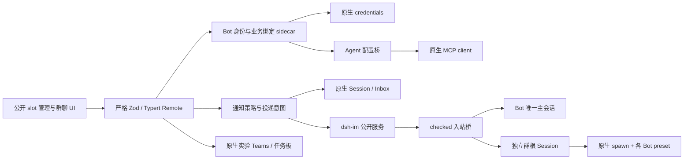

# P3 / P4 设计：连接器、通知、IM、协作与群聊（0.3.0）

本文是 `tasks/P34/D-design.md` 的设计交付，不表示功能已经实现。用户已授权设计后由编排方评审并继续实现，不设置新的用户审批关卡；产品中发送外部消息的授权仍遵守原生审批。

## 1. 基线、范围和证据等级

- **B**：本仓库当前 0.2.2。保留已有 Bot、MemoryStore、单主会话、原生定时任务、头像和公开 Remote；不清库重建。当前约束来自 `B/docs/architecture.md:84-97,113-143`。
- **H**：只读 `/Users/youzihui/ai-workspace/deepseek-harness`，tag `dsh-v0.2.1-rc.2`，HEAD `687f282e8625c6b8d11ff58211a90524be2e4317`。以下 H 路径均相对此根。只从包的公开入口导入；源码内部路径只作核实证据。
- **I**：社区 [`xmanrui/dsh-im`](https://github.com/xmanrui/dsh-im/tree/4645cf767257b4bc32c80f4f18e1f9f6cfbb5060)，tag **v5.5.0**，commit **`4645cf767257b4bc32c80f4f18e1f9f6cfbb5060`**。不以 main、star 数或兼容声明代替运行验证。
- **M**：MCP 官方参考服务器 [`modelcontextprotocol/servers`](https://github.com/modelcontextprotocol/servers/tree/6dd0a683e198783e30feabf7abaf42f925bd18b1/src/memory)，`@modelcontextprotocol/server-memory@2026.7.4`，commit **`6dd0a683e198783e30feabf7abaf42f925bd18b1`**。这是参考服务器，不是 DSH 自带的长期记忆库或支持承诺。

本文每节的“源码证据”表示已阅读锁定版本；“设计”表示本包将增加的契约；“待测”表示实施任务必须验证。当前没有新增 API spike、模型调用、IM 真实发送或桌面送达证明。本轮 `scripts/pnpm check` 的通过仅证明文档变更没有破坏现有产品回归。

| 用户范围 | 0.3.0 设计落点 | 证据边界 |
| --- | --- | --- |
| 每 Bot MCP / credentials | 原生 MCP + 原生凭据 + Agent 内配置桥 | env/header 引用是本包设计，原生不认识 credentialRef |
| 主动通知 | 本地通知中心、原生 Inbox、dsh-im 已配置渠道 | OS 桌面通知公开面缺失；明确显示不支持 |
| IM 入站 | 锁定 dsh-im 的飞书/Lark external-consumer 桥 | 其他平台只开放已核实出站，不承诺单主会话入站 |
| 多 Bot 协作 | 既有 `bot_delegate` / 原生 spawn；原生 Teams 任务板 | Teams teammate 不能直接选择各 Bot preset |
| 群聊 | 独立原生群根 Session + 多 Bot preset 子代理 + 确定性路由 | 群根不调用模型；群消息保存于原生 Session |
| 完整管理 UI | Bots 内管理导航与原生设置/定时 UI 组合 | 不复制宿主配置中心或会话树 |
| MCP 记忆 | 内置默认，参考 Memory MCP 显式并存及可恢复导入 | 不直接声称图谱无损替代 MemoryRecord |
| 市场 | 本地 tgz、元数据、索引 fixture 和安装验证 | 不发布 npm / GitHub，不伪造可安装的线上版本 |

决策：修订旧 PLAN 中“preset 直接写 `!!js process.env.X`”“Teams 直接容纳既有 Bot”“followup 即桌面推送”等隐含假设。理由：锁定版本的真实类型和生命周期不支持这些等同关系；本设计以当前单主会话实现为约束，而非恢复旧的多会话方案。

## 2. 总体结构与共同契约



### 2.1 身份、会话和工作区

所有 Bot 引用使用 `BotKey={botId,botCreatedAt}`；ID 相同但生日不同视为新 Bot。Session ID、preset ID 由 Host 权威读取，Client 不拼接。Bot 主会话继续 `dshBot/openConversation`，标题等于 Bot 名；连接器保存、IM 收消息、通知、群成员变化都不新建第二个 Bot 主会话。`B/docs/architecture.md:86-95`。

决策：Bot 绑定不要求 workspaceId；群创建也不要求选择/创建工作区。理由：连接器/渠道是 Bot 能力，不是目录所有权。原主会话保持现有 cwd/工作区；新主会话继续兼容当前共享 Bots 根。新群提供可选“运行目录”，省略时用插件受管群目录；只向原生创建 API 提供合法 cwd，不强制注册 workspace。目录和工具权限仍由原生处理，群成员同样没有文件安全隔离。

### 2.2 存储、版本和刷新

保留 `dsh_bot` v1 与全部旧表，不在启动时覆写 dormant 字段。`B/packages/dsh-bot/src/shared/schema.ts:55-100` 中 `mcpServers/channels` 已存在但尚未激活。新增独立、严格校验的 v1 sidecar；下表类型均为**设计**，不是现有 API。

| 领域 | 记录 | 关键字段与约束 |
| --- | --- | --- |
| `dsh_bot_connectors` | `definitions`, `assignments`, `legacyImports` | ConnectorDefinition / ConnectorAssignment，详 §3；仅非秘密数据 |
| `dsh_bot_notifications` | `policies`, `intents`, `receipts`, `readState` | 通知与外部投递分离，详 §4；同一 Host 串行准入 |
| `dsh_bot_im` | `bindings`, `inboundReceipts` | fingerprint、绑定目标、平台 event 去重和关联，详 §5 |
| `dsh_bot_groups` | `groups`, `members`, `turns`, `deliveries` | 原生 rootSessionId、BotKey、顺序与执行回执；正文仍在原生日志 |
| `dsh_bot_memory_backends` | `bindings`, `imports` | backend 模式、独立文件身份、迁移清单，不改变旧 MemoryStore |
| `dsh_bot_collaboration` | `teamLinks` | 只存 leadSessionId / 原生 teamId / UI 归属；不复制原生 roster/task |

所有写入有 `id/createdAt/updatedAt/schemaVersion` 和显式 `expectedRevision`；同一领域句柄内串行检查后写入。无跨表事务、无跨 Host JSON 协调。跨领域操作先写 intent，再原生动作，再确认结果；崩溃不确定标 `recovery_needed`，不自动重放外部副作用。坏数据只报诊断并保留原文件，不静默清除。

现有 Bot schema 的旧 `mcpServers/channels` 先作为只读“待导入”配置展示；用户显式启用时按纯引用映射创建 sidecar，以 `(BotKey,legacyDigest)` 幂等导入，不回写或删除旧值。无法解释的 credentialRef/路径显示校验错误。这样旧 0.2.2 数据仍可原样读取；不把保留字段解释成已授权运行。

Client 复用当前 catalog / polling scheduler / watch：首次加载才显示 skeleton，后台刷新保留数据、选择、滚动和未提交表单；用 epoch 拒绝迟到读；visible/focus/reset 刷新，结构相同保留引用；重连断流降级轮询。新领域变更发同一 `watch` 的失效原因，native schedule 继续其原生 changed。证据：`B/docs/architecture.md:113-123`、`B/packages/dsh-bot/src/client/state.ts:63-85`。

### 2.3 配置、Remote 与生命周期

导出 Schemastery `Config`：`connectorApplyTimeoutMs=30000`（1000–120000）、`notificationDailyLimit=20`（0–1000）、`notificationCooldownSec=60`（0–86400）、`notificationRetentionDays=30`（1–365）、`notificationMaxRecords=1000`（1–10000）、`groupMaxMembers=8`（2–16）、`groupMaxTurns=8`（1–32）、`groupMaxDepth=1`（1–8）、`groupContextMaxBytes=32768`（1024–262144）、`groupRoundTimeoutMs=300000`（1000–3600000）、`inboundDedupDays=7`（1–30）。这些是产品默认值，实施时不得另在执行分支硬编码。固定 schema 字节上限另导出常量。时区存 IANA ID，UI 默认取浏览器值，经 Host 校验。

新增 `dshBot.connectors`、`.notifications`、`.im`、`.groups`、`.collaboration`、`.memoryBackends` 的显式 Typert contribution，与现有单一 Zod spec 同源；不依赖已知失败的外部包自动 generator。Remote 输入不接受任意 Agent、工具调用名、平台服务方法名或秘密解析值。错误区分 `invalid/conflict/not-found/unavailable/unsupported/approval-denied/recovery-needed`；错误详情只返回受限 ID 和原因枚举，不回显 env/header/URL 中的认证信息。

Host effect 负责 sidecar、队列和服务；Agent effect 负责 MCP child、工具、source/上下文贡献和取消信号；Client effect 负责 slots、locale、Remote、订阅和导航取消。异步注册/`ctx.plugin`/disposer 都 await。停止顺序为拒新请求 → 取消待启动动作 → 排空/标记进行中动作 → 关闭 child/订阅 → root handle → preset disposer → domains；不删除持久数据或用户目录。

## 3. 每 Bot 连接器与凭据

### 3.1 原生能力核实

| 源码证据 | 已确认能力 / 不能假定的能力 |
| --- | --- |
| `H/packages/mcp/mcp-client/src/index.ts:39-104` | stdio、Streamable HTTP；serverName 为 1–32 位字母数字/下划线/连字符；env/headers 是字符串，没有 credentialRef/envRefs |
| 同文件 `:154-203`；`src/transport.ts:21-43` | async apply；namespace 随 `scopeOf(ctx)`；effect 清连接；stdio 清理部分敏感环境后合并显式 env；HTTP headers 是启动配置快照 |
| `H/packages/core/scope/src/index.ts:32-39,94-101` | 按 Agent scope 注册/继承。两 Bot 可各有 `mcp__github__...`，不是全局重命名工具，也不是 OS 安全隔离 |
| `H/packages/preset/agent-preset-registry/src/index.ts:81-111,148-151,218-228,265-273` | preset eager generation；readDocument 会 dump 原 plugins；旧 live Agent 保留旧代际，更新 preset 不热应用 |
| `H/packages/credentials/credentials/README.zh.md:28-32,46-81`；`src/types.ts:76-87` | resolve/describe/set/unset；describe 不含值；reference-updated 只覆盖 provider-managed 变更 |
| `H/packages/credentials/credentials-local/src/index.ts:28-34,624-642` | 本地 store 不 materialize 成 process.env；解析优先 file > env > fallback。`!!js process.env.X` 不会读取新保存的 credential |
| `H/packages/api/settings-controller/src/credentials.ts:45-50,82-129` | 原生 `remote.credentials.describe/set/unset`；describe 最多 64 refs；缺 provider 返回明确不可用 |

### 3.2 数据模型和复用决策

`ConnectorDefinition={id,label,templateId?,templateVersion,serverName,transport,command?,args?,url?,literalEnv?,literalHeaders?,credentialBindings,enabled,revision}`。`credentialBindings[]={destination:'env'|'header',key,credentialRef,format:'raw'|'bearer'|'basic-token'}`；format 仅模板白名单，不支持任意 JS。stdio command/args/URL、literal 值均需校验，不接受 URL userinfo、secret query、内联 token 或任意表达式；密钥通过原生凭据表单存储，引用名按原生语法校验。模板 command 必须是用户已配置的本地可执行文件，不用 latest/npx 自动拉包，不自动安装第三方连接器。

`ConnectorAssignment={id,bot:BotKey,connectorId,enabled,overrides非秘密,desiredRevision}`；运行状态仅内存/只读 DTO：`{sessionId,desiredRevision,appliedRevision,state:'pending'|'connecting'|'ready'|'unavailable'|'disabled',reasonCode,toolCount}`。同 Bot 的 serverName 冲突拒绝；Host 全局继承的同名 MCP 需列出来源并拒绝覆盖，不能暗中扩大权限。新增 schema 不放进 BotRecord；原字段仅兼容导入。

决策：不将已 resolve 的 env/headers 写入 `PresetDefinition.plugins`、`readDocument`、Loader 配置、fiber.config、日志、导出或 Remote。理由：preset 文档和 Cordis fiber config 都是可观察配置（`H/vendor/cordis/src/fiber.ts:184-192`），用“UI 不显示”不能防止配置泄漏。

决策：preset 仅插本包 bridge 的 `{botId,botCreatedAt}`/引用；在 `agent/created` 后按 Agent 精确身份解析，创建**无 config 参数**的私有 child plugin closure，再在其 context 调公开 `@deepseek-ai/dsh-mcp-client` 根入口的 `Config`/`apply`。理由：复用 native transport、工具同步、取消、重连和 subprocess effect，同时使密钥只作为必要运行参数留在内存。`ctx.plugin` 的公开 await/dispose 见 `H/vendor/cordis/src/registry.ts:177-185`；native 根 export 见 `H/packages/mcp/mcp-client/package.json:16-23`。不可 deep import connection/transport；该组合仍须 U01 真实 mock probe。

### 3.3 保存、热应用、撤销

1. 保存先持久化纯引用 definition/assignment，返回 desiredRevision；不隐式重启 Bot，不丢历史，不把“已保存”称“已连接”。
2. 主会话尚未创建时记录“首次打开应用”。已有 live Agent 记录 pending，用户可点“空闲时应用”；当前连接在未撤销前继续按 appliedRevision 工作。连接器桥自己处理更新，不能依赖重新注册 preset 自动刷新。
3. 先 `whenIdle()`，再 `runMaintenance()` 同步抢真正 idle；若被新 turn 抢走则回到 pending。原生保证 maintenance 中后续 wake 留 Inbox（`H/packages/core/agent/src/runtime-types.ts:185-202`）。
4. 同 serverName 不双挂：await 关闭旧 child → 重新 resolve → 挂新 child → 发现工具 → appliedRevision。连接失败显示 unavailable，重试显式执行；不以旧已撤销秘密回退。
5. 删除/撤权先用 scoped `tools.guard` 拒绝本连接器新调用，再在空闲边界关闭；已发给远端的请求不能承诺撤回。原生 guard 证据 `H/packages/core/tools/src/index.ts:724-732,1133-1151`。卸载清 guard 和 child，等待取消/关闭。
6. provider credential 变化事件将引用它的 assignment 标 pending。U01 实测修正：CLI 的 credentials-local 从不可变 launchEnvironment 快照读取 process 层；运行时改变 `process.env` 后，即使 bridge 重新 resolve/重建 child 仍读旧快照。环境变更须重启 Host；热轮换使用原生 provider-managed set/unset 与 reference-updated，再在维护窗口重新 resolve。native 自己 reconnect 使用静态 config，不会重新读取环境或 resolve（`H/packages/mcp/mcp-client/src/connection.ts:301-328`）；本包不为此另写重连器。证据见 [U01](spikes/P34-api-spike.md)。

### 3.4 UI、风险与 mock e2e

中文 UI：“连接器”目录 → “新建连接器” → 模板/传输配置 → “凭据引用” → “分配给 Bot”。Bot 详情连接器页显示已保存/待应用/已连接版本、发现工具数、脱敏错误与“空闲时应用/断开/测试连接”。凭据编辑使用原生 credentials Remote/设置能力；密码输入不预填，不提供查看值按钮，离开即清本地输入。复制 Bot 默认复制连接器分配意图但保持禁用，外部渠道与授权不复制。

首版内置 GitHub / filesystem / browser / Notion 的**配置模板**而非已认证可用服务；每模板记录上游版本、传输和所需引用，未锁定上游包的模板显示“需选择已安装服务器”，不执行下载。文件路径白名单只作为配置/权限说明，不声称各 Bot 沙箱隔离。

风险：任意 MCP server 可在错误里回显输入，native 日志会 `String(error)`，不能承诺所有第三方服务器永不泄密。桥只记录 reasonCode，不附原始 error；测试用唯一 sentinel 扫所有生成文档、fiber config、Remote dump、日志与打包文件，连接/认证失败也测。密钥不进入模型提示，MCP 输出仍按外部数据处理。

mock e2e：隔离 profile 两 Bot 同名 github client 使用不同 loopback MCP / sentinel；只各见自己的工具；普通 standard Agent 看不到；冷恢复只恢复各自引用；换 credential 不在 busy 中替换；空闲应用新 header；撤权立即拒新调用；HTTP 断线、stdio 退出、初始发现失败、native 重连、插件卸载/Agent dispose 均收敛且无残留进程/工具。无真实 GitHub、无真实凭据；实际 GitHub issue 检索另列外部联调验收。

## 4. 通知中心、Inbox 与外部推送

### 4.1 原生能力和最小可行方案

`H/packages/core/agent/src/runtime-types.ts:204-241` 的 `send/followup/steer/inject` 是 Inbox 模型输入：followup 会唤醒，inject 不唤醒；不是用户的 OS 通知。`H/packages/jobs/tool-jobs/src/index.ts:263-308` 已用 followup/inject 做会话内提醒，owner 不在会跳过。

`H/apps/desktop/src/preload-app.ts:13-58,76-100` 的 productAPI 只有 browser/deviceInfo/keyboard/shortcuts/updates 等，没有第三方通用通知方法。`H/apps/desktop/src/update-attention.ts:23-55` 的 Electron Notification 是内部升级提醒，不得导入或复刻内部桥。

决策：0.3.0 最小方案是持久通知中心 + 未读鲸鱼徽章 + 原生会话结果/Inbox + 用户配置的 dsh-im 出站。理由：这能在现有公开面落地；“桌面系统通知”显示“不支持当前宿主”，不把 toast、mock 回执、followup 或浏览器 Notification 当作 Electron 桌面送达。邮件/裸 webhook 不另造通用 SMTP/IM SDK；首版用已锁 dsh-im 提供的渠道，后续平台通过同一通知投递端口扩展。

### 4.2 数据、授权和状态机

`NotificationPolicy={id,owner:BotKey|GroupKey,channel:'in-app'|'im',targetRef?,enabled,timezone,quietHours?:{start,end},dailyLimit,cooldownSec,authorization:{mode:'ask'|'preapproved',scopeDigest,approvedAt?},revision}`。静默区间 start 含/end 不含，跨午夜按本地日历计算；IANA 时区和 DST 用时区库/Intl 受控时钟验证；start=end 表示全天静默，UI 明示。dailyLimit=0 禁用外推；cooldown 按最近已受理外推时间；限额在本 Host 串行预留，送达不明不自动释放。

`NotificationIntent={id,operationId,owner,source:{kind:'tool'|'manual-run'|'group-turn'|'schedule',id,sessionId?},contentRef或有界正文,policyId,policyRevision,targetDigest,createdAt,state}`；`NotificationReceipt={intentId,attemptId,channel,acceptedAt?,platformMessageId?,state,reasonCode}`。状态分 `recorded/waiting_approval/suppressed/sending/accepted/failed/unknown/cancelled`；没有“用户已读/保证送达”推断。中心通知与外推回执是两条状态，节流只限制外推，不删原生 Inbox 或会话结果。

`bot_notify` 只接受 text、选定已绑定 policy 和可选关联 ID，owner 由当前 Agent 决定。默认原生 ask，审批展示具体渠道、目标、内容、scopeDigest；执行前重验 Bot 生日/目标 fingerprint/policyRevision。预授权只能由用户管理 UI 显式保存到某 Bot+某目标+策略范围；模型不能自行放开或新增目标。子代理 native approvalPolicy=never 时 ask 会被拒绝，不能自动转成批准；中心仍可显示失败，不擅自借主会话发出。

`operationId` 在通知层唯一。同请求重试返回原 intent；“发送后断线”记 unknown，重启不自动补发。用户点“再次发送”创建新的、可见关联的 attempt 并重新确认。只对平台明确未受理且无副作用的错误可重试；不能把这层描述为 exactly-once。

### 4.3 会话、定时任务和完成通知

中心记录是用户提醒，不应为每次通知再唤醒模型。普通 `bot_notify` 只落中心并按授权外推；需要机器可处理的后续工作才使用带 `dsh-bot-notification` 来源和 intentId 的原生 UserMessage / Inbox。冷目标用主会话映射 resolve，不新开收件会话。外部来源不是 `source.kind=user`，避免触发既有“直接人类输入才能委派”的门禁。

显式 run 的投递 accepted 不是完成，沿用当前 `B/packages/dsh-bot/src/host/automation/coordinator.ts:17-43` 的边界。完成通知须关联真实终态和最终 assistant 事件，失败/取消发状态说明，不把请求进入 Inbox 称为结果。原生 schedule 的 history 也仅证明持久投递；选定 schedule 的“结果推送”必须在 U03 核实来源/turn 关联后启用，无法唯一归属的共享主会话并发 turn 不猜测归属。最小可行路径是在经用户确认的 schedule prompt 中明确调用 `bot_notify` 生成报告；UI 标“由任务调用通知工具”，不承诺对任意普通回复自动推送。禁止复活 Dispatcher、计时轮或定时重试队列。

### 4.4 UI、风险与 mock e2e

“通知”页提供全部/未读/受抑制/发送失败筛选，点击打开原生主会话或群；详情显示“已记录”“平台已受理”“结果不明”，不显示虚假的“送达”。策略页展示静默时段、时区、每日额度、冷却、目标与授权；“发送测试”是显式用户动作，也经过策略/确认。“桌面系统通知”控件禁用并写明宿主未提供公开能力。

mock：假时钟覆盖跨午夜、DST、额度竞争、修改策略期间的审批、通知重复 operationId、拒绝、子代理 ask 拒绝、断线 unknown、重启不重放；native Inbox 接收与会话 flush 独立断言；loopback dsh-im mock 验证准确目标/文本/AbortSignal、平台 accepted 并非 read。另列真实平台联调、OS 桌面推送为 `FAIL：本轮未执行/当前公开面不支持`，不以 mock 填充。

## 5. dsh-im：锁版与渠道桥

### 5.1 公开合同核实

以下 I 行号以锁定 commit 的文件为准，可用 [I 的固定源码树](https://github.com/xmanrui/dsh-im/tree/4645cf767257b4bc32c80f4f18e1f9f6cfbb5060) 复核。`package.json` 的 root/client/package/locale exports 是公开入口；`dsh.compatibility.dsh` 和 dshReleases 声明兼容 rc.2，但没有 `engines.dsh`，并不构成本项目实测。

| 固定来源 | 核实结论 |
| --- | --- |
| `I/PROACTIVE_DELIVERY.md:148-225` | 同 Host `dshIm.send(botId,targetId,text,{signal,format})`、listTargets/createTarget/listBots；targetId 稳定，重复 createTarget 拒绝，不隐式覆盖 |
| `I/plugin-src/host/index.mjs:100-116` | 实际 provide 的公开 service 包含 consumeInbound/historyChecked/replyChecked/describeBot/sendChecked/send/listTargets/createTarget/listBots |
| `I/PROACTIVE_DELIVERY.en.md:399-430`；`I/PROACTIVE_DELIVERY.md:391-409` | `contractVersion=1/inboundVersion=1`；checked fingerprint；consumeInbound 返回 disposer；目前仅飞书/Lark支持 external-consumer |
| `I/src/channels/feishu/external-consumer.mjs:11-54,60-100` | 规范化纯文本人类消息，过滤 bot/app；注册/注销 consumer；显式 accepted 收据 |
| `I/plugin-src/host/delivery-service.mjs:556-599` | sendChecked 要 expectedFingerprint 与 expectedTargetDigest，sent 仅表示平台受理；不提供持久幂等/重启补发 |
| `I/plugin-src/host/ds-bot-client.mjs:23-60` | 名为 DS Bot 的旧桥调用 `/api/bot`、识别 bundle `ds-bot` 及不同字段；不是本包 Typert `dshBot`，不能直接使用 |

决策：优先使用真实公开 external-consumer，而不伪造 `/api/bot` 兼容端点、不 import I 的 host/channel 私有模块、不写飞书 SDK 或登录器。理由：公开桥已经能将消息独占交给本包，绕过旧 DS Bot 的不兼容数据模型。

### 5.2 绑定与入站路由

`ImBinding={id,channel:'feishu',accountBotId,expectedFingerprint,conversation:{kind:'dm'|'group',id},target:{kind:'bot',bot:BotKey}|{kind:'group',group:GroupKey},enabled,consumerMode:'external-consumer',revision}`。原生规范化 event 对飞书/Lark 都使用 `channel:'feishu'`，Lark 是其账号域名形态，不伪造另一个 lark 事件渠道。`InboundReceipt={bindingId,fingerprint,eventId,messageId,status:'received'|'accepted'|'replied'|'failed'|'unknown',requestId,sessionId,replyHandleDigest,at}`；正文留原生会话，不再复制到去重表。平台 eventId 不替代 DSH requestId，两者关联保存。

启动先 feature-detect service/version/capabilities → describeBot 校 fingerprint → 检查用户已在 dsh-im 持久设置 external-consumer → 注册 consumeInbound。未开启该模式不抢独立会话流；该模式在消费者卸载/重启后也**不会**自动回退 dsh-im 独立 Session/slash/card 处理，UI 必须显示“渠道已交给 DSH-Bot，当前消费者离线”。不为回退而悄悄改平台账号配置。

event 使用官方字段 `channel/botId/fingerprint/eventId/messageId/actor{kind:'user',id}/conversation{kind:'dm'|'group',id}/mentions/mentionedAccount/at/text/reply{messageId,conversationId,actorId,threadId?,rootId?,parentId?}`。先查绑定/允许的 actor、group 规则和 fingerprint，再去重、校大小，再写入原生 Inbox。DM 绑定 Bot 时一律 `openConversation` 得唯一主会话；同一 native requestId 重试不得造成第二条人类输入。外部 IM 群只按显式绑定进入本包独立群，外群用户名单不自动成为 Bot 成员名单。

决策：IM 人类输入使用 `dsh-bot-im` 的 producer source，包含平台 actor/绑定/事件关联；本包明确区分“已验证外部人类”与 DSH 本地人类。理由：不能冒充本地 `source.kind=user` 绕过现有委派审批门禁；后续如允许 IM 发起 `bot_delegate`，必须按该受限来源明确授权，而非回溯早先本地消息。SessionController.prompt 固定生成原生 user 来源，因此 checked 入站应使用 resolve 后的 `agent.followup(createUserMessage(...))` 或公开 `send`，并 flush/观察精确 messageId；不能给 prompt 塞未声明 source 字段。

consume 的 accepted 收据仅在 native 消息持久化后返回；持久化失败返回未受理。平台 callback 超时/重投用 event key 查回同一 messageId；native 投递已发生但 sidecar 未提交时标 unknown，凭 message source/eventId 对账，不另发一条。关联回复只使用该入站 event 的官方 reply handle，经 replyChecked 重验 fingerprint；绝不靠模型生成的 targetId 决定回哪一群。

### 5.3 出站、UI、风险与 mock e2e

出站 target 由 listTargets 选择；Bot ID 是 IM 账号 ID，不能与本包 BotKey 混用。优先 sendChecked；将 fingerprint/targetDigest 固化到审批和 intent，再执行前复核。新增目标仅用户显式 createTarget，已有目标变化导致 conflict，不覆盖。没有 checked/exclusive 能力的平台显示“仅支持主动推送”；Telegram 的单主会话入站不列作 0.3.0 已支持。普通 send 的能力受限适配只能在 U04 检查合同后开放，不能降低检查继续发送。

“渠道”管理页显示插件安装/版本、账号名称、fingerprint、出入站能力、external-consumer 模式、绑定 Bot/群与在线状态；不显示平台凭据。停用绑定先停止接纳再 dispose consumer，进行中的回复按已持久关联完成或标 unknown；卸载不触发独立处理 fallback。依赖缺失时其他 Bot/MCP/记忆可用，渠道诊断为 unavailable。

mock e2e：真实锁定 dsh-im 服务加 fake 平台（不登录）或公开服务契约 mock；相同 event 投递两次只一条主会话消息，同 Bot 本地/IM 是同 sessionId；账号 fingerprint 变化拒绝；人类/机器人/非文本/未授权群分别正确处理；replyChecked 回原 thread；停止 consumer 后不启动独立 Session；重启去重及 unknown 对账。真实飞书接收/回复另验，不把 mock 平台 accepted 当作飞书送达。

## 6. 多 Bot 协作与实验 Agent Teams

### 6.1 原生能力与重要限制

原生实验包为 `@deepseek-ai/dsh-experimental-agent-team@0.2.1-rc.2`，仅使用根入口和公开 `/types`、`/client` 合同；`H/packages/experimental/agent-team/package.json:2-4,16-29` 定义名称、版本和入口。Host 服务名为 `agentTeams`。即使源码 manifest 有 `./src/*` 映射，本包也不从这些内部实现路径导入。

| 源码证据 | 复用结论 |
| --- | --- |
| `H/packages/experimental/agent-team/README.zh.md:28-32,60-84` | 持久 roster、任务 CAS/依赖、同 Team peer Inbox、冷恢复；实验包，不是跨机器协议 |
| `H/packages/experimental/agent-team/src/index.ts:111-219` | 公开 membership/listMembers/spawnTeammate/sendMessage/createTask/getTask/listTasks/updateTask/waitForChange/interrupt |
| `H/packages/experimental/agent-team/src/types.ts:164-172`；`src/roster.ts:264-273` | SpawnTeammateRequest 没有 agentPreset；内部 startActivation 仅传 prompt/parent。改 name/description 不会变成另一 Bot |
| `H/packages/subagent/subagent/src/types.ts:198-225,341-355` | provider 的 prepareContinuable 只返回 seed 等合同，不可塞 Agent/preset composition；不能用自定义 provider 偷换 Teams 成员 preset |
| `H/packages/experimental/agent-team/src/types.ts:179-219` | send 返回 Inbox messageId，不保证模型处理；任务 expectedRevision 原生 CAS；不自建同类任务事务 |
| `H/packages/subagent/subagent/src/types.ts:30-58,136-153`；`src/index.ts:269-283` | 独立 preset 用公开 startActivation；parent 必须 exact live Agent；result/dispose 是实际生命周期句柄 |

决策：区分“Bot 间委派”和“一个 lead 的原生 Team”。理由：既有 Bot 不是可以塞进 roster 的 AgentHandle。Bot A 请求研究员 Bot B 的工作复用现有 `bot_delegate` 与 native spawn，而不是把两个主会话重绑定到 Team；原生 Teams 则用于 lead 下面继承其 composition 的 teammates 与原生任务板。UI 如实标“研究员的 Team 助手”，不能显示成已加入的其他 Bot 身份。

旧 PLAN 的 `bot_message` 在 0.3.0 收敛为既有委派入口和群内定向消息，不新造同义工具/长收件会话。用户要求等待回复时，可由现有委派适配器使用 `delivery:'caller'` 等 `activation.result`，或保留立即 accepted + 原生 parent settlement；两种模式必须在工具输入/结果中明确。父冷恢复后补发不属于 native parent delivery 保证，不自建默认持久补跑系统。需要长期讨论直接创建 §7 群。

### 6.2 数据、UI、风险和 mock

`TeamLink={id,lead:{kind:'bot',bot:BotKey}|{kind:'session',sessionId},leadSessionId,nativeTeamId,enabled,revision}` 只关联原生身份。roster/task/status 从 agentTeams 查询，不持久复制。创建/编辑/claim/complete 的 Remote 用当前 live lead Agent 作权威，校 session / BotKey / native membership；不用 Client 传来的 name 猜 Agent。跨 Team 或跨机器发送返回 unsupported，未来 A2A 另案锁版，0.3.0 不暗中联网。

“协作”页分“Bot 委派”和“原生 Team 任务板”。前者显示父 Bot、目标 Bot、childSessionId、accepted/运行/终态与结果入口；后者展示原生成员、待办/进行/完成、依赖、claim/reassign/interrupt。任务变更直接携 expectedRevision；冲突保留草稿并刷新。原生 roster 保留 inactive 成员，不提供 leave/remove；interrupt 或 inactive 不自动释放其任务 owner，需要明确原生 release/reassign 动作。缺实验服务时任务板显示“当前组合未启用 Agent Teams”，不影响群和普通委派。

风险：Teams 无跨进程协调，send acceptance 不等于处理，自己不提供持久发送意图、重启去重或 exactly-once；task writeScopes 是协作声明，不是文件锁/沙箱。原生子代理的权限、approvalPolicy=never、深度限制照用，不为完成任务自动批准。`H/packages/subagent/subagent/src/child-agent.ts:135-153,220-277`。

mock e2e：周报 Bot A 通过原生 spawn 选择研究员 B 的真实 preset，mock 验证人设/工具/生日并回到 A；两 Bot 主会话数和标题均不变；同一 lead 创建原生 Team，两成员 claim 同 revision 仅一个成功，依赖未完成拒绝，消息精确进 peer Inbox，停止/恢复后任务仍在。另测 A 不能把 B 主会话作为 teammate、不能传未声明 agentPreset、不能通过 provider 绕过类型。Teams 服务关闭后群仍可运行。

## 7. 独立群会话：创建、成员、@、轮流和共享上下文

### 7.1 群根与原生日志

决策：群是独立逻辑会话，拥有一个**非 Bot** 的原生 root Session；成员执行是带各自 Bot preset 的原生子代理，不加入/复用 Bot 主会话。理由：一 Bot 一主会话约束保留，而群有自己的历史、标题、成员和路由；原生 Teams 无独立 preset，spawn 已满足这项差异，不自建 AgentLoop/MCP/模型客户端。

群 service 通过公开 `ctx.agents.create/resume` 持有 **AgentHandle**，不使用拿不到句柄的 sessionController.create 充当自己拥有的调度父。新建传 `{sessionId,meta:{cwd,agentPreset:groupRootPreset},agentOptions:defaultRoute,setup}`，恢复也传有效的 agentOptions；defaultRoute 从公开 `agentDefaultModel.currentSelection()` 只读取得 provider/model/reasoningEffort，不读取凭据或调用 saveSelection。缺省模型服务/路由不可用时显示模型未配置，不猜测或暗中调用其他 provider。证据：`H/packages/core/agent-default-model/src/index.ts:63-73`。每次启动成员也显式提供当时的默认 agentOptions；选 Bot preset 本身不补模型，未配置 Bot.model 的成员仍需有效 fallback，已配置的 Bot.model 沿用既有 override（`B/packages/dsh-bot/src/host/bot-context.ts:63-73,155-175`）。根的 pre-step guard 仍确保零模型调用。

setup await `agentPresets.mount(agentCtx,groupRootPreset)`，在 publish 前完成 guard。公开合同：`H/packages/core/agent/src/index.ts:51-118,125-162,384-417`、`H/packages/preset/agent-preset-registry/src/index.ts:276-289`；factory 先 setup 后 publish：`H/packages/core/agent-loop/src/index.ts:810-814`。native persistence 的 create/resume 写所有权继续原生负责，同 ID 不双开（同文件 `:715-722,750-783,874-895`）。

群根 preset 安装公开 `agent/pre-step` guard，精确匹配群根并返回 `{kind:'reject'}`，在模型调用前 blocked；普通 Bot worker 使用自己的独立 preset，不继承此 guard。证据 `H/packages/core/agent/src/runtime-types.ts:111-119,309-320`、`H/packages/core/agent-loop/src/agent.ts:315-332`，原生 parkParent 示例 `H/packages/subagent/subagent/tests/continuation-presets.spec.ts:75-78`。群根仅是 lifecycle parent，不请一个模型再转述/调度。即使原生 UI/Remote 对群根 prompt 返回 accepted，也必须终态 blocked、模型请求 0，并引导用户使用群入口。

使用公开 `createUserMessage` + `root.session.append('user/message',message,{surfaceOp:'append'})` 保存群时间线，随后 `await ctx.sessions.flush(root.session)` 且结果必须 true。证据：`H/packages/llm/llm/src/message.ts:103-147,241-252`、`H/packages/core/session/src/types.ts:303-310`、`src/index.ts:798-826,1306-1335`。本地人类输入 source 为 user；Bot 回文是本包 `dsh-bot-group` producer 的 **user-role 转发消息**，携 BotKey/turnId/childSessionId/stopReason，不伪造根 assistant 或 model source。结果来自真实 settled `SubagentResult.output`；该类型不保证 messageId，只有经公开日志核实时才附 `sourceChildMessageId`，否则引用 childSessionId/activation。`H/packages/subagent/subagent/src/types.ts:252-277`。

决策：不自建完整正文 ledger、不追加未知 Session 事件、不用 appendPluginRecord。理由：已知 user/message 支持 synthetic 来源，原生负责持久和冷恢复；appendPluginRecord 明确限定 experimental 内部且迁移可能丢（`H/packages/core/session/src/index.ts:469-480`）。sidecar 仅存路由、成员、去重和 native seq/msg 引用。该公开组合必须先过 U01 的持久化与渲染 probe；若不满足再记录具体失败并选择最小正文 sidecar，不能把备选默认为已实现。

### 7.2 具体数据模型

```ts
type GroupKey = { groupId: string; groupCreatedAt: number };
type GroupRecord = {
  id: string; createdAt: number; updatedAt: number; schemaVersion: 1;
  name: string; rootSessionId: string; rootPresetId: string; cwd: string;
  mode: 'mention' | 'round-robin'; nextMemberId?: string;
  membershipRevision: number; revision: number; archived: boolean;
};
type GroupMember = {
  id: string; group: GroupKey; bot: BotKey; order: number;
  joinedAt: number; removedAt?: number; enabled: boolean;
};
type GroupTurn = {
  id: string; group: GroupKey; operationId: string; inputMessageId: string;
  inputSeq: number; membershipRevision: number; orderedMemberIds: string[];
  mode: 'mention' | 'round-robin'; contextThroughSeq: number;
  state: 'accepted' | 'running' | 'completed' | 'partial' | 'cancelled' | 'recovery_needed';
};
type GroupDelivery = {
  turnId: string; memberId: string; ordinal: number; botRevision: number;
  contextOutputMessageIds: string[]; // 本轮已持久化且实际提供给该成员的前序回复
  state: 'pending' | 'starting' | 'running' | 'completed' | 'failed' | 'cancelled' | 'unknown';
  childSessionId?: string; outputMessageId?: string; outputSeq?: number;
  stopReason?: string; reasonCode?: string;
};
```

群名采用与 Bot 一致的 Unicode 名称/原生标题规范，原生 rename 固定为群名；不强制使用某 Bot 名。GroupKey 防删除同 ID 群后旧入站/结果串入新群。成员保存 BotKey，展示名称/头像从 Bot 目录读取，历史转发 source 另带当时的显示快照，Bot 改名后旧消息归属仍可识别。GroupDelivery.botRevision 记录现有 Bot.updatedAt 与实际绑定策略快照的对应值，不假设 BotRecord 新增 revision，也不读取 native 私有 generation。删 Bot 将该成员标 unavailable，不能自动换绑同 ID 新生日 Bot。群解散/归档保留原生日志；未明确删除前不删 cwd/child session/记忆。

### 7.3 创建与成员管理

创建表单：群名、至少两个现有 Bot、@ 或轮流模式、可选运行目录；默认顺序即选中顺序。Host 在任何资源创建前验证成员生日、preset healthy、人数和目录；创建 root → flush → sidecar 关联；中途失败不删用户 Session，标待对账并以 operationId 重试。首次聊天前展示成员能力说明：群 worker 会有该 Bot 的人设、长期记忆快照、skills/home、连接器和原生工具权限；它不自动复制主会话 transcript。不能声称群彻底隔离所有私人信息。

增删/排序采用 expected membershipRevision。新成员默认可看该群已有历史，此事实在确认中明确；不自动分享 Bot 私聊历史。进行中 turn 用启动时成员快照：移除成员立即取消其尚未启动项，已启动项发取消并保留可能的部分结果；新成员从下一 turn 生效。只有最终结果被 root flush 后才推进轮流指针；失败项 UI 可“跳过/重试”，重试为新可见 attempt，不偷偷重复工具副作用。

### 7.4 确定性路由和共享上下文

1. UI @ 是结构化 memberId token，不按可重名 Bot displayName 猜测；纯文本中的 `@名字` 只提供候选确认，不让模型决定收件人。非法/已移除 mention 在执行前拒绝。@ 模式无目标时提示选成员，不隐式广播；“本轮全部”是显式按钮，按成员顺序串行。
2. 轮流模式一次消息默认只到 nextMember；用户点“开始一轮”才按全部启用成员各运行一次。`groupMaxTurns` 限制用户明确的一轮，不因 Bot 回复中的 @ 再启动任务。Bot 文本不能驱动下一轮或修改成员，阻止自激循环。
3. 同群同一时刻仅一个 admitted turn，后续输入可排队/取消；跨群并发遵守原生资源能力。操作先去重 operationId、写 turn 关联，再 append/flush 人类输入；执行前重验 group/member/Bot/preset revision。侧表和 Session 非事务，所有消息 source 带 turnId 供崩溃对账。
4. 从 root 的已确认消息构造显式 `GroupContext`：群名、成员显示名、此次目标和问题、截至 contextThroughSeq 的固定轮前历史，外加同一 turn 已 flush 的前序成员结果；每个 delivery 的 contextOutputMessageIds 记录实际加入的结果引用，不把截止线以后的其他输入一并卷入。按 seq 保序；达到 groupContextMaxBytes 时取最近完整消息并显示“较早内容未包含”，不暗中调用摘要模型。上下文是参考数据，引用/命令不自动成为授权。
5. 调 `subagents.startActivation({provider:'spawn',label,delivery:'caller',signal,request:{parent:ownedRootAgent,agentPreset:status.presetId,agentOptions:currentDefaultRoute,prompt:explicitGroupContext,maxDepth:config.groupMaxDepth}})`；prompt 为公开 ContentBlock[]，不是裸字符串。先检查 provider capabilities.agentPreset/agentOptions/depthLimit 和不继承父上下文的条件。`depthLimit` 是 capability 名，真实 request 字段为 `maxDepth`（`H/packages/subagent/subagent/src/types.ts:118-182`）。不得 import subagent/internal。spawn 不复制父 transcript，显式上下文才是共享边界。
6. 收到 `activation.result` 后按 stopReason 区分完整/部分/失败；append producer 来源回文并 flush，再确认 GroupDelivery。`delivery:'caller'` 防止原生 settlement 唤醒根（`H/packages/subagent/subagent/src/manager.ts:1187-1189`）。错误 diagnostic 单独呈现，不作为 Bot 正常答复。空输出不是成功内容。

原生 child `origin=subagent/parentSession/delegationDepth`、权限和 teardown 完整复用，不进入 Bot 主会话选择器。群中的 `bot_delegate` 继续既有直接人类来源门禁；群不通过伪造 source 或无限深度授权递归协作。需要批准的外部行为在 native child 中被拒绝时，显示“需在主对话经批准执行”，可导航主会话，不自动转发/重试该行为。

### 7.5 重启、关闭与所有权

Host 启动先安装 group preset 与精确 guard，优先恢复活动群的 owned AgentHandle，服务 ready 后才接纳 groups.send；冷恢复同一 rootSessionId，重新 mount guard。每群创建/重开串行。若原生 SessionController 已抢先恢复该 ID，而插件没有其 handle，则 fail closed，状态 recovery_needed 并显示“群根已被另一入口占用”，不接管或销毁裸 Agent；调用裸 agent.cancel 也不等于取得所有权。U01 必须测试 native racing resume，并评估可用的原生入口引导使用户正常重开无需技术操作。

关闭群先拒新路由、abort/await 所有 activation.dispose、flush 根，再 await rootHandle.dispose，最后卸载 preset/guard/sidecar。guard 随所属 group-root preset/Agent 生命周期，而非先从仍活着的根撤掉；原生 Controller 恢复但本包不拥有的根必须继续 blocked，不能因 Host UI 卸载变为普通可运行模型。未能证明该卸载边界不得发布群功能。缺失 preset 时冷恢复应明确失败，不 fallback standard。

重启时已 completed 的 outputMessageId/source 不重发；starting/running 且不能确认终态的 delivery 标 recovery_needed，供用户查看子会话/取消/明确重试。原生子代理并非跨重启任务队列，不能自动恢复外部动作。群 root/title 保持原 Session；归档群停止新 turn，不顺带删除各 Bot。

### 7.6 群 UI、风险和 mock e2e

“群聊”独立列表与 Bot 列表并列；每行群名、组合鲸鱼、成员数、最后发言者、未读/运行状态。群页顶部成员鲸鱼和 @/轮流控件，正文按原生 source 显示人类/具体 Bot 鲸鱼、名称、时间、发送中/部分失败标记；自有 composer 把结构化 mentions 和 operationId 发送 `groups.send`，不是 session.prompt。右栏成员增删排序、群设置、上下文截断说明和 child 详情入口。支持键盘 @ 候选、Esc、成员列表焦点恢复、屏幕阅读器发言者名称，低宽度成员条可滚动。

已盘点公开原生嵌入方案：`conversation.content` 是 body+composer 的公开 Factory（无主 Header），`H/packages/client/ui-conversation/src/client/contract/slots.ts:301-321,534-550`、`src/client/apply.ts:336-380`；`renderFactorySlot`/注入的 SessionProvider 见 `H/packages/client/ui-slots/src/index.ts:348-401,481-500`。原生使用示例 `H/packages/client/ui-subagent/src/client/sidebar-chat/index.tsx:109-165,194-201`。可通过 `sessions.retain` + SessionProvider 嵌入，不应写“没有公开嵌入能力”；这些例子只读，不内部 import，Client 对未在平台表暴露的 conversation 包仅 type import。

决策：群页用公开 main/session 子 slot 和自有小型群 renderer/composer，原生 Factory 用于查看子会话/可选详情。理由：默认 composer 会 prompt 根，synthetic 来源默认是 context 卡片（`H/packages/client/ui-chat/src/client/conversation-nodes/message.ts:65-91`、`event-projection.ts:60-75`），没有多 Bot 鲸鱼发言者和确定性群路由。只补这层展示/提交，不替换全局 chat renderer、原生消息存储、会话导航或模型循环。

mock e2e：两个真实 Bot preset（至少一个不配置 Bot.model）+ native AgentHandle/root + 原生 spawn + loopback mock LLM；创建群/@B/轮流/全轮，断言 root 模型请求数始终 0，成员沿 Bot.model 或 Host 默认正确路由，B 人设和工具正确，A/B 主会话和标题不变，根按 source/msgId/seq 记录实际结果。覆盖重复名、未知 mention、生日重建、成员中途移除、串行取消、context 字节截断及前序结果可见、部分输出、native ask 拒绝、崩溃对账、冷重开、native prompt 旁路 blocked、race resume、卸载后无 live activation/进程/可运行裸根。群 UI 检查 source 鲸鱼、滚动/焦点/输入草稿稳定；DOM 与真实亮暗浏览器证据分开。

## 8. 完整管理界面

### 8.1 复用面与布局

复用现有 `sidebar.panellist/main/conversation.session.header.utilities/sidebar.session.row.leading/hover` 与右侧 Bots tab：`B/packages/dsh-bot/src/client/index.tsx:169-214`。复用 `WhaleGlyph` 与当前头像字段：`B/packages/dsh-bot/src/client/components/WhaleGlyph.tsx:15-27`、`src/shared/schema.ts:7-19,71-84`。新增 UI 不 runtime import 平台表外的包，所有 CSS 只用 `--dsw-alias-*`，locale/en.json 与 zh.json 同键。

| 导航 | 主要内容 | 原生/既有复用 |
| --- | --- | --- |
| Bot | 创建编辑、人设/模型/技能/权限、唯一主对话、头像、删除影响 | 既有 registry、editor、openConversation、原生标题/导航 |
| 群聊 | 创建、成员、模式、群会话、执行详情 | §7 原生 Session/spawn 与自有群展示 |
| 连接器 | 模板、凭据引用、分配、desired/applied、健康 | §3 native MCP / credentials |
| 通知与渠道 | 中心、策略、目标、授权、IM 消费状态 | §4/5 Inbox / dsh-im |
| 记忆 | 内容/标签/置顶、批量导入导出、图谱/迁移状态 | 现 MemoryStore + §9 独立后端适配 |
| 定时任务 | Bot 主会话的原生任务聚合、编辑、历史、显式运行 | 现 nativeSchedule + remote.schedule；不建第二编辑协议 |
| 协作 | 委派活动、原生 Team 成员/任务依赖 | §6 agentTeams 和 subagent lifecycle |

Bot 首页每 Bot 一行主会话，不回到最近多会话模式；状态面板统计“已受理/完成/失败/未知”而非混为运行成功。编辑入口与打开会话分别有 busy，后台刷新不关模态、不抢焦点、不闪白。删除 Bot 列明主会话历史、连接器分配、渠道绑定、群成员和记忆影响；默认停用关联，不删原生历史，外部账号/目标不会被连带删除。

### 8.2 导入导出、风险与 mock e2e

`BotExport={format:'dsh-bot-export',version:1,bot可编辑字段,skillsManifest?,connectorTemplates纯引用,channelTemplates禁用,memoryRecords?}`；不含机器绝对路径、解析后的秘密、会话正文、平台账号凭据、主会话 ID 或预授权状态。用户选择技能目录打包时先预览相对文件清单，拒绝越界/symlink 和覆盖已有文件；导入先 schema/size 校验、冲突预览，再以新 Bot ID/生日创建，连接器/外部渠道默认禁用，映射引用后显式启用。批量记忆导入沿用同一限额/凭据筛查/去重，不直接 domain.put。

风险：一页同时订阅多个领域会放大轮询/重绘；仅活动 tab 持 lease，统计不读完整历史；头像/名称相同不能代替身份。schema 版本不兼容、native 服务缺失、网络离线均保留表单和上次快照，给可操作错误。

mock e2e：正式安装 Client 验证全部导航、CRUD 回读、locale 同键、导入 dry-run/冲突/无覆盖、导出无秘密、删除依赖提示、跨 Client 变更、断线/reset、focus 恢复；同引用不重绘、背景 polling 不闪 loading、选择/滚动/草稿保持；窄屏、键盘、中文/英文及真实亮暗截图。不得用静态 token 扫描代替浏览器可见性。

## 9. 官方参考 Memory MCP 与现有 MemoryStore

### 9.1 证据与默认选择

`H/docs/user/guide/mcp-memory.zh.md:5-13,19-21,46-55` 提供三份默认关闭的参考：Memorix、MCP Reference Memory、Engram；DSH 负责 transport/工具/stdio 生命周期，不安装 server、不迁移数据库。本文选择官方 MCP Reference Memory 的锁定包/commit，其他后端保留适配端口，不同时实现多个存储系统。文档中的全局安装和 `$HOME` 默认文件不适用于本项目。

官方 reference 存本地实体/关系/observations，无需 LLM/embedding；search_nodes 是大小写不敏感子字符串，不是向量检索；没有摘要、冲突消解或遗忘。原生示例 `H/apps/cli/config/examples/mcp-memory/mcp-reference-memory.cordis.yml:1-13` 用 `mcp-server-memory` 和 MEMORY_FILE_PATH。实施以仓库局部精确依赖提供 executable，通过 `scripts/pnpm` 安装；显式配置 `MEMORY_FILE_PATH=<DSH_HOME>/dsh-bot/memory/<BotKey-hash>/graph.jsonl`，绝不沿用 HOME/global 路径。

现有 `MemoryRecord` 有 id/botId/kind/content（2 KiB）/tags/pinned/source/timestamps/cursor，参考图谱没有同等字段。证据 `B/packages/dsh-bot/src/shared/schema.ts:114-135`、`src/host/store.ts:385-465`：规范化去重、tags 并集、pinned OR、归属、分页均是当前产品契约。快照只在 Agent 创建时计算，`B/packages/dsh-bot/src/host/bot-context.ts:99-103`；切换后端不得悄悄改活跃主会话的提示词。

决策：0.3.0 默认 `internal`；显式启用 `internal+reference-graph` 并存。理由：用户旧 MemoryStore、memory_*、置顶/标签 UI 和快照语义继续有效；graph 作为可选择的 MCP 记忆后端提供实体/关系/观察功能，不能用一句“换后端”掩盖无损映射缺口。首版不开放 reference-only，不把 graph 当内置词法记忆的事务镜像。未来替代须单独通过完整契约/往返/并发测试，而非隐式执行。

### 9.2 单写者与生命周期

上游固定源码 `M/src/memory/index.ts:72-99` 读全图，`:102-118` 用 fs.writeFile 覆写，`:120-136` 是 read-modify-write；没有文件锁/CAS/atomic rename。因此“每 Agent 一 stdio、同 Bot 同文件”不是可接受的并发方案；同一个 server 内并行 tool call 也须序列化。上述是源码风险判断，本轮未实际运行 server。

`MemoryBackendBinding={bot:BotKey,mode:'internal'|'internal+reference-graph',provider:'mcp-reference',packageVersion:'2026.7.4',sourceCommit,connectorId,fileIdentity,scope:'main-only',revision}`。路径由受管根/BotKey 推导，不接收模型传文件名；Host 持一份 BotKey writer lease 和串行队列。native memory client 只挂精确 Bot **主 Agent**，映射确认前显示 pending；不为群 worker/普通委派再起同文件 server。所有 `mcp__bot_memory_graph__*` 调用，包括模型、UI 和导入，都经本包 scoped `tools/execute` around wrapper 的同一队列；公开 wrapper/execute 证据 `H/packages/core/tools/src/index.ts:153-165,327-352,1363-1378`。它只序列化图谱文件操作，不重写协议或绕过原生审批。

决策：先用唯一主 Agent + native MCP + 公共工具调用队列，证明单 writer；不能证明时 graph 写能力保持 unavailable。理由：Bot 私有文件仅解决 Bot 间隔离，不能解决同 Bot 并行覆写。群/委派仍可用既有 internal memory_*，UI 明示“图谱当前只在主对话启用”；不宣称同一 Bot 所有 Agent 自动共享 graph。用户在外部进程同时写此文件不受本包协调，管理页禁止把受管文件再分配给另一个连接器。

主会话 idle 才挂/换客户端，结束旧 process 后才取得新 lease；断线重连不能出现两个 server 进程重叠写。重新打开同 Bot 得同主 Agent；卸载/删除/切换先停止准入、排空队列、await native child dispose 再释放 lease。一个后端一个活动 Host 的约束与当前 JSON 域一致。不自建另一套数据库锁或声称可跨机器并发。

### 9.3 共存、映射与可恢复导入

记忆管理页分“条目记忆”和“参考图谱”，前者使用旧 Remote/服务；后者经 main-only native tools 做实体/关系读写。工具名与能力从真实发现结果校验，不硬调用未注册工具或私有 MCP SDK client。UI 管理动作使用 `agent.ctx.tools.execute` 的公开同进程输入和真实 Agent/signal，仍走 native policy；不能制造模型 assistant/tool 日志。工具处于 PTC 时遵循其 public dispatch 限制，未验证该组合先标 unsupported，不能伪造 parent token。

`MemoryImport={id,bot:BotKey,sourceRevision,sourceDigest,targetFileIdentity,phase:'preview'|'staging'|'verified'|'committed'|'failed',records:[{memoryId,digest,targetEntityName,status}],startedAt,verifiedAt?,committedAt?}`。源记录完整封装为 observation 的可读 JSON：`{format:'dsh-bot-memory-record',version:1,bot:BotKey,record:MemoryRecord,recordDigest}`；entityType 固定 `dsh-bot-memory-v1`，entity name 由 BotKey 与 memoryId 稳定生成。内容保持可检索明文；tags/pinned/source/timestamps 均在 envelope，不假装是服务器原生字段。图谱自然实体/关系与导入实体分组展示，避免任意 graph 节点被当作合法 MemoryRecord。

导入流程：

1. 用户选某 Bot，预览数量、目标文件、metadata 映射、冲突和不会迁移的关系；导出原 MemoryRecord snapshot 与 digest，不删除/改写原表。
2. 暂停图谱写入准入，等待主 Agent 空闲、排空图谱调用并 await 旧 child 关闭；持有同一 Bot writer lease 后接入新的独立 staging graph，经 native MCP 按稳定 entity name 分批幂等写。不开第二个同 Bot 图谱进程；同批重复导入比 digest，不重复 append observation。记录每项状态，取消保留清单与 staging，再关闭 staging child 并恢复旧 binding，不污染当前 graph。
3. read_graph/open_nodes 读回，逐条校验 JSON envelope、BotKey、字节上限、digest 和全部 metadata；源在复制期间有变化则显示差异，重新生成 preview，不默默覆盖。
4. 校验通过后显式“启用此图谱副本”切 binding，保存 importId/target identity；原 internal 表继续是条目记忆权威，不发生双写假事务。失败原 backend 不变；rollback 只是切回旧 binding，不删除新文件。
5. graph → internal 也先 preview/验证 envelope，仅导入明确合法记录，经 MemoryStore/服务入口做归属、秘密筛查和既有去重。现有 add 入口会生成新 ID/时间戳，命中去重还会合并 tags/pinned 并更新记录；预览必须展示这些变化，确认后按“新增或合并”执行，不承诺恢复原 ID/时间（`B/packages/dsh-bot/src/host/store.ts:385-465`）。自然图谱关系作为附件导出，不静默丢掉后称“无损迁移”。

“迁移”在 0.3.0 UI 具体称“复制到参考图谱”，明确两处之后独立写入；不出现已同步/完全替换的文案。若未来采用 graph-only，必须另外定义 update/delete/pinned 查询/分页/去重的适配契约和原子性，不能把现有模型所有 memory_* 直接重命名为 MCP tool。

### 9.4 风险、UI 与 mock e2e

管理页展示包版本、scope、文件身份、连接状态、单 writer、最近验证和迁移阶段；仅显示受管相对位置，导出时不带机器路径。开启前说明 graph 主对话可见、普通 memory_* 继续使用条目库；主会话 live 快照不因导入立即改变，查询工具可以取新值，新/冷恢复 Agent 再生成快照。完整人设抑制快照的既有提示继续保留。

mock / local e2e：真实 pinned reference server 无模型运行；两 Bot 不同文件相同实体名不串库，单 Bot 20 个并行写经 wrapper 后逐条读回不丢失；拒绝同 Bot 第二 writer/群 worker 同文件、process 重连无重叠、Host 重启可读；导入重复/取消/半批失败/源并发变化/坏 envelope/超限/secret sentinel 均可恢复，旧内置文件逐字不变。工具可用和成功 graph 写入分别断言，真实 mock LLM 的存/查/使用值再验证模型调用闭环。若原生工具模式或单 writer 组合失败，记录 `FAIL` 并关闭 graph 写，而非用两个独立文件冒充同库共享写通过。

## 10. 本地打包、市场元数据与依赖

### 10.1 原生市场能力

`H/apps/plugin-market-generator/README.zh.md:5,23-27,42-58` 说明生成器只读 package metadata、不安装执行包；source 仅 npm/Git，不接受 tarball URL；tag 的 manifest.version 要一致，支持 workspace package、locale/icon。`H/apps/plugin-market-generator/package.json:5` 为 private:true，它不是可假定已发布的 npm CLI，不能写 `pnpm dlx` 安装它。

公开 `@deepseek-ai/dsh-plugin-market-index` 的 `parseMarketIndex` / `marketInstallTarget` 在 `H/packages/util/plugin-market-index/src/index.ts:299,325-329`；`src/types.ts:43-58,66-101` 定义 npm 或 git（40 位 commit + path）、version/publishTimestamp（秒）/engines.dsh/format=1。安装仍走原生 pluginManager，市场 bundle 默认关闭、无 source 不联网：`H/packages/boot/plugin-market/README.zh.md:12,27,77`。

决策：只做本地 tgz、单包 metadata/索引 fixture 与干净隔离 profile 安装，不发布市场。理由：0.3.0 没有已发布 npm 版本，也没有编排方最终 Git commit/tag；不能把当前 HEAD 填成虚假的可安装 0.3.0 来源。native generator 是未发布私有 app，当前 H 又只读；本轮不运行它，避免写 cache/产物。未来完整市场扫描由编排方在另一个可写、同 pin 源码副本运行，不自研通用 crawler。

### 10.2 交付文件和元数据

0.3.0 产品完成后按 package scripts 构建本仓库 tgz；使用现有 package 的 lib/client/cordis.patch.yml/locale/icon exports，不夹 `.dsh-dev`、凭据、会话、dist 审计、缓存、node_modules 或机器路径。保留 lockfile。新增根入口/子路径必须有 types/default 与打包字节验证；Client 检查平台 external、无 Host/Node/第二份 React。

manifest 提供中英标题/描述、图标、版本 0.3.0、license/repository、原有 bundle/client 契约与 `engines.dsh='>=0.2.1-rc.2 <0.3.0'`，这里 0.3.0 是**插件版本**，不表示兼容尚未验证的 DSH 0.3。新增 Teams/MCP/credentials 等 Host runtime imports 逐包评估共享实例并声明 peer + 精确 dev；DSH dev=0.2.1-rc.2、Cordis dev=4.0.5 / peer ^4.0.5、Schemastery=3.18.5（需共享实例时 peer ^3.18.5），只 type-import 的包不为装饰加入 runtime peer。独立 MCP reference server 版本是 2026.7.4，不混作 DSH 版本。

本地生成 `artifact-manifest.json`（设计产物）含包名/插件版本/DSH pin/git HEAD/tarball SHA256/字节数/文件清单/构建命令，不含 install source 的线上承诺。`market-index.fixture.json` 使用明显 fixture 的 npm registry/source 或真实已存在的锁定测试 Git源，配 mock registry 验 parser/installer；fixture 不作为线上市场发布文件，不冒充本包未发布的 0.3.0。最终正式 index 由编排方拿真实已发布 npm 或实际 tag commit 生成，Git source path 为 `packages/dsh-bot`，校 version 一致并重新验证。

本地 tgz 安装与 market fixture 安装分开测试：前者证明当前字节可装；后者证明索引结构、target 解析、原生安装器路径和失败处理。没有真实 source 的新版本不能验“另一台机器通过线上市场一键装好”，该项保留外部发布后的验收，不能以离线 fixture 代替。

### 10.3 风险、管理 UI 与 mock e2e

管理页“关于/诊断”仅显示插件版本、宿主兼容范围、安装来源类型和导出诊断；不得把开发 fixture 显示为“市场已发布”。缺实验 Teams/dsh-im/Memory server 逐模块降级，不在启动时暗中安装依赖、启动下载或要求模型 key。

mock e2e：scripts/pnpm 的 frozen install/check/build/pack；检查 tgz 文件白名单与 sentinel；新 profile 安装当前 tgz，核已安装 Host/Client 字节与 sha、启用/禁用清理、0.2.2数据重开；公开 parser 对好/坏索引、40hex commit、时间戳单位、版本不符、npm mock 404、Git path 错误逐项验证；mock registry 安装不访问真实 npm 发布端点。真实桌面界面/外部 IM/市场发布另列未执行状态，不从 build 或 CLI 启用推导成功。

## 11. 本轮核查、命令与验证边界

本轮只新增本设计，不实现产品、不安装社区插件或记忆服务器。源码副本、CLI 失败记录和回归日志位于被忽略的 `dist/p34-design-run-20261024/`；已有 `.codex/` 未覆盖。没有修改 DSH 参考树、桌面应用、全局配置或既有用户数据。

| 实际执行 | 结果及其意义 |
| --- | --- |
| `git status --short`、branch / HEAD 核对 | 起始分支 `phase/p3-p4`，HEAD `0058e67998347d03426ac548d88585038d35b530`；仅已有未跟踪 `.codex/` |
| 参考树 `git rev-parse HEAD`、`git rev-parse dsh-v0.2.1-rc.2`、`git status --short` | HEAD 与 tag 均为 §1 的 H 提交，工作树干净；只读审计 |
| `rg` / `nl` / `sed` 读取项目、原生 API 和 manifest | 源码依据见各节；不代表 API 组合已经运行 |
| GitHub API / 固定 SHA raw 文件只读下载 | 锁定 I 的 tag/commit、公开 service 和 M 的实现；没有执行下载的代码、安装依赖或登录 IM |
| `codex exec --sandbox workspace-write -c sandbox_workspace_write.network_access=true -c model_reasoning_effort=ultra --ephemeral … </dev/null` | **FAIL**：沙箱拒绝 in-process app-server 初始化（`Operation not permitted`）；改用当前协作代理以 ultra 完成设计，不改全局配置、不绕过沙箱 |
| `DSH_HOME="$PWD/.dsh-dev" scripts/pnpm check` | **PASS**：build、41 个测试文件 / 555 项测试、typecheck、lint（142 文件）；日志 `dist/p34-design-run-20261024/pnpm-check.log` |
| Python 文档检查、`git diff --check`、最终双仓库状态复核 | **PASS**：具名引用文件/行号、资料链接、U 编号、代码围栏及 30 张截图计数无错误；结果 `dist/p34-design-run-20261024/document-check.json`；只有本设计为新增可追踪交付，参考树保持干净 |

设计验收逐项记录：

| 验收项 | 结果 |
| --- | --- |
| P3：每 Bot MCP/原生凭据、通知最小方案、锁版 IM 公开接口与适配边界 | **PASS**：§3–5 有源码、模型、UI、风险及 mock 方案 |
| P4：原生协作、独立群创建/成员/@/轮流/上下文与鲸鱼 UI | **PASS**：§6–7 说明 Teams 限制与公开替代，不改私聊主会话身份 |
| 完整管理界面、Memory MCP 共存/迁移、市场打包元数据 | **PASS**：§8–10 保留原生能力及旧数据 |
| 自主决策、依赖有序的 U 任务与亮暗截图清单 | **PASS**：各节决策及 §12–13 |
| 新 API 组合、MCP 热换、群根恢复、IM 平台联调、迁移运行验证 | **FAIL：本轮未执行**；这是设计交付，必须由后续任务产出真实证据 |
| 0.3.0 功能安装、浏览器/桌面操作及截图 | **FAIL：本轮未执行**；尚未实现或打包 0.3.0，本文只给清单 |

无需因上述“尚未执行”再请求设计批准。编排方可直接拆分实施；某 API gate 失败时保留其失败证据、按本文明确的能力边界收敛该项，不把 mock、静态检查或旧版本截图改写为 0.3.0 运行证明。

## 12. 实施任务拆分（U01 起）

各任务遵守根 AGENTS；实现、返工、文档及打包 run 显式传 `-c model_reasoning_effort=high`，stdin 为 `</dev/null`；设计变更 run 使用 ultra。只在本仓库写入；DSH 命令用 `scripts/dsh`，pnpm 用 `scripts/pnpm`，Host 全部使用仓库根的 `DSH_HOME="$PWD/.dsh-dev"`。每个任务先检查工作树、保留已有修改，运行相应检查与 `scripts/pnpm check`，报告文件、命令、逐项 PASS/FAIL 与遗留问题；未运行不得记 PASS。较大的任务按独立可验证增量分 run，不能靠一次大改跳过 gate。

| 任务 / 依赖 | 目标 | 验收与交付证据 |
| --- | --- | --- |
| **U01 公开 API 组合 spike**；无 | 先验证秘密桥、群 root/子代理、Teams、dsh-im 和 Memory 的关键假设，产出分项报告及可重跑 mock 探针；不先挂正式产品 | 精确版本的公开包入口可加载；两 Bot 同 MCP namespace 隔离；sentinel 不进入 preset/fiber.config/Remote/日志；维护窗口热换与卸载无残留；owned group root 创建、flush、冷恢复、原生 prompt 旁路零根模型调用；caller 子代理各 preset 正常，至少一个未配置 Bot.model 的成员使用默认路由成功；Teams roster/任务 CAS 及其继承 preset 边界通过；consumer 注册/撤销不回退独立 Session；Memory 并发丢写风险复现或受单写者约束。每项单列 PASS/FAIL；任一失败只阻断依赖它的功能，不伪造可用 API |
| **U02 连接器 Host 与凭据桥**；U01 的 MCP gate | 实现 §3 definitions/assignments/旧字段显式导入、严格 Remote、原生凭据引用解析、Agent child 生命周期和热应用 | 无秘密落盘/配置 dump；同 Bot 重名拒绝；主会话不变；busy pending→idle 应用；撤权先 guard、旧请求状态准确；缺失凭据/初始化失败/Host 停止均有可重试诊断；scope、版本、卸载及中英基础 UI 测试通过 |
| **U03 通知中心与推送策略**；U01 对应 gate，出站适配接 U04 | 实现 §4 通知记录、`bot_notify`、原生审批、静默/额度/冷却、去重意图与外推端口；中心先独立可用 | 受控时钟覆盖跨午夜/DST/额度竞争；审批拒绝无发送；子代理 never 不提权；原生 Inbox 与外推节流分离；unknown 重启不重发；同 operationId 不重复受理；schedule 只在来源/终态关联已验证的路径启用，未通过时使用任务显式调用工具方案 |
| **U04 dsh-im 可选适配**；U01 的 IM gate，U03 通知端口 | 在隔离 profile 锁定安装 I，消费公开服务；飞书/Lark checked 文本入站→唯一主会话→原路回复，配置已核出站目标 | 无内部模块 import / 私有配置读取；无插件时其余功能正常；fingerprint/targetDigest 变化拒绝；external-consumer 独占、取消及重启行为准确；event 重投不产生第二消息；回复只回原 thread；无真实平台凭据的 fake 平台证据与真实平台联调分开；Telegram 等不足能力明确 unsupported |
| **U05 原生 Teams 协作与任务板**；U01 的 Teams gate | 复用实验包 roster、任务 CAS/依赖、peer Inbox，只增加本包 teamLinks 和管理视图；普通跨 Bot 委派继续原生 spawn | 创建/恢复同 cwd 的原生 Team、任务状态/CAS 冲突/依赖阻塞/中断后 inactive 状态可视；不传不存在的 agentPreset 参数；不复制任务库或虚构成员删除 API；卸载与冷恢复通过；UI 明示 teammate 的继承配置，不冒充群内独立 Bot 成员 |
| **U06 独立群模型与原生根生命周期**；U01 的群根 gate | 实现 §7 group/member sidecar、群 CRUD、生日身份、标题、owned AgentHandle 创建与恢复、精确 no-model guard、原生日志读写 | 群创建不要求用户选 workspace；Bot 主 sessionId/标题不变；同 operationId 只一群；群改名/成员变更有 revision 冲突；根及正文 flush 后可恢复；重复 resume/被 Controller 抢先恢复 fail closed；取消/卸载先停子任务再销毁根，零根模型调用；不删除历史日志 |
| **U07 群消息路由与回执**；U06，U02（配置联测） | 实现 @ 精确 memberId/BotKey、无 @ 的轮流路由、多成员顺序、共享上下文截止线、原生 spawn/caller、取消及 turn 回执 | 两至多个 Bot 各用实际 preset；同名/改名不误路由；成员变更不扩展已确认 turn；轮数/字节/超时有界；子代理回文不伪造 root assistant；同 request 不重复启动；busy 排队、失败/取消/未知不记成功；崩溃不自动重跑不明副作用；长期记忆可见边界有说明 |
| **U08 群聊 UI 与鲸鱼消息**；U06–U07 | 用公开 main/session slot 与注入 hooks 实现群列表、创建/成员、@ 选择器、轮流模式、群气泡和子任务状态 | 多成员鲸鱼造型/配色/名称与实际 BotKey 一致；键盘可创建/编辑/@/取消；背景刷新保留 DOM、滚动、选择及草稿；中英键集相同且仅 alias token；断线与已删除成员仍可读历史；原生入口引导回群页；§13 群截图与操作证据齐全 |
| **U09 完整管理工作区**；U02–U05、U08，记忆后端接 U10 | 按 §8 汇总 Bot、连接器分配、通知、渠道、群、记忆、原生定时任务及协作入口，提供有限统计和可审阅导入/导出 | 六类必选管理能力都有可操作入口；凭据仍由原生 credentials 管；schedule 直接原生 CRUD；Bot JSON/技能导出不含凭据/聊天日志，导入先预览且不隐式启用连接器或推送授权；无资料时显示未知而非虚假 0/完成；亮暗/中英/窄屏和后台不闪验证通过 |
| **U10 Reference Memory MCP 并存**；U01 的 Memory gate、U02 | 将锁版 M 作为显式附加图谱接入 native MCP，保留 internal 默认与原 `memory_*`/UI；落实每 Bot 生日文件和单写者策略 | 不全局安装、不使用 HOME 默认图谱；两 Bot 无交叉召回；同 Bot 主/子 Agent、新旧代际不并发覆盖文件；单写者不可用时拒绝写而非冒险继续；冷恢复、损坏文件、server 退出/卸载、原记忆快照语义与数据不变均有证据 |
| **U11 记忆复制与迁移向导**；U10，U09 | 实现 §9 的预览、versioned envelope、幂等复制、readback 清单、显式 commit/回退；不后台双写 | 复制到图谱的 envelope 经 readback 校验，原 ID/kind/tags/pinned/source/时间戳不丢，原表逐字保留；反向导入明确预览新 ID/时间及去重合并变化，不称原身份无损恢复；重复复制幂等；逐阶段故障可继续或回退；并发修改冲突不提交；不满足替代契约时仅开放复制/并存，明确“不支持替换” |
| **U12 0.3.0 打包与市场元数据**；前述已实施功能 | 准备 manifest/exports/locale/icon/许可证/兼容范围、本地 tgz、校验和、公开索引 parser 验证的 fixture/元数据及离线交付说明 | 产品版号 0.3.0 与宿主 `engines.dsh >=0.2.1-rc.2 <0.3.0` 分开；精确 dev/兼容 peer 与真实 imports 一致；tarball 无 `.dsh-dev`、日志、凭据、引用树或未声明文件；全新隔离 profile 安装/启用/卸载/重装通过；不运行只读 H 中 private generator，不伪造线上 npm/tag；无发布/commit/push |
| **U13 集成、回归与发布证据**；U02–U12 | 用实际 U12 tgz、原生 Host/Remote/Client、loopback 模型和 MCP、fake IM 完成完整用户流程与截图矩阵 | 验包内字节一致；两 Bot 创建→连接器→私聊主会话→通知→IM→群 @/轮流→管理→记忆→原生定时→冷启动→卸载重载全链路；555 既有回归及新增针对性检查通过；模型只 loopback；浏览器操作、截图、真实平台/OS 未测项分别列 PASS/FAIL；外部发布留编排方 |

决策：U01 是实施前的技术 gate，不是新的用户批准步骤；U03 和 U04 通过公开端口组合，U06–U08 独立分层验证。理由：先证明真实公开 API 和恢复/清理边界，再逐步接入产品，可把失败定位到可复现的组合，同时保留已有 P1/P2 功能。

## 13. 0.3.0 截图与操作清单

所有截图使用**实际安装的 0.3.0 tgz**与仓库隔离 profile，种子仅为合成 Bot/消息/凭据引用。模型、MCP 和 IM 可使用明确标注的 loopback/fake 平台；截图标题不得写“真实飞书已送达”。全程保留截图条件、安装包 SHA256、Host/浏览器日志和对应操作断言；只有静态 mockup、DOM 单测或 seed 成功不算截图通过。

每行必须各拍亮/暗一张；中文全部 11 组，共 22 张。另对 G01、M01、C01、N01 各拍英文亮/暗，共 8 张，合计 **30 张必需 PNG**。窄屏群聊和管理至少另录一次真实浏览器交互/布局检查，不用宽屏截图推断。建议文件名 `v030-{locale}-{light|dark}-{id}.png`，证据目录按 run 唯一命名，保留旧截图不覆盖。

| ID | 页面/状态 | 截图前必须完成的操作与画面断言 |
| --- | --- | --- |
| **G01** | 群聊 @ 路由 | 创建至少三个不同鲸鱼的 Bot 和一个群；@ 一位成功回复，再 @ 两位顺序回复；画面有群名、成员、发言者/头像、路由状态和输入区；核同一 Bot 私聊主会话 ID 未改变 |
| **G02** | 群成员管理 | 增删/调整成员顺序、同名 Bot 选择和 revision 冲突各操作一次；截图展示明确身份与成员状态，删除成员后历史头像/姓名仍正确，确认未误删 Bot |
| **G03** | 轮流讨论与失败 | 执行一轮有界讨论，覆盖一个成员失败或需要审批、用户取消；画面准确区分完成/失败/取消且保留草稿；根模型调用数为 0 的证据另附日志 |
| **M01** | 完整管理总览 | 从 Bots 导航进入，Bot/连接器/通知/群/记忆/定时任务入口均可见；显示真实可核实统计与异常提示；后台刷新一次不跳选中、不闪 skeleton |
| **C01** | 每 Bot 连接器分配 | 同一连接器模板分别分配给两 Bot，展示不同 credentialRef、工具发现状态与待应用版本；核密码不回显；busy 保存后 pending、空闲应用后 ready，按当前真实状态截图 |
| **N01** | 通知中心 | 生成已记录、已读、受静默抑制、平台已受理、结果不明记录；筛选并打开来源会话一次；画面不把 accepted 写成用户已读/保证送达 |
| **N02** | 通知策略与渠道 | 展示时区/静默/额度/冷却、明确目标、授权范围；测试拒绝/取消和一次合成发送；桌面系统通知显示当前宿主不支持，IM 能力不足有明确状态 |
| **I01** | IM 绑定与入站 | 展示飞书/Lark external-consumer 账号、fingerprint、Bot/群绑定及消费状态；fake 平台文本进入同一主会话并回原 thread；截图不含真实平台标识、密钥或真实聊天 |
| **R01** | 记忆与后端 | 展示 internal 默认、附加图谱、预览/校验/迁移状态；至少一条带标签/置顶的原记忆；未通过替代 gate 的后端显示具体不可用原因，不能截图伪装已切换 |
| **A01** | 原生定时任务 | 从管理入口打开原生定时任务并编辑一次；展示真实原生任务、主会话归属与投递历史；明确历史不是模型完成收据 |
| **T01** | 原生 Team 协作 | 从协作入口展示同 lead 的原生成员、任务状态与 CAS 冲突；画面明确继承 lead 配置，不能把角色助手伪装为加入了群的独立 Bot |

每图验收包含：主题 token 对比度/可读性、鲸鱼头像与发言身份、焦点可见、无溢出、错误不遮挡、长列表背景刷新和已有草稿保留。中英 locale 键集与键盘操作另用自动检查，不能仅凭截图声称通过。真实平台收发、系统 OS 通知、关闭 Host 后的推送均单列运行验收；没有执行或宿主不支持时写 **FAIL + 原因**。

## 14. 编排方评审与最终决策（用户已授权跳过设计审批）
采纳 Codex 设计（§2–§13 中的“决策”均为 **[Codex]**），编排方补充/调整如下（**[编排]**）：
1. [编排] 范围收敛以保证一次出包：U11 记忆迁移向导只做“内部记忆 → MCP 图谱”单向复制 + readback 校验，不做反向导入；U05 Teams 只做“为某 Bot 主会话创建/查看原生 Team 任务板 + claim/complete”，不做 reassign 等全部操作。
2. [编排] U01 spike 任一 gate 失败：只关闭依赖它的功能并在 UI 标“当前宿主不支持”，其余继续（不停下等用户）。群根 no-model guard 或卸载边界不过关 → 群功能退回“群根为普通 session，不接受直接 prompt，由本包 composer 路由”，仍需零根模型调用证据。
3. [编排] dsh-im 锁定 xmanrui/dsh-im@4645cf7，只在隔离 profile 安装；无真实平台凭据，全部用 fake 平台；真实飞书联调列为用户验收项。
4. [编排] 桌面系统通知：宿主无公开 API → 不做，UI 禁用并说明（同 Codex）。
5. [编排] 群 UI 用本包自有 renderer + composer（同 Codex），后台刷新不闪是硬验收；群列表与 Bot 列表并列在 Bots 页。
6. [编排] 版本 0.3.0（插件版本），engines.dsh 不变；只出一个包。
7. [编排] 每个 U 任务结束编排方做代码审查；返工通过 resume。
