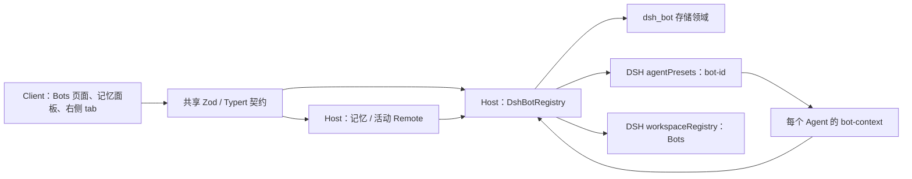
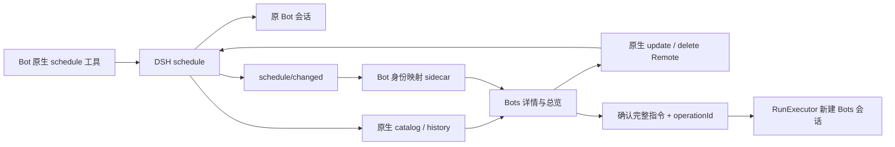

# DSH-Bot 架构（R02 原生定时聚合）

本页描述当前正式包的实现。DSH 参考源码锁定 `dsh-v0.2.1-rc.2`（`687f282e8625c6b8d11ff58211a90524be2e4317`），只使用已发布包的公开入口、service、Remote 和 slot。具体 API 出处见 [DSH API 核实记录](dsh-api-notes.md)，P1 操作清单见 [P1 验收清单](acceptance/P1.md)，P2 运行证据与验收边界见 [P2 报告](acceptance/P2.md)；架构说明本身不代表运行验收通过。

## Host、Client 与共享契约

单个 `dsh-bot` bundle 由 `cordis.patch.yml` 插入 Host 行，manifest 的 `dsh.client` 加载浏览器 Client。Host 入口是 `lib/index.js`，Client 是 `lib/client.js`；`/bot-context` 提供 preset 内的插件。Host 与 Client 不共享内存，以认证的 DSH Remote 通信。

| 层 | 实现入口 | 责任 |
| --- | --- | --- |
| Host | [`src/host/index.ts`](../packages/dsh-bot/src/host/index.ts)、[`registry.ts`](../packages/dsh-bot/src/host/registry.ts) | 打开存储、维护动态 preset、处理 Bot CRUD、受管目录与工作区、发布变更 |
| Agent | [`bot-context.ts`](../packages/dsh-bot/src/host/bot-context.ts) | 绑定 Bot 身份，安装工具与权限限制、可选模型路由、home 和记忆提示、活动观察 |
| Client | [`src/client/index.tsx`](../packages/dsh-bot/src/client/index.tsx) | 挂载 Remote、locale 和公开 slot，维护页面状态、调用原生工作区/会话导航 |
| Shared | [`shared/schema.ts`](../packages/dsh-bot/src/shared/schema.ts)、[`shared/remote-contract.ts`](../packages/dsh-bot/src/shared/remote-contract.ts) | 持久记录与输入 schema、错误码、Host/Client 方法类型和 wire descriptor |

Client 使用宿主平台模块表中的 React、Zod 和公开 UI 包，不内联另一套 React，也不导入 DSH 内部组件。主题样式使用 `--dsw-alias-*`；中英文词典具有相同键集。导航、默认头像及会话行角标共用 `WhaleGlyph`，采用 `currentColor`。

公开 slot 包括 `sidebar.panellist`、`main`、会话头部、空白会话 Hero、会话行 leading/hover，以及原生右侧 pane tab。右侧 Bots tab 由 `sidebarRightTabs.register` 注册，缺少右侧服务的精简 Client 仍可使用其他 Bots 页面。它复用原生会话导航与 tab 状态，不替换 DSH 会话树。

## Bot preset 与代际

[`composer.ts`](../packages/dsh-bot/src/host/composer.ts) 经 `agentPresets.readDocument()` 读取当前 `standard` 或 `minimal` 的公开文档，以公开 entry-list schema 解析，保留模板表达式，替换 persona 行、配置 Bot 技能目录并追加 `dsh-bot/bot-context`。

默认 preset ID 为 **`bot-<id>`**，前缀由 Host `presetIdPrefix` 配置。Client 使用 Host `status()` 返回的 `presetId`，避免自行猜测配置。注册调用等待 `agentPresets.register()` 返回异步 disposer，并检查结果是否 missing/broken。示例 Bot 仅按持久种子标记初始化；用户删空后不会在每次重启时重新生成。

修改 Bot 时先准备候选定义，再注销旧注册、注册新代际并持久化；失败尝试恢复旧定义。DSH 同 ID 注册替换存在短暂空窗，没有跨 preset 注册与存储的原子事务。恢复失败报告 `bot/rollback-failed`，后续写操作先尝试协调状态。

活跃 Agent 保留已捕获的人设、工具、模型和记忆配置；新建与冷恢复会话使用同一稳定 ID 下的最新定义。删除 Bot 保留会话日志，但缺少 preset 的历史会话不能冷恢复。复制只复制配置，不复制记忆、会话或文件。

`bot-context` 在所属 Agent effect 内注册资源。工具 deny 对继承工具调用公开 `tools.restrict`，对本地记忆工具和 `bot_manage` 直接不注册被禁止的定义。可选 Bot 模型只为尚无历史请求且没有用户待应用选择的会话提供初始路由，后续会话选择和历史继续由 DSH 管理。

## 存储和文件

[`store.ts`](../packages/dsh-bot/src/host/store.ts) 定义 **`dsh_bot`、version 1** 领域，四张表共用一次打开的 Domain：

| 表 | 保存内容 |
| --- | --- |
| `bots` | Bot 配置、身份、时间戳与 schemaVersion |
| `memories` | 按 botId 归属的内容、类型、标签、置顶、来源及时间戳 |
| `registry_state` | `examples` 种子进度、独立 `bots-workspace` 行的工作区 ID |
| `activities` | 会话归属、完成消息摘要、持久标题/首条用户摘要、读状态与事件去重信息 |

默认 JSON 后端文件为 `$DSH_HOME/storages/dsh_bot.json`；具体路径服从宿主存储后端配置，**不由 Host 的 `dataDir` 决定**。写入前由 Store 校验，同一 Domain 句柄的写队列保护检查与更新；读取返回副本。队列不协调多个 Host 进程，也不提供跨表事务。Bot 删除中的记忆/活动清理若中途失败可能已完成部分写入，不能宣称全量回滚。

活动表是有界投影，默认每 Bot 保留 50 个会话、总计 1000 个；原生会话日志才是完整历史。观察器只处理新追加的完整 human/assistant 消息，不写流式片段、工具输出或重放。Bot 创建时间和 preset 作用域防止旧 Agent 被误归属到同 ID 重建的 Bot。

文件目录分别承担以下职责：

| 默认路径 | 用途与清理规则 |
| --- | --- |
| `$DSH_HOME/dsh-bot/bots` | 共享 Bots 工作区根；Bot 删除不移除此根或其工作区登记 |
| `$DSH_HOME/dsh-bot/bots/<id>/home` | Bot 文件整理目录；默认保留，只在明确 `deleteHome=true` 且归属验证成功时清理 |
| `$DSH_HOME/dsh-bot/bots/<id>/.home-owner.json` | home 的归属/文件身份标记，不是访问控制规则 |
| `<dataDir>/bots/<id>/skills` | Bot 技能目录；dataDir 默认 `$DSH_HOME/dsh-bot`，删除 Bot 仍保留技能 |

home 固定从公开 `resolveDshHome()` 推导，不跟随自定义技能 `dataDir`。受管目录拒绝 symlink、验证 realpath 和归属标记，POSIX home 权限设为 0700；这些措施用于避免误接管/误删，不构成 Bot 间或同一 OS 用户之间的安全隔离。用户 `defaultCwd` 必须是已有绝对目录，插件不创建、不 chmod、不删除它。

卸载插件仅释放运行资源和关闭存储，不删除领域记录或上述用户文件。升级保持原 `DSH_HOME`、profile、存储后端及 `dataDir`；安装步骤见 [README](../README.md)。

## 共享 Bots 工作区（T08i）

DSH 对工作区成员有硬约束：**会话的 canonical cwd 必须精确等于 `workspace.path`**。把 Bot 的 home 作为 cwd、再把会话归到父目录 Bots 工作区不满足该约束。当前默认流程为：

1. Client 在点击时重新读取 Bot 与 preset status，确认 preset 可用。
2. `ensureHome(botId)` 准备该 Bot 的 home；`ensureBotsWorkspace()` 准备共享根，并通过公开 `workspaceRegistry.resolveByPath()` / `create(path, 'Bots')` 复用或创建原生工作区。
3. Client 调用 `sessions.create({ workspaceId, agentPreset })`，不同时传 cwd。DSH 令真实 cwd 等于 Bots 根，并登记会话归属。
4. 创建成功且导航未取消后，调用 `uiWorkspace.openSession()`。右侧 tab 的继续打开请求也受此次导航生命周期约束。

`registry_state` 保存工作区 ID 以记录身份，每次仍按真实路径查询，不信任过期 ID。已有工作区的用户自定义标题保留。用户删除工作区后，下次启动或开始聊天可重建登记；旧日志、归档状态和删除后留下的未分组会话保持原状，不自动重新附加历史。工作区存储与 Bot 领域没有跨资源事务，写 ID 失败时下一次按路径复用后补写。

若 Bot 配置 `defaultCwd`，Client 经公开 `workspaces.create({path})` 创建或复用该目录工作区，再以 workspaceId 创建会话。“在工作区中聊天”沿用用户选定的原生工作区。这两条路径的 cwd 同样由工作区决定。

Agent 提示提供 home、实际 cwd 与共享根，并说明 Bots 互不隔离。原生文件读取不按 home 隔离，写入及越界提权沿用用户 DSH 权限/审批设置，插件不放宽或覆盖它们。`persona.complete=true` 仍遵循 DSH 完整人设语义，会抑制包括 home、memory 在内的其他 prompt sections。

## Remote 契约

共享 Zod spec 同时派生 Host 方法签名、Client 调用类型及 Typert metadata。Host 通过 `ctx.typert.register(TYPERT)` 注册，Client 等待 `ctx.remote.$mount(TYPERT_REMOTE)`。当前显式贡献契约，不依赖 rc.2 外部包 generator 的自动识别。

| namespace | 方法 |
| --- | --- |
| `dshBot` | `list`、`get`、`catalogInfo`、`status`、`create`、`update`、`duplicate`、`delete`、`ensureHome`、`ensureBotsWorkspace`、`watch` |
| `dshBot.memory` | `list`、`search`、`save`、`update`、`delete`、`count` |
| `dshBot.activity` | `list`、`markRead` |

wire 使用 `delete` 避开 Client namespace 的保留方法名 `remove`；Host 实现仍可叫 `remove`。rc.2 检查精确参数数量，使用默认删除选项时 Client 也要显式传第二参数 `undefined`。输入使用 strict schema，Store/服务继续做业务校验；需要结果校验的活动、home、工作区和 watch codec 提供显式 encode/decode。raw stream 不自动执行结果 decode，Client 对每帧再 parse。

`bot/invalid`、`bot/conflict`、`bot/not-found`、`memory/not-found` 与 `store/unavailable` 等错误区分输入、身份、并发和服务故障。`bot/home-cleanup-failed` 表示 Bot 删除已提交、home 清理未完成，Client 先读回真实 Bot/活动列表再提示失败，不把它显示为删除回滚成功。

## 刷新、活动与标题（T08g）

同一 Client Context 的 Bot catalog、活动 catalog 和已打开的记忆 catalog 共用一个调度器、timer 及浏览器监听：

- 有主动订阅、页面 visible 且 focused 才持续轮询和开流；默认 5 秒，无变化逐次增加 5 秒，最大默认 30 秒。可配置区间为 1–60 秒，实际最大间隔不低于基础间隔。
- `dshBot/watch` 通过公开 Remote stream 发送进程内 revision 失效通知；首次开流立即通知以消除订阅读取空窗。通知不携带内容，Client 总是重新读取权威 catalog。
- Bot CRUD、活动完成/markRead 会使 stream 失效。记忆写入当前不单独发 watch 通知：本 Client 成功写后立即读回，其他 Client 或模型工具的修改由记忆 catalog 轮询取得。
- focus/visibility 恢复和连接 reset 立即读取；用户 pointer/keyboard 交互重置基础间隔。流失败保留已有数据，轮询继续且在轮询边界尝试重开。
- 相同结构复用快照引用，不重复发布；后台刷新不重置 loading；epoch 拒绝迟到响应覆盖新结果。显式修改后的读回可在失焦后完成。

Host 内部 `dsh-bot/changed` 不假定能通过宿主事件白名单转发；跨 Client 更新依赖上述 stream。revision 不持久化，不是事件回放日志。

Bot 历史列表以公开 session catalog 的 preset 投影确定归属，过滤 blank、subagent 和归档会话，活动只补充摘要与未读。标题优先级是 **Client live `title` → Host activity title → firstUserPreview → 本地化“新会话”**；不使用含 cwd basename 回退的 `displayTitle`。所有标题候选经过相同摘要和凭据筛查。当前 Bot 选择在初次成功选定后保持稳定，活动排序刷新不会自行切换选择。

## 记忆与管理工具

每个 Bot 的 `BotMemoryService` 封装固定 botId，模型工具参数不接受 botId 或来源身份。`memory_save/search/list/forget` 只作用于当前 Bot；Host 写入模型来源及 sessionId，Client 手工记忆由 Remote 标记 user 来源。

记忆内容 trim 后须非空且最多 **2048 UTF-8 字节**。保存按规范化内容去重；查询使用关键词匹配（含中文二元组），按置顶、更新时间和 ID 排序，游标分页不承诺跨页快照一致。模型和 UI 写入均筛查常见凭据模式，但启发式筛查不保证识别所有秘密，也没有加密存储或向量检索。

Agent 创建时在一个队列槽内取全部置顶候选及最近 `injectLimit` 条非置顶记忆（Bot 默认 20），生成最多 `maxInjectChars`（默认 4000）的摘要。记忆以 JSON 引号呈现并明确是参考数据，默认 order 100，位于 persona 之后和工具策略之前。候选超过预算会省略或按规则截断，置顶不保证全部进入 prompt。该文本仅计算一次；会话中新增记忆经工具查询，新 Agent 才生成新摘要。关闭 memory 后不注册记忆工具或 section，home 提示仍独立工作。

`bot_manage` 调用同一 registry。读取不写库，创建、更新、删除需公开 DSH 审批；拒绝不落库。默认只在 Bot preset 中提供，Host `enableBotManageInStandard=true` 才为 standard 加入该工具。

## 生命周期与交付边界

Host 合约、preset disposer、领域句柄、stream 订阅、Agent 事件/工具/prompt、Client locale/slots/Remote/timer 均由所属 Context effect 管理。卸载先拒绝新操作并排空已接受的队列，再注销 preset、关闭 Domain；Agent 资源也在 Agent 或所属 preset 卸载时释放。最后订阅离开时停止定时器/浏览器监听/stream，插件卸载取消迟到导航。

Host 配置集中在导出的 Schemastery `Config`；Client 刷新、分页及侧栏条数使用独立 Client `Config`，rc.2 不自动透传 Host 行的配置。记忆条数、工具 deny、人设、默认目录等属于 Bot 记录。

当前 R02 源码在 P1 Bot、记忆、活动和原生 UI 扩展上提供原生定时聚合、显式立即运行与既有委派回报。MCP 绑定、外部通知和通用 Bot 消息仍未交付。Host 的存活、构建成功或 dump-config 无错误都不能证明真实模型、桌面导航、亮暗视觉和端到端流程通过；对应证据按 [P1 验收清单](acceptance/P1.md) 分项记录。

## R02：原生定时与 Bots 聚合

依据 [P2 复用提案 §10](P2-reuse-proposal.md#10-用户批准的决策2026-10-20) 的方案 A，定时任务完全由 DSH `schedule` 管理。宿主禁用 schedule 时 Bot/记忆仍正常启动，聚合显示服务不可用和可读的旧版停用任务，不强制启用宿主服务。Bot 只暴露原生 `schedule_*` 工具；到期投递到创建时的原会话。本包不再计算时间、运行到期 timer、补跑、维护每日额度、并发池或单 Host 锁。原生任务是否继续投递取决于宿主原生服务与会话状态。

### 归属与刷新

独立 `dsh_bot_native_schedule` v1 的 `bindings` 只保存 `{botId, botCreatedAt, sessionId, nativeScheduleId}`。不镜像 prompt、规则或投递状态。启动、`schedule/changed` 及聚合读取会对账；原生成功而映射写入失败时，下次对账可按可靠会话证据找回。没有可靠证据的任务仍由原生页管理，不按标题、名字或 preset 前缀猜测。

优先使用当前 Agent 的本包绑定；没有 live Agent 时，使用公开 `sessionController.inspect().meta` 的准确 agentPreset，与注册表的实际 presetId 匹配，并要求会话创建时间不早于 Bot 创建时间且不是子会话/fork。活跃 Agent 没有绑定时不回退旧 header；活跃绑定同样检查会话创建时间。对切换 preset 或来源不可证明的旧会话宁可不归属。已持久绑定的 Bot 被删除/同 ID 重建后不重绑；保留旧 sidecar 防串归属。原生删除后按 catalog 权威隐藏，绝不重建任务。

Client 读取原生 catalog，以 Host sidecar 过滤；编辑/删除/历史直接走原生 `schedule.update/delete/history`。update 只传原生 ScheduleRecord 作为完整 `expected`，排除 catalog 和 sidecar 附加字段，保留原生冲突检查。未修改规则时不传 change，不改变 every 相位。原生不支持暂停，因此没有旧暂停/恢复或本包新建表单。新建请在 Bot 会话中使用原生工具。

复用原生公开 `/remote` 的 codec：已挂载 `remote.schedule` 时直接复用；精简 Client 缺失时才挂载并纳入 effect。`schedule/changed` 和 `connection/reset` 触发重读；共享轮询仍作断连/前台恢复兜底。结构相等时不发布新快照，保留旧数据且不闪烁。历史明确标注“投递记录”，展示投递/计划时间、当时 prompt 及裁剪提示，分页使用原生 message cursor，单页 1–100。它不证明模型处理或任务成功。

### 立即运行与委派的过渡边界

“立即运行”展示完整标题、prompt，用户确认后发送 `approved=true`、已观察的 Bot 创建时间和内容、UUID operationId。Host 重查映射和当前内容，不一致拒绝；同 nativeScheduleId + operationId 只持久受理一次。直接 UI Remote 调用的显式确认是此入口的审批，不是一个供模型免审批调用的工具；后续执行中的 DSH 工具审批仍由宿主管理。

保留现有 RunExecutor 的创建→核实 Bots 工作区→prompt→完成屏障→flush；每次在 Bots 工作区新开普通会话，不改变原生任务的规则或到期时间。受理回执不等于执行成功。新的 `dsh_bot_executions` v1 仅保存 explicit manual/delegate 的身份、幂等记录、执行状态和回报；没有额度/control 表、到期游标或后台排队驱动。`slotHeld` 仅表示执行链尚未确认停止，不再作为并发配额。重启时 queued 取消，未确认的进行中执行标记 recovery_needed，均不自动重放。

决策：R02 保留既有 bot_delegate 与持久 reporter，改为直接显式提交到执行器。理由：原生子代理替换在后续委派任务；本轮删除 Dispatcher 不能顺带破坏已批准的委派审批/回报契约。此保留不意味着批准两套定时调度。删除 Bot 身份检查、后台/回报来源门禁及回报防重发仍保留。

Config 只剩 runTimeoutMs=900000、executorPollMs=250、stopGraceMs=5000、delegateReportMaxChars=4000。旧 Host 行里的额度/并发/补跑配置只忽略，不执行。P1 19 个 Remote 保留；本包新 contribution 提供 nativeSchedule aggregate/deleteLegacy/runNow、run list/get 和 automation status，共 6 个。旧 `dshBot.routine/*` 全部移除。

### 0.2.0 数据处理

决策：不自动迁移，不提供单条自动转换按钮；提供“旧版定时任务（已停用）”列表与逐条确认删除。理由：原生每次投回固定会话，旧任务没有可靠的目标会话，必须新建；every 会重锚，旧 skip/补跑、启停语义也不能等价映射。低成本转换会隐含语义变更，用户应在 Bot 对话中明确重新创建。

启动以宽松 unknown 行 schema 打开旧 `dsh_bot_automation` v1，只读加载 routines/runs/control；逐条校验 Routine，坏行或 key 不一致跳过，整文件损坏/版本不符则报告不可读并继续启动。不会恢复旧 Run、修改游标、扣额度、自动回报或自动创建原生任务。显式删除只删除选中 routine 行，其他原始行、未知 runs/control、坏行仍保留。总览仍显示有效的孤立旧任务供删除；Bot 详情仅显示匹配 botId + createdAt 的旧任务，避免同 ID 重建混入。删除后的旧历史仅保留在文件中，没有本轮 UI。P1 Bot/记忆领域不改版本。

没有应用层多 Host 锁；与宿主原生 schedule/storage 一样，以一个活动 Host 使用同一后端为支持范围。停止旧版本 Host 后升级；切回 0.2.0 可能重新启用保留的旧定时任务，不能把保留文件误称为跨版本永久停用。

构建前清理生成的 lib，防止 tsc 留下已删 Dispatcher/锁的旧 JS 并混入包。版本仍为 0.2.0，R02 未进行发布升级或提交。截图命令 `DSH_HOME="$PWD/.dsh-dev" node scripts/screenshot.mjs --v021` 使用真实原生工具、every60 投递和一次手动 mock 执行，目标 `.codex/screens/v021-light.png` / `v021-dark.png`；非视觉验证 `--v021-host-only` 不输出 PNG，不能替代亮暗浏览器验收。实际结果见 [R02 验收](acceptance/P2-R02.md)。
