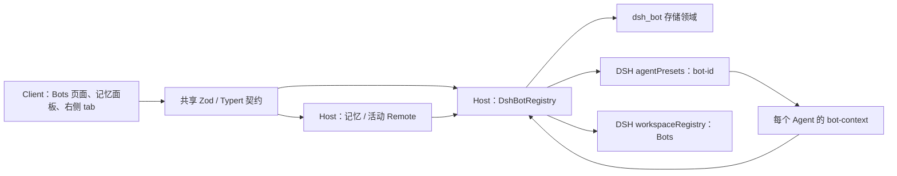
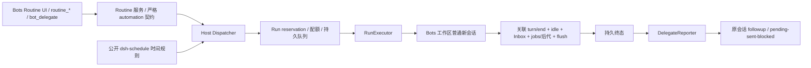

# DSH-Bot 架构（0.2.0）

本页描述当前正式包的实现。DSH 参考源码锁定 `dsh-v0.2.1-rc.2`（`687f282e8625c6b8d11ff58211a90524be2e4317`），只使用已发布包的公开入口、service、Remote 和 slot。具体 API 出处见 [DSH API 核实记录](dsh-api-notes.md)，P1 操作清单见 [P1 验收清单](acceptance/P1.md)，P2 运行证据与验收边界见 [P2 报告](acceptance/P2.md)；架构说明本身不代表运行验收通过。

## Host、Client 与共享契约

单个 `dsh-bot` bundle 由 `cordis.patch.yml` 插入 Host 行，manifest 的 `dsh.client` 加载浏览器 Client。Host 入口是 `lib/index.js`，Client 是 `lib/client.js`；`/bot-context` 提供 preset 内的插件。Host 与 Client 不共享内存，以认证的 DSH Remote 通信。

| 层 | 实现入口 | 责任 |
| --- | --- | --- |
| Host | [`src/host/index.ts`](../packages/dsh-bot/src/host/index.ts)、[`registry.ts`](../packages/dsh-bot/src/host/registry.ts) | 打开存储、维护动态 preset、处理 Bot CRUD、受管目录与工作区、发布变更 |
| Agent | [`bot-context.ts`](../packages/dsh-bot/src/host/bot-context.ts) | 绑定 Bot 身份，安装工具与权限限制、可选模型路由、home 和记忆提示、活动观察 |
| Client | [`src/client/index.tsx`](../packages/dsh-bot/src/client/index.tsx) | 挂载 Remote、locale 和公开 slot，维护页面状态、调用原生工作区/会话导航 |
| Shared | [`shared/schema.ts`](../packages/dsh-bot/src/shared/schema.ts)、[`shared/remote-contract.ts`](../packages/dsh-bot/src/shared/remote-contract.ts) | 持久记录与输入 schema、错误码、Host/Client 方法类型和 wire descriptor |

Client 使用宿主平台模块表中的 React、Zod 和公开 UI 包，不内联另一套 React，也不导入 DSH 内部组件。主题样式使用 `--dsw-alias-*`；中英文词典具有相同键集。导航、默认头像及会话行角标共用 `WhaleGlyph`，采用 `currentColor`。

公开 slot 包括 `sidebar.panellist`、`main`、会话头部、空白会话 Hero、会话行 leading/hover，以及原生右侧 pane tab。右侧 Bots tab 由 `sidebarRightTabs.register` 注册，缺少右侧服务的精简 Client 仍可使用其他 Bots 页面。它复用原生会话导航与 tab 状态，不替换 DSH 会话树。

## Bot preset 与代际

[`composer.ts`](../packages/dsh-bot/src/host/composer.ts) 经 `agentPresets.readDocument()` 读取当前 `standard` 或 `minimal` 的公开文档，以公开 entry-list schema 解析，保留模板表达式，替换 persona 行、配置 Bot 技能目录并追加 `dsh-bot/bot-context`。

默认 preset ID 为 **`bot-<id>`**，前缀由 Host `presetIdPrefix` 配置。Client 使用 Host `status()` 返回的 `presetId`，避免自行猜测配置。注册调用等待 `agentPresets.register()` 返回异步 disposer，并检查结果是否 missing/broken。示例 Bot 仅按持久种子标记初始化；用户删空后不会在每次重启时重新生成。

修改 Bot 时先准备候选定义，再注销旧注册、注册新代际并持久化；失败尝试恢复旧定义。DSH 同 ID 注册替换存在短暂空窗，没有跨 preset 注册与存储的原子事务。恢复失败报告 `bot/rollback-failed`，后续写操作先尝试协调状态。

活跃 Agent 保留已捕获的人设、工具、模型和记忆配置；新建与冷恢复会话使用同一稳定 ID 下的最新定义。删除 Bot 保留会话日志，但缺少 preset 的历史会话不能冷恢复。复制只复制配置，不复制记忆、会话或文件。

`bot-context` 在所属 Agent effect 内注册资源。工具 deny 对继承工具调用公开 `tools.restrict`，对本地记忆工具和 `bot_manage` 直接不注册被禁止的定义。可选 Bot 模型只为尚无历史请求且没有用户待应用选择的会话提供初始路由，后续会话选择和历史继续由 DSH 管理。

## 存储和文件

[`store.ts`](../packages/dsh-bot/src/host/store.ts) 定义 **`dsh_bot`、version 1** 领域，四张表共用一次打开的 Domain：

| 表 | 保存内容 |
| --- | --- |
| `bots` | Bot 配置、身份、时间戳与 schemaVersion |
| `memories` | 按 botId 归属的内容、类型、标签、置顶、来源及时间戳 |
| `registry_state` | `examples` 种子进度、独立 `bots-workspace` 行的工作区 ID |
| `activities` | 会话归属、完成消息摘要、持久标题/首条用户摘要、读状态与事件去重信息 |

默认 JSON 后端文件为 `$DSH_HOME/storages/dsh_bot.json`；具体路径服从宿主存储后端配置，**不由 Host 的 `dataDir` 决定**。写入前由 Store 校验，同一 Domain 句柄的写队列保护检查与更新；读取返回副本。队列不协调多个 Host 进程，也不提供跨表事务。Bot 删除中的记忆/活动清理若中途失败可能已完成部分写入，不能宣称全量回滚。

活动表是有界投影，默认每 Bot 保留 50 个会话、总计 1000 个；原生会话日志才是完整历史。观察器只处理新追加的完整 human/assistant 消息，不写流式片段、工具输出或重放。Bot 创建时间和 preset 作用域防止旧 Agent 被误归属到同 ID 重建的 Bot。

文件目录分别承担以下职责：

| 默认路径 | 用途与清理规则 |
| --- | --- |
| `$DSH_HOME/dsh-bot/bots` | 共享 Bots 工作区根；Bot 删除不移除此根或其工作区登记 |
| `$DSH_HOME/dsh-bot/bots/<id>/home` | Bot 文件整理目录；默认保留，只在明确 `deleteHome=true` 且归属验证成功时清理 |
| `$DSH_HOME/dsh-bot/bots/<id>/.home-owner.json` | home 的归属/文件身份标记，不是访问控制规则 |
| `<dataDir>/bots/<id>/skills` | Bot 技能目录；dataDir 默认 `$DSH_HOME/dsh-bot`，删除 Bot 仍保留技能 |

home 固定从公开 `resolveDshHome()` 推导，不跟随自定义技能 `dataDir`。受管目录拒绝 symlink、验证 realpath 和归属标记，POSIX home 权限设为 0700；这些措施用于避免误接管/误删，不构成 Bot 间或同一 OS 用户之间的安全隔离。用户 `defaultCwd` 必须是已有绝对目录，插件不创建、不 chmod、不删除它。

卸载插件仅释放运行资源和关闭存储，不删除领域记录或上述用户文件。升级保持原 `DSH_HOME`、profile、存储后端及 `dataDir`；安装步骤见 [README](../README.md)。

## 共享 Bots 工作区（T08i）

DSH 对工作区成员有硬约束：**会话的 canonical cwd 必须精确等于 `workspace.path`**。把 Bot 的 home 作为 cwd、再把会话归到父目录 Bots 工作区不满足该约束。当前默认流程为：

1. Client 在点击时重新读取 Bot 与 preset status，确认 preset 可用。
2. `ensureHome(botId)` 准备该 Bot 的 home；`ensureBotsWorkspace()` 准备共享根，并通过公开 `workspaceRegistry.resolveByPath()` / `create(path, 'Bots')` 复用或创建原生工作区。
3. Client 调用 `sessions.create({ workspaceId, agentPreset })`，不同时传 cwd。DSH 令真实 cwd 等于 Bots 根，并登记会话归属。
4. 创建成功且导航未取消后，调用 `uiWorkspace.openSession()`。右侧 tab 的继续打开请求也受此次导航生命周期约束。

`registry_state` 保存工作区 ID 以记录身份，每次仍按真实路径查询，不信任过期 ID。已有工作区的用户自定义标题保留。用户删除工作区后，下次启动或开始聊天可重建登记；旧日志、归档状态和删除后留下的未分组会话保持原状，不自动重新附加历史。工作区存储与 Bot 领域没有跨资源事务，写 ID 失败时下一次按路径复用后补写。

若 Bot 配置 `defaultCwd`，Client 经公开 `workspaces.create({path})` 创建或复用该目录工作区，再以 workspaceId 创建会话。“在工作区中聊天”沿用用户选定的原生工作区。这两条路径的 cwd 同样由工作区决定。

Agent 提示提供 home、实际 cwd 与共享根，并说明 Bots 互不隔离。原生文件读取不按 home 隔离，写入及越界提权沿用用户 DSH 权限/审批设置，插件不放宽或覆盖它们。`persona.complete=true` 仍遵循 DSH 完整人设语义，会抑制包括 home、memory 在内的其他 prompt sections。

## Remote 契约

共享 Zod spec 同时派生 Host 方法签名、Client 调用类型及 Typert metadata。Host 通过 `ctx.typert.register(TYPERT)` 注册，Client 等待 `ctx.remote.$mount(TYPERT_REMOTE)`。当前显式贡献契约，不依赖 rc.2 外部包 generator 的自动识别。

| namespace | 方法 |
| --- | --- |
| `dshBot` | `list`、`get`、`catalogInfo`、`status`、`create`、`update`、`duplicate`、`delete`、`ensureHome`、`ensureBotsWorkspace`、`watch` |
| `dshBot.memory` | `list`、`search`、`save`、`update`、`delete`、`count` |
| `dshBot.activity` | `list`、`markRead` |

wire 使用 `delete` 避开 Client namespace 的保留方法名 `remove`；Host 实现仍可叫 `remove`。rc.2 检查精确参数数量，使用默认删除选项时 Client 也要显式传第二参数 `undefined`。输入使用 strict schema，Store/服务继续做业务校验；需要结果校验的活动、home、工作区和 watch codec 提供显式 encode/decode。raw stream 不自动执行结果 decode，Client 对每帧再 parse。

`bot/invalid`、`bot/conflict`、`bot/not-found`、`memory/not-found` 与 `store/unavailable` 等错误区分输入、身份、并发和服务故障。`bot/home-cleanup-failed` 表示 Bot 删除已提交、home 清理未完成，Client 先读回真实 Bot/活动列表再提示失败，不把它显示为删除回滚成功。

## 刷新、活动与标题（T08g）

同一 Client Context 的 Bot catalog、活动 catalog 和已打开的记忆 catalog 共用一个调度器、timer 及浏览器监听：

- 有主动订阅、页面 visible 且 focused 才持续轮询和开流；默认 5 秒，无变化逐次增加 5 秒，最大默认 30 秒。可配置区间为 1–60 秒，实际最大间隔不低于基础间隔。
- `dshBot/watch` 通过公开 Remote stream 发送进程内 revision 失效通知；首次开流立即通知以消除订阅读取空窗。通知不携带内容，Client 总是重新读取权威 catalog。
- Bot CRUD、活动完成/markRead 会使 stream 失效。记忆写入当前不单独发 watch 通知：本 Client 成功写后立即读回，其他 Client 或模型工具的修改由记忆 catalog 轮询取得。
- focus/visibility 恢复和连接 reset 立即读取；用户 pointer/keyboard 交互重置基础间隔。流失败保留已有数据，轮询继续且在轮询边界尝试重开。
- 相同结构复用快照引用，不重复发布；后台刷新不重置 loading；epoch 拒绝迟到响应覆盖新结果。显式修改后的读回可在失焦后完成。

Host 内部 `dsh-bot/changed` 不假定能通过宿主事件白名单转发；跨 Client 更新依赖上述 stream。revision 不持久化，不是事件回放日志。

Bot 历史列表以公开 session catalog 的 preset 投影确定归属，过滤 blank、subagent 和归档会话，活动只补充摘要与未读。标题优先级是 **Client live `title` → Host activity title → firstUserPreview → 本地化“新会话”**；不使用含 cwd basename 回退的 `displayTitle`。所有标题候选经过相同摘要和凭据筛查。当前 Bot 选择在初次成功选定后保持稳定，活动排序刷新不会自行切换选择。

## 记忆与管理工具

每个 Bot 的 `BotMemoryService` 封装固定 botId，模型工具参数不接受 botId 或来源身份。`memory_save/search/list/forget` 只作用于当前 Bot；Host 写入模型来源及 sessionId，Client 手工记忆由 Remote 标记 user 来源。

记忆内容 trim 后须非空且最多 **2048 UTF-8 字节**。保存按规范化内容去重；查询使用关键词匹配（含中文二元组），按置顶、更新时间和 ID 排序，游标分页不承诺跨页快照一致。模型和 UI 写入均筛查常见凭据模式，但启发式筛查不保证识别所有秘密，也没有加密存储或向量检索。

Agent 创建时在一个队列槽内取全部置顶候选及最近 `injectLimit` 条非置顶记忆（Bot 默认 20），生成最多 `maxInjectChars`（默认 4000）的摘要。记忆以 JSON 引号呈现并明确是参考数据，默认 order 100，位于 persona 之后和工具策略之前。候选超过预算会省略或按规则截断，置顶不保证全部进入 prompt。该文本仅计算一次；会话中新增记忆经工具查询，新 Agent 才生成新摘要。关闭 memory 后不注册记忆工具或 section，home 提示仍独立工作。

`bot_manage` 调用同一 registry。读取不写库，创建、更新、删除需公开 DSH 审批；拒绝不落库。默认只在 Bot preset 中提供，Host `enableBotManageInStandard=true` 才为 standard 加入该工具。

## 生命周期与交付边界

Host 合约、preset disposer、领域句柄、stream 订阅、Agent 事件/工具/prompt、Client locale/slots/Remote/timer 均由所属 Context effect 管理。卸载先拒绝新操作并排空已接受的队列，再注销 preset、关闭 Domain；Agent 资源也在 Agent 或所属 preset 卸载时释放。最后订阅离开时停止定时器/浏览器监听/stream，插件卸载取消迟到导航。

Host 配置集中在导出的 Schemastery `Config`；Client 刷新、分页及侧栏条数使用独立 Client `Config`，rc.2 不自动透传 Host 行的配置。记忆条数、工具 deny、人设、默认目录等属于 Bot 记录。

0.2.0 在 P1 Bot、记忆、活动和原生 UI 扩展上加入 Routine 与一次委派回报。MCP 绑定、外部通知和通用 Bot 消息仍未交付。Host 的存活、构建成功或 dump-config 无错误都不能证明真实模型、桌面导航、亮暗视觉和端到端流程通过；对应证据按 [P1 验收清单](acceptance/P1.md) 分项记录。

## P2 Automation：Host 调度、执行与回报

`src/host/automation/coordinator.ts` 先取得 `$DSH_HOME/dsh-bot/automation/lock` 的单 Host 所有权，再打开服务。锁记录 hostname、PID、启动时间和 token；同机可证实进程已死或启动时间不符才接管，使用唯一后继文件避免 stale unlink 竞态。第二 Host 仅提供所有权诊断，不打开可写业务域，也不提供 P1 的实时只读镜像。

新增独立 **`dsh_bot_automation` v1**，含 `routines/runs/control`；P1 `dsh_bot` v1 不改版本。Routine 保存规则、时区、启停、revision/ruleRevision、锚点与游标。Run 保存 snapshot、来源 Bot 创建时间、会话/request 身份、quota receipt、slotHeld、内部 step、终态和 report。Run 是去重/扣额权威，control 和 Routine 游标可从 Run 修复；没有跨表事务。已经收费的非终态重启后保留 `recovery_needed` 和槽位，不重新 create/prompt。

Dispatcher 只在 Host 内运行最早到期 timer 与默认 60 秒兜底扫描，复用 `@deepseek-ai/dsh-schedule` 根入口的五类规则工厂及 recurring resolver。每 Routine 只补最近一次，默认追溯 24 小时（含边界）；暂停恢复重建未来游标，过期 at 不平移；run_now 不改锚点。同 Routine 不重叠，满全局并发进入持久有界队列；积压 scheduled 只保留同 Routine 最新一次，其余标为 superseded。满队列 scheduled 记 queue_full，manual/delegate 报 busy；额度耗尽记 skipped/quota。

默认 `automation` Config：并发 2、每 Bot 每日 20、队列 64、超时 900000ms、补跑上限 86400000ms、sweep 60000ms、委派深度 1、摘要上限 4000。quotaTimeZone 首次取系统时区并持久固定，额度日期倒退拒绝，失败不退款。配额是执行次数，不是 token 或费用预算。

执行器先 reservation，再准备 Bots workspace、读取当前健康 preset、create/rename/prompt，保存真实 create 回执。`accepted` 只是入箱；成功必须关联 request 与已提交 user/message 的 turn，确认真实 step、completed、idle、无 pending Inbox、自有后台 jobs/后代已结束并 flush。取消/超时停止无法证实时保留 recovery_needed；不以取消请求代替停止证据。

Agent 的 `bot_delegate` 从绑定获取原 Bot 身份和会话，审批展示目标与完整 task；只传 task，不复制父历史。原会话忙时通过 followup 排下一轮。Reporter 保存固定 message 与 attempts 后才投递，确认新增 Inbox splice 并 flush 后记 sent；冷恢复已有尝试且证据不明时 blocked，不重发。摘要先筛查再限长，不含中间工具输出。后台会话、fork/子会话及回报轮次禁止继续委派或修改 Routine；下一普通用户输入可恢复交互权限。

automation Remote 单独注册和 mount，保留 P1 的 19 个端点：`dshBot.routine` 的 list/get/create/update/delete/runNow、`dshBot.run` 的 list/get、`dshBot.automation/status`，共 9 个。runNow 需 operationId UUID，返回持久受理记录。没有公开取消、Run 删除或回报重试端点。UI 位于 Bots 顶部总览和 Bot 详情，使用现有共享轮询，Client 不计时调度；历史最新状态按最新 Run 查询。

卸载按 Dispatcher → Reporter → Executor → stores/registry → lease 显式 join，停止新任务并等在途操作；所有注册、timer、监听、Remote 和 Agent 工具由所属 effect 管理。未知外部工作不释放可能仍被占用的 lease。降级 0.1.x 保留独立 automation 文件，旧版不会调度它；实际升级前停止旧 Host 并备份数据，不能并发让旧版绕开 P2 锁写同一后端。
