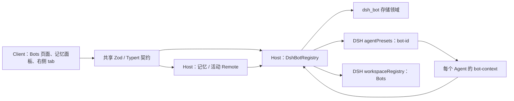
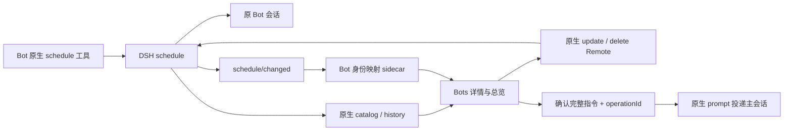

# DSH-Bot 架构（0.3.0）

本页描述当前正式包的实现。DSH 参考源码锁定 `dsh-v0.2.1-rc.2`（`687f282e8625c6b8d11ff58211a90524be2e4317`），只使用已发布包的公开入口、service、Remote 和 slot。具体 API 出处见 [DSH API 核实记录](dsh-api-notes.md)，P1 操作清单见 [P1 验收清单](acceptance/P1.md)，P2 运行证据与验收边界见 [P2 报告](acceptance/P2.md)；架构说明本身不代表运行验收通过。

## Host、Client 与共享契约

单个 `dsh-bot` bundle 由 `cordis.patch.yml` 插入 Host 行，manifest 的 `dsh.client` 加载浏览器 Client。Host 入口是 `lib/index.js`，Client 是 `lib/client.js`；`/bot-context` 提供 preset 内的插件。Host 与 Client 不共享内存，以认证的 DSH Remote 通信。

| 层 | 实现入口 | 责任 |
| --- | --- | --- |
| Host | [`src/host/index.ts`](../packages/dsh-bot/src/host/index.ts)、[`registry.ts`](../packages/dsh-bot/src/host/registry.ts) | 打开存储、维护动态 preset、处理 Bot CRUD、受管目录与工作区、发布变更 |
| Agent | [`bot-context.ts`](../packages/dsh-bot/src/host/bot-context.ts) | 绑定 Bot 身份，安装工具与权限限制、可选模型路由、home 和记忆提示、活动观察 |
| Client | [`src/client/index.tsx`](../packages/dsh-bot/src/client/index.tsx) | 挂载 Remote、locale 和公开 slot，维护页面状态、调用原生工作区/会话导航 |
| Shared | [`shared/schema.ts`](../packages/dsh-bot/src/shared/schema.ts)、[`shared/remote-contract.ts`](../packages/dsh-bot/src/shared/remote-contract.ts) | 持久记录与输入 schema、错误码、Host/Client 方法类型和 wire descriptor |

Client 使用宿主平台模块表中的 React、Zod 和公开 UI 包，不内联另一套 React，也不导入 DSH 内部组件。主题样式使用 `--dsw-alias-*`；中英文词典具有相同键集。导航、默认头像及会话行角标共用 `WhaleGlyph`，采用 `currentColor`。

公开 slot 包括 `sidebar.panellist`、`main`、会话头部、空白会话 Hero、会话行 leading/hover，以及原生右侧 pane tab。右侧 Bots tab 由 `sidebarRightTabs.register` 注册，缺少右侧服务的精简 Client 仍可使用其他 Bots 页面。它复用原生会话导航与 tab 状态，不替换 DSH 会话树。

## Bot preset 与代际

[`composer.ts`](../packages/dsh-bot/src/host/composer.ts) 经 `agentPresets.readDocument()` 读取当前 `standard` 或 `minimal` 的公开文档，以公开 entry-list schema 解析，保留模板表达式，替换 persona 行、配置 Bot 技能目录并追加 `dsh-bot/bot-context`。

默认 preset ID 为 **`bot-<id>`**，前缀由 Host `presetIdPrefix` 配置。Client 使用 Host `status()` 返回的 `presetId`，避免自行猜测配置。注册调用等待 `agentPresets.register()` 返回异步 disposer，并检查结果是否 missing/broken。示例 Bot 仅按持久种子标记初始化；用户删空后不会在每次重启时重新生成。

修改 Bot 时先准备候选定义，再注销旧注册、注册新代际并持久化；失败尝试恢复旧定义。DSH 同 ID 注册替换存在短暂空窗，没有跨 preset 注册与存储的原子事务。恢复失败报告 `bot/rollback-failed`，后续写操作先尝试协调状态。

活跃 Agent 保留已捕获的人设、工具、模型和记忆配置；新建与冷恢复会话使用同一稳定 ID 下的最新定义。删除 Bot 保留会话日志，但缺少 preset 的历史会话不能冷恢复。复制只复制配置，不复制记忆、会话或文件。

`bot-context` 在所属 Agent effect 内注册资源。工具 deny 对继承工具调用公开 `tools.restrict`，对本地记忆工具和 `bot_manage` 直接不注册被禁止的定义。可选 Bot 模型只为尚无历史请求且没有用户待应用选择的会话提供初始路由，后续会话选择和历史继续由 DSH 管理。

## 存储和文件

[`store.ts`](../packages/dsh-bot/src/host/store.ts) 定义 **`dsh_bot`、version 1** 领域，四张表共用一次打开的 Domain：

| 表 | 保存内容 |
| --- | --- |
| `bots` | Bot 配置、身份、时间戳与 schemaVersion |
| `memories` | 按 botId 归属的内容、类型、标签、置顶、来源及时间戳 |
| `registry_state` | `examples` 种子进度、独立 `bots-workspace` 行的工作区 ID |
| `activities` | 会话归属、完成消息摘要、持久标题/首条用户摘要、读状态与事件去重信息 |

默认 JSON 后端文件为 `$DSH_HOME/storages/dsh_bot.json`；具体路径服从宿主存储后端配置，**不由 Host 的 `dataDir` 决定**。写入前由 Store 校验，同一 Domain 句柄的写队列保护检查与更新；读取返回副本。队列不协调多个 Host 进程，也不提供跨表事务。Bot 删除中的记忆/活动清理若中途失败可能已完成部分写入，不能宣称全量回滚。

活动表是有界投影，默认每 Bot 保留 50 个会话、总计 1000 个；原生会话日志才是完整历史。观察器只处理新追加的完整 human/assistant 消息，不写流式片段、工具输出或重放。Bot 创建时间和 preset 作用域防止旧 Agent 被误归属到同 ID 重建的 Bot。

文件目录分别承担以下职责：

| 默认路径 | 用途与清理规则 |
| --- | --- |
| `$DSH_HOME/dsh-bot/bots` | 共享 Bots 工作区根；Bot 删除不移除此根或其工作区登记 |
| `$DSH_HOME/dsh-bot/bots/<id>/home` | Bot 文件整理目录；默认保留，只在明确 `deleteHome=true` 且归属验证成功时清理 |
| `$DSH_HOME/dsh-bot/bots/<id>/.home-owner.json` | home 的归属/文件身份标记，不是访问控制规则 |
| `<dataDir>/bots/<id>/skills` | Bot 技能目录；dataDir 默认 `$DSH_HOME/dsh-bot`，删除 Bot 仍保留技能 |

home 固定从公开 `resolveDshHome()` 推导，不跟随自定义技能 `dataDir`。受管目录拒绝 symlink、验证 realpath 和归属标记，POSIX home 权限设为 0700；这些措施用于避免误接管/误删，不构成 Bot 间或同一 OS 用户之间的安全隔离。用户 `defaultCwd` 必须是已有绝对目录，插件不创建、不 chmod、不删除它。

卸载插件仅释放运行资源和关闭存储，不删除领域记录或上述用户文件。升级保持原 `DSH_HOME`、profile、存储后端及 `dataDir`；安装步骤见 [README](../README.md)。

## R06：头像造型与配色

`WhaleGlyph` 是导航、Bot 头像和选择器的共享入口。导航不传 variant，继续使用经典图标；头像可选择经典、戴眼镜、喷水、小鲸鱼、戴帽子、睡觉六种。五种原创派生造型组合一份身体路径及负空间眼睛/鳍，喷水、帽子和 Zz 由单色几何路径绘制；SVG 仅 currentColor/none，避免主题固定色或重复身体 path。

决策：存储可选 `avatarVariant`，显式 `auto` 表示自动造型；保留 `avatarColor` 并扩为 12 个受限 ID。理由：旧字段不存在的记录必须保持 classic，不能仅用字段缺失同时代表自动造型。新建 UI 默认 auto，编辑旧 Bot 默认 classic，自动按钮同时设置 auto 并清空指定颜色；按 Bot ID 的两个 FNV-1a 哈希域独立选择造型/颜色，重载、主题、语言和名称变化不影响结果。API 创建省略 variant 仍按兼容规则显示 classic。图片优先于 emoji，再使用鲸鱼；选造型或颜色切回鲸鱼并保留另一个维度。`null` 清空 variant 后恢复 classic，无批量改写、无 schemaVersion 升级。

决策：八个新增配色由原四个主题 alias 混合，再朝 label-primary 混合以保证对比度。理由：只用原生主题 token 即可扩色，无需硬编码亮暗色值。亮暗计算阈值为非文本图形 3:1；中英名称键一致。选择器分造型、颜色两个有名称的 fieldset，使用可聚焦的原生按钮和 aria-pressed，支持 Tab、Enter、Space、左右键循环及 Home/End；窄屏自然换行。上传 FileReader 的原有卸载取消保持有效。

`--v022-avatar` 安装本地构建到隔离 profile，以真实 Remote 种六个 Bot，先打开编辑器并验证键盘选择、12 色对比度及两行完整可见，单独截头像选择器到 `.codex/screens/v022-avatar-{light,dark}.png`；关闭编辑器并等待卸载后，核对六种头像及六种颜色、视口内完整可见和中心点无遮挡，再截列表到 `v022-avatar-list-{light,dark}.png`。两种主题共四张，不要求模态框旁可见列表，不发送模型请求。r2 将造型图块增至 40px（SVG 36px），加粗装饰并将头像内 SVG 占比从 76% 增到 90%，24px 头像内绘制 21.6px。实际运行在 Chromium 启动阶段失败，未验证新版页面或 24px 视觉辨识，见 [r2 验收](acceptance/P2-R06-r2.md)。

## R05：持久主会话与共享 Bots 工作区

每个 Bot 的一个主会话由 `dsh_bot_main_session` v1 sidecar 保存，键为 JSON `[botId, botCreatedAt]`，值为 `{botId, botCreatedAt, sessionId}`。没有消息副本或第二个会话系统。原生 Agent、Session、Inbox、持久存储、标题与导航仍由 DSH 管理。

- Client 的所有打开入口调用 `dshBot/openConversation(botId)`，取得同一个 sessionId 后用 `uiWorkspace.openSession` 导航；同一 Host 中并发打开串行合并。列表每 Bot 一行显示主会话活动，详情仅显示主对话；“新会话”改为“打开对话”。
- 初次对账只使用公开 `sessionController.list` 的更新时间/投影、活跃 Session header 或 `sessionPersistence.stat().header`，绝不调用 inspect/search 读取历史内容。选最近活跃、身份匹配且不是 origin=subagent、parentSession、fork、delegationDepth 的会话；映射持久化后不随其他历史活跃度变化。live Agent 还须具有本包精确 Bot 生日绑定。
- 没有历史候选时，只在打开/立即运行时惰性创建：`ensureBotsWorkspace` → `sessionController.create({workspaceId, agentPreset})` → flush → sidecar。新会话 cwd 为共享 Bots 根，preset 默认 `bot-<id>`，保留宿主配置的前缀。迁移会话保持原 cwd/工作区；DSH 不提供任意改 header cwd 的公开 API，移动会破坏原生工作区路径约束。`defaultCwd` 保留兼容读取/编辑，但不再选择新主会话位置。
- 其余原有会话不删除、不改标题、不改工作区/归档状态，在原生普通历史保留，仅在 Bots 的主会话展示中隐藏。已映射主会话被删除或不再属于此 Bot 时，保留 sidecar 墓碑；下次打开创建新主会话，不复活隐藏历史。同 ID Bot 重建用新生日，已映射给旧生日的会话不得被重新领用。
- 原生 `sessionController.rename` 写入 `session/title`、`source.kind=user`，取消未完成自动标题并固定后续标题。Bot 更新完成后同步 rename；初始化对账/重新打开也会修复标题。显式外部标题变更由事件观察器按 microtask 合并修复，自己的 rename 不再次排队；卸载清理订阅并排空队列。标题遵守原生空白/控制字符规范化和宿主字节上限；普通 Bot 名称保持完全一致。
- Bot 改名与会话 rename 没有跨存储事务。rename/flush 失败会报告错误，已保存的 Bot 名不回滚；后续对账可重试。映射写入前先 flush 新会话，崩溃留下的未映射会话可由下轮元数据迁移领用；绝不以清理方式删除用户会话。

决策：原生已有的 rename 固定标题、SessionController 与 prompt 队列全部复用，仅增加 Bot 身份映射与入口约束。理由：原生不认识 Bot 的 birthday，也不维护“一 Bot 一主会话”，这部分必须由插件 sidecar 补足。仅支持同一后端一个活动 Host，不自建跨进程锁。

源码依据（只读参考 tag `dsh-v0.2.1-rc.2`）：`packages/api/session-controller/src/commands.ts:199-207`；`packages/session/session-title/src/index.ts:395-421,508-510`；`packages/session/session-persistence/src/index.ts:46-55,196`。所有资源由 Host effect 管理，创建过程不占 registry 的写队列，避免 Agent 初始化访问记忆/home 时死锁。

## Remote 契约

共享 Zod spec 同时派生 Host 方法签名、Client 调用类型及 Typert metadata。Host 通过 `ctx.typert.register(TYPERT)` 注册，Client 等待 `ctx.remote.$mount(TYPERT_REMOTE)`。当前显式贡献契约，不依赖 rc.2 外部包 generator 的自动识别。

| namespace | 方法 |
| --- | --- |
| `dshBot` | `list`、`get`、`catalogInfo`、`status`、`create`、`update`、`duplicate`、`delete`、`ensureHome`、`ensureBotsWorkspace`、`openConversation`、`watch` |
| `dshBot.memory` | `list`、`search`、`save`、`update`、`delete`、`count` |
| `dshBot.activity` | `list`、`markRead` |

wire 使用 `delete` 避开 Client namespace 的保留方法名 `remove`；Host 实现仍可叫 `remove`。rc.2 检查精确参数数量，使用默认删除选项时 Client 也要显式传第二参数 `undefined`。输入使用 strict schema，Store/服务继续做业务校验；需要结果校验的活动、home、工作区和 watch codec 提供显式 encode/decode。raw stream 不自动执行结果 decode，Client 对每帧再 parse。

`bot/invalid`、`bot/conflict`、`bot/not-found`、`memory/not-found` 与 `store/unavailable` 等错误区分输入、身份、并发和服务故障。`bot/home-cleanup-failed` 表示 Bot 删除已提交、home 清理未完成，Client 先读回真实 Bot/活动列表再提示失败，不把它显示为删除回滚成功。

## 刷新、活动与标题（T08g）

同一 Client Context 的 Bot catalog、活动 catalog 和已打开的记忆 catalog 共用一个调度器、timer 及浏览器监听：

- 有主动订阅、页面 visible 且 focused 才持续轮询和开流；默认 5 秒，无变化逐次增加 5 秒，最大默认 30 秒。可配置区间为 1–60 秒，实际最大间隔不低于基础间隔。
- `dshBot/watch` 通过公开 Remote stream 发送进程内 revision 失效通知；首次开流立即通知以消除订阅读取空窗。通知不携带内容，Client 总是重新读取权威 catalog。
- Bot CRUD、活动完成/markRead 会使 stream 失效。记忆写入当前不单独发 watch 通知：本 Client 成功写后立即读回，其他 Client 或模型工具的修改由记忆 catalog 轮询取得。
- focus/visibility 恢复和连接 reset 立即读取；用户 pointer/keyboard 交互重置基础间隔。流失败保留已有数据，轮询继续且在轮询边界尝试重开。
- 相同结构复用快照引用，不重复发布；后台刷新不重置 loading；epoch 拒绝迟到响应覆盖新结果。显式修改后的读回可在失焦后完成。

Host 内部 `dsh-bot/changed` 不假定能通过宿主事件白名单转发；跨 Client 更新依赖上述 stream。revision 不持久化，不是事件回放日志。

Bot 展示只接受 `status.mainSessionId` 指定的原生 catalog 行，复核 preset，过滤 origin=subagent、parentId 和归档记录；空白主会话也可显示。Host 活动 Remote 只聚合主会话摘要/未读；原始历史活动不删除。Agent 活动观察器对 origin、parentSession、delegationDepth 的子代理直接不注册，避免子任务预览盖过主对话。没有旧消息回读，因此迁移会话若从未有活动摘要，预览留空，下一条真实消息才更新。当前 Bot 选择与活动排序刷新仍相互独立。

## 记忆与管理工具

每个 Bot 的 `BotMemoryService` 封装固定 botId，模型工具参数不接受 botId 或来源身份。`memory_save/search/list/forget` 只作用于当前 Bot；Host 写入模型来源及 sessionId，Client 手工记忆由 Remote 标记 user 来源。

记忆内容 trim 后须非空且最多 **2048 UTF-8 字节**。保存按规范化内容去重；查询使用关键词匹配（含中文二元组），按置顶、更新时间和 ID 排序，游标分页不承诺跨页快照一致。模型和 UI 写入均筛查常见凭据模式，但启发式筛查不保证识别所有秘密，也没有加密存储或向量检索。

Agent 创建时在一个队列槽内取全部置顶候选及最近 `injectLimit` 条非置顶记忆（Bot 默认 20），生成最多 `maxInjectChars`（默认 4000）的摘要。记忆以 JSON 引号呈现并明确是参考数据，默认 order 100，位于 persona 之后和工具策略之前。候选超过预算会省略或按规则截断，置顶不保证全部进入 prompt。该文本仅计算一次；会话中新增记忆经工具查询，新 Agent 才生成新摘要。关闭 memory 后不注册记忆工具或 section，home 提示仍独立工作。

`bot_manage` 调用同一 registry。读取不写库，创建、更新、删除需公开 DSH 审批；拒绝不落库。默认只在 Bot preset 中提供，Host `enableBotManageInStandard=true` 才为 standard 加入该工具。

## 生命周期与交付边界

Host 合约、preset disposer、领域句柄、stream 订阅、Agent 事件/工具/prompt、Client locale/slots/Remote/timer 均由所属 Context effect 管理。卸载先拒绝新操作并排空已接受的队列，再注销 preset、关闭 Domain；Agent 资源也在 Agent 或所属 preset 卸载时释放。最后订阅离开时停止定时器/浏览器监听/stream，插件卸载取消迟到导航。

Host 配置集中在导出的 Schemastery `Config`；Client 刷新、分页及侧栏条数使用独立 Client `Config`，rc.2 不自动透传 Host 行的配置。记忆条数、工具 deny、人设、默认目录等属于 Bot 记录。

当前 0.3.0 在原有 Bot、记忆、活动、原生定时与 spawn 委派上增加每 Bot MCP 桥、应用内通知、独立群聊、原生 Team 任务板、管理传输及附加图谱。IM 收发依赖的 consumer gate 未通过；系统通知没有公开 API。Host 存活、构建或 dump-config 不能证明桌面导航、亮暗视觉或完整端到端流程；本轮证据及未通过项见 [P3/P4 验收](acceptance/P3-P4.md)。

## R02：原生定时与 Bots 聚合

依据 [P2 复用提案 §10](P2-reuse-proposal.md#10-用户批准的决策2026-10-20) 的方案 A，定时任务完全由 DSH `schedule` 管理。宿主禁用 schedule 时 Bot/记忆仍正常启动，聚合显示服务不可用和可读的旧版停用任务，不强制启用宿主服务。Bot 只暴露原生 `schedule_*` 工具；到期投递到创建时的原会话。本包不再计算时间、运行到期 timer、补跑、维护每日额度、并发池或单 Host 锁。原生任务是否继续投递取决于宿主原生服务与会话状态。

### 归属与刷新

独立 `dsh_bot_native_schedule` v1 的 `bindings` 只保存 `{botId, botCreatedAt, sessionId, nativeScheduleId}`。不镜像 prompt、规则或投递状态。启动、`schedule/changed` 及聚合读取会对账；原生成功而映射写入失败时，下次对账可按可靠会话证据找回。没有可靠证据的任务仍由原生页管理，不按标题、名字或 preset 前缀猜测。

优先使用当前 Agent 的本包绑定；没有 live Agent 时，使用公开 `sessionPersistence.stat().header` 的准确 agentPreset，与注册表的实际 presetId 匹配，并要求会话创建时间不早于 Bot 创建时间且不是子会话/fork。活跃 Agent 没有绑定时不回退旧 header；活跃绑定同样检查会话创建时间。对切换 preset 或来源不可证明的旧会话宁可不归属。已持久绑定的 Bot 被删除/同 ID 重建后不重绑；保留旧 sidecar 防串归属。原生删除后按 catalog 权威隐藏，绝不重建任务。

Client 读取原生 catalog，以 Host sidecar 过滤；编辑/删除/历史直接走原生 `schedule.update/delete/history`。update 只传原生 ScheduleRecord 作为完整 `expected`，排除 catalog 和 sidecar 附加字段，保留原生冲突检查。未修改规则时不传 change，不改变 every 相位。原生不支持暂停，因此没有旧暂停/恢复或本包新建表单。新建请打开 Bot 主会话后使用原生工具；Host 对 Bot 的 schedule_create 校验调用会话必须为主会话，旧普通会话/子代理会被拒绝，普通非 Bot 会话不受影响。原生 tool-schedule/src/index.ts:483 将任务绑定 agent.session.id，无需包装另一套 schedule 创建器。

复用原生公开 `/remote` 的 codec：已挂载 `remote.schedule` 时直接复用；精简 Client 缺失时才挂载并纳入 effect。`schedule/changed` 和 `connection/reset` 触发重读；共享轮询仍作断连/前台恢复兜底。结构相等时不发布新快照，保留旧数据且不闪烁。历史明确标注“投递记录”，展示投递/计划时间、当时 prompt 及裁剪提示，分页使用原生 message cursor，单页 1–100。它不证明模型处理或任务成功。

### 立即运行与委派的边界

“立即运行”展示完整标题、prompt，用户确认后发送 `approved=true`、已观察的 Bot 创建时间和内容、UUID operationId。Host 重查映射和当前内容，不一致拒绝；同 nativeScheduleId + operationId 只持久受理一次。直接 UI Remote 调用的显式确认是此入口的审批，不是一个供模型免审批调用的工具；后续执行中的 DSH 工具审批仍由宿主管理。

R05 将立即运行改为 `MainSessionDelivery`：幂等入库 → 核实 Bot 生日 → 打开主会话 → 保存目标 → 原生 `sessionController.prompt(mode=queue)`。`delivered` 只证明 Inbox 受理，模型执行/审批/子代理完成由原生会话管理。UI 对未确认投递显示错误，不展示成功通知。不会修改原生任务的规则、相位或到期目标。删除 RunExecutor、运行时适配器、完成屏障与超时/轮询配置，不再新建执行会话、扫描历史推断完成或取消共享会话。

保留 `dsh_bot_executions` v1 的历史字段用于读取旧版本。新请求仍以 nativeScheduleId + operationId 幂等；不同内容重用相同操作 ID 拒绝，已经投递的请求重试不再入 Inbox。投递链路异常可能已受理时标记 recovery_needed，重启不重放；queued 重启取消，旧未确认执行保留恢复状态。卸载排空已接受的投递操作，不 cancel 用户会话。没有持久的逐消息执行调度器。

P1 契约增加 openConversation 和可选 status.mainSessionId，共 20 个端点；automation contribution 仍为原有 6 个端点。旧 Host 行里的 automation 超时/额度配置不再使用。原生委派继续由 spawn 管理。共享主会话不能因历史上有 manual Run 就永久禁止委派，因此递归门禁按 header 和最新真实输入来源判断；新的人工输入可再次委派，schedule/settlement 等通知不能递归发起。

### 0.2.0 数据处理

决策：不自动迁移，不提供单条自动转换按钮；提供“旧版定时任务（已停用）”列表与逐条确认删除。理由：原生每次投回固定会话，旧任务没有可靠的目标会话，必须新建；every 会重锚，旧 skip/补跑、启停语义也不能等价映射。低成本转换会隐含语义变更，用户应在 Bot 对话中明确重新创建。

启动以宽松 unknown 行 schema 打开旧 `dsh_bot_automation` v1，只读加载 routines/runs/control；逐条校验 Routine，坏行或 key 不一致跳过，整文件损坏/版本不符则报告不可读并继续启动。不会恢复旧 Run、修改游标、扣额度、自动回报或自动创建原生任务。显式删除只删除选中 routine 行，其他原始行、未知 runs/control、坏行仍保留。总览仍显示有效的孤立旧任务供删除；Bot 详情仅显示匹配 botId + createdAt 的旧任务，避免同 ID 重建混入。删除后的旧历史仅保留在文件中，没有本轮 UI。P1 Bot/记忆领域不改版本。

没有应用层多 Host 锁；与宿主原生 schedule/storage 一样，以一个活动 Host 使用同一后端为支持范围。停止旧版本 Host 后升级；切回 0.2.0 可能重新启用保留的旧定时任务，不能把保留文件误称为跨版本永久停用。

构建前清理生成的 lib，防止 tsc 留下已删 Dispatcher/锁的旧 JS 并混入包。R05 集成版本为 0.2.2；统一 tarball 验证入口为 `scripts/p2-e2e`，结果见 [P2 验收](acceptance/P2.md)。截图命令 `DSH_HOME="$PWD/.dsh-dev" node scripts/screenshot.mjs --v022` 使用真实原生工具、every60 投递和一次手动 mock 执行，目标 `.codex/screens/v022-light.png` / `v022-dark.png`；非视觉验证 `--v022-host-only` 不输出 PNG，不能替代亮暗浏览器验收。实际结果见 [R02 验收](acceptance/P2-R02.md)。

## R03：原生 Bot 委派

`bot_delegate({ targetBotId, task, title? })` 经 DSH 工具审批后调用公开 `subagents.startActivation`：`provider=spawn`、`request.agentPreset=status().presetId`、`request.parent=当前精确 Agent`、`delivery=parent`。只把 task 放入 prompt，不复制父会话日志，不拼接人设、不猜 preset 前缀。原生 preset 组合负责目标 Bot 人设、记忆、工具和技能。工作目录沿用原生默认的父 cwd；不额外创建 Bots 普通工作区会话。回执是 `{ childId, status: "accepted" }`，只表示受理。完成、错误与回报由原生生命周期、子会话及 `subagent-settled` 通知负责；不再写本包 Run/outbox。

原生能力盘点依据只读 `deepseek-harness` tag `dsh-v0.2.1-rc.2`：`subagent/src/types.ts` 的 activation/request、`subagent-spawn-in-process/src/index.ts` 的无 seed 实现、`subagent/src/child-agent.ts` 的 preset/权限元数据、`subagent/src/manager.ts:1186-1204` 的原生回报。没有新增 DSH runtime import；既有精确 rc.2 dev 包提供类型。

| 决策 | 理由与边界 |
| --- | --- |
| 保留 Bot 身份与审批薄层 | 原生识别 Agent/preset，不识别本包 Bot 的 createdAt。工具参数严格校验；父绑定检查生日；目标审批记录 createdAt/updatedAt，批准后重验并从 status 取当前可用 preset。目标删除重建或审批期间修改均拒绝。仍使用原生 approval，不代替用户批准。 |
| 保留后台与通知来源门禁 | 原生 delegationDepth 识别子会话，本包还需阻止通知递归委派；依靠 header 和跳过原生 ambient context 后的最新 user/message 的可信 source。除 agent-instructions/runtime-context/time-context/tmux-context 环境消息之外的非 user 来源（包括原生 settlement、agent-message、schedule、旧报告）不能开启 bot_delegate 链，直到新人工输入。此规则只约束本包工具，不宣称是对任意宿主插件或其他原生委派工具的全局沙箱。 |
| 普通委派只用原生 spawn，不自动回退 | provider 缺失、不支持独立 preset、继承父上下文或启动失败时明确失败，不偷偷创建普通会话。原生管理自己的深度上限；本包入口拒绝子会话再次委派。 |
| 删除本包持久 reporter/runtime 和报告更新 API | 本轮采用原生在线父回报承诺。原生仅发给仍是同一对象的 live parent；idle 时 queue，busy 时 steer，父对象消失或替换时不补发。没有新建冷恢复 outbox 或第二份摘要，不再承诺本包凭据筛查/摘要长度上限。历史 report 只用于兼容读取，不重发。 |
| 不保留需要子任务交互审批的另一条执行链 | 原生 child 的 approvalPolicy=never：需要 ask 的动作被拒绝，并非自动批准。入口审批只授权发起委派，不授权后续 ask。需要交互审批时应由用户在普通 Bot 会话处理；本工具不提供隐含模式切换。中英工具说明和审批展示均明示。 |
| 保留有限的 live 调用去重和资源清理 | 同一 live step/rootCallId/callId 重试共享受理 promise，不维护跨重启执行账本。Agent/preset ctx.effect 取消正在启动的请求，等待启动并 dispose 未完成 activation；自然完成由原生清理。本包不接管执行、轮询或回报。 |
| 显式投递也复用原生主会话 | R05 删除剩余 RunExecutor；旧 Run/report 只兼容读取，新 manual 使用主会话投递回执，不恢复旧委派或回报。 |

子会话走 DSH 原生子代理目录/导航；既有 Bots 最近普通会话列表继续排除 subagent，不把它当普通会话展示。本轮没有新增 UI 或亮暗主题修改。完整运行证据与限制见 [R03 验收](acceptance/P2-R03.md)。

## P34 U06–U08：独立群会话

群由 `Groups` 服务持有独立非 Bot root AgentHandle；`dsh-bot-group-root` preset 的 scoped pre-step guard 在模型前 reject。成员使用公开 native spawn/caller 运行各自 Bot preset，并显式提供当前宿主默认 route；Bot.model 仍由既有 bot-context override。群不复用 Bot 主会话或 Team teammate。

`dsh_bot_groups` v1 保存群/生日成员/turn/delivery/read_state，正文只在原生 user/message 中。输入为 user 来源，回文为 `dsh-bot-group` producer，含当时的发言身份/鲸鱼快照、childSessionId 与 stopReason。回文保留原始 ContentBlock，群 renderer/context 当前只展示文字并明示非文字需查看子会话。所有成功投递与轮流指针均在根 flush=true 后确认。

@ 在 Host 契约中始终使用 memberId；Client 将输入框中的 `@名称` / `@BotId` 按当前有效成员快照解析成 memberId。支持中文、含空格名称、NFKC 和大小写归一化，并优先匹配完整长名称。重名需结构化选择器消歧；未匹配的 @ 显示提示并保留正文，有有效目标或轮流路由时继续发送，没有可路由目标时保留草稿并提示，不发无效 Remote 请求。准入时保存成员顺序、Bot revision、上下文截止 seq 与 operationId 摘要。每群串行 worker；后续输入可以排队。上下文只包括固定截止线前的群记录与本轮已 flush 的前序回复，不带 Bot 私聊 transcript；按字节去掉较早完整消息并提示截断。失败/部分/取消/未知各有回执，不默认重试不明副作用。重启把不确定的执行回执标 recovery_needed/unknown。

取消、超时、成员移除及卸载会 abort 并立即启动 activation.dispose，先排空 child/worker，再 flush/dispose owned root、注销 preset 和关闭领域。Controller 抢先拥有 root 则拒绝路由，只允许从公开日志读取历史；不取得或销毁裸 Agent。retained preset 代际继续保护 Controller 根，缺失 preset 不 fallback standard。

Client 在 Bots 页增加群列表和专用 composer，使用公开 main/header slots、同源严格 Remote 与现有 polling/epoch；后台读不重新挂载已有消息和草稿。独立 read_state CAS 保存未读位置，不改变群设置 revision。成员会使用其 Bot 的记忆快照、skills/home、连接器和原生权限，不构成私人记忆或文件的安全隔离。

实际运行、变更文件、恢复边界与未完成的浏览器/物理崩溃/群内 ask 证据见 [U06–U08 验收](acceptance/P34-U06-08.md)。

## U09–U11：管理传输和主对话参考图谱

Bots 一级导航只有 Bots、群聊、管理。管理分区提供记忆/传输、连接器、通知、原生定时、协作和 IM；记忆区另含条目/参考图谱/传输步骤及最近 50 条显式执行统计。打开过的分区用稳定 DOM 保留非秘密草稿；未打开的分区延迟挂载，相同轮询快照不发布更新。隐藏图谱页取消读订阅，切回时复用已有快照；凭据密码在提交、失败和离开连接器分区时清空。条目记忆仍归 MemoryStore。Bot JSON 只携带可迁移编辑字段、禁用的连接器纯引用、无目标的渠道类型和可选记忆/文本技能；不携带配置目录、凭据、会话或预授权；文本中仍含可识别绝对文件路径或凭据签名则拒绝传输，不静默改写正文。导入预览保存在独立 `dsh_bot_workspace` v1，确认后新建 Bot 或经既有服务批量新增/合并记忆；无跨存储事务，部分失败保留 receipt，不能自动覆盖重试。

`dsh_bot_reference_memory` v1 只管理 binding/显式复制清单。默认 internal；显式启用 internal+reference-graph 后，唯一主 Agent 空闲时由 native MCP 挂载本地精确锁版 server。图谱位于 `<DSH_HOME>/dsh-bot/memory/<BotKey hash>/<fileIdentity>.jsonl`。同进程 writer lease + Agent scoped guard/around wrapper 串行所有图谱调用；Agent/Host effect 关闭先停准入、排空、await child dispose，最后释放 writer。native reconnect 关闭，断线后显式重试。群/委派 worker 没有该 client，继续使用条目记忆；不承诺跨 Host 或外部进程并发安全。图谱/传输 sidecar 启动失败只关闭该领域，其他管理入口继续启动。

复制链为 preview → staging → verified → committed，另有 failed/rolled-back。预览保存旧 binding、源 digest、完整 MemoryRecord snapshot 与稳定 entity name；只在独立 staging 文件里通过原生工具幂等写 envelope，再 read_graph 验证每项全部元数据。串行工具入口不绕过原生审批。提交在 MemoryStore 原队列里复核源与目标，再写唯一 binding 指针，条目表不变；清单写入中断可从已提交 binding 对账重试。取消 abort 正在暂存的操作并恢复旧 client；回退恢复旧 pointer，保留两份文件。图谱自然实体/关系不会复制到新条目副本；UI 明示其保留在旧文件中。流程不提供反向导入、reference-only 或后台双写。

证据及限制见 [U09–U11 验收](acceptance/P34-U09-11.md)。

## P34 审查返工：领域模块与兼容边界（2026-10-24）

- `shared/identity.ts`、`connectors.ts`、`notifications.ts` 定义身份与各领域 schema，`integrations.ts` 只组合 catalog；Client 对应 `integrations-state.ts`、`ConnectorsPanel` / `ConnectorEditor` / `CredentialEditor` / `NotificationsPanel`，locale 使用领域 namespace。Host 的通用队列/错误位于 `common/operations.ts`，存储组合位于 `common/integration-stores.ts`，连接器和通知的 Remote 分别归属各自目录。
- r2 按任务要求将 Remote contribution/package/typeSymbol 统一为 `dsh-bot/integrations` / `dsh-bot/integrations#…`，通用操作错误统一为 `dsh-bot/<code>`，消息为 `DSH-Bot: <code>`。`shared/operation-errors.ts` 导出错误码常量及结构类型守卫，Client 不导入 Host 错误类。Host 与 Client 必须一起更新，旧 `p34/*` 错误码和旧 contribution 不再作为新响应输出。保留 `dshBotP34` 的 Cordis service id、所有 Domain/表/schemaVersion/operation digest；无需数据迁移，没有新增依赖或升级发布版本。
- `ReferenceMemory` 是薄请求入口，继承链按职责分为 `MemoryCopyWorkflow`（复制状态机）、`ReferenceBackend`（主会话选择与后端状态）、`ReferenceWriter`（MCP client/串行调用/关闭）；`model.ts` 集中 domain、writer lease 和完整读回校验。保持同一 `control` 队列、同一 writer Map 及关闭顺序，原 `service.ts` 继续 re-export 验证 helper/domain。所有这些单文件均小于 300 行。
- 图谱 UI 分为后端概览、`GraphTools` 和 `MemoryCopySteps`，导入 UI 的预览收据拆到 `TransferPreview`。单向复制说明明确“不会同步回写、不删除源”；暂存前显示条目数并要求用户确认，确认绑定 copyId/sourceDigest/count。提交和回退仍使用原 Host 契约。
- 群的 `prepareDelivery`、`deliver`、`recordDeliveryResult` 将身份复核、原生 worker 生命周期、持久回执分开，仍在根 flush=true 且成功时推进 nextMemberId。公开 sidebar leading/hover slots 根据 exact 群根 SessionId 显示鲸鱼及群名称；成员 worker 保持原生 subagent，Bot 列表仍只显示唯一 mainSessionId。

静态、DOM、完整首次/冷 Host 与浏览器证据分开列于 [返工验收](acceptance/P34-rework.md)。截图统一入口为 `packages/dsh-bot/scripts/screenshot-v03.mjs`，只使用仓库 `.dsh-dev`、全新 profile 和 loopback mock，输出中英×亮暗共 40 个目标至 `docs/screenshots/v03/<run>/`；沙箱内 Chromium 受 MachPort 权限阻断，真实截图与窄屏验收仍为 FAIL（环境）。

### r2 拆分边界（2026-10-24）

- 群服务 `groups/service.ts`（103 行）只组合内部模块、转发公开请求并协调关闭。`state.ts` 集中同一个 Serial 队列、Domain、根/worker 所有权与取消状态；`members.ts` 处理群创建及成员编辑；`roots.ts` 负责根的创建辅助、恢复、命名与 preset；`messages.ts` 读取原生日志并管理摘要/读状态；`turns.ts` 负责准入、取消与归档；`turn-runner.ts` 负责准备、原生 activation、回文落盘与结算；`round-robin.ts` 计算成功后的下个成员。所有文件 ≤300 行，最大的回合执行模块 246 行。继续先 flush 回文再推进指针，先排空 worker/队列再释放根、preset 与 Domain。
- `pages/BotsPage.tsx`（162 行）保留页面布局、一级导航与状态提示；Bots 主分区、历史、对话框和记忆页分别在 `BotsTab`、`BotSessionHistory`、`BotDialogs`、`BotMemoryTab`。管理和群分区继续复用既有独立组件。`use-bots-page.ts` 保持原订阅、选中项、导航取消与表单操作状态，`bots-page-types.ts` 定义注入合同。组件在模块顶层定义，未为轮询引入新 key、新订阅或卸载重挂载；原页面继续导出注入类型。
- `store.ts`（70 行）保留原导出与 effect 打开/关闭入口；`stores/{bots,activity,memory}.ts` 按领域拆分，`stores/domain.ts` 集中原领域 schema、同一 WeakMap 写队列及级联删除 helper。Bot 删除在已有 writer 槽调用 helper，不能二次入队；所有 Store 实例继续按同一个 Domain 串行写入。没有修改表名、读写校验、CAS、落盘或失败映射。
- Registry 仅低风险移出 `registry-config.ts` 的配置/schema，并从原路径 re-export `Config`。剩余 `registry.ts`（712 行）暂不强拆：初始化/关闭共享 `ready`、`tail`、`releaseResources`、`watchOwner`；preset transition 的注销/获取/回滚共享 `leases`、`activating`、诊断和同一写队列，Agent setup 又会回调本注册表。按 CRUD 或活动分成多个有状态服务会引入重入、回滚和 disposer 次序风险。本轮保留此所有权边界；以后需要拆分时可先抽取显式 transition 状态机，再独立验证注册失败与关闭并发，不能只以减少行数为目的。

r2 实际检查结果及未重新运行的完整 Host/浏览器边界见 [返工验收 r2](acceptance/P34-rework.md#r2-返工2026-10-24)。

## U12–U13：最终包和可重跑证据

正式版本为 0.3.0，宿主仍锁定 rc.2，`engines.dsh` 不变。发布内容只有现有 exports 的 lib、bundle patch、双语 locale、鲸鱼图标、README、LICENSE 和 manifest。仓库原先没有许可证授权，本轮显式记录 UNLICENSED，不自行赋予开源许可。repository 指向本仓库 packages/dsh-bot；没有新增产品服务或在线安装源。

Client CSS 构建的虚拟模块键及嵌套编译入口使用相对 packageRoot 的路径。原产物将本机绝对目录写入 CSS 注释和 sourcemap；最终包审计发现后修复，bundle 回归同时检查 client.js/map 不包含构建路径。类映射和平台 external 策略不变。

`scripts/p34-e2e` 从仓库根、隔离 DSH_HOME 运行 frozen install/check/build/pack，生成 dist/artifact-manifest.json 与 tgz SHA256。artifact 审计遍历实际文件、exports、版本、依赖、locale、机器路径和合成 secret sentinel；pnpm 会重新序列化 manifest，因此源码 manifest 比语义，其余文件比字节；每个 profile 的安装文件全部按 tgz hash 核验。四个原生领域 runtime、原生 schedule/delegate 和截图脚本均接收同一 `DSH_BOT_E2E_PACKAGE`；故障场景使用独立 profile/storage/session/agents 根，避免共享测试状态。CLI remove/reinstall 另验证持久文件不变及重新启动 Host 可读。升级场景使用本地保留的实际 0.2.2 tgz，在新 profile 生成合成 Bot/置顶记忆/主会话，再安装最终包逐字段比较；缺少旧包时明确 FAIL，不修改当前 manifest 来伪造旧发行版。

公开 `dsh-plugin-market-index` 仅为精确 rc.2 开发依赖。离线 fixture 使用显式合成包和 .invalid registry；运行时换成 loopback registry，原生 CLI 验证安装、版本读回及 404。Git 的 commit/path 仅由公开 parser/target 验证；没有最终已发布来源时不执行或宣称 Git 安装、线上市场验证。未运行只读参考树的 private generator。

`scripts/screenshot.mjs --v03` 复用返工 screenshot-v03：中英 × 亮暗 × 15 页面（60 张目标），另做群聊/管理 390px 操作与截图。先准备并核验安装包及真实种子 Host，再启动缓存 Chromium；浏览器失败不抹去 Host 成功收据，矩阵仍逐项 FAIL。正式报告汇总 U01–U13、r1/r2，清楚区分历史证据、最终 tgz Host 回归、DOM 与浏览器验收，见 [P3/P4 验收](acceptance/P3-P4.md)。

## 0.5.0：自然群聊与前后台并行

本节取代上文历史版本的 delivery=parent、群只显示文字及必须指定路由的描述。完整设计见 [实现计划](grok-bot-implementation-plan.md)，证据见 [0.5.0 验收](acceptance/V050-natural-bots.md)。

Bot 的持续主对话仍由原生 Session 承载。bot_delegate 使用 native spawn/caller，插件只做 Bot 身份、审批、数据范围和结果回流检查；不新增任务执行器。启动工具的取消信号只负责受理阶段，受理后绑定 Agent 生命周期，停止当前前台回复不再取消无关后台结果。任务列表读取原生 catalog/status，补充/停止/打开复用原生 Remote 与页面。原生冷恢复不保留 caller 检查，因此已结束子任务不可直接恢复执行；agent/created 在启动前拒绝无准确租约的恢复，用户回主聊发起新委派。

群沿用独立无模型 root 与 fresh Bot workers。默认 natural 模式接受普通消息；group_message 可选择发言或跳过、定向提问并追加有限接续，支持 A→B→A。宿主持久确认群消息后继续调度，取消覆盖整条接续链。记忆上下文按全群读者过滤；附件通过原生上传 receipt、AttachmentStore 和 ContentBlock 引用传递；Markdown 渲染和文件打开复用平台 API。没有任务 DAG 或固定主持人角色。

能力入口从公开模型、技能和平台服务读取实际目录。技能编辑仅操作本 Bot 自有 SKILL.md，使用路径检查及 hash CAS；不复制原生技能加载器。定时历史继续使用 native schedule，附加纯 SessionProjection 区分 Inbox 投递与回复结束；responded 不代表任务成果成功。合法当前主会话的 schedule 消息只继承本 Bot 范围，不转成人工委派授权，也不清除旧的限制。

新建主聊为用户显式恢复动作：Bot 代际与旧 main 指针 CAS → 原生新 SessionId/create/flush → 更换映射。旧历史、记忆、子任务、定时和原数据范围保留，不自动迁移、清洗或重放。旧任务仍只回旧主聊；旧定时仍指向旧 Session。界面切换或卸载后的迟到回执不强制导航。

原生执行策略默认允许有限的准确 ToolDefinition，保留宿主 deny/ask 与身份限制；它信任单用户 Host，不是任意脚本的数据隔离沙箱。浏览器 provider 缺公开的逐 Session 工具归属接口，不能按 MCP 前缀放行；语音使用官方 Voice Input，当前只验证就绪诊断。云账号、托管分享、手机推送、支付和外部部署仍需独立服务及真实闭环。
