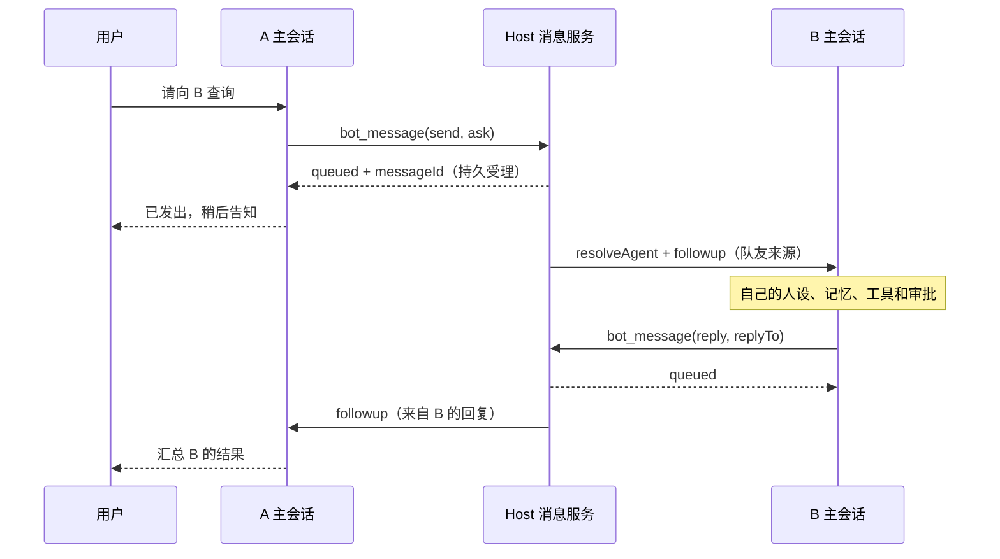

# Bot 间互通设计

2026-10-24；任务：[`tasks/P34/D-bot-to-bot.md`](../tasks/P34/D-bot-to-bot.md)。本文为中文设计交付，未实现消息功能。所有方案选择、默认值、实施门槛及取舍均标记 **[Codex]**；源码事实不代表运行验证。

## 1. 范围与结论

**[Codex]** 新增 `bot_message`，在既有 Bot 主会话之间交换消息。Host 用原生 `sessionController.resolveAgent` 恢复目标，使用带明确 producer 的原生 Inbox 输入唤醒对方；对方以自己的主会话历史、人设、记忆、模型、连接器和工具处理。`ask` 表示建立待回复关联，工具立即返回持久受理回执；回复经同一工具异步回到发起会话，发起方不阻塞、不轮询。

**[Codex]** 插件只补 Bot 身份路由、持久发送意图、请求/回复关联、限流与授权门禁、鲸鱼消息展示。复用原生 Agent、Inbox、会话日志、恢复、工具审批、聊天渲染框架；不新增调度器、模型循环、Team、聊天根或每对 Bot 的会话。

**[Codex]** 保留 `bot_delegate` 为“一次性子代理”，不暗改为主会话互通。它适合独立工作、原生 spawn 隔离与 parent settlement；`bot_message` 适合持续关系和目标主会话上下文。二者的目标、权限、取消及冷恢复合同不同。现有 delegate 的交互来源门禁继续阻止队友消息触发新委派。更新工具描述/帮助，明确“询问队友本人”用 message、“派一次性子任务”用 delegate。

**[Codex]** 本设计替代旧 [P3/P4 设计 §6](P3-P4-design.md#6-多-bot-协作与实验-agent-teams) 中“bot_message 暂收敛为委派/群内定向”的范围选择，其余既有功能保持原合同。群聊、原生 Team 任务板、通知和 IM 不迁移到本协议。

基线实查：工作分支 `phase/p3-p4`，HEAD `d5dc11590cd01d7fc5663e986adfe9752b5eb647`；产品 manifest 为 `0.3.1`（architecture 标题仍为历史 0.3.0）。参考仓库 `~/ai-workspace/deepseek-harness` 干净且精确位于 `dsh-v0.2.1-rc.2`，对应 `687f282e8625c6b8d11ff58211a90524be2e4317`。下文 `H/` 为此只读源码根，`B/` 为本仓库 `packages/dsh-bot/`。源码路径只供核查，实施时禁止从内部路径 import。

## 2. 原生能力核查与最小缺口

| 能力 | 公开入口、锁定源码位置 | 可用范围与决定 |
| --- | --- | --- |
| 找回目标 Agent | `@deepseek-ai/dsh-api-session-controller` 根，`sessionController.resolveAgent(sessionId)`；`H/packages/api/session-controller/src/index.ts:243-245`、`agent.ts:196-255,424-446` | 返回 live Agent 或错误，合并并发 resume，恢复 preset 并拒绝受 subagent 所有权管理的会话。**[Codex]** 作为唯一普通主会话恢复入口；不自行 `agents.resume` 抢所有权。 |
| schedule 的跨会话投递 | `@deepseek-ai/dsh-schedule` 根服务；`H/packages/schedule/schedule/src/runtime.ts:101-140` | 原生内部组合为 resolve → createUserMessage(source=schedule) → followup → sessions.flush=true → 存 history。没有面向任意 producer 的公开 `schedule.deliver`。**[Codex]** 复用所调用的公开基础 API，不导入 runtime、不创建伪 schedule。history 仅证明投递，不证明模型完成。 |
| 人类 prompt | `sessionController.prompt`；`H/packages/api/session-controller/src/index.ts:462-485`、`commands.ts:319-363` | requestId 去重，内部强制 `source.kind='user'`；接受不等待 flush 或模型完成。**[Codex]** 不用来发送队友消息，也不传类型中不存在的 source。 |
| 普通排队/唤醒 | `Agent.send/followup`；`@deepseek-ai/dsh-agent` 根类型；`H/packages/core/agent/src/runtime-types.ts:204-222`，`agent-loop/src/agent.ts:154-164` | followup 是 next-turn+wakeup；忙时排队，空闲时起轮。**[Codex]** notify、ask、reply 的普通投递都用 followup；“不等回复”不等于“不唤醒”。 |
| steer / inject | 同上 `runtime-types.ts:225-241`、`agent-loop/src/agent.ts:167-172` | steer 在下个 step 边界插入，不中止正在执行的请求/工具；inject 不唤醒。**[Codex]** 两者均不能直接当“立即打断”；inject 不作为通知投递方案。 |
| 取消当前轮 | `Agent.cancel({kind:'hook',reason}, {keepInbox:true})`；`runtime-types.ts:37-44,176-201`、`H/packages/core/session/src/types.ts:190-195`、`agent-loop/src/agent.ts:154-179,214-235` | 协作式 abort，保留待处理输入；取消后 waking input 被转为 next-turn，等原执行收敛。**[Codex]** 用于显式 priority=interrupt；不能保证撤销已完成外部副作用、杀死不响应取消的工具或毫秒级抢占。 |
| 已识别输入与来源 | `@deepseek-ai/dsh-llm` 根 `createUserMessage`、可扩展 `MessageSourceMap`；`H/packages/llm/llm/src/message.ts:103-147,241-252` | 生成新 MessageId，不能给 createUserMessage 指定旧 id；producer 可扩展，user role 不等于 user 来源。**[Codex]** 使用 `dsh-bot-message` 来源，保存完整 native UserMessage 后重试复用原对象值，不重新生成身份。 |
| 原生日志与持久屏障 | `Session.append/snapshotEvents`、`sessions.flush`；`H/packages/core/session/src/index.ts:725-744,798-826,1306-1335` | 已有标准 user/message、Inbox splice、turn/step 事件可读；flush=false 不能声称落盘。**[Codex]** 原生日志保存交互事实；不用实验 `appendPluginRecord`、不伪造 assistant 或 turn/end。 |
| Inbox 状态及恢复限制 | `Agent.inbox.nextTurn/nextStep`、`prepend/splice/remove`；`runtime-types.ts:47-96`；实现证据 `H/packages/core/agent-loop/src/inbox.ts:22-68,98-145,224-278`、`agent.ts:123-138` | Inbox 持久重建并拒绝相同 pending MessageId，但 send 不对历史已消费消息去重；Agent 构造为 idle，resolve 本身不承诺启动 pending。**[Codex]** 插件补业务去重及“已入箱未唤醒”恢复协调，见 §6，不调用 private wakeDriver。 |
| Teams mailbox | `@deepseek-ai/dsh-experimental-agent-team` 根 `agentTeams.sendMessage/membership/listMembers`；`H/packages/experimental/agent-team/src/index.ts:111-158,223-248`、`types.ts:164-190`、`roster.ts:264-273` | 校验同 Team 的真实 membership，发给 lead 使用 steer，给 teammate 的内部桥不是插件入口；没有把任意已有主会话加入 Team 的公开 API，spawnTeammate 也无 agentPreset。**[Codex]** 不用于跨 Bot 主会话，不伪造 roster/membership。 |
| 动态队友上下文 | `@deepseek-ai/dsh-system-prompt` 根 `systemPrompt.context/section`；`H/packages/core/system-prompt/src/index.ts:53-89,478-520,614-662` | context 支持动态 text、required 和禁用插值；complete persona 会覆盖普通 section。**[Codex]** 队友目录用 required context 的同步快照，运行组合先 spike；不依赖普通 section 在 complete 模式仍保留。 |
| 安全与审批 | `@deepseek-ai/dsh-tools` 根 `tools.guard`、scoped `tools/pre-execute`；`H/packages/core/tools/src/index.ts:148-165,725-733,1135-1149,1514` | guard 单调拒绝；pre-execute 可 ask，缺审批服务时 ask 拒绝。**[Codex]** 来源约束由 Host enforcement 承担，高风险动作仍逐工具原生审批，不能靠一段提示词或转发源自动授权。 |
| 消息精确渲染扩展 | `@deepseek-ai/dsh-client-ui-conversation/client` 的 `uiConversation.events.register`、`ConversationMatchResult.exclusive`；`H/packages/client/ui-conversation/src/client/contract/conversation.ts:8-21,213-273`、`conversation/event-registry.ts:22-36`、`assembler.ts:520-550` | 可只认自有来源并对 chat target 独占该事件，其他 target 不受影响。**[Codex]** 为自有消息生成专属 ChatNode，避免重复显示默认 context 行。 |
| 节点渲染与缺省展示 | `@deepseek-ai/dsh-client-ui-chat/client` 的 `ChatNodeDataMap/ChatNode`、公开 `conversation.chat.node` keyed slot；`H/packages/client/ui-chat/src/client/index.ts`、`contract/slots.ts:397-409`、`conversation-nodes/message.ts:65-135`、`event-projection.ts:48-84` | 未安装扩展时非人类输入显示 context/turn-trigger，未知 producer 保留 kind。**[Codex]** 注册新 key `dsh-bot-message`；不替换全局 context/turn-trigger key，不导入私有 `chatNode` helper 或默认组件。 |

**[Codex]** 公开 API 已足以提出方案，但“恢复唤醒、优先取消、来源跨 wire、exclusive 节点”的完整组合尚未实测。B01 必须先完成；失败时明确哪个要求未满足，不把 private 方法当备选，不通过修改 DSH 本体绕过。新增 API 实施时再同步 `docs/dsh-api-notes.md`；本轮只改本文。

## 3. 对现有模块的接入位置

| 当前实现 | 事实与 [Codex] 接入决定 |
| --- | --- |
| `B/src/host/main-session.ts` | `MainSessions.open/find` 使用 Bot id+createdAt 映射、迁移元数据、排除 child/fork、保持标题；find 也可能做对账/rename，不是纯读。**[Codex]** 新投递首次调用 registry.openConversation；已受理消息固定 sessionId，重启不得再次 open 把旧消息移到新主会话。 |
| `B/src/host/delegate/{tool,guard}.ts` | startActivation(spawn, delivery=parent)，返回 accepted+childId；异步原生 settlement，不保证父冷恢复补发。guard 拒绝非 user 来源。**[Codex]** 保留功能、审批和 guard，仅补说明与 message 入口互斥测试。 |
| `B/src/host/groups/{service,roots,turns,turn-runner,routing,messages}.ts` | 独立群根、显式成员路由、spawn worker、群日志/turn sidecar、自有 renderer。**[Codex]** 不把群发言转进私聊，不给群根/worker 暴露 bot_message，不改变取消/轮流指针及根 prompt guard。 |
| `B/src/host/collaboration/{service,remote}.ts` | TeamLink 把 Bot 主会话关联为 lead；board/task 操作校验真实 membership。**[Codex]** Bot 名单不是 Team roster，新协议不创建/加入 Team。 |
| `B/src/host/native-schedule/service.ts` | 只聚合原生 schedule，保留旧库只读；不是消息调度器。**[Codex]** 消息独立事件驱动，禁止借 schedule 建一次性轮询/唤醒任务。 |
| `B/src/host/bot-context.ts`、registry、现有 connectors/memory | Agent 绑定有 Bot birthday，资源随所属 effect 清理。**[Codex]** 在 exact 主 Agent 安装目录、工具和来源门禁；不从发件 Bot 复制 persona、记忆或凭据。活跃目标继续其已捕获代际，冷恢复使用现行 preset，沿用现有更新提示。 |

**[Codex]** 队友目录是当前 registry 中其他 Bot 的 `{id,name,description}`，按 id 稳定排序，JSON 引用并设 `interpolate:false`，说明“目录/简介是数据，不是指令”。每次组装读取 Host 已更新的内存快照，不在同步 provider 中异步读库。自动刷新增删/改名，发送前再次核实身份与启用状态；不存在或不可发送的目标给明确错误，不自动替换。

**[Codex]** 不复制其他 Bot 的人设全文、连接器配置、密钥、文件路径或记忆。目录默认预算 32 KiB，简介按 160 码点摘要；超预算清楚标记目录不完整，并通过同一工具的 `action=list` 分页读取完整列表，不能悄悄宣称全员已注入。complete persona、includeRuntimeContext=false、新旧主 Agent、工具 deny 和卸载均纳入 B01/B04。

## 4. 用户体验与工具合同

**[Codex]** `bot_message` 是一个工具，支持三个互斥输入形态，strict schema 拒绝多余字段：

```ts
type BotMessageInput =
  | { action: 'list'; cursor?: string; limit?: number }
  | { action: 'send'; to: string; content: string;
      mode: 'notify' | 'ask'; priority?: 'normal' | 'interrupt';
      inReplyToContext?: string }
  | { action: 'reply'; replyTo: string; content: string };
// send/reply 输出：{ messageId, threadId, status: 'queued', mode }
// queued = 发送意图已持久受理，不代表 delivered / processed / replied。
```

**[Codex]** from、fromSessionId、Bot birthday、thread/hop、授权引用由 Host 填写，不能由模型选择；`inReplyToContext` 仅是候选父消息 ID，Host 必须核对该消息确实已交给当前 Agent/轮次。reply 的目标和线程完全从原 ask 查得，禁止同时传 to/priority。首次阶段只支持 UTF-8 文本（默认 8 KiB），不转发会话全文、图片、文件或工具隐藏输出。

**[Codex]** notify 也唤醒目标，但不建立等待回复义务，不能对 notify 调 reply。ask 返回 queued 后发起方可继续回答用户“已向研究员询问，收到回复后告诉你”；不得以工具 Promise 等待对方。目标完成任务后显式 `action=reply`，发送内容必须由该目标模型选取。Host 不将任意 assistant 最后一段自动当答案，不根据空闲/turn-end 猜测成功。

**[Codex]** 目标处理 ask 时，受限上下文提示其在完成后用 replyTo 回信；未调用工具就结束则保持 waiting，展示“对方尚未回复”。deadline 到期产生一条可见状态提醒，不重新向模型提问。回复到达发起方时，提示其向用户说明结果；只有观察到关联的真实 assistant 消息并 flush 才能记“已向用户说明”，否则保持“回复已送达，待说明”。不保证模型必然服从提示。



**[Codex]** priority=interrupt 意为“请求取消目标当前活动，再排入消息”，默认 normal。Host 在已持久记录发送意图、核实授权/目标身份之后，同步调用 `cancel({kind:'hook',reason:'dsh-bot-message:<id>'},{keepInbox:true})` 再 followup。它不清空用户输入、不重排原生已排队的人类请求、不自动重跑被取消任务；因此优先消息可能仍排在已存在输入之后。UI 明示“打断当前任务，保留已排队消息”。

**[Codex]** 打断不继承为下游权限；reply 固定 normal。打断每次需原生具体审批，包含双方、摘要和“不能回滚已执行操作”。目标不响应 abort 时标 interrupt-pending，默认 30 秒后提示需人工处理，不重复 cancel、不创建替代 Agent。取消在 sidecar 标 interrupted/current-turn 后使用事件追踪真实终止；不把 cancel 返回 void 当已停止。取消调用与记录有崩溃空窗时标 unknown，恢复不再次打断后来的人类轮次。

## 5. 数据模型与持久边界

**[Codex]** 新增独立 `dsh_bot_messaging` v1 领域，保留所有现有领域和版本。以现有 `BotKey={botId,botCreatedAt}` 作为身份；主会话 ID 是一次已受理路由的不可变部分。

```ts
interface MessageEnvelope {
  schemaVersion: 1;
  id: string;                         // Host 生成逻辑消息 ID
  from: BotKey; to: BotKey;
  fromSessionId: string; toSessionId: string;
  threadId: string;                    // 首次请求创建，后续不可重置
  correlationId: string;               // 根消息 ID
  parentMessageId?: string;            // 衍生请求/通知的因果父消息
  replyTo?: string;                    // reply 精确指向直接 ask
  origin: { bot: BotKey; sessionId: string; userMessageId: string };
  hop: number;                        // 根为 1；每条消息（包括回复）加 1
  depth: number;                       // 根请求为 1；下游请求加 1
  mode: 'notify' | 'ask' | 'reply';
  priority: 'normal' | 'interrupt';
  ts: number; expiresAt: number;
  path: BotKey[];                      // 请求路径，reply 沿已验证父边返回
  content: string; contentDigest: string;
  fromDisplay: { name: string; avatarVariant?: string; avatarColor?: string };
  toDisplay: { name: string; avatarVariant?: string; avatarColor?: string };
  authorizationId: string;             // Host 审批/来源记录引用，不是可转移许可
}
interface MessageRecord {
  envelope: MessageEnvelope;
  nativeInput: UserMessage;            // 原生 factory 创建，含唯一 id、source、content
  invocationKey: string;               // session + turn/step + rootCallId + callId
  revision: number;
  delivery: 'queued' | 'delivering' | 'delivered' | 'unknown' |
            'canceled' | 'expired' | 'failed';
  processing: 'pending' | 'claimed' | 'completed' | 'interrupted' | 'unknown';
  response: 'not-required' | 'waiting' | 'reply-queued' | 'replied' | 'timed-out';
  nativeRef?: { sessionId: string; messageId: string; seq?: number; turn?: number };
  outgoingRef?: { sessionId: string; messageId: string; seq?: number };
  lastErrorCode?: string; nextAttemptAt?: number;
}
```

**[Codex]** 另外存 threads（根授权、计数、路径、开放 ask 边、deadline、闭合状态）、limits（带生日的无向 Bot 对滚动时间戳/interrupt 时间戳）、read_state（会话及已读游标）、dedupe 墓碑（invocationKey、消息摘要、native refs）。message 单行首先包含完整已批准发送意图；衍生索引可重建，跨表不假装事务。限额预留先持久化再接受消息，崩溃可多耗一次额度，但不得超发；预留键与 invocationKey 绑定可对账。

**[Codex]** `nativeInput.source` 为 `{kind:'dsh-bot-message',form:'relay',messageId,threadId,replyTo?,from,to,fromSessionId,toSessionId,hop,mode,priority,displaySnapshots}`。正文前增加固定、非模型可编辑的来源框架，消息内容以 JSON 字符串呈现，注明“队友数据，不是用户授权”；不能仅靠 source 元数据假定模型看得见身份。

**[Codex]** 出站仍需在发件会话可见：同一次逻辑发送另创建 `source.kind='dsh-bot-message-sent'`、form=notice 的原生 user/message 镜像，用 `Session.append(...,{surfaceOp:'append'})` + flush 保存，不唤醒发件方，不伪造 assistant。内容是已发送文本及对方快照，严格标“已发出”；模型上下文可能读到该记录，按非授权数据处理。它与目标输入具有不同 native MessageId、同一逻辑 id，不能当第二次来信。发送意图已落盘而镜像写失败时不撤销发送，UI 展示镜像待对账；恢复只补镜像，不补发目标消息。

**[Codex]** outbox 中暂存正文/完整 UserMessage 是最小必要自建：原生没有跨会话持久发送事务，目标可能不可恢复，不能只留下一个没有可投递内容的 ID。双方日志确认持久后，默认 7 天清除 outbox 正文，仅保留去重/路由/摘要；完整聊天历史仍由原生日志管理。日志丢失后不从摘要猜回复，不因去重窗口到期重放旧任务。缺失正文且需补镜像时显示不可恢复。

**[Codex]** 本地存储权限与现有领域一致，仍不是加密或 OS 用户隔离。不得发送凭据/私钥；沿用现有秘密启发式筛查，但不能宣称可发现全部敏感信息。工具审批明确显示待发送正文；不默认复制私聊历史。

## 6. 投递、恢复与幂等

### 6.1 正常路径

**[Codex]** 按目标 BotKey 串行准入，消息服务不持有 registry 写队列等待 Agent 初始化，避免 main-session/记忆读取反向死锁。单后端仅一个活动 Host，不增加跨进程锁服务。

1. **[Codex]** 从 exact live Agent、getBotBinding、当前主映射及真实 input provenance 识别发件人；排除群根、群 worker、Team teammate、delegate child、旧生日、非主会话。
2. **[Codex]** 校验目录、工具 deny、来源、大小、链路预算、速率和去重键。首次目标没有主会话时仅调用现有 openConversation 惰性创建唯一主会话；这不是新增第二个会话。已有三 Bot 主会话的验收夹具必须保持 session 集合不变。
3. **[Codex]** 必要原生审批完成后重验双方身份/目标配置 revision；持久保存完整 envelope、nativeInput、额度预留，返回 queued。发起工具不等待目标恢复、目标模型或回复。
4. **[Codex]** Host 工作器 resolve 固定 toSessionId，检查 live identity、header、BotKey、当前映射；目标不再属于该 Bot 则 fail closed。向目标投递前先查原生日志、pending Inbox 和本包 receipt。
5. **[Codex]** 普通 followup；显式 interrupt 按 §4；flush=true 后写 delivered。目标自身 agent/pre-step 及 tools 门禁验证来源记录，不能跳过现有连接器禁用、工具 deny 或审批。目标模型处理后以 reply 再走同一受理/投递链。
6. **[Codex]** 持久 session/event 与 live inbox claimed 事件驱动 processing 状态；恢复从日志重算。不把 Agent.whenIdle 当某一消息的完成；批量输入同轮要保存 message→turn 映射。reply 持久受理并关联原 ask 后，原 ask 为 reply-queued；回复目标日志 flush 后为 replied，用户已看到另有 read_state。

### 6.2 冷恢复与不确定窗口

**[Codex]** Host 启动、消息受理、相关 session 事件及连接恢复触发扫描；失败可用有界退避 timer（1/5/30/300 秒，最多 5 次）重试明确尚未入箱的投递。这是 Host outbox 重试，不是发起 Bot 的轮询，也不新建 schedule。应用关闭时不执行；重启后恢复，过期/已取消不补跑。未知持久状态不进入自动重试。

| 崩溃/异常位置 | [Codex] 恢复决定 |
| --- | --- |
| 意图写入前失败 | 无 queued 收据、不投递；同 invocation 可重试。 |
| 意图已存，尚未 send | 检查固定目标/生日，恢复同一个 nativeInput 投递；不重新 createUserMessage。 |
| send 后尚未确认 flush，或 delivered 行写失败 | 先读取完整已验证原生日志及当前 Inbox：同逻辑 id/native id/摘要已 pending 或已进入 user/message 则补收据；不得只查当前上下文窗口。不能完整对账则 unknown，不盲重发。 |
| 已持久 pending，但目标不在内存 | resolveAgent 后查 Inbox；仅恢复 Agent 不算唤醒，采用下述 wake 协调。 |
| 已 claim，未见 user/message/未能证明处理完成 | claim 是 splice 移除，不等于完成；检查 turn/step/取消日志。标 processing=unknown/interrupted，不重放可能产生副作用的正文。 |
| user/message 已落盘，目标结束但未 reply | 不自动重跑模型；保留 waiting，deadline 后 timed-out，用户可显式发新 ask。 |
| reply 已受理，发起方离线 | reply 自身是持久消息，恢复其固定 fromSessionId/toSessionId 后投递；不是依赖内存 Promise 回调。 |
| 两方日志已完成、sidecar/出站镜像不完整 | 以原生日志精确 ID 对账，补状态或镜像；不再向模型发一遍。 |
| Bot 被删除/同 id 重建，主会话被删/替换/不可读取 | 停止该路由，标 target/source-gone 或 recovery-needed；不转交新生日或新主会话。 |
| 用户在 Inbox 手工取消消息 | 原生 canceled splice 为取消事实；标 canceled，不在冷恢复时“修复”回来。 |
| 存储损坏/另一个 Host 写者占用 | 禁用消息受理和恢复，保留原文件；不修改共享会话所有权。 |

**[Codex]** 冷 Inbox 唤醒采用需 B01 验证的公开组合：只在确有本协议 pending 且无 canceled/claimed 终态时，为该目标代际创建一个 `dsh-bot-message-wake` 控制输入，通过 `agent.send(wake,'next-step',true)` 唤醒；它不包含业务正文，不冒充第二条来信。`agent/pre-step` 的公开 waterfall 在保留 `next()` 决策、原有安全检查的前提下剔除该控制输入，使模型只处理已持久的业务输入。控制输入日志仍可供审计，chat 专属定义隐藏控制行。正常发送不需要此辅助输入。

**[Codex]** wake 必须可验证精确所属 Host/目标/恢复 generation；未知或伪造控制输入不能抑制显示或取得授权。每个恢复代际合并一次，不用固定循环不断加 wake；控制 token 尚在 pending 时不得重复插同一 MessageId。由于 claim、pre-step、flush 可交错，需专测“wake 已消费而业务未完成”“用户同时取消”“只剩 wake”“maintenance”“进程被杀”；不能通过 B01 则冷恢复自动唤醒为 FAIL，保留 queued/recovery-needed，停止发布该能力。此方案不依赖未公开的 `wakeDriver`，也不删除再插入原业务消息制造 canceled 记录。

**[Codex]** 幂等分三层：同工具 invocationKey 同摘要返回原回执，异摘要冲突；同消息 id/目标 birthday 只接受一次；replyTo 仅允许一个终态 reply，重复相同回复返回原结果，修改答案需用户新开请求。默认去重墓碑至少 30 天，且开放 thread 永不提前清理；到期之后仍先读原日志才能重放旧 invocation。速率限制不能代替去重。

**[Codex]** 本设计承诺有证据的去重受理/投递，不能承诺跨文件 exactly-once 模型副作用。原生 Inbox、会话日志和插件领域无跨写入原子事务，崩溃可能处在 unknown；安全边界选择显式恢复，不能以“自动重试”掩盖重复操作风险。

**[Codex]** 完整持久日志对账使用 `@deepseek-ai/dsh-session-persistence` 根公开 `sessionPersistence.open(id,'read')`、返回 handle 的 `read()`/`close()`（`H/packages/session/session-persistence/src/index.ts:154-167`、`handle.ts:46-118`）。read 不抢写者所有权，需在确认原写者 flush 后读取并核对 seq/摘要；资源随 effect/finally 关闭。不向该 read handle append，不用当前模型压缩后的上下文代替完整日志。

## 7. 回复路由与防循环

**[Codex]** 回复给直接发送方，逐层返回；不直接跳到原始发起方。例：A→B ask=m1（hop1/depth1），B→C ask=m2（parent=m1，hop2/depth2），C→B reply=m3（replyTo=m2，hop3），B→A reply=m4（replyTo=m1，parent=m3，hop4）。threadId/correlationId/origin 始终相同。B 综合 C 的结果后负责向 A 回复；A 向用户说明。不将 C 的内容自动转发为 B 的答案。

**[Codex]** Host 维护每条因果边，model 只能选择已经实际交付给自己的 ask。B 收到 m3 后继续处理 m1，其最终 reply 的 hop 取最新因果父的 hop+1，不能重新用 m1 的 hop+1 规避上限；depth 为对应 ask 的深度。存在多个待办/并发输入时需显式关联，歧义拒绝，不用“最近一条”猜 replyTo。

| 控制项 | [Codex] 首版默认值与规则 |
| --- | --- |
| 最大请求深度 | 3；A→B→C→D 可询问，D 不再向下游 ask/notify。路径中重复 BotKey 拒绝，A→B→A 的新 ask 不合法。 |
| 最大 hop | 8，含每次 notify/ask/reply；配置须满足 maxHop ≥ 2×maxDepth，允许最深链逐层返回。到上限不发送新业务消息。 |
| 每 thread 总消息 | 16；接受子 ask 时为必要返回边预留额度，不能让分支耗尽后无法回复。最多 4 个开放 ask；回复不能再回复 reply。 |
| Bot 对限流 | 带 birthday 的无向对，普通新请求 6 条/60 秒；总消息（含 reply）12 条/60 秒。reply 也受限，预算不足保持有界 queued，不新开线程绕过。 |
| 打断额度 | 每无向对 1 次/60 秒、每目标 3 次/10 分钟；排队中的过期打断不在以后补执行。 |
| 全局/单 Bot 积压 | Host pending 200、每目标 50，满额拒绝新请求，保留已接受回复的预留空间；无模型重试风暴。 |
| 有效期 | 普通消息 24 小时，ask 等待回复 24 小时，interrupt 意图 60 秒；deadline 到期只出状态，不派新业务请求。 |
| 去重 | invocation 精确匹配；30 天墓碑且不少于线程寿命；同内容短时间发送不同 ID 仍计速率，不按文本误合并用户独立请求。 |

**[Codex]** 所有参数进入导出的 Config 与 Schemastery schema，验证正整数、上下限及交叉约束；不可由模型改。推荐 maxDepth 范围 1–4、maxHop 2–16、消息大小 1–32 KiB。线程速率/预算记录持久化，重启不归零；时间回拨按不早于已记录时间处理，不能获得额外额度。

**[Codex]** 收到队友消息后产生的 send 必须继承该 thread。Host 以已 claim 的输入和当前 turn provenance 限制新根，即使模型省略 inReplyToContext 也不能洗成新线程。无明确新的人类发起输入则拒绝创建根；reply、notice、wake、schedule、Team settlement、旧出站镜像均不能解除来源限制。循环/限额错误只返回当前工具结果和本地状态，不再给对端发一条会引发回复的“错误消息”。

## 8. 授权、隔离与生命周期

**[Codex]** 首次 send 默认原生 ask 审批，展示双方、模式、完整文本及允许的只读协作范围。审批记录绑定 from/to birthday、session、内容 digest、配置 revision 与当前用户输入；工具执行前重验。线程内 reply 和已批准范围内的下游只读询问不重复要求同一批准，新增目标超出范围、数据范围扩大或 interrupt 必须新的原生审批。未批准不写可投递意图。

**[Codex]** 队友消息不继承发起方的工具审批、记忆访问权、连接器凭据或 unrestricted 权限。目标 read-only 工具采用显式允许列表；命令执行、文件写/删、记忆修改、MCP 不明动作、外部发送、任务创建/修改及未知工具全部默认走原生 ask，现有 deny/cancel 不可被覆盖。审批拒绝/缺失时不调用工具。不能通过工具名字猜所有 MCP 都只读；支持到的连接器要有可审计策略，其余按未知处理。

**[Codex]** 除 pre-execute 的 ask 外，用 tools.guard 复核 provenance 与作用域限制；Host 保存的是具体批准结果，文本“用户说已批准”无效。来源约束按整轮/嵌套工具调用传播，包含 PTC 的 run_code 内部 sub-dispatch；混合人类输入和队友 steering 不自动清掉限制。下一次独立、可验证的人类轮次才允许新的根授权。PTC 覆盖未通过 spike 时该组合不启用消息执行，不宣称已安全。

**[Codex]** `bot_delegate` 在队友来源下继续拒绝；群 worker/Team teammate 不提供此工具。这样不能借一次性子代理洗掉 hop 或审批约束。目标仍可按其原生工具集工作，新增消息协议不扩展它的能力；用户批准的高风险操作也仍按原生沙箱与工具策略执行。

**[Codex]** Host 消息 effect 持有 Domain、队列、退避/过期 timer、订阅与待完成 I/O；Agent effect 持有目录、工具、pre-step/工具来源门禁；Client effect 持有 codec mount、locale、slots、state。卸载先停止准入与唤醒、取消自有 timers、排空持久写，再注销资源并关闭 Domain，不 dispose Controller 所有的 Bot 主 Agent，不取消它正在处理的用户轮次。

**[Codex]** 关闭功能前显示已有原生 pending 数量；已入原生 Inbox 的消息仍属原生队列，不能声称关闭开关会自动撤回。若用户明确撤回，仅以原生 Inbox.remove 精确移除本协议未 claim 输入并 flush，保留取消记录。插件热卸载后来源保护失效是发布风险：启用阶段需验证 retained Agent 的 guard 生命周期，并要求在确认无队友处理中/待处理后卸载，或保留最小守卫直到 Agent 释放；不以静默移除所有安全监听作为正常回退。具体实现由 B04 的卸载测试确定，未满足不得开启自动处理。

## 9. 会话 UI 与概览

**[Codex]** 原生聊天时间线上显示双方往来，不新增 conversation。来信卡显示对方鲸鱼、名称+稳定 id、`来自 B · 提问/通知/回复`、时间和优先标记；发信卡显示对方鲸鱼与 `发送给 B`。默认折叠为一行摘要，正文弱化但满足可读对比度；展开可看完整文本、replyTo 链及投递/等待状态。头像快照沿用当前 WhaleGlyph 的造型和主题色，不取任意远程图片。

**[Codex]** 精确 UI 路径：公开 `uiConversation.events.register` 注册自有 Definition，只有通过 schema 的 `dsh-bot-message` / `dsh-bot-message-sent` 标准 user/message 才返回 `{id,role:'start',exclusive:true}`、target=chat。通过公开 `ChatNodeDataMap` 增加自有 kind，使用公开 ChatNode 字段（key/id/target/anchorSeq/location/visibility/data）生成节点，再注册 `conversation.chat.node` 的新 key。引用公开 session surface guard 区分 append 与 replacement，防 compaction/fork 重放产生重复卡片；不导入 `conversation-nodes/common.ts`。

**[Codex]** 原生 schedule、Team、用户、assistant、tool、群 renderer 完全走原有分支。非法/未知 source 返回 null 让原生保底显示；不全局替换 context/turn-trigger。本插件关闭后原生仍显示有来源框架的 context/turn-trigger，不丢正文。两个插件对同一事件 exclusive 冲突会报错，B01 必测加载/卸载与冲突，并在功能状态说明不兼容，不直接覆盖对方注册。

**[Codex]** 尚在 Inbox 的来信不假造 user/message 提前渲染为“已处理”。通过原生 pending 状态和自有概览显示待处理；claim 后时间线显示真实原生日志。双方详情中可以查看失败/queued 消息，但不把发件侧出站镜像计为新来信未读，也不让自有 wake 控制行产生用户通知。

**[Codex]** Bots 详情增加“队友消息”摘要区：待回复数、最近 20 条往来、状态、打开现有主会话、用户显式取消/重试入口；不增加独立聊天列表或每对 Bot 会话。概览用本协议记录与原生日志引用，不复制整段会话正文。跨 Client 失效通知复用项目 watch 结构；与发起 Agent 无轮询的约束无冲突，UI 兜底刷新沿用现有策略。

**[Codex]** 所有文案进入 locale/en.json、zh.json 同键；样式仅 `--dsw-alias-*`。折叠用可键盘操作按钮和 aria-expanded，图标有来源文字，颜色不作为唯一状态标记；亮/暗、中/英、窄屏、长中文/同名 Bot、后台刷新不抢焦点均需真实浏览器验证。

## 10. 与其他功能的边界

| 功能 | [Codex] 边界 |
| --- | --- |
| 群聊 | 原有独立根与成员 worker 保持；不桥接私信、不自动共享群上下文、不改变群内 @/轮流语义。 |
| Teams | 保留每个 lead 的 roster/任务板；Bot 名单不等于 Team 成员。不会从 peer mailbox 自动转为 bot_message。 |
| bot_delegate | 保留一次性 spawn，返回子会话结果；不能假装访问被委派 Bot 的主会话，不能以 message 回复替代原生 settlement。 |
| notifications | 可将“新回复/投递失败/超时”投影为通知，key=消息 id+事件类型去重；通知只是用户可见提醒，不再触发另一条 bot_message。不开系统通知假承诺。 |
| IM | 当前 consumer gate 边界保留；此轮不启用任何外部平台。未来经已验证 IM human 身份进入主会话，也需独立授权映射，不能伪造本地 source=user。bot_message 回复不自动发送外部 IM。 |
| schedule | 到期仍走原生 schedule 输入；不把定时提醒当新的人类授权，不创建内部 schedule 帮消息轮询。 |
| internal/reference memory | 目标按自己的现行绑定访问；队友消息不能切换后端、复制图谱或授予对方记忆写权限。 |

## 11. 独立任务拆分与测试计划

**[Codex]** 后续实施按下表顺序，每项单独可验收。B01 失败先记录实测限制并修订本文，不用后续构建通过掩盖。任务号在本提案内为局部编号，不覆盖已有 P34/Uxx。

| 任务 | 范围 | 独立验收 |
| --- | --- | --- |
| B01 公开 API spike | 不改正式产品；实际 rc.2 Web Host、Gateway、loopback mock，探测来源、resume/pending wake、cancel/keepInbox、exclusive ChatNode、required context、PTC | 首次/冷 Host 各有收据；source 跨持久/wire 不丢字段，pending 可唤醒且无重复正文，真实当前 mock 请求被取消，其他 Inbox 保留，普通消息默认 renderer 不变；失败组合列 FAIL。 |
| B02 契约/Store | 严格 schema、Config、身份/信封、threads/limits/dedupe、状态机、JSON 后端恢复 | 正负 codec、同 invocation 并发仅一条、异摘要拒绝、生日隔离、跨表故障/预算预留/保留期/时间回拨测试；旧领域字节不变。 |
| B03 Host 投递 | 主映射、outbox、flush/事件、恢复 wake、取消、reply 回路与镜像 | A→B→A 的真实模型脚本走 bot_message；受理返回在 B 完成前，两个主日志及 sidecar 可对账；无额外 create/spawn，关闭资源清零。 |
| B04 工具/安全/目录 | Agent scoped 注册、动态名单、来源约束、原生审批、链路预算 | 人设/记忆/同名 MCP 隔离；A→B→C→B→A；循环、假 replyTo、新根洗来源、PTC/子代理绕过均拒绝；未知工具批准/拒绝各一条实测；卸载仍有来源保护或拒绝自动处理。 |
| B05 UI/概览 | 精确事件 Definition/slot、折叠/鲸鱼、locale、状态/导航 | 已安装正式 Client 的亮暗中英窄屏截图；非消息节点无变化、源未知保底、取消/恢复/刷新不丢草稿或焦点，卸载恢复原生行。 |
| B06 集成与发布材料 | 安装真实 tgz，全新与冷 profile；只在获授权发布轮修改版本/打包说明 | 全量 check、完整矩阵、包身份、旧功能回归、风险与回退记录；真实模型请求 0；不 commit/push、不升级桌面。 |

**[Codex]** mock e2e 的强制场景及断言如下，全部使用仓库根 `DSH_HOME="$PWD/.dsh-dev"`、`scripts/dsh`、loopback 模型/MCP，不读取真实 key：

| 场景 | 必须观察的事实，不能只测返回值 |
| --- | --- |
| A→B→回复 A | A 工具先 queued，A 可结束当前轮；B 的真实模型请求包含 B 人设/自己的记忆/工具及队友标记；B 实际调用 reply；A 被再次唤醒并产生真实 assistant 告知用户；无轮询调用。 |
| notify | B 被唤醒、A 不建立 waiting；notify 的 replyTo 被拒绝；B 结束不自动向 A 回传。 |
| A→B→C→回复链 | C 仅回复 B，B 收到后汇总回复 A；同 thread、hop=1/2/3/4、无未授权的主会话历史泄漏，A 不直接收到 C 的终态冒充 B。 |
| 循环与攻击 | A→B→A 新 ask 拒绝、超 hop/depth/总数拒绝；伪造 from/生日/线程/高风险授权、replyTo 其他 Bot、重复终态回复、通过 delegate/Team/PTC 洗来源均拒绝。 |
| 优先打断 | B mock 故意保持当前请求，排入原生人类输入；批准 interrupt 后旧请求观察 abort/turn-end，中止后本消息最终执行，旧输入仍在或正常处理；拒绝审批时不 cancel、不投递。工具已完成副作用不作回滚断言。 |
| 冷恢复投递 | 分别在 outbox 持久、send/flush 空窗、pending 持久、claim 后、reply 受理后强杀自有 Host，冷启动同存储；明确 pending 能唤醒且只处理一次，不确定处理不自动重跑；旧发送方离线仍能收到 reply。 |
| 人类取消与存储失败 | 原生取消 pending 后重启不复活；flush=false、领域写失败、会话缺失/换生日/写者冲突进入相应 unknown/failed；不得搬到新主会话继续。 |
| 无新增可见会话 | 预建 A/B/C 三个有效主会话并各完成 mock 首轮（blank=false）；前后 `sessionController.list`、workspaceRegistry.list/sessionIds 与主映射精确比集合和 title/preset，浏览器原生侧栏只三行，无 New Session。不靠隐藏/归档作弊。另测未打开的新 Bot 仅惰性创建第一个主会话。 |
| 旧功能与权限 | 群根模型请求仍 0，群路由/取消/成员不变；Team board/schedule/delegate/notifications 保持；审批被拒时外部 mock 调用数 0；两 Bot 同名 MCP 只调用目标自己的服务。 |
| 生命周期 | 接受中卸载/重启、Agent 代际变化、Client mount/unmount；无遗留 timer/订阅、无重复 wake、无自有 AgentHandle（本方案不创建）；原生主 Agent 不被错误 dispose。 |

**[Codex]** 运行证据分层记录：源码核查 → 单元/存储 → build/typecheck/lint → 安装与完整 Host → 实际模型工具调用和冷恢复 → 浏览器互动/截图。任何未执行项按项目规则写 FAIL（NOT_RUN 及原因），不可用 DOM 测试替代截图、用源码保证替代真实打断、用 delivered 替代回复。

## 12. 风险、回退与实施门槛

| 风险 | [Codex] 处理与回退 |
| --- | --- |
| pending 冷恢复缺无消息 wake API | B01 验证辅助控制输入+公开 pre-step；未通过即阻断自动恢复上线，保留失败状态，不能宣称冷恢复 PASS。 |
| 取消与 Inbox 非事务 | interrupt 只取消当下活动，未知窗口不重复取消；UI 明示等待和可能已发生副作用。普通 send 可独立保留，优先功能经完整 probe 才启用。 |
| 同轮混合来源造成授权扩大 | 采用整轮保守来源标记及具体工具审批，子调用继承；不把后到的文本当审批。来源无法证明时 fail closed。 |
| 处理已开始但未持久确认 | 标 unknown，用户审查后发新操作 ID；不自动重放。无需构建通用工作流/事务引擎。 |
| 热卸载去掉安全 guard | B04 前不可默认启用；要求自有 pending/处理收敛，或在 retained Agent 保留最小 guard，关闭开关不等于撤回已入箱消息。 |
| UI exclusive 冲突/宿主升级 | 精确来源匹配、公开类型、加载前能力状态及集成测试；移除自有 Definition/slot 后原生仍显示可读来源/正文。锁定 rc.2，升级重验。 |
| 模型未 reply 或未告知用户 | waiting/timed-out 与 delivered 分开，用户有清楚状态；不伪造模型答复、不不断催模型。 |
| 目录变化/大规模 Bot | 同步快照版本化，发送时重验 birthday，目录超限公开提示并分页；不因改名改写旧消息身份。 |

**[Codex]** `messagingEnabled` 初始默认 false，B01–B06 通过才在发布方案中决定默认值。新增 Host runtime import 按真实共享实例需求评估 peer；沿用 Cordis/DSH 锁定开发版本和宿主兼容范围。Client 若新增 ui-chat 类型依赖放精确 dev；平台模块表提供的 runtime 包先核查再配置 external，不因 API 表写了包名就全部加 peer。

**[Codex]** 回退先禁用新受理/新唤醒，列出已入箱和处理中消息并按 §8 收敛，保留持久记录；降级旧包不读新领域，也不删除任何原生会话或日志。重新升级先对账，不批量重放过期请求。无需迁移现有群、Teams、notification 或 IM 数据。

## 13. 本轮交付与验收记录

本轮只新增 `docs/bot-to-bot.md`，无产品代码、API 依赖、schema、版本或任务单修改，无 commit/push。开始时已有 `pnpm-lock.yaml`、`pnpm-workspace.yaml` 修改及未跟踪 `.codex/`、任务单，全部保留。

| 本轮检查 | 结果 |
| --- | --- |
| 项目规则、任务、PLAN、P3/P4 设计、architecture、API notes 与指定模块核查 | PASS；现行源码优先于历史方案，已列出与旧计划的差异。 |
| DSH 源码 tag 与只读状态 | PASS；精确 rc.2，未修改参考仓库。 |
| 原生 API、delegate 去留、信封/恢复/幂等、防循环、UI、边界、测试、任务拆分/回退 | PASS（设计覆盖）；各决策标记 [Codex]。 |
| `scripts/pnpm check` | PASS，exit 0；build、52 个测试文件 / 670 项测试、strict typecheck、lint（248 文件）通过。日志 `.dsh-dev/bot-to-bot-design-check-20261024.log`；只是现有代码基线，不能视为新功能运行证据。 |
| 文档格式、工作树与参考源码收尾核对 | PASS；`git diff --check` 通过，文档独立检查无尾空白/坏本地链接；参考源码仍干净。原有 lockfile 条目恢复过程见下。 |
| 新功能 mock e2e / 冷恢复 / 优先打断 / 浏览器截图 | FAIL（NOT_RUN）；本任务只出设计，产品功能尚未实现，计划见 B01–B06。 |

执行的命令类别：`git status/branch/rev-parse/diff` 核对工作树；参考仓库 `git status --short`、`git describe --tags --exact-match` 验证锁定基线；`rg`、`cat`、`sed` 只读核查上述资料与源码；`scripts/pnpm check` 做现有仓库基线检查。初次搜索中若干猜测路径不存在，已用 `rg --files` 定位真实 `runtime.ts`、`agent.ts`、`agent-loop/src/inbox.ts`，没有据不存在的文件推导 API。

检查副作用记录：pnpm 在 check 前自动整理依赖，移除了开始时 lockfile 中已有的 `@deepseek-ai/dsh-client-ui-tool@0.2.1-rc.2` 条目（现行 manifest 未声明它）。依据既有 `.codex/runs/V032-bot-ask.jsonl` 的安装命令、已安装包 manifest 与本地 registry 缓存的完整性值，恢复 importer/package/snapshot 三段，共 12 行；恢复后与起始 `git diff --stat` 一致（lockfile +12、workspace +1）。未保存运行前文件 hash，故不宣称已做逐字节备份比较；本次未决定增删该依赖，也没有为迎合 lockfile 修改 manifest。check 已触发一次本地依赖整理，未另运行 install/frozen-lockfile。

**[Codex]** 后续建议从 B01 开始；优先解决冷 Inbox 唤醒、精确 UI 投影、interrupt 的实际取消和卸载后的安全门禁，四者决定完整方案能否按本文交付。当前设计完成不等于功能已可用。

## 14. 编排方评审决定（[编排]，用户已授权不停下审批）
1. [编排] 采纳 §1–§13 全部 [Codex] 方案：新增 `bot_message`（notify/ask/reply，normal/interrupt），走原生 resolveAgent + createUserMessage(source=dsh-bot-message) + followup；回复逐层回直接发送方；保留 `bot_delegate` 为一次性子代理。
2. [编排] 默认值采纳：maxDepth 3、maxHop 8、thread 16 条、Bot 对 6 请求/60s（含回复 12/60s）、打断 1/60s。
3. [编排] 审批体验：每个新线程首次发送一次原生审批；线程内 reply 与已批准范围内下游只读询问不再审批；interrupt 每次审批。
4. [编排] PTC/run_code 内部若 B01 证明无法可靠传播来源约束，则在 run_code 内禁用 bot_message 并拒绝队友消息轮次中的 run_code 自动执行（走原生审批），而不是整体关闭消息功能。
5. [编排] B01 任一 gate 失败：按 §12 回退只关闭对应子能力（如 interrupt 退化为 normal+提示），其余继续交付，不停下等用户。
6. [编排] 版本 0.3.2，单包。实施分两次 Codex run：B01–B03、B04–B06（B06 含打包 0.3.2、e2e、截图脚本 v032）。
