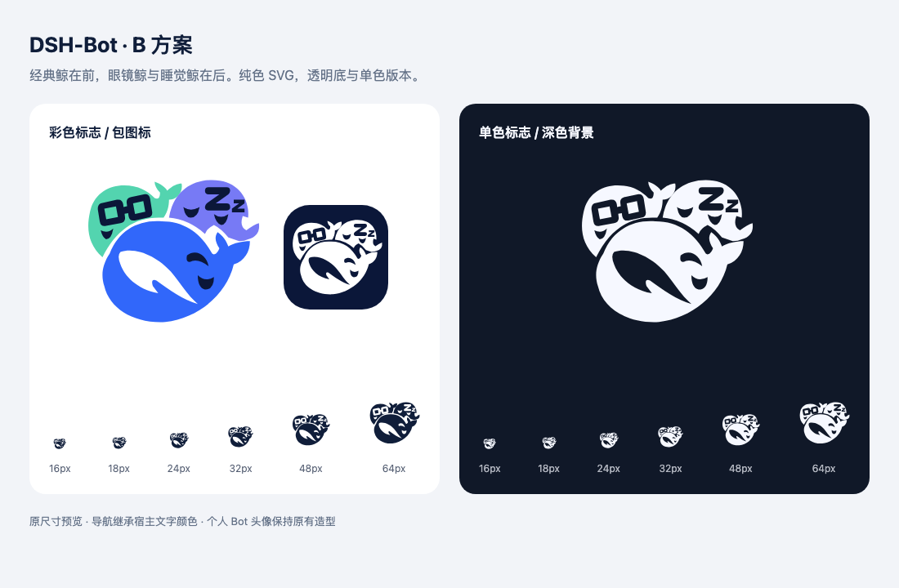

# DSH-Bot Logo B 定稿与接入

定稿采用 B 方案：经典鲸在前，眼镜鲸在左后，睡觉鲸在右后。矢量轮廓沿用这个构图，统一用于品牌入口。



## 交付资源

| 用途 | 文件 |
| --- | --- |
| 插件包图标 | [icon.svg](../../../../packages/dsh-bot/icon.svg) |
| 市场 PNG，256 × 256 | [icon-256.png](../../../../packages/dsh-bot/assets/icon-256.png) |
| 透明底彩色 SVG | [logo.svg](../../../../packages/dsh-bot/assets/logo.svg) |
| README 置顶图 / 透明底彩色 PNG，1024 × 1024 | [logo-1024.png](../../../../packages/dsh-bot/assets/logo-1024.png) |
| 单色 SVG | [logo-monochrome.svg](../../../../packages/dsh-bot/assets/logo-monochrome.svg) |
| 导航与导出共用的矢量轮廓 | [bot-brand.ts](../../../../packages/dsh-bot/src/shared/bot-brand.ts) |

Bots 导航通过现有 slot 使用同一组轮廓，继承宿主 `currentColor`。群聊侧栏、会话头和无可用成员的群图标也复用此三鲸标志；有成员的群列表和管理页仍展示实际成员头像拼图。个人 Bot 的造型、颜色和自定义头像维持现有行为。四份中英文 README 均在标题之前居中展示 160 × 160 的彩色 `logo-1024.png`；该图精确列入包文件白名单，安装包不依赖远程图片地址。

## 生成与验证

SVG 和界面图标使用同一份矢量轮廓，PNG 由 Chromium 对 SVG 直接渲染。

```sh
node scripts/render-brand-assets.mjs
DSH_BOT_CHROMIUM="<existing Chromium executable>" node scripts/render-market-icon.mjs
scripts/pnpm check
scripts/pnpm check:docs
scripts/pnpm check:format
DSH_HOME="$PWD/.dsh-dev" DSH_BOT_DSH_BIN="$PWD/.dsh-dev/native-api-rc2/node_modules/.bin/dsh" node scripts/screenshot.mjs --v016
git diff --check
```

以上 DSH 路径是本次隔离环境中的实际 CLI 位置，不是发布包的环境依赖。导出脚本只需要项目已有 Node 与缓存 Chromium，不增加依赖。

## 验收记录

- PASS：B 构图与三种 Bot 特征保留；彩色、单色与包图标使用同一组路径。
- PASS：256px PNG 人工检查，无明显裁切或断裂。
- PASS：以 0.05 个 viewBox 单位对 452,505 个表情/腹部填充内采样点检查，轮廓外采样点为 0。该检查不代替视觉判断。
- PASS：16、18、24、32、48、64px 的亮暗预览共 12 组，实际尺寸、三条路径及单色继承核对通过。小尺寸优先辨识三鲸整体，不能保证每个 Zz/眼镜细节都可读。
- PASS：`scripts/pnpm check`，196 个测试文件 / 1604 项通过 / 3 项既有预期失败；构建和类型检查通过，lint 保留 3 个既有 warning 与 1 个 info。
- PASS：最终轮廓调整后重新生成 Client，并重跑导航/头像/截图支持回归，3 文件 / 54 项通过。
- PASS：真实 DSH `0.2.1-rc.2` 隔离宿主亮暗导航验证；三鲸正确继承主题颜色，与相邻原生导航项保持尺寸及对齐。记录位于本地 `.dsh-dev/logo-b-native/`，发送模型请求数为 0。
- PASS：904 条文档本地链接、1485 个文本文件格式、四份 README 图片路径、三个 SVG 与共享路径一致性、脚本语法和 `git diff --check`。

测试数量比此前 1606 少 2 项，是旧 `whale-glyph.spec.tsx` 的 4 项耦合测试整理为 2 项职责测试：导航一项覆盖两种宿主尺寸、三个角色与主题色；个人/群头像一项保留旧经典路径断言。没有删除对应行为的验证。

用户随后要求彩色 README 置顶并更新群聊图标：默认个人头像继续核对经典路径，群头像回退分支改为核对共享三鲸路径；新增的群聊界面与打包验证见[跟进验收](../../../verification/logo-b-readme-groups.md)。

## 改动范围

- 新增共享轮廓 `src/shared/bot-brand.ts` 与导航组件 `BotBrandGlyph.tsx`；`client/index.tsx` 通过原 slot 接入。
- 更新包 `icon.svg`、市场 `icon-256.png`，新增彩色/单色 SVG 与透明 PNG。
- 新增矢量导出脚本 `scripts/render-brand-assets.mjs`，扩展现有 PNG 渲染脚本。
- 更新根目录和包目录四份 README、架构说明、导航回归与截图验证脚本。
- 增加 B 方案定稿说明和亮暗尺寸预览。

本地桌面使用独立的 0.6.6 候选包验收。运行结果见[跟进验收](../../../verification/logo-b-readme-groups.md#桌面复核)。
