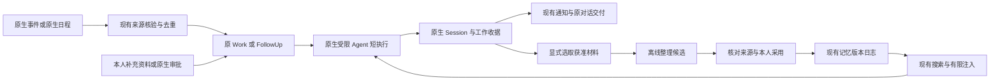

# DSH-Bot 记忆质量与持续任务优化方案

日期：2026-11-16（America/Los_Angeles）。状态：**已按批准的能力边界实现并安装本地；未通过项见实施验收**。

设计分支：`codex/agent-memory-reliability`。起点：`main@3b1c32c2a7c9fb1f4959bdc80f68c0c0c92a23a0`，包含 0.7.0 发布准备；包名为 `dsh-botgroup`，内部插件身份仍为 `dsh-bot`。本轮只增加设计与计划文档，不修改产品代码、依赖、数据或桌面安装，不提交、推送或发布。

本方案改善四件事：证明记忆对任务的帮助、从已授权记录中整理可核对的经验、在等待后准确恢复原任务、可靠处理到期唤醒。建议先建立质量基线，交付手动整理，再完成恢复和定时接入。每项新能力单独通过验收后开放，既有 Bot 聊天、条件跟进和通知继续使用原实现。

| 文档 | 用途 |
| --- | --- |
| [记忆质量评估](memory-quality.md) | 数据集、对照实验、成本与质量门槛 |
| [离线记忆整理](memory-consolidation.md) | 来源核验、候选修订、提交、清理与预算 |
| [定时唤醒和任务恢复](wakeup-recovery.md) | 原生能力验证、状态转换、恢复与故障矩阵 |
| [分阶段实施计划](../../../tasks/continuous-agent/README.md) | 依赖、任务落点、各阶段验收及停止条件 |

## 1 审批范围与产品目标

用户应能在原有 Bot 界面完成以下操作：选择一段获准历史整理成有来源的记忆建议，检查差异后采用；为已有任务设定一次提醒或持续关注；补充资料或完成原生审批后继续原工作；重启后看到真实的等待、执行和待核对状态。

首版采用以下范围：

- 评测以原始记录搜索、当前记忆加搜索、整理后记忆加搜索三组对照为主，固定任务、模型、权限和预算，所有失败保留分母。
- 整理默认关闭，由本人在现有记忆页手动发起，限定一个 Bot 和明确的来源集合；生成候选修订，本人采用后才影响日常记忆。首版不自动共享、不自动改用户指令、不自动置顶。
- 恢复保留原工作、原输入、真实权限和用量，不因重试或换会话重置预算；不确定外部副作用先核对。
- 定时第一批只支持已获准任务的检查或提醒。到期不自动新增执行授权，不补跑过期的外部写入，不把多个漏期累计成多次模型调用。
- UI 复用现有 MemoryPanel、记忆变更、FollowUp、原工作卡、待处理聚合和原生审批入口。无需新建项目中心、记忆后台或审批系统。

方案获批后，按阶段在仓库内实施及运行隔离合成模型验证。仓库 [AGENTS.md](../../../AGENTS.md) 仍禁止需要真实模型 API key 的会话；真实语义质量试点要在用户明确授权模型、数据范围和预算后运行，也可由用户执行并提供完整收据。仅批准本方案不会自动授权提交、推送、日常安装、公开发布或真实外部账号操作。

## 2 现状和复用决策

下表的“已有”指当前源码及所链接的历史验收范围。新组合尚未通过运行验证，不能继承旧组合的 PASS。

| 能力 | 当前基础与证据 | 本次决定 |
| --- | --- | --- |
| 记忆存储与治理 | [V2 类型](../../../packages/dsh-bot/src/shared/memory-v2.ts)、[提交内核](../../../packages/dsh-bot/src/host/memory/op-log.ts)、[变更与恢复](../../../packages/dsh-bot/src/host/memory/facade.ts)；已有版本、信任、权限、有效期、CAS 与遗忘屏障 | 沿用原内核。整理候选及来源证明的缺口先验证，只补无法表达的窄记录，不新建记忆库 |
| 召回与注入 | [检索](../../../packages/dsh-bot/src/host/memory/retrieval-rank.ts)、[动态上下文](../../../packages/dsh-bot/src/host/memory/context.ts)、[群经历召回](../../../packages/dsh-bot/src/host/groups/recall.ts) | 先测现有检索；日常注入仍用原预算与权限过滤。首期不建向量库或 wiki |
| 整理执行 | 原生 Agent、Session、工具限制；已有[文档任务与方法评估接线](../../verification/proactive-optimization-cd.md) | 以原生受控会话运行一项整理工作。使用现有工作关联和预算，不新建模型客户端或通用执行器 |
| 事件观察 | [FollowUpEvents](../../../packages/dsh-bot/src/host/proactive/follow-up-events.ts)、[协调器](../../../packages/dsh-bot/coordinator/commands.ts)已有来源、游标、去重和可重建观察队列 | 继续从权威事实读状态；业务命令 Inbox 不宣传为所有外部事件的统一耐久队列 |
| 日程 | [NativeSchedule](../../../packages/dsh-bot/src/host/native-schedule/service.ts)聚合公开 schedule；[原生接入历史边界](../../verification/v066-schedule-p0.md)仍有冷恢复和消息身份问题 | 保留原生时钟，先做 occurrence、冷恢复和零额外模型的验证。公开桥接失败则该能力继续关闭，不新增独立 cron/守护进程 |
| 工作等待和续办 | [原工作续办](../../../packages/dsh-bot/src/host/supergroup/task-support.ts)、[Work](../../../packages/dsh-bot/coordinator/work.ts)、[跟进](../../../packages/dsh-bot/coordinator/follow-up.ts)已有精确关联与 unknown | 按原工作后端扩展窄恢复记录，不强制将所有 Supergroup 工作搬成另一个 Ticket；保留原主会话和来源 |
| 审批 | DSH 原生 pendingInteraction、approval 事件与工具控制 | 原生待审批工具的挂起/冷恢复必须实测。若不支持，仅保留原生审批入口与工作级等待，不自建审批令牌或序列化任意工具调用 |
| 投递 | [持久通知批处理](../../../packages/dsh-bot/coordinator/notices.ts)、[原通知桥](../../../packages/dsh-bot/src/host/proactive/deferred-notices.ts)已有合并、静默、限额、unknown | 所有新增提醒复用该链路。延迟通知不等于延迟工具调用，不增加第二重试责任方 |
| 评测 | [现有评分器](../../../evals/scorers/index.ts)、检索回归、[任务结果统计](../../../packages/dsh-bot/src/shared/proactive/outcomes.ts) | 复用收据、固定分母和成本；增加时间线和任务语义评分，不把合成模型判定当质量增益 |

复用顺序为 DSH 公开能力、公开能力的薄桥、项目既有服务的窄扩展。确实无法复用时，记录失败证据、最小新增范围和迁移成本；更换运行时、独立业务数据库或通用调度器属于本方案之外的设计变更。

开发 API 继续锁定 `dsh-v0.2.1-rc.2`。隔离验收分别覆盖锁定 rc.2 和已有明确适配的官方 `0.2.2-rc.3`，不据 manifest 范围推断其他宿主兼容。当前 [0.7.0 准备记录](../../releases/v0.7.0.md)用于选择精确基线包，不能替代新功能验收。

## 3 权威状态和数据流

“离线”指退出用户当前交互后独立运行的整理任务，仍可能消耗模型调用；不代表无需网络或免费。每次原生执行有终点，等待、定时和通知由持久状态接续。Host 关闭期间不执行任务，恢复保证仅从 Host 启动且依赖就绪后计算。

| 信息 | 唯一权威 | 禁止的替代判断 |
| --- | --- | --- |
| 实际输入、工具结果与模型输出 | 原生 Session 和准确事件引用 | 用摘要中的“做过了”证明执行 |
| 当前任务及尝试状态 | 原 Work/Assignment/群轮次和其证据 | 用长期记忆覆盖 accepted/failed/unknown |
| 长期事实或经验 | 现有记忆 op/version/payload | 用候选文案自行提升 trust 或共享范围 |
| 定时规则和时间推进 | 原生 schedule | 插件另维护一套扫描时钟、推导并重发 occurrence |
| 是否获准执行 | 原授权来源与当次有效原生审批 | 用户沉默、旧 approved 字样或同文“继续” |
| 是否已通知 | 原通知操作、投递收据和不确定状态 | 以已生成正文、排队成功代表已送达 |

所有跨原生 Session、记忆域和协调库的操作都按可恢复协议处理，不声称跨存储事务。先保存意图，实际操作后核对准确证据；已知未执行可重试，结果不明留待核对。重复 operationId 必须同内容，否则拒绝。

## 4 记忆质量和整理的关键选择

先测“是否更好地完成任务”，再优化召回分数。原始搜索是保留能力，不让某一组获得额外数据、工具或未来信息。整理器仅能看到时间截点之前且当前仍有权限读取的材料；测试答案、评分和未来纠正不会进入模型上下文。

经验证据区分用户明确表达、实际工具观察、助手结论与待检验推测。反复出现不自动提高可信度；原始会话中也可能有错误。针对动态状态保存引用、观察时间和重查条件，任务的实时状态继续从原系统查询。

首版整理必须能展示原文定位、修改理由、现值/建议值和不确定项。来源失效、无法证明归属、发生遗忘或权限收紧时，不展示旧正文、不提交候选。本人采用只针对这份准确候选，不授权跨 Bot 分享或修改 Bot 职责。

候选采用、来源依赖和清理库存的具体合同见[整理方案](memory-consolidation.md)。现有 `sourceRefs` 中有 sessionId 等字段，不等于已完成任意 transcript 的证据闭包；P0 必须验证读取、版本绑定、派生关系与遗忘组合。

所有质量阈值都是事前冻结的试点放行标准，不代表总体统计显著。未达到质量标准时保留评测和人工候选功能，不自动开启持续整理或扩大常驻上下文。wiki、向量检索、自动晋升和定时自动整理留到结果支持后再设计。

## 5 任务恢复与定时的关键选择

等待资料、等待确认、待执行、执行中、待核对和已交付，投影自原工作事实；详细状态转换见[恢复方案](wakeup-recovery.md)。等待释放的是本次执行/协调占用，不删除仍需恢复的工作收据。

恢复时核对原 Bot 代际、原 main/工作/输入、来源版本、权限、期限与剩余预算。新用户消息可以建立不同工作；不能被旧等待任务吞掉。具有明确原工作标识的继续操作才恢复该工作；指代不明时沿现有 UI 选择目标。

原生审批若不能跨重启恢复，界面明确引导回原会话重新发起适用的原生审批，或停在待核对。对可能已执行的调用不生成新批准来自动重试。工作级续办与精确恢复原工具调用分别验收，不能以一种替另一种。

定时 MVP 依赖恢复链路先通过。一次性提醒与周期提醒共享原生日程，业务层只保存原规则和工作之间的关联及消费收据。优先提供“查看当前状态并提醒”的受限行为；任何模型执行仍使用原预算和授权。

过期策略、周期合并、时区/DST 和时钟跳变必须以原生可观测语义为前提。若公开接口无法稳定识别同一 occurrence 或证明自然冷恢复，本期如实交付能力验证结果，定时产品保持关闭；既有非定时关注继续可用。

## 6 分阶段交付与依赖

| 阶段 | 主要交付 | 核心验收门槛 |
| --- | --- | --- |
| P0 契约与能力验证 | 冻结基线、原生定时/审批/来源与清理实验、选定可实施路径 | 各组合都有真实隔离 Host 正反例和精确版本；每项支持/不支持有证据，无法支持的范围显式保留 FAIL |
| P1 质量评测基线 | 时间线数据、三组 runner、评分、成本与结果报告 | 数据/权限/预算公平，评分不可泄漏，真实产品检索被调用，失败/unknown 不被剔除；真实模型质量与机制分别判定 |
| P2 手动离线整理 | 授权材料选择、受控整理、候选差异、本人采用与清理 | 候选来源可核对；冲突、重复、撤权、遗忘、强杀均正确；未采用候选不影响日常上下文 |
| P3 任务等待与恢复 | 工作级持久等待、释放资源、原任务恢复与核对界面 | 重启/重复答复/并行工作/权限变化不串单、不重放；已有待审批工具能否恢复单独判定 |
| P4 定时唤醒 | 原生日程到工作事实的窄桥、到期提醒、漏期策略 | 正常到期、自然冷启动、重复乱序、混批、DST、撤销通过；没有额外时钟或无授权模型请求 |
| P5 组合验收与试点 | 同包双宿主、UI/升级/故障链路、质量与注意力结果 | 机制、质量、资源、迁移各有独立结果；未通过质量不宣称学习增益，未过能力门槛的入口不开放 |

P0 通过相应接口门槛后，P1 与 P3 可并行；P2 依赖 P1 的冻结评测合同和 P0 的来源证明；P4 依赖 P0 的日程路径与 P3；P5 汇合。无需等待定时才能交付手动记忆整理，也无需开启整理才能使用可靠任务恢复。

## 7 验收证据和发布边界

每项验收记录代码/包摘要、精确宿主、输入摘要、操作/工作/会话关联、预期与实际、调用次数、用量完整度、PASS/FAIL 和清理结果。敏感原文和原始 profile 只存仓库 `.dsh-dev` 隔离证据，不提交公开评测集。

- 机制层：单元与实际 Host/Browser 测试，包括重复、强杀、撤权和遗忘。模型可为本地确定性模拟，明确 `realModelRequests: 0`。
- 质量层：受控真实模型三组实验、人工盲评和通知影子回放；缺授权时为 FAIL（NOT_RUN），不由机制 PASS 替代。
- 运行层：取消/卸载后实际资源回基线；等待时无占用执行请求；停机时零执行，恢复时原身份可核对。
- 交付层：同一冻结包升级、冷启和配置保留。日常桌面安装、外部渠道与公开发布不在本轮设计交付范围。

新增能力默认关闭；关闭后停止新准入，既有在途任务按证据收尾，unknown 保留可见。回退使用经验证的版本与备份路线，不让旧二进制读取不兼容新 schema；新候选可以失效，但原会话、用户记忆和既有工作不能被删除。

## 8 审批决定

建议批准 P0–P5 的技术范围与阶段顺序，允许通过各自门槛的独立增量继续实施。原生能力不足时按已定义的收窄路径交付并保留失败项；若要新增第二执行器、时钟、审批系统或扩大资料/模型/外部操作范围，再提出具体变更。

本轮审批前只完成文档。真实模型试点的模型、可用数据和可执行预算尚未授权，因此不纳入“批准技术方案即自动运行”的范围。实现阶段不能将此限制解释为无需进行质量验证，只能将质量结论保持未验证。

## 9 参考依据

[Building always-on agents](https://claude.com/resources/articles/building-always-on-agents) 提供事件、定时、记忆、权限和投递的分工；[The components of agent memory](https://www.anthropic.com/research/components-of-agent-memory) 提供跨会话记忆层次与离线整理思路。本文的阶段、数据合同和验收数值属于针对 DSH-Bot 的设计，不是原文已证明适用于本项目的结论。

当前项目的能力与边界以[API 核实记录](../../dsh-api-notes.md)、[0.7.0 候选验收](../../releases/v0.7.0.md)、[OpenMaus 验收](../../verification/openmaus-improvements.md)、[非定时跟进验收](../../verification/v066-local-follow-up.md)及本方案链接的实际源码为依据。
