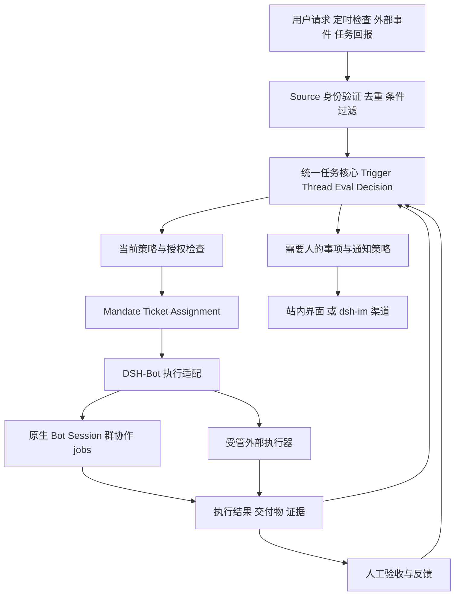

# DSH-Bot 主动协作与任务交付设计提案

> 后续开发以[完整设计包](proactive-bot/README.md)及 [PB00 任务](../../tasks/proactive-bot/PB00-compatibility-spike.md)为入口。本文保留行业调研、来源和初步选择的依据；具体契约、任务依赖及验收标准见完整设计。

状态：设计提案，未实施。日期：2026-11-06。仓库核对基线：`4a0aab4`，包版本 `0.6.4`，开发依赖仍锁定 DSH `0.2.1-rc.2`。

DSH-Bot 的目标定位是：**每个 Bot 有长期职责，在授权范围内发现值得处理的事情，按需组织协作，跨会话推进任务，以证据交付结果，并在可控反馈中改进。**

能力建设分两层：核心能力由 DSH 与 DSH-Bot 提供，专项能力通过公开协议接入。能力覆盖以可运行的用户场景为单位；“更强”以相同条件下的发现质量、交付通过率、人工介入、成本和恢复能力验证。云端多租户、商业连接器市场和任意跨机器无损恢复属于独立扩展范围，不能从插件功能清单推导为已经具备。

本次外部资料以第一方文档和公开源码为依据，部分来自可变的 `main` 或 `canary`，不代表已发布版本或实际部署结果。实施前必须固定所选上游 revision，再验证与锁定宿主的组合。

## 设计目标与能力定义

Superagent 侧重多个任务和执行者如何持续协同；主动式 Agent 侧重没有本轮明确指令时，如何识别工作机会并选择介入。这两个维度可以组合。定时器解决何时检查，模型判断解决是否值得做，权限决定可以做什么，通知策略决定何时打扰人。

对 DSH-Bot，需要分别支持以下行为，避免用一个“自动运行”开关混合它们：

| 行为 | 示例 | 机制与边界 |
| --- | --- | --- |
| 定时执行 | 每个工作日上午整理关注项目动态 | 原生 schedule 提供检查时机；实际成果另行验收 |
| 事件响应 | CI 由成功变为失败后分析原因 | 已认证事件、去重、状态变化过滤、受限执行 |
| 主动发现 | 发现交付报告有构建记录但缺设备验收 | 依据职责和证据判断缺口，先产生建议 |
| 持续跟进 | 已受理的修复任务在 CI 返回后继续推进 | 同一个任务的订阅、执行回报和有界续跑 |
| 未来条件提醒 | 下次讨论发布时提醒检查回滚方案 | 持久关注条件、范围、过期和冷却；不必后台反复调用模型 |
| 后台整理 | 汇总最近任务中的重复返工原因 | 独立的反馈候选；不自动扩大权限或改写已确认事实 |

主动程度与行动权限分别配置。一个只读 Bot 也可以有很强的发现能力；拥有写权限的 Bot 仍可能只在用户提问后工作。

## 业界实现与可复用经验

| 实现 | 已核实机制 | 值得吸收的部分 | 使用边界 |
| --- | --- | --- | --- |
| DeepSeek Superagent 原型 | Source → Trigger → Eval → Mandate/Ticket → Assignment；规则准入与模型研判分开，订阅后续事件，持久 effects/outbox | 接单授权、唯一任务状态、后续讨论归属、只在有用时发言 | 单仓库编码原型，MIT；部分设计文章内容未实现。见[领域模型](https://github.com/deepseek-ai/dsh-superagent-prototype/blob/main/docs/001-domain.md)与[架构](https://github.com/deepseek-ai/dsh-superagent-prototype/blob/main/docs/007-architecture.md) |
| OpenClaw 当前 main | 旧 heartbeat 迁移为普通 automation job；条件脚本先返回 fire；另有 standing intents 和 goal continuation | 无模型前置判断、静默结果、区分周期检查与任务续跑、明确投递结果 | Gateway 必须运行；main 文档不等于全部发行版。见[迁移说明](https://docs.openclaw.ai/gateway/heartbeat)、[条件监控](https://github.com/openclaw/openclaw/blob/main/docs/automation/cron-jobs/schedules.md)、[Goal](https://github.com/openclaw/openclaw/blob/main/docs/tools/goal.md) |
| LangChain ambient agents | 邮件分为 ignore/notify/respond；interrupt 后由人接受、编辑、反馈或忽略；偏好存在 Store | 先分流再执行，把通知、问题和审阅集中呈现 | 旧 Executive AI Assistant 和 Agent Inbox 已归档；教学摄取脚本仍有去重 TODO。见[概念](https://www.langchain.com/blog/introducing-ambient-agents)、[源码](https://github.com/langchain-ai/agents-from-scratch/blob/main/src/email_assistant/email_assistant_hitl_memory.py)、[Inbox](https://github.com/langchain-ai/agent-inbox) |
| LangSmith Fleet | 跨 Agent Inbox、身份与凭据、权限、traces、程序调用 | 集中处理需要人的事项，明确 Agent 代表谁运行 | 商业产品；其配置发布 webhook 不等于入站事件触发。见[产品说明](https://www.langchain.com/blog/introducing-langsmith-fleet) |
| Letta Code | 持久身份与记忆、定时任务、Channels、远程工具环境、后台 dreaming | 长期身份与临时会话分离，后台整理与对外行动分离 | LettaBot 已停止维护；本地 schedule 依赖活动进程，云端行为另有配置。见[代码](https://github.com/letta-ai/letta-code)、[定时机制](https://docs.letta.com/configuration/schedules)、[记忆整理](https://docs.letta.com/configuration/memory) |
| LobeHub | 主管与成员编排、结果汇合、本地/队列运行；Acceptance 真实交互与多轮评审 | 主管对外交付、逐项验收、返工延续、反馈先提议 | 主库 Community License 带附加条款；Acceptance 独立为 Apache-2.0。见[群执行](https://github.com/lobehub/lobehub/blob/canary/apps/server/src/services/agentRuntime/AgentRuntimeService/groupMember.ts)、[主库许可](https://github.com/lobehub/lobehub/blob/canary/LICENSE)、[Acceptance](https://github.com/lobehub/acceptance) |
| Copilot Studio 与 Agentforce | 连接器或业务事件 → 工作流/编排 → Agent 工具 → 人工步骤与运行监控 | 复用业务事件总线，将来源、运行身份和审批绑定 | 商业平台机制，不是可直接嵌入的开源运行时。见[Copilot 触发器](https://learn.microsoft.com/en-us/microsoft-copilot-studio/authoring-triggers-about)、[Agentforce 架构](https://architect.salesforce.com/docs/architect/fundamentals/guide/agentic-patterns) |
| ProactiveAgent 与 ContextAgent | 从用户活动或感知上下文预测是否需要帮助，使用标注数据评估误报与漏报 | 将“何时应该介入”作为独立可评估问题 | 研究代码与数据集，不能当作通用生产助手。见[ProactiveAgent](https://github.com/thunlp/ProactiveAgent)、[ContextAgent 论文](https://proceedings.neurips.cc/paper_files/paper/2025/hash/f4e5cd2079f5a6cf5176818add841531-Abstract-Conference.html) |

OpenClaw 的 standing intent 在符合条件的用户回合前匹配提醒，不会自行启动后台回合；Goal 在已有目标仍活动时续跑，也不负责关机后启动进程。两者都不应直接当成外部事件监控器。[Standing intents](https://docs.openclaw.ai/concepts/standing-intents)

LobeHub 的反馈工具明确只声明改进意图，将验证、去重和实际修改留给下游。Letta dreaming 可以由后台 Agent 修改记忆，其 Agent review 也不等于人工批准。DSH-Bot 可吸收后台整理能力，同时保留自己的反馈采用边界。[LobeHub 自迭代说明](https://github.com/lobehub/lobehub/blob/canary/packages/builtin-tool-self-iteration/src/systemRole.ts)、[Letta dreaming](https://docs.letta.com/configuration/memory)

## 当前能力与差距

“已有”表示当前代码存在该能力；具体运行覆盖仍以对应验收报告为准。新的组合不继承旧验收结果。

| 能力 | 当前状态 | 设计动作 |
| --- | --- | --- |
| 多模型、工具、技能、Session | 复用 DSH；Bot composer 组合原生 preset | 保留，不增加第二套 Agent loop。见[composer](../../packages/dsh-bot/src/host/composer.ts) |
| 长期 Bot 身份与私有记忆 | 已有 BotKey、私有记忆和手动共享；自动共享关闭 | 任务绑定精确 Bot 代际，保持数据标签与遗忘机制。见[可信入口](../../packages/dsh-bot/src/host/memory/trusted-ingress.ts) |
| 群内并发与多轮 | 已有 spawn、准确 childId/runId、续聊、成员取消 | 接入任务执行适配；不再造群调度。见[concurrent](../../packages/dsh-bot/src/host/groups/concurrent.ts) |
| 跨会话业务任务 | 有群 turn/delivery 和原生 Team 任务板，缺统一主动接单生命周期 | 复用 DeepSeek 核心，关联现有执行收据；不把群空闲当作任务完成 |
| 定时检查 | 已复用原生 schedule，投回原会话 | 保留原生时钟与规则，补业务事件适配。见[native schedule](../../packages/dsh-bot/src/host/native-schedule/service.ts) |
| 外部事件 | 原生 webhook 可接收和验证，缺可靠业务摄取组合 | 补稳定事件 ID、游标、持久受理与去重；见[锁定版本 webhook 文档](https://github.com/deepseek-ai/deepseek-harness/blob/dsh-v0.2.1-rc.2/docs/subsystems/webhook.zh.md) |
| 主动研判 | shadow 仅 synthetic/offline-only，默认关闭 | 将其保留为离线验证资源；生产主动研判走统一任务核心，不能直接开关上线。见[shadow planner](../../packages/dsh-bot/src/host/shadow/planner.ts) |
| 自动委派授权 | bot_delegate 阻止后台来源并强制原生 ask | 增加受限 Host 执行入口；不把自动来源伪装成 user。见[guard](../../packages/dsh-bot/src/host/delegate/guard.ts)、[tool](../../packages/dsh-bot/src/host/delegate/tool.ts) |
| 通知与少打扰 | 有持久 intent、去重和 unknown；静默/日额/冷却目前只约束 IM 分支 | 补站内呈现和模型唤醒预算。见[notifications](../../packages/dsh-bot/src/host/notifications/service.ts) |
| 外部 IM | NotificationPort 已定义，正式适配器未接通 | 优先桥接社区 dsh-im，不重写各平台 SDK |
| 连接器 | 已有 per-Bot MCP、凭据引用和受管出站 | 用于外部专项能力，保留精确目标/正文授权。见[connectors](../../packages/dsh-bot/src/host/connectors/service.ts) |
| 交付验收 | 有执行投影、日志、用量及验证材料；缺统一产品级验收记录 | 新增证据索引、验收决定和返工关联，不复制完整 Session 日志 |
| 常驻与恢复 | 依赖本地 Host，进程内 jobs 不能关机继续 | 分开定义本地恢复与独立常驻部署；现有产品边界见[README](../../README.md) |
| 持续改进 | 有记忆与离线评估设施，真实自主改进未交付 | 反馈候选、版本化采用、回归与撤销分期接入 |

原生 webhook 是 fire-and-forget，不提供队列、去重、崩溃重放和完成结果；HTTP 受理不能直接变成任务成功。原生 schedule history 是投递证据；当前 outcome 的 responded 也只证明回复轮次结束。[outcomes](../../packages/dsh-bot/src/host/native-schedule/outcomes.ts)

## 产品体验与特色

用户给 Bot 配置的是长期职责，例如“关注本项目交付质量”，而不是要求用户理解 Router、Eval 或 Assignment。Bot 详情提供少量可解释选项：

| 用户设置 | 示例 | 内部约束 |
| --- | --- | --- |
| 关注什么 | 选定仓库的 CI、PR 和验收报告 | Source 范围、项目与 Bot 身份 |
| 何时认为值得处理 | 新失败、重复返工、缺少必要证据 | 确定性条件与研判规则 |
| 可以做到哪一步 | 提醒我、先准备材料、按规则处理 | 明确动作集合，不是无限权限开关 |
| 使用多少资源 | 每日检查/执行预算、单任务上限 | 准入预留、运行计量和停止策略 |
| 什么时候联系我 | 阻塞立即提示，其余晚间汇总 | 时区、紧急类别、合并与冷却 |

普通聊天和现有群聊保持可直接使用。持久任务只用于用户明确交付目标、主动建议被接受，或命中已授权规则的工作；不把每句聊天都变成工单。

每项任务有一个负责 Bot。它可以直接完成，也可以复用群协作。成员持续工作时，用户可展开原生执行过程；默认呈现当前结论、交付物和需要用户决定的事项。没有实际增益的任务不强制拉多个 Bot。

建议卡应能回答五个问题：发现了什么、依据是什么、为什么与你有关、准备怎么做、需要你决定什么。提供“接受”“稍后”“忽略”，并允许给出范围有限的反馈。一项建议到期或证据变更后，接受按钮先重验，不继续旧授权。

与 LobeHub 相比，差异落在产品重心与集成深度：DSH-Bot 以长期个人 Bot 为入口，将职责、授权、任务、私有记忆、原生执行和证据验收连接起来。LobeHub 已有多项相似能力，因此这些是待验证的设计优势，不是独占技术。

## 总体架构与状态归属

统一核心优先复用 DeepSeek 的 Engine。它应继续作为 Trigger、Thread、Decision、Ticket、Assignment 的唯一写入者，保留 batching、订阅、后续输入归属和恢复语义。不要另造一个 ProactiveCandidateStore，再与第二套 TaskService 双向同步。

| 数据 | 唯一权威 | 其他层保存什么 |
| --- | --- | --- |
| Bot 身份、配置、私有记忆 | 现有 DSH-Bot | 核心只引用 BotKey 与必要版本 |
| 来源事件、研判、授权、任务和派工 | 所选任务核心 | DSH-Bot 保存 ID 关联及可重建视图 |
| 成员会话、运行过程、工具事实 | DSH 原生与现有群收据 | 核心保存准确 session/run/effect 引用 |
| 验收条件、证据引用、用户决定 | 任务关联的验收记录 | Session 可展示引用，不复制为另一任务账本 |
| 业务消息是否应发送 | 核心 Outbox | Channel adapter 返回传输回执 |
| 传输尝试和远端发送结果 | 现有通知传输适配 | 核心读取同一个幂等发送操作的结果 |

原生 Team 任务板是可选关联视图，不强迫所有群任务转 Team。已有 Team 封装直接读取 native listTasks；新增关联不应再建立第三份任务事实源。[collaboration service](../../packages/dsh-bot/src/host/collaboration/service.ts)

产品上的“忽略、继续观察、建议、执行”不是原型自带四种 Decision。原型 Decision 是 accept/stop/ignore/unavailable，适配如下：

| 产品行为 | 核心映射 |
| --- | --- |
| 忽略 | ignore，并保存理由与证据引用 |
| 继续观察 | 当前 Eval 结束；未来条件与检查时机属于 Source |
| 建议 | would-accept 等决定的只读投影；接受时重新核实策略与事实，再接单 |
| 执行 | 现行 Policy 允许后 accept，创建 Mandate/Ticket/Assignment |

用户看到的“待验收”“已验收”来自执行事实与验收记录。原型 ready/ended 在某些情况下会结束 Ticket，不能原样等同产品验收通过。M0 必须验证这套映射；如需改变结束策略，只在任务核心一处做最小扩展，避免界面维护平行状态机。

## DeepSeek 核心的复用决策

原型根入口已经 `export * from './core/index.ts'`，其中包含 Engine、ports 和 MemoryRepositories，因此可以研究公开入口复用。但 package 为 private，没有独立 `/core` 子入口，根入口同时关联 Runtime，依赖仍含 alpha 版本。它不是已经发布、兼容 rc.2 的独立任务 SDK。[根入口](https://github.com/deepseek-ai/dsh-superagent-prototype/blob/main/src/index.ts)、[核心入口](https://github.com/deepseek-ai/dsh-superagent-prototype/blob/main/src/core/index.ts)、[package.json](https://github.com/deepseek-ai/dsh-superagent-prototype/blob/main/package.json)

复用按以下顺序决策：

1. 固定上游 revision，使用公开根导出与离线 ports 验证核心语义、依赖加载和生命周期；不直接安装整个原型到正式 profile。
2. 评估将核心及官方 SQLite 适配封装为独立协调进程。这个进程只管理业务状态；模型、Bot 执行和权限仍由 DSH Host 承担。
3. 若需要稳定的独立核心入口，优先提出上游接口需求或维护有范围的 MIT 源码封装，记录修改与升级成本；不从 DSH 内部路径导入。
4. 只有现成核心在目标场景确实无法包装适配，且有失败证据时，才讨论自研替代，并重新评审维护成本。

同步事务是关键限制。原型 Repositories.atomic 和核心操作同步完成，外部副作用在提交后执行。DSH KvTable 写入返回 Promise，不提供等价的跨表同步事务；不能用 Serial 队列冒充事务。因此优先保留原型的存储语义，DSH Host 不直接写核心数据库。[原型 ports](https://github.com/deepseek-ai/dsh-superagent-prototype/blob/main/src/core/ports.ts)、[现有群写入](../../packages/dsh-bot/src/host/groups/state.ts)

独立进程与 Host 之间需要新增、验证的窄协议：提交事件、读取决定、承接派工、报告进度/结果、取消、对账。官方管理 HTTP 主要提供状态、设置和 stop/retry，不能假定它已经是完整外部任务 API。端点认证、协议版本、幂等键与取消回执均属于适配工作。[管理 API](https://github.com/deepseek-ai/dsh-superagent-prototype/blob/main/docs/006-deployment.md)

原型直接运行时还会修改进程 PATH/Git 环境，默认执行权限较宽。独立协调进程不应加载其整套 worker 环境和执行 preset；同 Host 共装原型也必须先证明这些副作用不会影响其他 Bot。[环境实现](https://github.com/deepseek-ai/dsh-superagent-prototype/blob/main/src/infra/environment.ts)

## 主动判断与成本控制

每条规则绑定 BotKey、来源范围、职责版本、可处理条件、行动范围、期限和预算。自然语言描述帮助研判；可验证边界由 Host 检查。

一次检查按顺序进行：

1. 验证来源身份和监听范围，记录稳定 eventId 与来源 revision。游标仅在覆盖事件已持久受理后推进。
2. 无模型过滤重复、过期、自己发出的回声、无实质变化和明确无关事件。
3. 关联已有 Thread/Ticket，合并同一事项的新证据；已有任务得到后续输入，不重复接单。
4. 检查模型预算、当前负载及规则有效性，再用受限研判读取最小证据。
5. 生成理由、证据、建议动作、责任 Bot 与是否需要用户决定；模型不能改写准入身份或授权。
6. 对准备执行的动作再次核验当前策略，然后派工。通知独立经过呈现策略。

模型输出的置信度不能成为授权。用于排序的价值判断可以包含紧急度、与职责的相关性、用户收益和预估成本；第一版采用可解释规则与冻结样例校准，不依赖一个无证据的综合分数。

需要三种独立预算：检查/研判消耗、执行消耗、用户注意力。安静时段通常延后低优先级研判和通知；已获准且有时限的后台工作是否继续，由该规则单独决定。不能把“没有通知”当成“没有模型成本”。

Observe 也不等于离线。DeepSeek observe 仍可能运行研判，明确请求在该模式下仍能执行。研发阶段使用离线 fixtures、禁用真实 Source 和替身 ports；产品观察模式只约束主动规则产生的新执行，不改变用户直接发起任务的权限。[授权模式](https://github.com/deepseek-ai/dsh-superagent-prototype/blob/main/docs/002-authorization.md)

## 授权与执行边界

有效行动权限取以下约束的交集：职责允许范围、任务 Mandate、DSH 当前工具/沙箱权限、Bot 数据流与目标许可。允许观察不等于允许执行；允许执行不等于允许将资料发送到任意渠道。

任务授权至少关联准确 Bot 代际、任务与派工 ID、来源和策略版本、动作类别、目标项目/端点、数据范围、期限及预算。这些细化字段部分属于 DSH-Bot 的部署扩展，不能宣称原型 Mandate 已全部提供。

当前交互式 `bot_delegate` 和群入口保留原有语义。后台派工使用新的受限 Host adapter，复用底层 group/subagent 执行能力，保留自动来源；禁止伪造 `source.kind='user'` 或移除现有递归门禁。[委派门禁](../../packages/dsh-bot/src/host/delegate/guard.ts)、[交互式群入口](../../packages/dsh-bot/src/host/groups/turns.ts)

DeepSeek 原型的 Policy 变更会通知活跃任务，并在恢复前重验；它不保证即时停止全部活跃动作。DSH-Bot 若提供撤销授权，必须在每次新副作用前重验并传递取消信号。已经发出的远端请求不能保证撤回，应单独显示已发生或未知状态。

现有外部通知仍要求准确正文与目标的数据授权，并可能需要 live approval context。无人值守发送属于后续授权桥的能力，不能用通用通知策略替代数据出站批准。[通知数据边界](../../packages/dsh-bot/src/host/notifications/data-flow.ts)

## 持续执行与恢复

Bot 是长期身份，Ticket 是业务工作，Assignment 是一次承接，Session 是实际运行载体。一个 Ticket 可关联多个 Assignment；群成员 turn/delivery 仍归现有执行系统管理。

任务续跑由新的可处理输入或明确未完成目标驱动。普通进度、感谢和重复结果不唤醒全组。等待外部条件时结束当前执行，让 Source 的新事件再次驱动；不让模型忙等或反复轮询同一个无变化状态。

持久化边界采用提交后派发、稳定幂等键和恢复对账，不声称跨核心 SQLite、DSH JSON 和外部服务存在分布式原子事务。

| 故障点 | 恢复要求 |
| --- | --- |
| 事件已到达，游标未推进 | 重放后去重，不重复接单 |
| 任务已提交，派工尚未发送 | 依据持久 effect 继续派发 |
| Host 已受理，协调进程没收到回复 | 查询同 assignmentId 的派发收据，不直接创建第二个 worker |
| 工具可能完成，进程退出 | 标记 unknown；有可靠远端查询时对账，否则等待人工决定 |
| 旧 worker 晚到结果 | 核对 assignmentId、childId、runId 和策略代际，不归给新执行 |
| 用户取消或 Bot 删除重建 | 阻止后续派工，尽力排空现有执行；晚到回报不能复活任务 |
| 对外通知超时 | 只有可证明未发送才重试；不确定结果不盲重发 |

核心 Outbox 负责业务发送意图，Channel adapter 经 Notifications 服务关联稳定 operationId、通知 intent 和传输回执；NotificationPort 仅承担 describe/send，当前发送参数中的 attemptId 不等于业务操作 ID。适配器需要持久映射 Outbox ID、通知记录和发送尝试，不能绕过 intent 层直接调用 Port 来承诺幂等。只能有一层负责安排重试，另一层不得自行再开定时重发。已有 Notifications 对 sending 冷恢复为 unknown 的行为应保留。

长期运行分两种交付：本地版依赖 DSH Host 存活；常驻版需要独立运行的 Host 与受监督进程。外部 watchdog 可以恢复进程和报告健康，不能因为“看起来卡住”就盲目重放有副作用任务。电脑关闭时，部署在该电脑上的工作不会继续。

原型当前历史记录还会持续增长。正式运行前要给事件正文、过滤记录、结束任务和传输回执定义保留策略；正文可裁剪或转引用，审计关联和去重所需标识不能随意丢弃。规则应进入 Config，敏感数据遗忘须与现有数据流机制协调。

## 交付验收与反馈

任务受理时记录目标、范围、交付物和验收条件；收工时保存证据索引和检查结果。执行者不能仅凭自己的总结把验收置为通过。

证据明确分层：源码/静态检查、构建与单测、安装启动、真实设备或浏览器流程、业务验收。截图相似度只能支持视觉结论。每项检查显示 PASS、FAIL 或未执行，并保留失败原因及所对应的产物版本。

Acceptance 可提供报告契约与辅助能力；其 `lh` CLI 仍需适配验证，登录后默认云端发布的行为不得隐含开启。首版可以先实现任务内证据索引和接受/返工流程，再评估是否使用完整 CLI 与托管评审。[Acceptance 报告规范](https://github.com/lobehub/acceptance/blob/main/skills/acceptance/references/report.md)、[运行模式](https://github.com/lobehub/acceptance/blob/main/README.md)

反馈按影响范围处理：

| 反馈类型 | 处理方式 |
| --- | --- |
| 本次成果问题 | 在原任务中返工，追加新的执行与证据版本 |
| 误报或打扰 | 记录原因，形成该关注规则的调整候选 |
| 稳定个人偏好 | 经可信入口和现有记忆操作采用，保留来源与撤销 |
| Skill 或流程问题 | 形成版本化修改提案，用冻结回归集检验后采用 |
| 权限与共享范围 | 通过显式配置变更，不从“忽略”或普通反馈自动推断 |

后台整理只生成候选。未经独立评估，不宣传递归自我改进或模型能力持续提升。衡量重点是后续任务中重复错误是否减少，以及是否引入新的漏报、误报或权限变化。

## 外部能力与部署选择

专项执行器优先作为受管工具接入。DeerFlow 可用于研究与报告，OpenHands 可用于编码环境，Deep Agents 适合确有自定义执行器需求时评估；其能力是否优于 DSH 原生执行，必须在同任务上证明。[DeerFlow](https://github.com/bytedance/deer-flow)、[OpenHands SDK](https://github.com/OpenHands/software-agent-sdk)、[Deep Agents](https://github.com/langchain-ai/deepagents)

薄适配协议需要 submit/get/events/cancel/artifacts 及真实 externalRunId；这些是拟新增内部契约，不是既有 DSH API。支持 MCP client 不等于能作为 MCP server 被调用；缺少服务端入口时要包装真实 API。

原生外部 subagent provider 也不能直接替换群里的 spawn。当前群需要 preset、agentOptions、深度限制和可续聊 child；外部 provider 必须逐项声明能力，缺少能力时拒绝对应模式。外部费用与原生 Session tokens 分源展示，不伪造原生 usage projection。

IM 优先核验 `xmanrui/dsh-im` 的 `ctx.dshIm.send()` 与稳定 botId/targetId，桥接现有 NotificationPort。[官方讨论入口](https://github.com/deepseek-ai/deepseek-harness/discussions/5080)、[主动投递接口](https://github.com/xmanrui/dsh-im/blob/main/PROACTIVE_DELIVERY.md)

社区 `Kanadego/dsh-heartbeat` 可参考静默、忙闲、日额和冷却设计；不能与当前 native schedule 并行建立第二套相同轮询，也不能假定它与锁定 rc.2 已兼容。[作者仓库](https://github.com/Kanadego/dsh-heartbeat)

## 实施阶段与退出条件

下列阶段均待实施。进入下一阶段以验收结果为依据，不用文件数量或工具连通代替闭环。

| 阶段 | 可交付范围 | 必须通过的验收 |
| --- | --- | --- |
| M0 契约验证 | 固定上游 revision；离线 Engine/MemoryRepositories；确认公开入口、SQLite 边界、Host adapter 与单一状态归属 | 重复事件不重复接单；单 Thread Eval 串行；事务失败无半写；Bot 重建不继承授权；ready/验收映射明确；零真实模型与外部写入 |
| M1 主动观察 | 一个只读来源，建议 Issue/CI；条件过滤、研判回放、would-accept 建议视图；关闭与失效规则 | 游标重启、重复乱序、自发消息回声均正确；观察不产生执行；站内建议合并/过期/静默；质量与成本未实测则不得标完成 |
| M2 人工接受与交付 | 接受建议后单 Bot 执行，再接现有群；交付物、独立验收、原任务返工 | 接受前权限复检；派工与回报幂等；精确 run 归属；取消和权限失败；重启/强杀矩阵；执行结束不冒充验收 |
| M3 有界自动处理 | 仅开放白名单规则和明确动作；期限/预算；通知桥；可控真实试点 | 撤权后的新副作用被拒绝；预算跨重启保持；IM unknown 不盲重发；Host/核心分别退出可对账；先合成 72 小时 soak，再独立记录真实试点 |
| M4 专项能力与常驻 | 按需求接一个外部执行器、一个常驻部署、反馈版本采用 | 能力协商、远端取消与成本归属；跨进程故障恢复；反馈 held-out 回归不退化；公开兼容矩阵 |

M1 与 M2 可以在 M0 确定统一契约后分别推进，但必须共用同一核心。第一条完整试点选择“发现一个新 CI 失败 → 建议检查 → 接受 → 定位与修复 → 构建/测试证据 → 人工验收”。初期不自动发布评论、提交、推送或合并。

第二条试点选择“交付质量 Bot 发现某项迁移缺少设备验收证据”，验证它是否准确区分构建成功、安装启动和业务通过。第三条才是定期研究/日报，验证来源质量、去重、审稿和低打扰交付。

实现位置以现有职责为边界：Source/任务核心适配是新增薄层；groups/delegate、native-schedule、notifications、connectors、memory 保留各自权威。新增服务与监听纳入所属 ctx.effect；配置使用导出 Config 与 schema；UI 使用公开 slot、主题 token 和同键中英 locale。新依赖的真实公开 API 在实现时写入 dsh-api-notes。

## 能力对照与更强的判定

按三组基线分别比较：当前 DSH-Bot 被动模式、相同模型与工具下的 DeepSeek 参考实现、选定场景的主动机制参照。商业产品若无法提供相同权限、任务和预算条件，只比较公开能力与交互，不宣布性能胜出。

先冻结至少 200 条人工标注的事件回放，覆盖应执行、仅通知、无关、重复、过期、冲突、自发回声和恶意内容；另准备约 20 个有独立验收条件的端到端任务。数字是建议试验规模，应按成本和覆盖情况调整，不能冒充统计显著性保证。

| 评价面 | 测量方式 | 建议首轮门槛 |
| --- | --- | --- |
| 发现质量 | 任务级 precision/recall、严重漏报、建议接受率 | 自动执行候选 precision ≥95%，应处理任务 recall ≥90%；报告分母和误例 |
| 执行效果 | 相同模型/工具/预算下的独立验收 | 有效交付率不低于被动执行基线；测试集中虚报完成为 0 |
| 人的注意力 | 通知、提问、审批次数及人工分钟 | 对比“每事件均提醒”，人工时间降低目标 30%，召回下降不超过 3 个百分点 |
| 成本与效率 | 研判、执行、外部服务费用分开；事件到交付耗时 | 公布每个验收通过任务的成本与耗时分布，不用总 token 代替计费 |
| 恢复 | 在摄取、接单、派工、工具执行、回报与投递处注入故障 | 指定用例全部可追溯；幂等测试工具重复副作用为 0；unknown 不冒充成功 |
| 授权 | 撤销、过期、Bot 重建、成员变化、跨目标数据出站 | 测试集内越权与撤权后新发起的禁止动作均为 0 |
| 反馈 | 前段纠正、后段未见事件，与无反馈版本对照 | 误报减少且交付/召回不过度退化；授权不随反馈扩大 |

上述数字是设计目标，尚无实测结果。“测试集内为 0”不等于真实世界风险为零。至少进行三个独立回放批次，记录模型版本、工具权限、执行预算、失败样例和人工判定差异。

消融实验至少包含：无主动层、仅固定规则、规则加模型研判、加任务持续跟进、加反馈。另设“人工直接提供正确任务”的执行上限参照，分清发现增益与执行器增益。群协作与单 Bot 分开比较，只有净收益成立时才默认增加成员。

研究项目已经把误报和漏报作为关键指标。ProactiveAgent README 的奖励模型 F1 与主动任务预测 F1 是不同结果，不能混用，更不能拿它们证明我们的生产质量。[ProactiveAgent 评估](https://github.com/thunlp/ProactiveAgent)

## 实施前必须解决的决策

1. 原型公开根入口能否在锁定依赖下加载，是否需要独立核心门面；固定哪一个上游 revision。
2. 采用独立协调进程还是经验证的同 Host 封装；谁拥有 SQLite、单实例锁和升级迁移。
3. 原型 Ticket ready/ended 与人工验收的准确映射，以及建议被接受时使用哪个受支持命令。
4. 后台 Host adapter 的授权证据与撤销语义，如何保留自动来源且兼容现有数据出站批准。
5. Engine Outbox 与 Notifications 的唯一重试责任、稳定幂等键及 unknown 对账协议。
6. 首个 Source、真实试点动作范围与独立验收任务集；没有这些条件就不开放自动执行。

这些决策属于 M0 的交付。产品方向可以先确定为“有长期职责的主动式 Bot”，对外能力声明则随各阶段实际验收递增。
