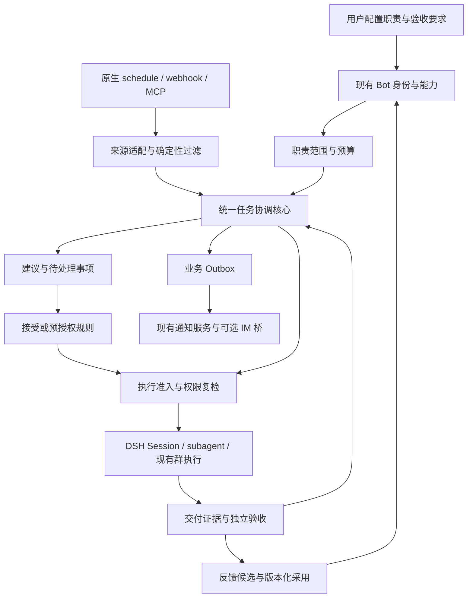

# DSH-Bot 主动协作完整设计

> 2026-11-09：**0.6.6 非定时个人/群主动跟进**已实现并形成同包验收候选；用户确认定时能力留到后续版本。当前[验收与边界](../../verification/v066-local-follow-up.md)、[交付记录](../../releases/v0.6.6.md)和[实施台账](../../../tasks/proactive-bot/V066-implementation.md)优先于下方历史准备状态。完整目标保留在[设计](v0.6.6-personal-group-follow-up.md)，GitHub 是可选来源。

> C/D 更新：用户已授权继续完成剩余开发；等待/核对、文档任务、归因、方法评估与交换、结果观察已实现，按同包隔离验证交付。具体能力边界与验收证据见 [C/D 验收记录](../../verification/proactive-optimization-cd.md)。普通入口保持现有侧栏与任务/反馈页，未升级桌面版。

> A+B 更新：A 剩余查询/维护项与 B 批 CI 个人质量 Bot 已实现，最终验证、边界与交付文件见 [A+B 验收记录](../../verification/proactive-optimization-ab.md)。复用原 Bot 侧栏与工作页；工程产物执行仍关闭，本轮未更新桌面版。下文旧状态保留用于追溯。

2026-11-08 更新：本页保留最初开发设计基线。当前实现及 review 后的优化请优先阅读 [优化方案与目标体验](optimization-proposal.md)、[重构技术合同](optimization-contracts.md) 与 [下一步落地清单](../../../tasks/proactive-bot/NEXT-personal-proactive-superagent.md)。D1–D6 已批准，A 批基础修复与简化侧栏已通过隔离验收；[实际验收](../../verification/proactive-optimization-a.md)与后续目标分别记录。

日期：2026-11-06。状态：开发设计基线，运行功能尚未实施。代码基线：远端 main `4a0aab42a2e4e005542528ada4c985d0786e1fc9`；DSH-Bot `0.6.4`；开发 API 锁定 DSH `0.2.1-rc.2`。

DSH-Bot 将长期 Bot 身份、主动发现、持续任务、多 Bot 协作和证据验收连成完整工作流程。用户可以给 Bot 一项长期职责，Bot 在规定范围内观察变化、判断是否值得处理、提出建议或按授权行动，直到交付被验收。**执行基础尽量复用 DSH，任务协调优先复用 DeepSeek 原型，DSH-Bot 专注于职责、接入适配、用户体验与交付质量。**

## 1 阅读与开发入口

| 文件 | 解决的问题 |
| --- | --- |
| 本文 | 产品定位、全景能力、总体决策、落地顺序与分支交接 |
| [产品与交互设计](product.md) | 职责配置、工作台、建议、任务、验收、默认策略与完整使用流程 |
| [原生能力复用矩阵](native-reuse.md) | 原生 API、现有实现、必须新增的薄层、禁止重复建设的边界与验证实验 |
| [技术架构与契约](architecture.md) | 模块、数据、状态、协议、授权、事务、恢复和升级 |
| [验证与能力对照](validation.md) | 验收层次、故障矩阵、质量指标、成本与人工时间、对照试验 |
| [PB00 至 PB12 实施任务](../../../tasks/proactive-bot/README.md) | 可派发增量、依赖顺序、文件归属和阶段退出条件 |
| [PB00 兼容性验证任务](../../../tasks/proactive-bot/PB00-compatibility-spike.md) | 下一次开发可直接开始的任务；验证关键组合后再开放生产能力 |
| [前期调研与提案](../proactive-bot-and-superagent-proposal.md) | 业界比较、第一方来源、为什么采用这些机制 |

本文及配套设计约束本分支的主动协作工作。旧 PLAN 的历史 Routine 自建调度方案不能据此重新启用；现有 `native-schedule` 为定时能力基线。设计中的新类型、Remote 方法和模块名均为拟定契约，真实公开依赖以 PB00 结果更新 [API 核实记录](../../dsh-api-notes.md)。

## 2 能力定位

Superagent 负责“复杂工作怎样拆解并交付”，主动式 Agent 负责“何时有值得处理的工作”，持久 Bot 负责“谁长期承担这个职责”。三者通过同一任务身份连接。

| 对象 | 存续时间 | 责任 |
| --- | --- | --- |
| Bot | 跨任务、跨会话 | 身份、职责、人设、技能、连接器、记忆与行动范围 |
| Responsibility 职责 | 有版本与期限，可暂停 | 监听什么、何时介入、允许什么动作、预算和验收要求 |
| Source 来源 | 持续监听或有界检查 | 认证、读取、游标、变化检测、来源引用 |
| Trigger / Thread | 一次输入 / 同一事项的一组输入 | 去重、归并、研判上下文、后续事件关联 |
| Ticket 任务 | 从接单到验收或停止 | 目标、承诺、责任人、进度、证据、等待和返工 |
| Assignment 派工 | 一次承接或重试 | 精确执行者、预算、能力和运行关联 |
| Session 会话 | 一段实际执行 | 原生模型、工具、日志和结果；不能替代 Ticket |
| Review 验收 | 每个交付版本一次或多次 | 独立判断验收条件、接受、返工及其证据 |

产品面对用户只使用“Bot、职责、建议、任务、交付、验收”等词。Trigger、Thread、Assignment 留给开发和诊断。

## 3 完整能力范围与吸收方式

能力覆盖按用户能完成的场景验收；第三方有某个能力不意味着我们必须引入其整套框架。专项执行器可通过受控接口提供能力，只有更换执行器能提高交付质量时才增加依赖。

| 能力 | 当前基础 | 目标与来源启发 | 交付阶段 |
| --- | --- | --- | --- |
| 多模型和推理工具 | DSH 原生模型、工具与权限 | 复用，任务选择现有 Bot preset；不新增模型路由器 | 现有 + M2 |
| 人设、技能与长期身份 | Bot composer、私有记忆 | 职责独立版本，任务记忆和偏好可追溯，吸收 Letta 长期身份设计 | M1、M4 |
| 任务规划与持续推进 | 原生 Session / subagent / jobs | DeepSeek Ticket/Assignment 贯穿等待、恢复、返工；不靠模型无限循环 | M0、M2 |
| 多 Bot 分工与主管汇总 | 现有并发群与多轮执行 | 保留成员执行过程，主管对外交付；吸收 LobeHub 的结果汇合 | M2 |
| 定时检查和事件响应 | 原生 schedule、webhook，现有 MCP | 来源适配、可靠摄取、条件过滤；复用原生触发而非第二套 cron | M1 |
| 主动判断和少打扰 | 离线 shadow、现有通知策略 | OpenClaw 的低成本条件判断，ambient agents 的忽略/建议/行动分流 | M1、M3 |
| 跨会话长期任务 | 群 turn 和原生 Team 任务板 | 一个 Ticket 权威，其他界面只投影或关联，不复制任务事实 | M2 |
| 未来条件提醒 | 会话、职责和来源基础 | 下次出现特定条件才提示；无事件不调用模型 | M1 扩展 |
| 人工审核与授权 | 原生 approval + 数据流边界 | 职责授权、任务范围、原生权限、数据出站交集；接受建议时再次核验 | M2、M3 |
| 文件、研究、浏览器和编码 | DSH 工具/技能与连接器 | 原生工具先行；DeerFlow、OpenHands 等仅作可选专项执行器 | M2、M4 |
| 成果验收和返工 | 现有日志、测试及运行投影 | 参考 Acceptance 的逐项证据与版本评审，形成产品闭环 | M2 |
| 外部 IM | NotificationPort，未接生产发送器 | 优先桥接社区 dsh-im，统一投递意图和回执 | M3 |
| 可靠恢复 | 原生持久 Session、插件收据 | 核心与 Host 之间稳定 ID、对账、unknown；不承诺任意执行无损恢复 | M0、M3 |
| 反馈与持续改进 | 记忆、离线评估 | 反馈形成候选，经采用、回归、版本与撤销后生效 | M4 |
| 常驻部署 | 本地 Host | 独立部署 DSH Host 和协调进程；宿主关闭不能等同常驻服务 | M4 |
| 开放接入和成本观测 | MCP、Remote、原生 usage projections | 窄协议、能力协商，原生/外部用量分列，任务级成本归属 | M2、M4 |

与 LobeHub 的主要对照是“团队协作 + 完整交付体验”，与 DeepSeek 原型的主要对照是“可靠接单与持续推进”，与主动式产品的主要对照是“低误报、少打扰和有界行动”。DSH-Bot 的特色集中在**长期职责、原生执行、可核实交付与跨任务改进的连续体验**。

## 4 总体结构



运行时按四层分工：

1. **DSH 原生执行层**：模型、工具、技能、权限、沙箱、Session、subagent、jobs、schedule、Remote、UI slots。继续使用公共 API。
2. **DSH-Bot 现有服务层**：Bot 身份、记忆、群、连接器、消息、通知、数据标签、工作区。各自保留唯一权威。
3. **任务协调层**：来源关联、研判、接单、派工、等待、恢复、验收关联。优先封装 DeepSeek 原型 Engine；该层不创建第二套模型执行循环。
4. **产品体验层**：职责、工作台、任务详情、证据与反馈，复用现有侧栏、Bot 详情和群活动视图。

首选独立协调进程隔离原型 alpha 依赖和环境修改，主进程仍是 DSH Host。进程间协议只运输业务命令、派工与回报，不开放任意 shell / SQL，也不直接访问对方数据库。若 PB00 证明公开根入口和依赖可安全同 Host 装载，再通过决策记录调整部署；不能把研究原型直接装入正式 profile 试运行。

## 5 原生优先的建设决策

| 决策 | 实施要求 | 原生或已有能力不能单独满足的部分 |
| --- | --- | --- |
| D01 不新增 Agent loop | 所有实际模型与工具运行走 DSH；外部专项运行单独声明能力 | 无需自研模型上下文、工具协议、推理重试 |
| D02 复用现有 Bot 与群 | 从现有 executor 中抽取可复用内部运行步骤，保留入口授权差异 | 后台自动来源不能调用会伪造 user 来源的交互入口 |
| D03 统一任务权威 | 优先 DeepSeek Engine；固定 revision、许可与适配差异 | 原生 Session、群 turn、Team 任务板不等同主动接单/业务验收生命周期 |
| D04 不新增通用调度器 | 原生 schedule 管用户计划；Source 只做必需的摄取和回压 | 无模型通知适配若公开 API 不足，先保持只读事件源与手动同步，提交缺口决策 |
| D05 保留原型事务语义 | 同步 SQLite 事务在协调进程；Host 使用原生 storageDomain 存收据 | 异步 KvTable 与串行队列不能模拟跨表同步事务 |
| D06 保留原生审批与数据边界 | 新增职责和任务级范围检查，不替代原生 allow/ask/deny | 自动任务授权须有独立、精确、可撤销的部署扩展 |
| D07 一个通知运输权威 | 核心 Outbox 关联现有 Notifications intent 和 operationId | Port 的 attemptId 仅表示一次发送尝试；不另建 IM SDK 和重试循环 |
| D08 验收先于宣告完成 | 交付版本、标准、证据和评审相互绑定 | 原生 idle/responded/ready 不能证明业务成功 |
| D09 反馈采用可撤回 | 更新职责/记忆/Skill 各走现有权限与版本流程 | 不将一次忽略或模型自评直接变成长期事实与新增权限 |
| D10 能力不足明确降级 | source / execution / egress 分别报告 capability-unavailable | 不能用不安全默认值、私有 API 或悄悄自研绕过 PB00 门槛 |

完整 API、调用作用域、证据与缺口见[原生复用矩阵](native-reuse.md)。每项新增模块都必须说明以上哪一缺口使它必要；如果无法说明，就继续复用现有实现。

## 6 第一条完整产品闭环

试点选择“项目 CI 失败”。它既能测主动发现，也能测编码协作、证据质量、取消和恢复。

1. 用户给质量 Bot 配置职责，选择精确项目/分支与 CI 类型，先开启“只建议”。
2. 来源取得新失败事件，用 provider delivery ID、commit SHA 和任务类型去重；成功→失败才进入研判，同一提交重复失败合并。
3. Bot 在预算内读取最小日志，给出“发生了什么、为什么值得处理、计划做什么、预计成本、验收条件”。
4. 用户接受一次任务。Host 重新核对 Bot 代际、事件版本、工作区、工具权限和当前授权。
5. 先单 Bot 处理；确有收益再由主管派研究/修复/验证成员。实际运行都保留原生执行过程。
6. 交付包含改动摘要、对应产物版本、检查命令与结果、失败项。不能把“写了代码”标为“测试通过”。
7. 用户接受或指出具体失败项。返工沿同一任务创建新的交付版本，保留之前证据。
8. 重复失败或用户反馈形成规则/Skill 调整候选，单独评估采用。

M2 试点不自动发表评论、commit、push、合并或部署。它们若要进入后续任务，必须成为明确行动类型、目标和批准内容；不能从“修复 CI”泛化获得权限。

第二条场景是迁移交付质量：检查报告中的构建、安装、设备运行和业务验收是否有匹配证据。第三条是研究报告：去重来源、并发研究、交叉审稿、证据引用和静默摘要。先以这些场景证明价值，再扩展泛用自动化。

## 7 研发顺序与发布门槛

| 里程碑 | 用户能得到什么 | 核心退出条件 |
| --- | --- | --- |
| M0 契约验证 | 可运行的离线原型与兼容性结论 | 公开入口、事务、Host 适配、来源、授权、验收映射均有证据；不确定项阻断对应功能 |
| M1 主动观察 | 来源状态、职责、建议与低打扰工作台 | 只读、去重、游标恢复、零自动派工、建议可解释 |
| M2 接受与交付 | 从建议到单 Bot / 群执行、证据、验收和返工 | 同一 Ticket、精确运行关联、取消/失效、验收独立于执行总结 |
| M3 有界自动处理 | 白名单自动执行、持久预算、可选 IM | 授权回收、重启对账、unknown、不重复发送和 soak 合格 |
| M4 专项扩展 | 外部执行器、常驻部署和可控反馈采用 | 各适配器能力矩阵、费用和取消、持久化和回归单独验收 |

不以“接通 MCP”“页面出现”“模型说完成”作为里程碑完成标准。某个扩展失败可以关闭该能力，已通过的原生 Bot 体验继续可用。M0 与后续开发可在本分支分批提交，由编排方负责提交、推送和最终合并。

## 8 如何判定更强

先测机制正确，再测模型质量。对比保持模型版本、任务、工具权限、执行预算和评审标准一致，分别设置当前 DSH-Bot 被动模式、仅规则、规则加研判、持续任务、反馈五组。商业产品只能在可获得等价环境时参与性能比较。

重点测量：应处理事件的精确率/召回率、独立验收通过率、虚报完成次数、每个成功任务的总费用、人工分钟、提醒次数、撤权后违规派工、重复副作用和故障恢复后的 unknown 处理。首轮目标与完整计算口径在[验证设计](validation.md)中，目标不能冒充已达成结果。

“更强”的优先目标是：同样预算得到更多验收通过的交付，用户花更少时间检查和重复下指令，失败可以定位和恢复。能力入口多不等于净收益，增加成员或外部框架要有对照结果支持。

## 9 分支与交接

设计最初在独立 worktree 的 `codex/proactive-bot-design` 分支形成。按用户后续要求，完整设计和任务单已经同步回当前项目目录；再次执行 `git fetch origin main`，确认最新 main 仍为 `4a0aab42a2e4e005542528ada4c985d0786e1fc9`，并在当前目录创建实现分支 `codex/proactive-bot-implementation`。原 worktree 保留为设计快照。

在 DSH-Bot 仓库根目录确认实施分支：

```sh
git branch --show-current
# codex/proactive-bot-implementation
```

准备期间并行发布任务形成了 v0.6.5 提交 `8fbcdb5`，该提交已保存在其独立发布分支及保留分支 `codex/proactive-bot-preparation-v065`。当前实现分支重新从上述 main 创建，不夹带发布提交。用户随后明确要求本地提交，设计、任务单和准备记录随本次文档提交纳入版本管理；未推送或发布。

**当前状态：准备完成，等待用户通知；PB00–PB12 尚未开始实现。** 收到开始通知后，从 [PB00](../../../tasks/proactive-bot/PB00-compatibility-spike.md)执行。先读当前仓库的 AGENTS、API notes、PLAN 和任务单；隔离产物只放当前仓库 `.dsh-dev`。必要时用 `scripts/pnpm install --frozen-lockfile` 复现依赖。

原设计阶段的检查证据见[设计检查报告](../../verification/proactive-bot-design.md)，本次目录迁移和分支准备见[准备检查报告](../../verification/proactive-bot-preparation.md)。历史 worktree 检查不能替代未来实现的验收。
