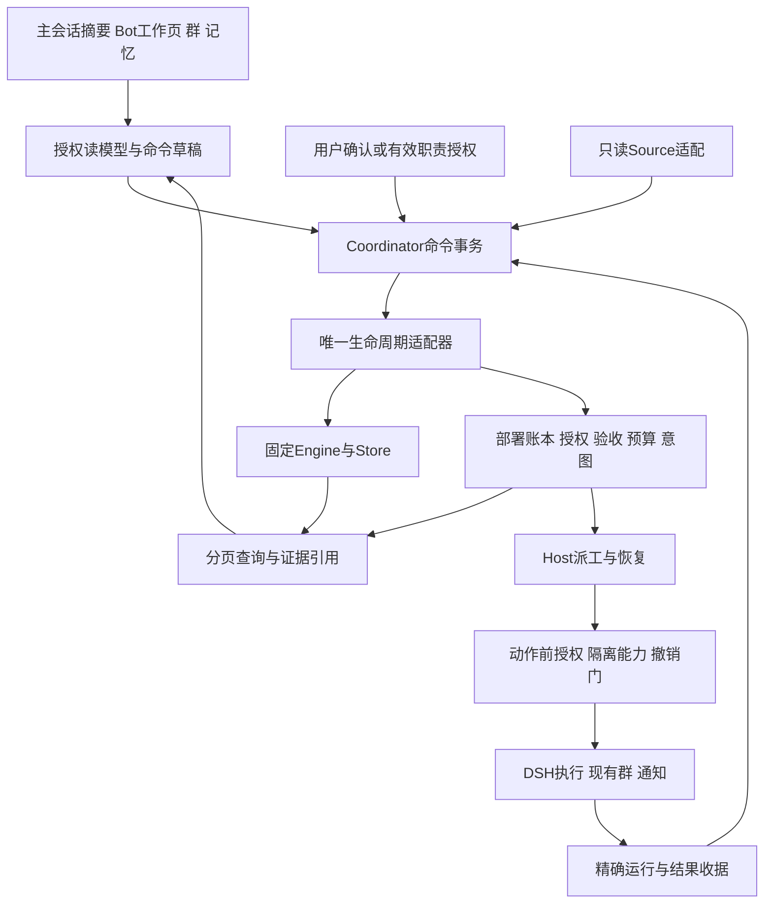

# DSH-Bot 整体优化与重构方案

日期：2026-11-08。状态：**D1–D6 已获批准，A 批基础修复与简化侧栏已通过隔离验收；B/C 未开始**。起始代码基线：`codex/proactive-bot-implementation@e9bcdcf`。本方案细化[17 项落地清单](../../../tasks/proactive-bot/NEXT-personal-proactive-superagent.md)，不把原方案中的目标、现有代码和真实运行效果混为一层。

## 1 推荐决策

把 DSH-Bot 做成一个可以持续委托工作的个人 Bot 工作区：用户与一个长期主管 Bot 沟通；需要主动关注的事项以职责表达；每件被接受的工作用同一任务贯穿执行、等待、返工和验收；复杂工作从已有专家群选择成员；有效经验经独立评估后成为方法。

推荐**保留 DSH 与固定 DeepSeek 核心，重构部署适配和工作体验，逐步扩展任务范围**。核心改造是统一生命周期写入口、准确的执行隔离与撤销、按任务组织工作页，以及个人与团队上下文的受控交接。允许替换现有模块的内部结构，不以保持现有函数形状为目标；Bot、群、会话、任务和证据身份需要连续保留。

建议本次批准整体设计和分批实施范围，按每批验收条件推进。尚无证据支持的隔离能力先验证，不能为赶进度放宽授权。真实账号/付费模型试点、发布、推送和桌面升级不包含在本次代码设计审批中，沿用现有项目权限规则。

| 审批项 | 推荐选择 | 影响 |
| --- | --- | --- |
| D1 产品入口 | 主会话沟通，现有 Bot 右侧栏看日常信息，已有工作页处理详情 | 保留概览/任务/消息，不增加主管首页、项目中心或独立看板 |
| D2 重构范围 | 渐进重构 Coordinator/Host/Client；保留原生执行与固定 vendor | 首批修复状态与权限，再提取模块，避免大规模搬代码掩盖行为变化 |
| D3 执行边界 | 无法落实读写/网络边界时，关闭相应模型产物执行；保留获准只读分析与候选展示 | 人工接受与自动接单适用同一边界；不能将未验证产物标为已验证交付 |
| D4 群协作 | 默认单 Bot；首版从持久群选两个角色，复用规划→实施→技术复核 | 其他成员不收到任务资料或产生请求；各角色模型与成本明确绑定 |
| D5 方法改进 | 手工维护可直接显式采用，效果晋升必须有独立对照 | 保留用户控制，新增可核查收益；不宣称已实现 RSI |
| D6 交付节奏 | A 修复基础 → B 个人质量 Bot → C 持续工作/方法改进 → D 可选共建 | 每批独立可用；同包验收后推进，不把 17 项塞进一次发布 |

备选方案：仅修 review 的八类问题可以最快恢复受限功能，但个人工作仍分散；全量重写运行时/任务核心会重复 DSH、丢失已有验证与迁移优势。推荐路线在这两者之间，逐批替换当前不合理的内部设计。

## 2 完成后用户如何使用

### 2.0 2026-11-08 截图反馈后的收敛约束

用户指出不要增加使用复杂度，并指定现有会话 Bot 面板作为常用信息入口。本节优先于此前大屏示意的页面展开方式；之前五场景示意用于解释行为，不要求做成五个日常入口。

代码核查：`BotRightPanel` 的概览显示 `bot.persona.prefix`，标题却为“当前职责”；任务页只有 Routine/BackgroundTasks，没有主动任务。完整 `BotsTab` 工作页同时堆叠建议、职责、治理、反馈和其他运行。这是信息位置与接线问题，不需要新的工作台。

| 位置 | 默认呈现 | 点开才呈现 |
| --- | --- | --- |
| 右侧栏概览 | 最重要的待决定事项、进行中/待核对摘要；真实已配置职责最多两条；角色说明短摘要 | 完整人设、Bot ID、来源/预算/模型等设置细节 |
| 右侧栏任务 | 待接受/待验收优先，进行中/待核对随后；少量标题、状态、下一步及查看入口 | 跳转现有工作页的准确任务；其他后台任务与定时安排保留分区 |
| 右侧栏消息 | 原有 Bot 消息 | 不另外复制任务事件流 |
| 现有工作详情 | 接受、产物、验收/返工、过程、结果待核对 | 原始标识、hash、完整证据和费用明细 |
| 现有设置/记忆 | 用户主动进入时管理职责、连接器、通知、偏好和方法 | 不在日常侧栏堆配置表单 |

“当前职责”中的人设应改称“角色说明”；真正的职责只来自已保存 Responsibility。没有配置则如实说明，不从人设生成假职责。普通聊天与后台运行不强行包装为 Ticket。无工作时不展示空统计卡，无可靠总量时显示有限摘要或“更多”，加载失败不显示成零任务。

首轮不增加项目选择器、主管专属首页、可定制仪表盘、经验评分或能力矩阵。先从当前 Bot 自然使用；项目与个人背景不是开始工作的必填前置。群协作按需选，角色模型沿用已配置值；改选、预算与授权详情只在相关动作前出现。已有有效范围内的重复操作不再额外索要同样批准，范围改变时再确认差异。

实现上，右侧栏与工作页共用一个按 Bot 代际隔离的只读查询源和现有前台刷新调度。缓存不成为任务权威，不新增数据库、轮询器或消息总线。隐藏的 RetainedPanel 必须释放主动订阅，不能只靠卸载；查看详情只扩展现有一次性导航请求，不建通用路由系统。

A 批保留 R01–R08 的正确性与安全修复，并在能复用同一查询源时接入最小侧栏摘要。完整导航重排、通用上下文协议、独立角色模型和方法评估平台均不属于 A。重构以修复反例为界，不以创建目录数量为完成标准。

本批侧栏增量是概览状态摘要、任务只读列表、定位已有任务/其他运行及低频资料折叠。真实职责摘要暂不重复读取，继续在现有工作页管理；表中“职责最多两条”是后续目标。N02 采用透明 IPC 字节分页，不同时重建业务查询模型。完整生产迁移/备份向导也不混入本批；范围与验证缺口在[验收记录](../../verification/proactive-optimization-a.md)单列。

### 2.1 一条完整体验

1. 用户继续使用已有“质量助手”的原生持久主会话，右侧栏即可查看需要决定的事情。不要求先设置主管身份或新建项目。
2. 需要时确认个人报告偏好、关联已有 Workspace；未配置这些信息也可开始工作。执行状态始终从任务核心读取。
3. 配置“关注主分支质量”职责，选仓库/分支/job，只提建议。执行能力关闭时，这一步仍能完成。
4. 新 CI 失败到达，右侧栏显示简短待决定事项，点击进入已有工作页查看来源、原因和建议。无新事实时不进行无意义模型轮询。
5. 用户查看准确文件快照、检查命令、模型、预算和期限，选择单 Bot 或工程群中的主管 A 与实施者 B。其他专家不参与本次工作。
6. 执行过程保留原生 Session/群记录。工作页始终只有一项业务任务；内部可以有多个阶段、尝试和交付版本。
7. 用户检查产物、工具检查和技术复核；接受准确版本，或写明未满足的标准后要求返工。旧版本明确被替代。
8. 第二天从主会话说“继续这个项目”，主管能定位上次接受的成果、仍在等待的任务和待决定事项；旧授权不随上下文恢复。
9. 有价值的经验形成候选。用户可手工保存方法，或先比较旧新 Skill 在未见任务上的效果，再采用为经过验证的方法。

### 2.2 页面结构

继续使用“我的 Bots / 群 / 最近对话 / 设置”。Bot 详情保留“概览 / 工作 / 记忆 / 设置 / 历史”，但重新分配内容职责。

| 页面 | 目标形态 | 与当前相比的改造 |
| --- | --- | --- |
| 我的 Bots / 最近对话 | 常用主管置顶，待决定/进行中数量，直接打开原主会话 | 小幅接线；不新建聊天记录或聊天容器 |
| 主会话 | 简短任务摘要、待决定事项、准确任务/成果链接 | 复用公开会话/slot 能力；若不能安全嵌入交互卡，仅提供受限摘要和跳转 |
| 概览 | 人设、已确认背景、职责摘要和最近成果 | 长人设和低频技术信息折叠 |
| 工作 | 需要我决定、进行中、已结束；项目筛选；同一 Ticket 的详情 | 重点重构，停止堆叠全部配置、维护和运行面板 |
| 职责与来源 | 工作页打开的侧面板，窄屏为独立全宽步骤 | 来源健康、范围、响应方式、交付标准、预算、期限统一编辑 |
| 群 | 现有会话/成员/活动/设置；任务活动明确显示本次参与者 | 长期组织与任务子集分开；原生执行过程继续复用 |
| 记忆 | 已确认背景、待确认/冲突、方法 | 复用现有存储；图谱、迁移等移到次要入口，反馈方法引用同一候选 |
| 设置 / 历史 | 模型、连接器、通知和维护；原生会话轨迹 | 保留能力，避免任务历史与会话历史互相复制 |

配置移动以路由和链接为主，不能删除现有功能。后台任务、Routine、Bot 消息若已关联 Ticket，直接定位同一任务；尚无关联的旧运行保留在“其他运行”，不虚构业务任务或验收历史。

### 2.3 工作页

```text
质量助手 / 工作                       [职责与来源] [停止新执行]
项目：DSH-Bot        最近更新：刚刚

需要我决定 2       进行中 1       已结束
────────────────────────────────────────────
待接受  CI #118 解析器边界测试失败
来自“主分支质量跟进”；来源快照有效
建议先分析失败原因                       [查看建议]

待验收  CI #116 修复交付 v2
工具检查通过 · 技术复核通过 · 尚待你接受     [查看成果]

其他运行 ▸ 后台任务 / 定时 / 消息
```

- 建议尚未被接受时显示“待接受”，不能以已存在 Ticket 为展示前提；接受后各视图关联到唯一 Ticket。
- “需要我决定”包括待接受、待验收、待补充、结果待核对；“进行中”包括排队、执行和有条件等待；“已结束”区分已验收、失败终止、拒绝和取消，不能全部叫成功。
- unknown 即使核心已停止，仍显示待核对标记，不能被“已结束”筛选隐藏得无法处理。
- 第一批使用现有共享前台刷新，按可见性/卸载释放；采用分页和旧响应围栏。刷新失败保留最近快照并标记时间，不清空成“没有工作”。
- 每个用户命令在首次提交前生成稳定 ID；超时显示“处理中/结果待核对”，查询原 ID，不自动换 ID 重发。

### 2.4 职责与一次任务批准

职责保存回答“长期关注什么、什么时候介入、允许什么”。一次任务批准回答“本次谁做、读什么、改什么、运行什么、用多少资源”。两者都不从自然语言人设或记忆推导执行权限。

```text
主分支质量跟进
负责人  质量助手
来源    仓库 / main / parser-test       健康 · 刚刚同步
模式    关闭  |  只提建议  |  按范围自动处理
条件    新失败，排除过期与已被成功覆盖的事件
动作    只读分析
交付    原因、影响范围、建议处理方式
期限    ……           预算 / 并发 ……
                                      [保存职责]
```

先只摄取来源事实，与启用职责生成建议是不同层次。职责 off 不再接收新机会；暂停职责不自动撤销已经接受的任务授权，界面提供单独“同时停止已接任务”。来源撤销和资料遗忘是独立动作。

接受修复时显示资料快照、允许文件、固定检查、网络目的地、模型、阶段预算、期限，以及本次给成员的最小共享资料包。任何相关版本变化使旧批准失效。自动模式的批准内容与一次接受使用同一合同，区别是有效期内允许的匹配范围。

### 2.5 专家群与验收

```text
工程专家组（4 人）                 本次任务：修复 CI #118
本次选中
  质量主管 A  规划＋技术复核   模型/阶段预算 ……
  代码专家 B  实施           模型/阶段预算 ……
未参加
  测试专家 C                 文档专家 D

执行顺序  A 规划 → B 实施 → A 技术复核
共享内容  目标＋获准快照＋检查证据引用
                                      [查看范围并接受]
```

群成员、角色建议和 `@` 都不是 TaskGrant。首版固定两角色三阶段，不做任意动态 DAG。主管再次审阅称“技术复核”，不夸称独立 Agent 审计；用户验收是另一事实。产物群审阅与新事实跟进也使用准确成员子集和独立批准，不能只删除现有两人群判断。

任务详情优先展示目标、当前交付、差异、工具检查、技术复核、用户决定。内部 hash 和运行标识可展开查看。返工仍是同一 Ticket 的新 Assignment；旧证据只读保留并标“已被替代”。

对于缺少可靠执行隔离的环境，只显示获准分析或候选 diff，并标“未执行验证”；不会出现可误解为“修复已验证”的绿色状态。对于 unknown，显示最后已证实步骤、未确定效果、可核查引用和“检查状态/停止后续”，不提供默认盲重试。

## 3 保留 修复与重构边界

| 对象 | 决策 | 理由与完成标准 |
| --- | --- | --- |
| DSH Agents/Session/subprocess/Remote/slots | 保留公开 API 与宿主实例 | 实际执行、会话、进程和 UI 集成继续由原生能力承担 |
| 固定 Engine/Store/vendor | 保留 pin、许可和同步事务 | 已有业务身份与原型语义，不为适配问题重写核心 |
| `pb_work` | 保留数据，明确为 Assignment 部署扩展账本 | 含 grant、启动/交付收据、证据、验收和通知事实，不是可删除的纯缓存 |
| `work.ts` 生命周期变更 | 必须重构 | 只通过一个事务适配器改变 Engine 和部署记录，关闭 R04 |
| `commands.ts` | 分离命令事务与只读查询 | 稳定幂等、按字节分页、可恢复读取错误，关闭 R02 |
| `service.ts` / `execution.ts` | 按副作用和恢复边界拆分 | 每次实际作用前核验、统一撤销/排空，关闭 R01/R06 |
| 职责、预算、通知、反馈、治理 | 保留已有机制并理清消费关系 | 规则采用必须影响真实行为；代际与清理范围一致，关闭 R03/R05 |
| Suggestion/Responsibility/Review 面板 | 拆读模型、命令状态和视图 | UI 不拥有任务事实；停止 600–800 行组件混合大量请求、表单和状态转换 |
| 主会话、Bot、群、记忆 | 保留身份、数据与已有交互 | 增加关联和入口；不复制另一套画像、任务或群运行系统 |

重构以行为边界为依据，不设机械行数指标。当前大文件只是职责混杂的信号，验收依据是原有合同保留、review 反例关闭、模块可独立验证以及迁移不丢事实。

## 4 目标架构与数据归属



此图中模型主管只能访问获准的读模型或产生草稿；owner 命令仍要求真实 principal。模型不能通过读模型获得签发 grant、人工验收或采用长期规则的权限。

| 数据 | 唯一权威 | 其他模块保存什么 |
| --- | --- | --- |
| Bot / Group / 主会话身份 | 当前 Registry/Groups/MainSessions | 稳定引用与版本快照 |
| 个人背景与共享范围 | 当前 Memory 与 data-flow | 经授权的引用，不复制个人全文 |
| Ticket 与 Assignment 生命周期 | 固定 Engine，经 TaskLifecycle 单一入口 | 任务列表和摘要为查询结果 |
| Grant、派工关联、验收、效果确定性 | Coordinator 部署扩展账本 | Host 保存原生运行/回报的传输收据 |
| 原生 Session / 进程 / 群执行 | DSH 与既有群运行服务 | 精确 input/run/turn/delivery 引用 |
| 通知运输与去重 | 现有 Notifications | Coordinator 保留业务意图与准确回执，原型 sender 不并行启用 |
| 项目 | 现有 Workspace 引用加最小关联元数据 | 不存第二份任务状态、权限或成果正文 |
| 反馈候选与晋升记录 | 既有 feedback 工作流 | Memory/Capabilities 执行采用，返回 hash/版本收据 |

更详细的状态、接口、执行与迁移合同见[重构技术合同](optimization-contracts.md)。

## 5 技术设计必须解决的问题

### 5.1 任务结束与效果确定性分开

accepted 是对某版交付的用户决定，核心 completed 是业务责任结束。原型 `ready` 可能仍在等待 followed threads；适配器必须读回确认，不能直接假定二者等价。unknown 可与核心 stopped 共存；它继续阻断安全重发和遗忘。

失败/拒绝若明确终止本次责任，应核实并使用 report(dropped) 等实际结束组合，而非仅 report(failed)；stopTicket 带人工操作语义，只用于真实用户取消。waiting 交付返工须在同一事务内 report(failed)、retryTicket 并写 superseded 关联，不能直接重试 waiting 或重开 stopped。转换时共同提交核心、部署记录、预算/意图和命令收据；外部执行在提交后发生。

### 5.2 授权与能力证明分开

批准范围包括文件、网络、命令/依赖、模型、成员、预算和期限。环境是否能执行该范围由隔离能力证明决定。现有 workspace-write 不能被解释为只读白名单和禁网。

每次模型请求、verifier/external spawn、通知发送前重新核验。撤销过程分为“禁止新准入 → 取消并排空 → 停止确认”；跨进程尚未排空时显示停止中或 unknown。承诺的是确认生效后无新副作用，不能把请求提交瞬间当成所有已发效果消失。

### 5.3 配置 观察和执行分开

Host 分别报告可配置、可摄取、可形成建议、可分析、可生成候选、可执行验证和可外发的能力及原因。保存 off/suggest 不依赖 directExecution；模型分析仍有独立的数据/模型费用授权，不能被“只读”一词隐去。

### 5.4 经验采用与效果晋升分开

普通手工维护和显式采用保留现有路径，并标记效果未验证。希望称为方法改进的候选必须有版本对照、实际激活证据和独立评估。效果不成立就保留旧版本。最终保留集不向候选生成反馈，防止多轮优化拟合测试。

## 6 数据迁移与既有用户兼容

- 保留 BotKey、group、Ticket、Assignment、Session 和已提交证据标识；不因页面重排创建新身份。
- 协议、部署 schema、grant、evidence 分别版本化；上游 Store schema 与本包扩展 schema 分开，不修改固定 vendor 来兼容本包变化。
- 先停派工、排空可确认执行、取得独占所有权并做一致备份，再 dry-run 分类。可证明的 failed/denied 与返工替代关系在事务中修复；不确定的启动/效果保留 unknown。
- 缺少新隔离/角色模型快照的旧授权保留可读历史，不自动补默认值激活；需新的准确确认才可产生后续动作。旧只读职责可保留配置与观察语义。
- 旧客户端写命令在合同不兼容时明确拒绝；同包 Host/Client 升级和“需要重新加载”提示一起验收。
- 回滚优先使用能读取新 schema 的兼容包并关闭新执行。已有新副作用后不恢复旧库，否则可能重放已执行动作；保留新账本做前向修复。备份还原仅用于可证明未发生备份后副作用的场景。
- 迁移前后核对原有 Bot/群/会话/已验收成果、规则、预算与回执；旧运行没有业务验收时明确保持原类型。

## 7 分批交付与最终样子

| 批次 | 包含范围 | 完成后的样子 | 对应清单 |
| --- | --- | --- | --- |
| A 可信基础 | 八类 review 修复；必要生命周期/执行/查询重构；unknown 可见；迁移设计与指标口径 | 可保存建议职责，工作状态持续更新，执行/撤销和清理结果有依据 | N01–N05，N17 口径 |
| B 个人质量 Bot | 主管入口、工作页重组、背景确认、项目关联、只读 CI、群成员子集与明确模型/成本 | 一条 CI 工作能从个人入口持续推进到验收，隔天可准确接续 | N06–N11 |
| C 持续工作与方法 | 条件跟进/对账，经验归因与 Skill 独立评估；增加一种资料研究任务 | 可处理等待与返工，可解释地采用有效方法，证明跨任务类型复用 | N12–N15 |
| D 可选共建 | 可移植 Skill/证据包，同题比较；有收益时才做一个运行适配 | 与九问/ArkTS-Core 交换方法和验证资产，各自保留运行权威 | N16、N17 扩展 |

本次推荐批准 A–C 的整体设计及按顺序实施；D 的方法包规范可一起准备，真实运行系统互联按具体收益另行设计。批次验收是继续推进的技术门槛，不增加无必要的重复审批；涉及新账号、实际付费使用或发布时遵循现有授权要求。

### 可演示的最终验收

| 场景 | 用户观察到的结果 | 必须保留的反例 |
| --- | --- | --- |
| 只观察/只建议 | 执行关闭仍能配置，来源变化形成准确建议 | 无自动派工、无偷偷调用模型或外发；模型分析需单独准入 |
| 个人连续服务 | 最新确认偏好被正确使用，项目成果跨会话可找 | 私有资料、旧偏好、旧授权不被错误继承 |
| 专家群按需协作 | 四人群仅两人执行，阶段/模型/预算清楚 | 其他成员零请求，成员变化旧批准失效 |
| 验收与返工 | 同一任务有 v1/v2，旧版被替代，当前证据可查 | 旧 hash/旧检查不能接受新产物，技术复核不代替用户接受 |
| 撤销与重启 | 已证实结束、停止中、未知有不同状态与核对路径 | 回执丢失不盲重发，未知不伪清理 |
| 反馈与方法 | 静音改变后续通知；Skill 有新旧对照才能称改进 | 采用成功但行为未变、Skill 未激活、保留集污染都不能算通过 |

机制验证使用合成输入、隔离 Host 与真实存储/进程；模型解决问题的效果由后续获授权试点单独证明。第一轮完整检查的历史结果不代替新实现验收。72 小时长跑已取消，不重新设门槛。

## 8 评估与审批边界

每个交付批次使用同一最终构建产物，记录源码、包 hash、协议/迁移版本、命令、PASS/FAIL 和未执行项。优先度量已验收比例、人工追问/补背景/补救次数与分钟、无效通知、返工、总费用、等待和完成时间；失败、取消和 unknown 保留在全部任务分母中。

用户已批准 D1–D6 并要求从 A 开始，随后要求减少复杂度并复用现有右侧栏；按第 2.0 节收敛实施，不重复申请相同权限。方案内代码重构不需要为每个拆文件动作重复询问。

最初审批前的交付仅包括方案、技术合同和交互示意。示意使用虚构任务，不构成运行证据。用户批准后实施的 A 批基础修复与简化侧栏已通过完整检查及同包隔离验收，见[实施验收](../../verification/proactive-optimization-a.md)；尚未完成的远景目标单列。

## 9 审批前的设计交付检查（历史记录）

| 验收项 | 结果 | 证据与限制 |
| --- | --- | --- |
| 当前实现与审查问题对应 | PASS | 基于 e9bcdcf 与 R01–R08，区分保留、重构、扩展；详细拆分见 N01–N17 |
| 产品、核心状态与授权合同交叉审查 | PASS | 已修正人工停止语义、waiting 返工、unknown 恢复、遗忘例外与 Skill 评估资格 |
| 本地文档链接 | PASS | `scripts/pnpm check:docs`：281 份 Markdown、735 个本地链接；不检查外部 URL 和锚点 |
| 文本与 diff 格式 | PASS | `scripts/pnpm check:format`：1351 个文本文件；`git diff --check` 无错误 |
| 交互示意桌面与窄屏 | PASS | 浏览器查看工作页、320px 视口重排；容器宽 273px、scrollWidth 273px，无横向溢出 |
| 交互示意操作 | PASS | 保存暂停职责、选择 A/C 两人并接单、返工后禁用旧版接受、手工采用保持效果未验证 |
| 暗色外观与隔离降级交互 | FAIL（未执行） | 使用主题 token/系统颜色及降级分支，不将代码存在当作浏览器验证；正式 UI 实现须补验收 |
| 当前仓库完整检查 | PASS | `scripts/pnpm check` 退出 0；构建、测试、类型检查与 lint 完成，lint 保留 1 warning / 1 info，未自动修复；日志在 `.dsh-dev/design-preview-20261108/full-check.log` |
| 新方案实际产品执行 | FAIL（未执行） | 本轮按用户要求先审批，仅改设计与示意，未运行新实现或真实模型会话；现有检查通过不证明新增目标已实现 |

交互示意仅是审批辅助；自动响应的实际配置仍须落实完整授权表单，不能以示意中的模式选择或回执替代 grant。真实公开 API 组合、执行隔离、迁移和最终包验收在对应实施任务中完成。
