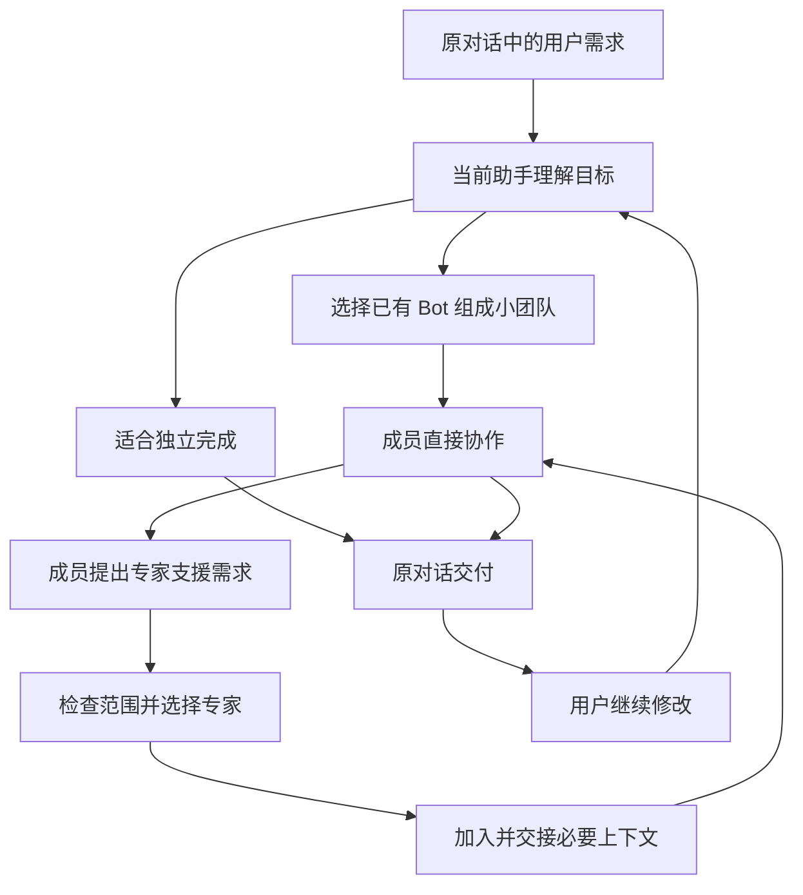

# Supergroup 整体方案

2026-11-18 起的界面设计见[取消独立 Bot 模式，回归 DSH 原生工作区](native-bots-workspace.md)。新方案将 Bot 和群入口放回原生桌面，沿用现有自动协作授权；下文的旧模式方案供迁移时对照。

> 2026-11-13 自动协作授权 P0 已完成仓库实现及[日常部署](../../verification/supergroup-collaboration-desktop-deploy.md)：一次开启后，任务内私信、委派、群协作与专家接续共用工作授权，文件模式保持原设置。双版本真实 Host 同包验收通过。见[授权方案](collaboration-authorization-proposal.md)与[最终验收](../../verification/supergroup-collaboration-authorization.md)。下方为此前设计与阶段记录。

> 交互升级：用户已批准[Bot 中心交互方案](bot-mode-proposal.md)及[B00–B04 开发计划](../../../tasks/supergroup/BOT-MODE.md)，并授权完成后的本地服务部署。B00 真实实验已发现原生命令逃逸，[前置门槛未通过](../../verification/bot-mode-b00.md)，后续实现等待最小宿主适配裁决。下方保留已实现 P0 的来源与协作约束。

日期：2026-11-12。设计基线：DSH-Bot `0.6.6`，`main@f6e3c64`；开发 API 锁定 `dsh-v0.2.1-rc.2`。状态：**已在 `codex/supergroup-p0` 实施，当前结果与边界以[实施验收](../../verification/supergroup-p0.md)为准。** 下方保留产品合同和路线选择依据。

Supergroup 是 DSH 中的一种协作模式：用户在一个对话中表达需求，助手按需组织已有 Bot，成员遇到能力缺口时自动邀请专家，最后在发起对话交付结果。用户只需要说清要完成什么，并在确实需要时补充信息或作决定。

**P0 必须完整覆盖自动组队、协作中邀请已有专家、原对话交付，以及同一工作内的继续修改和停止。** 只实现创建群、启动子代理或跳转到群查看答案，均不构成 P0 完成。

本方案作为后续 Supergroup 的产品与开发入口，取代旧提案中将项目接续、决策收件箱、真实事件源并列为首批产品入口的安排。已有主动跟进功能及其验收记录保留；不扩大尚未验证的工程执行、定时恢复或外部发送能力。

| 阅读入口 | 内容 |
| --- | --- |
| 本文 | 用户体验、P0 范围、总体结构与关键行为 |
| [原生复用与验证门槛](native-reuse.md) | DSH 公开能力、现有代码缺口与 SG00 路线选择 |
| [开发计划](../../../tasks/supergroup/README.md) | SG00–SG05 任务、依赖、文件落点和逐项验收 |

## 1 用户如何使用

在现有设置或新会话模式选择中开启 Supergroup，记住选择。沿用 DSH 的模型、工作区和权限入口；人数、并发和预算采用默认值，放在高级设置中。开启模式不要求用户创建项目、建立专家群、选择成员或填写任务表。

首版优先复用原生新会话与 preset 组合入口，具体组合由 SG00 验证后确定。既有 Bot 主会话必须保留原 preset 身份、主会话绑定、记忆和审批；单独注册一个名为 Supergroup 的 preset 不代表能接管该 Bot。若采用独立协调会话，则准确显示其身份，不声称继承某个 Bot 的私有记忆。已有 Bot 对话内动态开关需要单独验证；不得在已开始会话上强行切换 preset。若宿主只能让新对话生效，界面明确说明生效范围，不丢失或重建用户已有对话。

实施选择：在既有 Bot preset 的所属 Agent 内动态注册协作工具与目录，通过原生 ConfigEditor 局部保存模式设置；保留原主会话与 preset。当前仅支持本次用户消息中的文字材料，协作成员仅开放群互通工具；附件、工作区读取及外部操作不在本版范围。

以下是目标交互示例，并非当前运行截图：

> 用户：结合这份方案和项目现状，帮我评估是否值得做。
>
> 助手：我会结合产品价值和实现成本评估，邀请产品与技术 Bot 分别检查。
>
> 协作卡片：产品 Bot、技术 Bot 正在协作。可展开过程或停止。
>
> 系统动态：技术 Bot 需要数据库迁移方面的支持，已邀请数据库 Bot 加入。
>
> 助手：这是建议方案、主要依据和仍存在的分歧……
>
> 用户：按第二种方案继续，把迁移步骤细化。
>
> 系统接续同一工作，保留必要成员和已确认结论。

默认只有当前聊天和一张折叠的协作卡片。展开后查看真实成员过程、分工、主要交流、失败和费用；卡片绑定实际 Group/Session，不维护另一份群聊天记录。用户可继续输入要求、点名成员、停止工作，最终结果直接出现在原对话。

只有影响结果的关键信息缺失才澄清。当前消息、附件与已确认背景能够确定的内容直接使用；不询问内部项目名、群名、工作 ID 或成员名单。用户在同一对话有多项工作且指代不明时，简短确认所指事项。

## 2 P0 的完整范围

| 能力 | P0 要求 | 明确边界 |
| --- | --- | --- |
| 按需组队 | 判断独立完成或协作，自动选择可用的已有 Bot，并给出任务分工 | 简单任务不建群；不根据角色名称假定 Bot 拥有工具、资料或专业能力 |
| 真实群协作 | 保留 Bot 身份、模型与工作区设置；成员可直接求助、回复和交换进展 | 不用多段角色扮演文本冒充独立成员；不要求主管逐条转发成员消息 |
| 协作中邀请专家 | 任意成员可提出能力缺口，系统选择并邀请已有专家，交接上下文后继续原工作 | P0 不要求自动创建全新永久 Bot；不能满足时准确说明缺口 |
| 原对话交付 | 当前助手综合实际成员结果、产物引用、分歧与未完成项，准确返回发起消息对应的工作 | 不把成员空闲或工具成功当业务完成；不把用户沉默记作验收通过 |
| 继续与停止 | 用户继续修改命中原工作；停止覆盖执行中成员、待邀请和待回传操作 | 重启后先核对已发生的事实，不自动重放结果不明的调用 |

首批场景采用用户提供材料的分析、方案比较与评审，以验证协作价值。使用文件读取、联网或其他工具时继续遵循该宿主、Bot 和任务实际可用的能力；不得借 Supergroup 开关开放已有受限执行路径。

没有足够合适 Bot 时，当前助手可独立完成并说明限制，不能把降级行为记作自动组队通过。运行验收夹具准备真实独立 Bot 身份，普通用户无需为每次任务手工建 Bot。

## 3 总体结构与复用顺序

当前助手负责理解需求、组织初始分工、处理需要决策的增员和最终交付。Host 负责身份校验、准入、去重、持久关联与实际派工；成员在范围内直接交流。原生 Team 要求只有 Lead 能创建 teammate，因此“任何成员可以请求增员”与“由 Lead/Host 执行增员”同时成立，不需要用户介入每次邀请。

优先顺序固定为：**DSH 原生能力 → 公开 API 包装桥接 → 现有 DSH-Bot 服务扩展**。只有这些路径都无法满足的能力才讨论新实现，并记录不能复用的证据和最小自研范围。

1. SG00 首先验证原生 Agent Teams 能否通过公开能力绑定已有 Bot 的身份、独立 preset、模型、权限和群展示。若成立，原生 Team roster、任务和执行是权威；已有 [Collaboration](../../../packages/dsh-bot/src/host/collaboration/service.ts) 只维护身份链接与视图。
2. 若原生 Team 无法通过公开桥接满足已有 Bot Group 的约束，记录失败证据，复用现有 [Groups](../../../packages/dsh-bot/src/host/groups/service.ts) 和原生 Subagent，补当前聊天到群的连接层。此路线由 Groups 管理成员和群轮次，不同时双写另一套原生 Team roster。
3. 两条路线选择一条作为该项工作的执行权威；原型期间可以比较，生产同一工作不能同时运行两套调度与任务板。原生能力验证通过不能代替既有 Bot 身份、动态增员和回传组合的验收。

不新增 Agent runtime、通用工作流引擎、定时轮询器或独立业务数据库。现有群根仍保持无模型；在 Groups 路线中，对外负责的助手就是原对话里的 Bot，群根不改为另一个主管。

## 4 自动组队与动态增员

初次选择依据是任务所需能力、可独立分工或复核的价值，以及 Bot 当前可用性、工具、模型和授权。只读能力目录用于匹配，不把 Bot 的私人聊天历史当成员简历。已有配置不足时承认能力未知。

建议初始默认 2 名工作成员、最多 4 名工作成员，当前对话助手另计；这些是待 SG00/SG05 校准的配置默认值，不能硬编码在业务逻辑。任务共用并发、请求次数、超时和费用约束；原生缺少可靠金额时显示未知，用可执行的请求与时间上限约束，不能将未知费用视为零。

一次专家支援包含：需要解决的问题、缺失能力、相关依据、可选的候选 Bot 和期望返回内容。它绑定请求者的真实工作/成员/调用身份。Host 去重并复核：是否已有成员能处理、是否已有同类邀请在进行、候选是否可用、是否在共享范围与预算内。

专家已在群内时直接交给该成员；确实缺人时再邀请。新专家也能提出后续支援需求，但共享整项工作的限制，不因接力产生新的无限预算。任务停止后不再受理邀请。专家完成后可以待命，不自动加入每一轮，也不因本次加入自动成为所有未来任务的常驻成员。

**增员必须同时解决执行交接和数据可见范围。** 当前 `members.edit` 增加成员版本，而 `turn-runner.enqueue` 会拒绝旧版本继续派工；当前数据流还会校验完整群受众。不能仅调用成员编辑，再删掉版本或权限检查让旧轮次继续。

Groups 路线首选验证“安全交接后建立关联的新轮次”：保留已完成结果，明确处理正在执行和迟到结果，提交新成员与共享范围后，以准确来源开启关联轮次；用户仍看到同一项工作、同一个群和同一张卡片。若公共能力支持同轮次受控扩员，可在 SG00 提供正反例后选择。不能为增员重新执行已完成子任务，或把模型生成的摘要伪装成人类新指令。

同群新轮次仅解决执行版本，不会自动解决根会话累计的数据标签。现有标签按读者集合交集继承，SG00 必须证明有效授权怎样作用于准确资料及根会话的数据流；不能重置标签、复制到新群或重述摘要以规避限制。无法表达合法共享变更时，该路线保持能力阻塞。可以等待成员到达安全交接点，但专家必须在本项工作最终交付前加入并实际参与。

交接内容限于当前目标、已确认约束、相关证据、已有结论、争议和具体支援问题。摘要继承原资料的共享限制，摘要本身不能使资料获得更宽权限。不得向新成员复制个人私聊、全部群历史或凭据；原资料不允许该专家读取时，省略相应资料或在原对话请求新增范围。

## 5 单一工作关联与原对话交付

主对话与群之间只新增必要关联和操作收据：原会话与输入、Bot 代际、任务范围版本、群或原生 Team 身份、关联轮次、专家请求和交付版本。优先扩展现有 storageDomain；若已经有 Ticket，关联该 Ticket，不建立并行任务状态库，也不要求普通聊天先创建 Ticket。

原生 Session 保存实际输入输出，选定的群后端保存成员与执行事实；卡片状态从这些事实推导。关联收据记录“发给哪个原对话、哪一版结果是否已投递”，不复制所有聊天正文或取代执行状态。拟定字段与接口在 SG00 后收敛，不预先增加新框架。

短任务优先通过当前工具结果回到原助手。异步任务使用 DSH 公开 followup/事件能力，并保存准确来源、工作与交付引用。两个需求同时执行时，结果分别回到自己的工作，不因“最近会话”或“最后一个群”选错目标。重复通知只展示一次；未确认投递保留待核对状态。

最终交付包含成果或结论、支撑证据、成员之间的实质分歧和未完成部分。部分成员失败时可以交付可靠部分并说明影响，不以一段汇总文本抹掉失败。用户后续修改生成新的工作修订和交付版本，保持旧证据可追溯。

## 6 权限与生命周期

模式设置保存用户允许的协作范围和上限，每项工作再绑定真实人类输入与具体资料范围。组队、群内互通及增员在已确认范围内自动进行；新增资料访问、外部写入或预算扩张继续使用原生批准入口，并回到原对话解释具体差异。

“开启模式”不等于授权访问所有 Bot 私聊，也不意味着永久自动执行任何目标。当前 `bot_delegate` 强制逐次 ask；本方案要求通过受限的新入口和原生批准组合验证减少重复确认，不能隐藏 ask、伪造已批准事件或关闭现有来源 guard。原生 child 初始来源的限制必须由 SG00 明确解决或报告阻塞。

停止覆盖当前工作所有成员执行、在途准入和结果回传，不改用户其他工作。关闭模式后不接受新协作调用，当前工作按可解释的取消/收尾合同处理；配置保存不得重载整个 Bot 破坏已有会话。资源、订阅和工具注册都纳入 `ctx.effect` 生命周期。

恢复先核对原生执行和持久收据。已交付不重发，已完成子任务不重跑，未确认是否执行的操作保留 unknown；必要时由用户在原对话选择继续。P0 必须保证安全、准确的恢复状态，跨日无感接续和常用团队管理在 P1 细化。

## 7 交付阶段

| 阶段 | 交付内容 | 完成依据 |
| --- | --- | --- |
| P0 | SG00 原生验证 → SG01 入口与关联 → SG02 自动组队 → SG03 动态邀专家 → SG04 同屏交付与接续 → SG05 同包验收 | 一句需求启动两个已有 Bot，成员主动请求第三位专家，第三位实际参与，结果准确返回原对话且可继续修改；同时通过失败与停止场景 |
| P1 | 常用团队复用、跨日接续体验、已确认共同背景、任务级临时角色 | 不增加日常前置步骤，身份、上下文和恢复行为有真实验证 |
| P2 | 用户通过对话约定持续关注，再接一个真实事件源 | 事件在约定范围内触发原团队协作，结果仍返回原对话；定时与执行限制单独验证 |

项目接续体现为“继续上次”；需要用户决定的事项优先在当前对话提出；事件源在用户约定持续关注后接入。P0 不新增项目中心、决策收件箱、专家配置向导或强制验收表。原有页面仍可用于高级管理与历史查看。

分支实施、Host/UI 与打包验收见[当前记录](../../verification/supergroup-p0.md)。真实模型质量与发布分别记录，不将合成模型结果当作真实语义质量，也不将隔离安装当作日常桌面部署。
