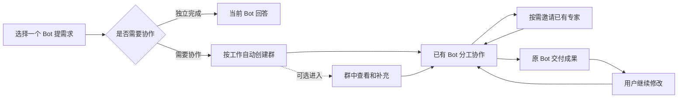

# Supergroup Bot 中心交互方案

日期：2026-11-12。当前状态：**已按用户批准的 B00–B04 实现并部署独立本地审批服务。** Bot/群导航、自动组队、途中增员、群内补充及原 Bot 交付已通过最终包真实 Browser 验证；双窗口同包重连和冷启动也通过。独立 Web runtime 为 `0.2.1-rc.2`；当前桌面及数据未改动，完整新模式桌面 UI 和真实模型质量未外推通过。详见[交付验收记录](../../verification/bot-mode-delivery.md)。

本文保留产品合同；原始 B00 反例见[B00 记录](../../verification/bot-mode-b00.md)，已授权的适配依据见[最小宿主适配](host-command-routing.md)。原 Supergroup 的既有证据见[历史验收](../../verification/supergroup-p0.md)，本轮状态与阶段范围见[实施计划](../../../tasks/supergroup/BOT-MODE.md)。

开启 Supergroup 后，DSH 的日常交互以 **Bot 和 Bot 群**为对象。用户找到一个 Bot 就能持续聊天，复杂工作由 Bot 自动组队、途中邀请已有专家，最后向发起的 Bot 收取结果。用户不需要新建、命名、选择、分叉或归档 Session，也不必管理项目、任务板或内部执行轮次。

本方案升级用户界面与导航合同，继续使用已实现的 Groups、原生 Subagent、模型、审批和存储。底层 Session 负责消息与执行记录；Bot 的身份、职责和记忆才是用户持续接触的对象。

## 1 审批结论与范围

以下四项已获用户批准，作为本轮产品合同：

| 决策 | 已批准的行为 |
| --- | --- |
| 模式形态 | 一个 Supergroup 开关同时进入 Bot 中心界面并开启按需协作；日常页面只出现 Bot 与群，模型和权限仍可直接操作 |
| 对话与协作 | 一个 Bot 是持续入口；一项工作对应一个自动群；同工作继续修改复用群；允许用户进入群直接补充和点名，最终成果由原 Bot 负责交付 |
| 首版范围 | P0 完整交付 Bot 导航、持续聊天、可参与的真实群、途中增员、原 Bot 交付、停止与恢复；右栏先提供已有资料和成果的引用 |
| 开发门槛 | 全部 Session 入口接管与群输入桥接纳入最终验收；必要宿主适配已获授权，仅应用于仓库内独立审批服务，不以残留 Session 的界面作为完成 |

用户后续已明确授权仓库内宿主副本适配、必要隔离启动选项、全部功能实现和本地审批服务部署。该授权不包括修改当前桌面安装、日常 `~/.dsh`、只读参考树、真实付费模型会话或公开发布。原 B00 失败是适配前的历史证据；本轮以冻结候选的逐项同包结果判定交付，不能用源码完成替代运行验收。

## 2 三栏界面

以下为目标结构，尚非运行截图：

```text
┌─────────────────┬────────────────────────────────┬──────────────────┐
│ 搜索 Bot 和群  ＋ │ 通用助手                 详情  │ 通用助手          │
│                 │                                │                  │
│ 通用助手         │ 你：帮我评估这份方案……          │ 详情  资料        │
│ 方案评估群 · 处理中│ 助手：已请研究员和审阅员协作。   │ 职责、模型、权限  │
│ 研究员           │                                │ 已保存的记忆      │
│ 审阅员           │ [方案评估群 · 3 位成员]          │ 本次资料与成果    │
│                 │ [查看讨论]              [停止] │                  │
│ 更早的群         │                                │ 群内额外显示成员  │
│                 │ 助手：这是建议和需要确认的点……   │                  │
│ 设置 · 模式      │ 输入消息…    模型  访问权限 发送 │                  │
└─────────────────┴────────────────────────────────┴──────────────────┘
```

### 左侧只有交互对象

- Bot 和群混排，置顶对象优先，其余按最近对用户可见的活动排序。后台工具事件不反复把群顶上来。
- 每项显示头像、名称、最近一句公开消息、时间、未读和必要的工作状态。群头像组合真实成员头像；途中加入专家后更新人数和头像。
- 点 Bot 进入该 Bot 的持续对话；点群进入该群的讨论。重启后恢复最近对象与阅读位置，后台校验对象代际与权限。
- 搜索默认找 Bot 和群；在对象内查历史时仍以该 Bot 或群定位，不打开 Session 列表。P0 先复用现有可核实历史范围，不承诺全局语义检索。
- 「＋」只提供新建 Bot 和手动建群，自动协作不需要用户使用。空目录引导创建一个 Bot；能力不足时说明缺口，不悄悄生成永久 Bot。
- 已结束的自动群保留，可在「更早的群」找到；手动归档只影响列表，不删除记录、不等于停止工作。运行中的群须先停止再归档。

### 中间围绕当前对象聊天

个人 Bot：固定显示该 Bot 名称和头像，按时间展示用户与 Bot 的消息。换主题直接输入新的要求；只有多项工作确实无法判断指代时，才询问一句或显示少量可选事项。没有「新建会话」「切换 Session」「分叉 Session」等操作。

协作群：每条公开发言显示真实 Bot 的名字和头像，用户发言单独区分。加入、停止、需要决定等事件以简短系统动态展示。工具执行和成员过程按需展开，不把子执行日志全部铺进群正文。普通进度不唤醒所有成员，未被点名的 Bot 不因展示消息而启动模型。

输入框保留草稿、发送、停止、模型与访问权限入口；群内可以 `@Bot`。个人 Bot 使用其原配置，群沿用已有效的群成员模型与权限控制。切换 Bot、群和设置时草稿按对象隔离，打开群或右栏本身不调用模型。

### 右侧按需展开

| 对象 | 右栏内容 | 首版行为 |
| --- | --- | --- |
| Bot | 详情、资料 | 职责、模型、访问范围；跳转既有记忆管理；已授权资料和交付引用 |
| 群 | 详情、资料、成员 | 当前目标、进展、停止；本工作资料与成果；实际成员、职责、状态及模型 |

右栏默认收起，点标题或详情按钮展开。宽屏可同时显示三栏；窄屏显示当前聊天，列表和详情按需覆盖，返回仍定位原 Bot 或群。主题、中英文、键盘焦点、未读播报与可访问名称均列入验收。

「资料」首版是已有内容的来源与成果索引，不新建知识库：当前可共享文字、已有受权附件引用和成果引用各自核验权限。Supergroup 成员当前只消费文字，附件只可按已支持的入口查看，不宣称成员已经读取附件。上传解析、检索增强、目录同步和自动文件访问留到后续资料库能力。

## 3 从一句话到交付



1. 用户对通用助手说「评估下面这份方案，给出实施建议」，粘贴材料。简单问题直接回答。
2. 需要分工时，助手选择允许的已有 Bot，自动命名「方案评估群」。左侧出现该群，当前 Bot 中出现简短进展，不自动抢走页面焦点。
3. 成员按自己的真实身份工作并相互交流。技术 Bot 发现缺口，提出邀请专家；在既有共享范围内自动加入，群中显示加入动态。
4. 用户可继续留在当前 Bot，也可进群说「重点看成本」或 `@审阅员`。补充绑定同一工作，不新建第二个群、不重新执行已经确认完成的部分。
5. 原 Bot 综合实际结果，交付结论、依据、分歧和未完成项。群内显示同一成果的引用，用户不必读完整讨论。
6. 用户说「按第二种方案继续细化」，沿用同一工作、群和已授权材料。出现多个合理目标时才简短澄清。

页面不显示内部 workId、turnId、sessionId。定位与校验由后台完成，供诊断的技术信息只在明确展开的执行详情内出现。

## 4 长期 Bot 与群的生命周期

**Bot 身份长期稳定。** 点击 Bot 复用已有 `openConversation(botId)` 和主对话绑定，不能每次打开创建新的底层会话。职责、模型、工具、记忆沿用已有配置。长内容先使用原生上下文管理；自动跨底层会话拼接、无限历史记忆不作为本轮新增承诺。缺少旧信息时明确请求必要材料，不声称已记住全部历史。

**群按工作稳定。** 同一工作的追问、返工和中途增员不新建群；不同目标独立建群，避免只因成员相同就合并资料。P0 不做自动跨工作复用常用团队。重放同一真实输入不能多建群，同一个群在列表只有一项。

**群内可继续参与。** 自动群与手动群都能接收真实用户输入。自动群中的补充归属原工作，保留发起 Bot 的交付责任；手动群沿用既有群行为。后续输入若改变了资料范围或预算，按新增差异处理，不继承不相干工作的授权。

**已结束不等于已删除。** 工作结束后不再轮询模型，历史仍可打开；归档只是收起对象。停止针对整项工作，包括在途成员和待邀请项，明确记录可能已完成但无法确认的结果。删除沿用既有单独操作，不与归档或关闭模式混用。

**多工作不串线。** 用户在群内输入天然绑定该群的工作；在 Bot 内引用某成果或工作卡时绑定该工作。没有引用时只在唯一合理目标下继续，不能总把「继续」送到时间最近但不相关的工作。P0 沿用原生发送和排队限制，不增加同一 Bot 的并行主模型循环；群工作仍使用既有并发能力。

## 5 群中补充与原 Bot 交付

这是本轮已实现的 Host 增量：保留发起 Bot 主对话的人类输入核验，并新增严格 owner Remote 的群根真实输入桥接、工作 revision 与输入/交付收据。以下合同仍须在最终同包 E2E 中逐项核对，不能把源码存在当作运行通过。

| 行为 | 必须保持的合同 |
| --- | --- |
| 用户在自动群补充 | 来源指向真实群根人类消息、该群、所属工作和当前用户；Host 确认身份与范围后排队，模型成员的消息不能冒充人类输入 |
| 工作执行中追加 | 复用现有群队列和安全轮次交接；先显示已收到，明确生效阶段；不修改已冻结的成员版本或绕过原数据标签 |
| 与原 Bot 同时输入 | 同一工作内串行核对 revision、输入收据和取消状态；冲突保留消息并让用户可重试，不覆盖一方输入 |
| 邀请专家 | 继续使用原受控准入、请求去重和预算；新专家只拿有权读取的工作材料，不把原 Bot 私聊搬进群 |
| 汇总回原 Bot | 原 Bot 保持唯一最终交付责任；携带真实群输入与执行来源引用，不把群内容伪造成新的私人主对话人类命令 |
| 原 Bot 忙碌、离线或被删除 | 已完成结果保留，显示等待交付或无法送达；不冒用另一 Bot、不自动重放不明请求；恢复后以交付收据核对 |
| 群内显示成果 | 引用同一工作和成果版本，避免把私聊全文再投递到群；仅能显示本群获准公开的结果 |

对每个结果版本记录一次可核对交付。用户查看群或打开原 Bot 只更新阅读状态，不能触发新的总结模型；两处显示的是同一成果关系，不建立互相转发的循环。已有 Bot 主会话收到群补充后的安全接续使用原生后续执行与真实来源引用；最终验收须核对其输入与交付收据，不依靠伪造 user source 或解除 continuation guard。

## 6 模式开启与退出

用户仍只使用一个「Supergroup」开关。不开新 Bot、新群或模型会话来完成设置。

- 开启时保存原导航和用户偏好，确认 Host 配置与 Client 能力，安装本模式的临时 UI 注册。成功后进入上次选中的 Bot；首次进入优先使用当前明确所属 Bot，否则展示 Bot 列表供选择。
- 模式恢复时先显示简短加载态，等对象绑定确认后显示聊天，避免先闪现 Session 列表或错误 Bot 的内容。
- 关闭沿用当前 Supergroup 的停止语义：阻止新组队，取消本模式工作并核对状态，然后释放 UI 接管、恢复原生导航。开关旁显示「关闭将停止正在进行的协作」；普通 Bot 配置和历史保留。
- 切换失败时显示可重试的明确状态，Host 与 Client 状态必须重新核对。不能 UI 显示关闭而后台仍接收新组队，也不能界面半接管后假称开启成功。
- 同一 Host 的窗口共享模式开关，选中对象、阅读位置与编辑中的草稿保持各自的交互状态；并发设置按版本核对。存在其他插件占用相同布局入口时，先核查兼容，接管失败保留明确状态，不能静默吞掉另一插件的必要功能。
- 查看原生插件、模型等设置保留在左下「设置」；返回仍定位原对象。退出 Supergroup 后可访问原生普通工作区和历史。
- 本轮不新增“协作开启但界面关闭”等第二套用户模式。内部可以有启动、停止和失败状态，不能转化成多项必填配置。

## 7 原生复用与最小新增内容

| 层次 | 已有能力与源码依据 | 本轮增量 |
| --- | --- | --- |
| 左中右布局 | DSH 公开 `sidebar`、`main`、右栏 slots；`ui-layout/src/client/index.ts:58–87` | 模式化 Bot 导航和标题，保留原生中央 Conversation |
| Bot 定位 | 本项目 `client/index.tsx:199–216` 调用 `openConversation(botId)`；`host/main-session.ts:135–185` 保存绑定 | 对象导航以 BotKey/GroupKey 为入口，不要求用户输入或选择 Session |
| 消息和输入 | 公开 `conversation.content` factory、View、composer、模型/权限控制；已有群 `workspace-group.tsx` | 原生个人聊天继续复用；群复用已有 composer 和真实 speaker，不假定它自动获得全部个人审批行为 |
| 群与协作 | 已有 Groups、Supergroup work、原生 Subagent、准入和交付 | 群内真实输入桥接、原 Bot 回交付关联、列表和资料引用投影 |
| 右栏 | 已有 Bot panel、公开 sidebar-right tabs、群成员和资料记录 | 详情/资料/成员的对象化呈现，控制默认展开与窄屏行为 |
| 模式设置 | 已有 `plugins.bundle.config`、owner Remote、ConfigEditor、volatile 更新 | 进入、恢复、退出时的 UI 生命周期协调与失败核对 |
| 快捷键、消息分支和深链 | 原生 workspace 命令与消息尾分支均可绕过单纯侧栏替换 | 仓库内 shortcuts/chat 适配提供临时模式与执行时重核；可信对象深链由公开 Conversation 槽保护，最终同包行为待验收 |

`sidebar` 是整个左栏的公开 single slot，替换后其内部子 slot 会随原实现失活；新左栏需通过公开能力承接必需的设置与导航，不能同时依赖原 sidebar 私有组件。通过有序注册与 disposer 恢复原实现，全部纳入 `ctx.effect`。

最小新增状态是对象选择、列表偏好和必要的输入/交付关联；复用现有存储域并版本化。消息、成员、执行状态、预算和权限各有既有权威，不新增聊天库、轮询调度器或模型运行时。查询投影必须按 Bot/Group 完整身份校验，不能只靠显示名或同 preset 猜测归属。

### 适配基线与当前约束

未适配的固定 rc.2 全局快捷键 API 没有 `when/isEnabled` 或修改其他注册者 resolver 的入口，同 ID 和冲突默认键会报错。`ui-workspace` 在同一插件中提供导航服务并注册 Session 快捷键，而原生 Conversation 依赖这个服务。卸载 workspace 可能使聊天一起失活，不能作为已成立的解决方案。

需要覆盖左栏、macOS `shell.leading`、聊天头部、全局新建/搜索/分叉/归档快捷键、应用菜单、旧深链和冷启默认路由。B00 必须同时取得真实 Browser 与目标版本隔离桌面桥的证据；菜单、快捷键、深链和退出恢复不能推迟至最终验收。没有隔离桌面证据则保持门槛未通过。仅隐藏按钮或 CSS 遮挡不能通过验收。不永久修改用户键位、不拦截全局 DOM 事件充当原生命令路由、不修改私有 registry。

该缺口已按用户授权由仓库内的 shortcuts/chat 适配解决：`registerCommandMode` 管理窗口内命令，原生 Chat 通过 `modePresentation` 隐藏分支，并在执行时调用 `resolveCommandMode` 重核。`commandModeSurfaces` 只有原生 Chat 登记 `chat.branch` 后才允许 Client 开启完整模式。适配仅用于独立审批 runtime；参考树和当前桌面安装继续只读。新增超出本轮范围的宿主改动仍须另行说明。

## 8 历史与数据范围

- 已有 Bot 主对话直接复用。其他历史只有核实归属后才作为该 Bot 的历史入口，不按名称合并，不自动注入当前模型上下文。
- 已有普通 DSH 历史继续留在原存储，Bot 模式不将其自动归到任何 Bot。退出模式后可正常访问。
- 旧链接可核实属于 Bot/群时，进入相应对象并定位原消息；无法核实时显示简明说明，不猜测对象、不跳到 Session 管理页。
- 资料展示、成员能读到的资料与长期记忆分别沿原权限校验。群讨论不自动写入每个 Bot 的私人记忆，显示资料条目不等于新专家获准读取。
- 插件卸载或模式关闭只清理自身注册和临时资源；数据迁移必须可审计。不会因 Bot 改名、删除重建或关联缺失把旧私人记录挂给新 Bot。

## 9 开发顺序和交付边界

| 阶段 | 优先级 | 退出结果 |
| --- | --- | --- |
| B00 完整接管与群输入实验 | P0 前置 | 只用公开能力证明全入口 Bot 化、原生聊天和审批可用、群补充准确接续、关闭可恢复；失败即提交能力缺口 |
| B01 Bot 导航与模式生命周期 | P0 | Bot/群列表、对象选择、搜索入口、所有原生 Session 入口处理、冷启和退出恢复 |
| B02 持续聊天与历史呈现 | P0 | 点击 Bot 稳定进入原对话，草稿隔离、模型权限保留、旧记录和深链准确定位 |
| B03 可参与的 Supergroup | P0 | 自动组队、真实成员交流、群内补充、途中增员、原 Bot 交付、同工作继续与停止 |
| B04 右栏与整体验收 | P0 | 详情/资料引用/成员、窄屏/中英/明暗/键盘、双宿主及完整同包回归 |
| 后续资料库与团队增强 | P1 | 明确授权的文件解析检索、常用团队、自动跨工作接续；另行设计验收 |

已有 Supergroup 不是重写对象。B03 只补本轮新增的群参与与呈现合同，并回归原有自动组队、动态增员和交付。B01–B04 源码已按上述范围连续完成，阶段之间不重复请求原范围审批；当前正在统一冻结包验收。仓库内必要宿主适配已有授权，只有超出本轮范围的变更才另行处理。

不把完整资料库、自动创建永久专家、跨项目文件访问、工程执行、外部 IM、定时或真实事件源加入本轮隐藏依赖。首版重点证明用户可以仅面对 Bot 和群完成同一项工作。

## 10 验收标准

以下是最终同包验收合同。B01–B04 源码已实现，构建、单测、Host 机制、Browser 与隔离桌面命令桥证据分别记录；本表不预写统一 PASS。冻结候选的 E2E 正在进行，实际 PASS/FAIL 与未运行项以[交付验收记录](../../verification/bot-mode-delivery.md)为准。

| 用户路径 | 通过标准 |
| --- | --- |
| 首次开启 | 一个开关进入 Bot 界面；保留现有 Bot，零模型请求，不创建无业务意义的 Session 或群 |
| 全部入口 | 鼠标、键盘、macOS 窗口控件、菜单、深链、冷启动均不暴露 Session 管理；不靠忽略快捷键场景通过 |
| 持续聊天 | 多次切换与冷启仍回到同一 Bot；身份、主对话、记忆和模型不被重建或串用 |
| 草稿与历史 | Bot/群之间草稿隔离；已核实历史能定位；普通历史和未知归属不泄漏到当前 Bot |
| 简单请求 | 当前 Bot 直接完成，群创建和成员请求为零 |
| 自动协作 | 自动建一个真实群，成员独立身份/模型；用户无需命名或选人，不抢当前焦点 |
| 群中参与 | 用户群补充真实落盘、准确接续原工作；与 Bot 输入冲突时不丢消息、不伪造授权、不串目标 |
| 途中增员 | 2→3 真实专家在交付前加入并贡献；重复请求只准入一次，权限和预算不扩大 |
| 原 Bot 交付 | 群中参与后仍能回原 Bot；同结果版本不重复，忙碌/离线/重启保持可核对状态 |
| 停止与关闭 | 停止整项工作，关闭恢复原生入口和键位；迟到结果不触发新的执行；未知状态不盲重跑 |
| 原生能力 | 个人与群的模型、访问范围、实际支持的审批路径和停止可操作；旧群/记忆/主动跟进回归通过 |
| UI 与生命周期 | 中英、亮暗、宽窄屏、键盘和读屏；开关反复切换、插件卸载无重复注册、串话或资源泄漏 |
| 同包验证 | 精确 tgz 与适配产物在独立 Web `0.2.1-rc.2` runtime 核对；隔离桌面 `0.2.2-rc.2` 副本命令桥单独记证，不扩大为完整桌面 Bot UI 验收 |

合成模型用于可重复验证路由、预算和身份；真实模型是否合理选人、协作质量与耗时费用需要后续用户体验，不能由合成机制通过推定。

## 11 历史设计核查记录（适配授权前）

修改文件为本方案、[实施计划](../../../tasks/supergroup/BOT-MODE.md)、原设计与任务入口、`docs/PLAN.md`、`docs/dsh-api-notes.md`。产品源码、依赖、版本、日常桌面均无本轮变更；此前未提交的实现及未跟踪文件保留。

实际检查使用 `git status --short --branch`、`rg`、`sed`、`nl` 读取项目与固定版本参考源码。公开布局与 Bot 主对话绑定源码核查 **PASS**；完整快捷键接管与群输入新组合的运行证明 **FAIL（NOT_RUN）**。文档链接、格式及仓库检查结果在[实施计划的设计验收](../../../tasks/supergroup/BOT-MODE.md#历史设计验收适配授权前)登记。

以上为适配授权前的设计轮与原始 B00 记录。当时命令逃逸导致门槛未通过；用户随后已授权必要的仓库内独立宿主适配并要求全部实现。当前源码实现完成、最终同包 E2E 进行中，本文保留历史失败依据，不再表示等待授权，也不作为新界面已交付的证据。
