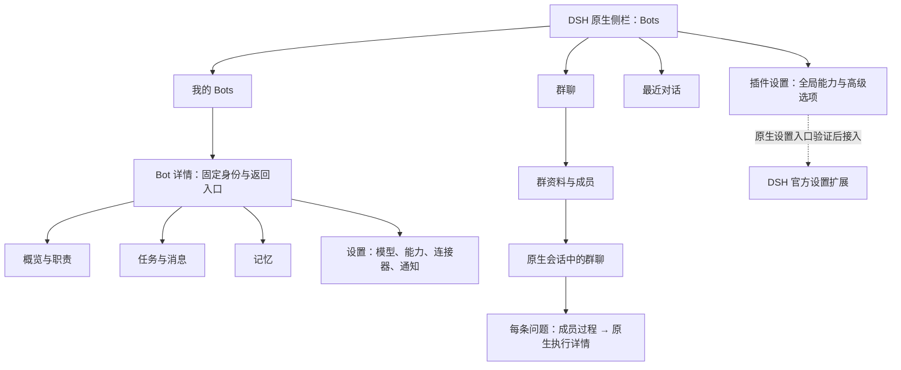

# DSH-Bot 全页面体验与原生复用优化方案

状态：待用户审批。日期：2026-11-01。审查基线：`4f16fe4` / 插件 `0.6.3`。本轮只做截图、评审和方案，不修改产品实现。

本文保留当时的审查状态，供追溯设计依据；后续实现与验证请查看 [UI 优化验收](../../verification/ui-completion/desktop-install.md)、[群管理验收](../../verification/group-management-ui.md) 和 [Bot 详情预览验收](../../verification/bot-preview-layout.md)。

84 张截图浏览器（`output/playwright/dsh-bot-review/index.html`） · [逐页覆盖与验证](coverage.md) · [Taste 评审](taste-review.md) · [原生复用清单](native-reuse.md)

## 建议决策

建议采用 **“保留 DSH 原生外壳，按 Bot 整理功能入口，收敛到官方公共控件”** 的方向。先解决配置对象不明确、表单默认全展开、记忆页被无关统计挤占的问题，再整理 Bot 详情、任务和群聊执行过程。

当前最值得做的三件事：

1. **始终知道在配置哪个 Bot。** 实测连接器选 api-beta，切换通知后变为 api-alpha。把 Bot 身份提升到公共页面上下文，切换分区不暗中换对象；未保存修改仍保留现有返回确认。
2. **每个页面先呈现内容，再进入编辑。** 连接器、通知默认展示列表/空态，点击新增才显示表单；记忆第一页直接展示搜索与记忆条目，将执行统计移到任务页。
3. **替换重复的 UI 基础设施。** 优先替换自制 Modal、普通按钮、输入、勾选、菜单、标签切换和 Toast。群聊调度、Bot 身份、记忆归属等领域逻辑继续保留。

## 证据边界

- 使用真实 DSH Web Host `0.2.1-rc.5` 和当前打包插件截图；Host、凭据、会话、浏览器临时文件均隔离在仓库 `.dsh-dev/taste-review/`。测试数据为 api-alpha / api-beta、模拟群聊和一条标注“演示数据”的记忆。
- 共 84 张页面、弹窗、滚动位置及运行状态截图；不是 84 个独立页面。桌面 1440×1000、中等宽度 768×1000、窄屏 390×844；亮暗主题均有覆盖，并非每一状态都做了完整的四象限组合。
- 页面经过实际点击和 DOM 检查，截图没有用静态页面替代，也没有隐藏真实页面元素。长页采用不同滚动位置补图；切换过渡态在索引单独标识。
- 原生 API 对照依据项目安装的 **rc.2 公共包入口、类型声明、包文档**；声明可用不等于完成替换验证。约定的参考源码目录当前不存在，因此未声称完成源码 tag 对照。
- 本轮没有使用真实模型、修改桌面账号/配置、发送外部消息或发布 GitHub 内容。新开单聊没有提交模型问题；群聊运行展示来自本地测试 Adapter。
- 未验证真实 IM 接入、启用后的 Agent Teams 看板、真实定时任务结果、大量数据和完整英文矩阵。当前宿主未启用相应能力的页面已如实截图，不能据此判定这些功能不存在。

## 信息架构

保留 DSH 的全局侧栏、会话树、原生单聊、权限体系和自动化任务入口。插件内部围绕“选 Bot → 聊天/查看工作/配置”组织，不增加另一套应用级侧栏。

“插件设置”只承载插件级内容。过渡期间保留当前入口，顶部用同一个 Bot 选择器与明确分区导航访问现有内容；后续收敛到 Bot 详情。旧入口应跳转同一页面状态，不复制两套表单或维护两份数据。

Bot 专属设置显示“api-beta / 通知”，共享记忆显示“用户共享记忆”，全局任务显示“所有 Bots”。跨对象切换要显式确认当前对象；按 `id + createdAt` 保持身份，防止同名或删除重建后误操作。

## 逐页改造

| 页面/流程 | 当前证据 | 建议行为 | 原生复用与验收重点 |
|---|---|---|---|
| 原生插件详情 | 01–02：包信息、来源、启用开关；没有 Bot 业务配置表单 | 保留官方页面。插件级配置若需可视化，通过公开设置扩展接入；入口名称与 Bot 设置区分 | 先验证 `settings.section` / `settings.plugins.tab` 及配置 namespace，不能把 Bot 记录 CRUD 直接当配置文档写入 |
| 我的 Bots | 03、58、67：列表已正常展示，但顶部 `+` 与列表新建重复，资料藏在更多菜单 | 保留列表；每行稳定呈现头像、名称、职责/最近进展、状态；主点击开聊，资料有明确次级入口；一个主要“新建 Bot” | 官方 Button / Menu / StateDot；同名 Bot 用次级标识消歧，ID 按需查看 |
| 最近对话 | 31：群和 Bot 混合，置顶/隐藏入口在行菜单 | 明确“最近对话”是时间排序入口；置顶、隐藏和未读保持一致；无结果有清空搜索操作 | 会话打开沿用原生 workspace/session 服务；不重建原生会话树 |
| 新建 Bot / 头像 | 20–22、59、78–80：快速创建已简洁，头像按钮横跨整行；高级区嵌套较深 | 保留“名字 → 创建并聊天”，头像改为紧邻名字的小入口；把模型、工作目录、迁移选项分组；高级区保留但名称具体 | 官方 Modal / Input / Checkbox；不强制新增复杂向导。创建会生成问候的提示继续保留 |
| 编辑 Bot / 能力 | 23–29、79：资料、编辑、兼容设置、记忆之间多层跳转 | 单一 Bot 详情面板，身份固定；基础设置、模型与能力、记忆可直接访问；把“兼容设置”拆为有意义的分组，旧字段放“高级与迁移” | 先原生 Modal，再评估长详情是否改为插件内部详情页；模型目录服务继续复用；不导入私有 ModelSelect |
| 新建工作目录状态 | 80，`BotEditor.tsx:124`：只在 editing 分支请求工作区，但创建页显示“正在加载” | 创建前显示“创建后使用共享 Bots 工作区”；确有异步请求才显示加载，有失败才提供重试 | 不把未开始的请求显示为加载。保存前不要求创建不必要的私有目录 |
| 连接器 | 04–05、48–50：列表为空也直接呈现长表单、凭据区、测试/应用入口 | 默认列表/空态；新增/编辑才开表单。分“服务定义、绑定 Bot、连接状态”；保存与测试/应用是两个明确动作 | MCP 与凭据后端已有原生桥接。保留引用名和“已保存/待应用/连接失败”的真实状态；长说明收进相应字段帮助 |
| 通知 | 06–07、51、68：历史、策略、静默时段及不支持的渠道说明混排 | 页内分“通知记录 / 通知策略”；空态说明如何产生通知；新增策略按需打开；不可用渠道说明原因和入口 | Toast 只负责短反馈，不能替代持久通知记录、投递回执和未读状态；不支持的渠道不显示可成功完成的操作 |
| 任务与消息 | 08、24、52、69：任务概览和 Bot 详情重复，空态只能读说明 | Bot 详情聚合后台任务、定时任务、队友消息。每种状态给主动作：查看/补充/停止；空态提供“去对话创建任务” | 原生 schedule / subagents 已在用。保留原生自动化总览；插件仅按 Bot 过滤、绑定和导航，不新增 scheduler |
| 协作 | 09、53、70：当前宿主不支持，界面以技术说明为主 | 改成简短状态和相关入口；明确“团队助手”与“独立 Bot 群聊”的区别，避免重复入口让用户误解 | 已桥接 `agentTeams`；启用后的任务板是否有公开可复用 UI 待 spike。不能以 Team 替换不同身份 Bot 的群聊 |
| IM | 10、54、71：首屏显示依赖 pin、契约检测等开发信息 | 主界面只展示可用/未配置/暂不可用和下一步；版本、协议和 pin 收到“诊断详情” | 保留能力门控；只有公共契约通过实际验证才开放连接/发送，不因视觉改造解除 gate |
| 记忆 | 11–16、29、55–56、72：顶部无关统计挤占空间，多层 tabs 和技术说明 | 从“这个 Bot 记住了什么”开始；搜索、新增与条目优先；私有/共享明确；候选、旧记忆和冲突放管理入口，保持可发现 | 共用一份 Memory 视图，Bot 编辑、详情与管理页只传不同上下文；不把共享/私有与原生会话历史合并 |
| 参考图谱 | 17、73：功能解释、后端状态、查询与表单堆叠 | 定位为记忆高级工具：先连接状态/查询结果，编辑动作渐进展示，技术诊断折叠 | 已复用原生 MCP 传输，未核实官方有可直接替换的图谱 CRUD UI；保留领域能力，不另造可视化图谱引擎 |
| 导入导出 | 18–19、57、74：JSON 长文本区占主位，说明偏工程化 | 分“导出 / 导入”；导出先选择内容再下载，JSON 展示放高级；导入先选择/粘贴文件，再预览变更、冲突、目标和排除项 | 不取消原有预览、确认、路径/凭据排除规则；JSON 预览可用官方 JsonTree / JsonBlock |
| 删除/复制/遗忘 | 30、63、76–77：动作语义已存在，但警告较密 | 明确对象、影响、是否保留记忆/文件；主文案解释用户后果，技术细节展开；独立区分删除 Bot 与停止工作 | 官方 Modal / Checkbox，保留业务确认和后端校验；本轮只截图预览，未确认删除 |
| 群资料与成员 | 32–36、47、75：已有成员头像与身份；编辑内嵌，刷新与主动作同权重 | 列表与详情分工；“打开群聊”为主，成员、模型来源、状态紧凑呈现；窄屏只显示一层，返回保留选中与滚动 | 使用公共 Menu / Input / Checkbox；群历史可见性确认保留 |
| 群聊消息 | 37–46：用户已右对齐、Bot 已左对齐，过程已随问题归属 | 保留当前正确布局。问题下默认一行状态，展开看每个 Bot，执行详情按需打开；“自动后续执行 0/32”等诊断移入高级详情 | 原生 reasoning Factory / conversation content 已复用；继续只读订阅，展开不触发模型；不恢复底部聚合任务块 |
| 群聊成员运行 | 43–46：每成员同时有执行详情、补充、停止等按钮，窄屏多行 | 状态、简短过程预览始终可见；常用查看明确；补充/停止收进各成员操作菜单，整个问题的停止入口清晰区分 | 官方 DisclosureRow / Menu / StateDot；键盘可达，停止一员不影响其他成员，动作不只依赖 hover |
| 原生执行详情 | 39：默认看到完整派发 prompt，技术字段占较大空间 | 默认定位执行过程；若公开 slot 能安全包装，则把插件生成的派发摘要与原始技术详情分层；原始记录保留 | 需要 spike，不能在原生组件内部打补丁或删日志。无公开方案时保留官方详情并给清晰标题，先优化行内摘要 |
| 单聊及两处 Bot 侧栏 | 65–66：原生聊天与插件快捷入口可用 | 继续使用原生聊天；统一列表行、身份、状态和“管理 Bots”去向；侧栏做快捷切换，完整管理集中在 Bots | 复用官方 slot/workspace，抽取插件内共享行视图；不把快速侧栏做成另一个设置应用 |

## 统一交互规则

- 页面标题表达任务，一级导航只选分区，当前 Bot 选择器只选对象。不要在同一区域同时堆叠多套同等权重的按钮导航。
- 主操作使用 DSH 官方 primary，次操作用 ghost/outline，删除放独立菜单项或确认页。资料、刷新、展开不是主操作。
- 表单统一“进入编辑 → 修改 → 保存/取消”。字段附近显示错误，保存中防重复提交；保存失败保留草稿；跨 Bot 切换及离开时继续提示未保存修改。凭据草稿不放共享持久状态。
- 长表单有清晰分组和可见保存区；内容滚动时不形成不必要的多层滚动容器。切换页面恢复合理滚动位置，不沿用其他页面的底部位置。
- 保留原生字体、字号设置和 `--dsw-alias-*` 主题 token，不引入新字体、配色库或 UI 框架。Taste 的方向用于层级与布局，不覆盖 DSH 选中态、按钮颜色、头像身份或原生控件行为。
- 桌面内容区按任务约束宽度；简单表单不让单个选择框跨满整个可用宽度；列表可以充分利用宽度，不为填空新增统计卡片。
- 窄屏采用单列与一层内容。菜单、保存、返回、成员操作可触达；关键触摸目标以 44px 为验收目标，通过公共组件尺寸/外层间距适配。原生外壳的问题分开记录，不覆盖 Host CSS。
- loading / 空 / 错误 / 不支持四类状态分开，提供实际能执行的下一步。不把“已投递”写成“已完成”，也不把无资料写成零结果。
- 图标、标题、标签、提示和错误提供中英文本；长名、同名、长 ID、无模型、无记忆都不破坏布局。

## 实施拆分与审批范围

每个阶段一个小 PR，按顺序合入，避免一次改完全部状态管理。以下是建议的开发范围，尚未创建新 Issue/PR。

| 阶段 | 建议 Issue / PR 主题 | 交付与完成条件 |
|---|---|---|
| U0 原生接口验证 | 公共控件、设置扩展与详情包装验证 | rc.2 与本地 rc.5 各跑 Modal 嵌套 Menu、Escape/焦点回归、主题、窄屏；验证 `SettingsForm` 与 Bot CRUD 的边界；确认设置 slot 的运行时 owner 和返回能力。输出可复用/不可复用清单，再开始迁移 |
| U1 配置入口与上下文 | 统一设置对象、表单入口和返回 | Bot 选择跨连接器/通知/记忆保持一致；共享/全局作用域明确；记忆从折叠入口移到稳定导航；执行统计移出记忆；新增表单默认关闭；原生 Modal/常规控件优先落地；修正新建工作目录伪加载 |
| U2 Bot 详情与任务 | 整理资料、能力、记忆、任务和消息 | 单一 Bot 详情入口、稳定返回；保留快速创建；长内容不塞入无限增长的 Modal；复用任务后端与原生打开入口；两处快捷侧栏共享身份和行组件 |
| U3 群聊阅读与过程 | 精简逐问题、逐成员执行展示 | 保留用户右/Bot 左；过程默认紧凑、按问题展开；成员菜单更清晰；原生详情只读；模型继承、权限和 @ 成员保持现有语义。详情 prompt 分层只在 U0 证明公开包装可行后做 |
| U4 完整验收与收敛 | 亮暗主题、窄屏、键盘、文案和旧样式清理 | 页面矩阵与关键交互覆盖；移除已无引用的自制控件和重复 CSS；补原生替换证据；无法桥接的功能保留清晰降级 |

推荐批准 U0–U4 的整体方向，先执行 U0、U1。U0 若发现公共能力不足，回退到“官方原语 + 最薄适配层”，并记录理由；涉及删除领域能力、引入新运行依赖或改变群聊执行语义的方案另行确认。

## 验收清单（开发阶段使用）

1. **上下文**：连接器切到 beta 后，通知/记忆/任务按设计保留 beta；全局功能明确标注作用域；删除重建同名 Bot 不接收旧草稿或旧响应。
2. **导航**：从列表、群资料、聊天入口进入设置后，返回恢复来源、选中、搜索、滚动和焦点；脏表单可继续编辑或放弃，不能悄悄保存。
3. **控件**：Modal 嵌套 Menu 时 Escape 先关菜单再关弹窗，Tab 不进入背景；焦点回触发点；IME Enter 不误提交；所有入口有名称，键盘可操作。
4. **首屏**：记忆页在 1440×1000 显示搜索和至少一条记录/空态；390×844 不被统计卡片挤走主要操作。连接器与通知默认没有展开的新建长表单。
5. **群聊**：用户右/Bot 左、逐问题归属、逐成员只读思考，展开收起不增大输入区、不增加模型请求；停止单成员、停止本轮和补充任务语义不串线。
6. **业务状态**：已保存/待应用/连接失败，已受理/已完成，空态/不可用各自准确；更新失败保留输入并可重试；旧响应不覆盖新身份/新版本。
7. **兼容**：rc.2/rc.5；中文/英文；亮/暗；1440/768/390；长名称/长说明；小数据与至少 50 个 Bot/成员上限内群聊的列表场景。这里是验收目标，不是本轮已通过结果。
8. **工程**：仅公共包入口与 slot；资源进入 `ctx.effect`；无私有导入、全局 CSS 覆盖、复制原生日志或密钥状态；`scripts/pnpm check` 通过，新增有意义的交互回归覆盖。

## 风险、非目标与回退

本轮不改群聊并发/多轮执行算法，不升级 DSH 依赖，不新建会话渲染器、消息总线、调度器或 MCP 客户端。插件记录仍由现有服务持有，UI 调整优先不迁移持久数据。

原生 Modal 与 SettingsForm 的生命周期不同于现有实现，必须验证草稿、busy、嵌套层和焦点；官方 SettingsForm 的离开即丢弃契约不能直接覆盖我们现有的未保存确认。并非所有 HTML `select` / `textarea` 都有对应官方导出，只在契约匹配处替换。状态 store 迁移排在低优先级，不能顺手删掉轮询协调、连接恢复和版本栅栏。

每个 PR 独立保留后端契约，可单独回退 UI。截图与方案没有修改正在使用的桌面插件；审批后再新建开发分支和对应 Issue/Draft PR。
