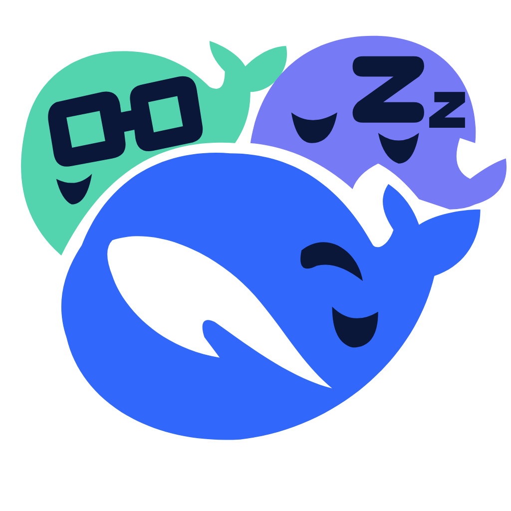

<p align="center">
  
</p>

# DSH-Bot

English · [中文](README.md)

**Your personal agent workspace.** Create Bots with their own roles, memory and tools in DeepSeek Harness. Keep working in ongoing conversations, collaborate, and receive results in the original chat.

**Current source: 0.7.3 candidate (npm package: `dsh-botgroup`).** See the [0.7.3 release notes](https://github.com/MJ-CJM/DSH-Bot/blob/main/docs/releases/v0.7.3.md) for candidate features. The published stable release is [0.7.2](https://github.com/MJ-CJM/DSH-Bot/releases/tag/v0.7.2). [Changelog](https://github.com/MJ-CJM/DSH-Bot/blob/main/CHANGELOG.md).


Screenshots show basic workflows from an earlier version in a real, isolated DSH environment, with fictional data and scripted replies. Current candidate entry points are described below. Screenshots do not establish real-model task quality.

## Start with one Bot

After installation, open Bots in the native DSH sidebar.

1. Open **Bots** in the native sidebar, select or create a Bot, then open its native chat. For example: “Compare these two proposals. Ask the researcher and reviewer to help if needed.”
2. Use the Bot/group directory for roles, memory, tasks and materials. Conversation details link back to the corresponding directory. New, search, branch and archive remain native DSH commands.
3. Ask your Bot to contact another Bot or ask a follow-up. The reply appears in the original conversation. Sharing private memory or private chat content requires your confirmation. To let Bots form teams, open **Bots → My Bots → Automatic collaboration**. The button shows the current state and expands the setting in place.
4. Add materials, continue or stop through the existing work controls. Navigation and closing details do not enable or stop collaboration. File permissions, tool approvals and model configuration remain those of the host.

Chat requires an available DSH model, and model services may charge for usage. Follow-up and collaboration have separate settings; opening Bots enables neither.

## Find everyday features

| What you want to do | Where and what happens |
| --- | --- |
| View tasks and follow-up | Bots → the Bot/group → Tasks. Explicitly enable follow-up for that Bot/group. |
| Add materials and continue | The Bot/group → Materials. Select the exact task and text file; the original question is kept by default, with optional additional requirements. |
| Find pending work | Bots → Tasks needing your attention. Return to the original conversation to provide input, verify results or use native questions/approvals. |
| Manage roles and memory | Bots → the Bot’s details, then full settings or Manage saved memories. |
| Change group preferences and reuse teams | Bots → the group’s settings, including Team recipes. |
| Configure optional services | Advanced settings in Bots. Continue everyday tasks in the Bot/group conversation. |

### Automatic collaboration, results in the original chat

Supergroup reuses DSH's native subtasks, models, tools and approvals. Existing Bots can form a team for the task and request support from other existing experts during collaboration. You do not need to select every member in advance. Inspect real members, execution, usage and public results in the group, add task input or stop collaboration.

Shared inputs are the current task text, explicitly selected materials and authorized results. Private chats and private memories are not automatically handed to teammates in full. A working directory is not a file sandbox. Actual answers and delegation depend on the model, tools, permissions and task materials.

### Add missing materials or connections, then continue the same work

The Materials page shows the original task and authorized readers, and lets you select bounded text files directly. When a connection blocks a task, open its connection and credential settings from that work. **A ready connection still requires an explicit continuation**; saving configuration does not automatically replay the task.

The work directory collects items needing input or review, unknown outcomes and available native question/approval entry points. Opening or reading an item does not resolve it. Approvals remain in native controls. If execution or delivery is uncertain, verify the existing operation before continuing; it is not automatically rerun.

### Optional, unscheduled follow-up

Use **Bots → the Bot/group → Tasks → Turn on follow-up** for the current Bot or group. Viewing and refreshing locally makes no model requests and requires no GitHub account or external credentials. Following and executing work are separately authorized.

Supported task cards offer **Follow this task**, prefilling the name, available condition and an editable deadline. Observe completion of a native subtask or the next GitHub CI result from an already configured source, or register an item with a manual completion condition. **Edit or cancel before saving; opening the form creates no watch.** A matching result becomes a review card without automatically starting a model or repeating the task.

Registration through a personal Bot chat uses native tool approval. A group-chat proposal takes effect only after explicit confirmation. Stop an item or pause observation for its Bot/group. This feature **does not provide timed reminders** and needs a running local DSH Host. Ordinary schedules continue to use native DSH facilities.

### Trace and review memory changes

Each Bot has independent memory. Open **Recent memory changes** in its memory page to inspect sources, timestamps and before/after differences. For an eligible historical version, explicitly choose **Restore as new revision**. This cannot revive forgotten, revoked or currently inaccessible content.

With the Bot's memory enabled, use **Memory → Group work this Bot joined** to find work it actually participated in and can still access, and open its source. **Ask in direct chat** in a group member's menu prepares a referenced draft for you to send. Finding group work does not automatically save it as long-term memory, and private memories are not automatically shared.

### Save team preferences and use ordinary groups on demand

**Team recipes** in group settings previews the current team automatically and lets you save it directly. Import and JSON editing are under advanced controls; export remains available in the preview. Preview role mappings and explicitly confirm membership changes before applying. Recipes contain team preferences without chats, memories, credentials or execution authorization. **New members may read only records explicitly authorized for the current audience; joining does not grant all earlier history.**

New manually created ordinary groups select relevant speakers locally for each question by default; turn this off in settings if preferred. Explicit mentions, replies and rounds take priority. Unmatched questions use the existing route. Selection makes no decider-model call; member answers still use models. Existing groups keep their preferences. Automatic Supergroup teams collaborate around the task without ordinary-group routing configuration.

The group @ menu lists available members and @everyone. In an ordinary group, write “Ask Jarvis: which migration tasks are still open?” for a reply from Jarvis in the group. To have a member report back, reply to that member’s message with “Ask Jarvis which migration tasks are still open.” Jarvis answers the member, who then replies in the group. Expand the relay in the group to inspect the delivered question, intermediate answer, and final report within the current readers’ permissions. Jarvis’s incoming and outgoing markers open the original text for that delivery. If the question refers to “this,” enter the topic you want to share, or select “Use the quoted excerpt” and edit it before sending. Guest queries use shared material by default. If an answer uses private material, sharing it with the member and then with the whole group requires a separate decision for each audience.

Preview same-round replies going to the same group readers together, deselect any replies to hold back, and confirm the send. Replies that arrive during review wait for the next batch. In an ordinary group, write “Just note this down: …” or reply to a message with “Just note this down” to save it in members’ own memories and report the write status in the group.

You can expand or collapse each question and reply. In multi-member rounds, long replies start as a single line. Short replies and individually addressed answers start open. Once two Bot replies have arrived, you can expand or collapse all replies in that round.


Native background tasks, result review, ordinary schedules, Bot messages, and optional document-snapshot analysis and working-method evaluation remain available through task/management entry points. Configure advanced execution and external connections when needed; neither is required to start a Bot conversation.

## Installation and compatibility

| Scope | Current status |
| --- | --- |
| Published stable release | [0.7.2 Release](https://github.com/MJ-CJM/DSH-Bot/releases/tag/v0.7.2), with its own release notes and assets. |
| Development candidate | `dsh-botgroup-0.7.3.tgz`. Use the acceptance record for the exact frozen package. |
| Recommended target | Official macOS arm64 **DSH 0.2.2-rc.5 + official web-app + one dsh-botgroup product package**. Stock rc.3 is the upgrade regression baseline; support depends on this iteration's same-package acceptance. |
| Other hosts | Declared range: `>=0.2.1-rc.2 <0.3.0`; development dependencies remain pinned to `0.2.1-rc.2`. This does not establish testing on every version or platform. |

The native design needs no replacement web-app, three-Client adapter package or Bot-mode switch. The previous rc.3-specific `dsh-bot-web-app` belongs to the older delivery. Active legacy installations must be migrated to the official composition in a staged copy, retaining current settings and data. Never select both web-app bundles or exempt the old adapter for an unreviewed host version.

### Published releases

The public npm package is **[dsh-botgroup](https://www.npmjs.com/package/dsh-botgroup)**. The DSH-Bot product brand, plugin ID and data directory remain DSH-Bot/`dsh-bot`. The stable versioned archive is `dsh-botgroup-0.7.2.tgz`. The fixed download name `dsh-bot.tgz` is an alias for the same package.

Open the relevant [Release](https://github.com/MJ-CJM/DSH-Bot/releases), read its compatibility notes, and download the plugin tgz and checksum file from that same release. On macOS, for example:

```sh
shasum -a 256 -c dsh-bot.tgz.sha256
```

In DSH, use **Plugins → Add plugin → Install third-party plugin**, select the tgz, enable it as instructed, then fully quit and reopen DSH. Source-code archives are not prebuilt plugins. Community markets or `latest` URLs may still point to the stable release; they do not provide an unpublished candidate or prove current candidate compatibility.

### Current candidate

See the [0.7.3 release notes](https://github.com/MJ-CJM/DSH-Bot/blob/main/docs/releases/v0.7.3.md) for installation and migration requirements. Verify the download using the matching checksum and install in the validated host configuration.

To migrate from the old `dsh-bot` package, stop the Host and back up the complete profile and data. Remove the old package through native plugin management, then install `dsh-botgroup`. Before restarting, inspect the profile's `cordis.patch.yml`: if the original `id: dsh-bot` override has `name: dsh-bot`, change only that name to `dsh-botgroup`. Keep its ID, config and dataDir; do not add a name where none exists. Keep only one package dependency/bundle selected, and review old references in custom includes/templates separately. See the [migration notes](https://github.com/MJ-CJM/DSH-Bot/releases/tag/v0.6.7).

Before upgrading, back up the original profile and complete data and keep the storage location. Do not delete Bots or reset data as an upgrade step. Keep history and settings written after upgrading. Restore this transaction’s profile snapshot only if its installed state is unchanged; otherwise use a targeted reverse migration, never overwrite current data with an old full backup. Upgrading does not automatically authorize external connections, paid execution or sharing.

## Validation and limits

See the [0.7.3 release notes](https://github.com/MJ-CJM/DSH-Bot/blob/main/docs/releases/v0.7.3.md) for the exact candidate, isolated Host and browser checks, and upgrade validation.

These checks do not establish real paid-model quality, external account authentication, external IM messaging or automatic compatibility with future hosts. Tasks need a running local Host. Cloud hosting, execution after system exit, and system/mobile push are not provided. Uncertain execution outcomes are not automatically replayed.

## Updates and feedback

[Releases](https://github.com/MJ-CJM/DSH-Bot/releases) · [Report an issue](https://github.com/MJ-CJM/DSH-Bot/issues) · [Security feedback](https://github.com/MJ-CJM/DSH-Bot/blob/main/SECURITY.md)

Include DSH/plugin versions, reproduction steps and redacted screenshots or errors. Do not post keys, private conversations or full profiles.

MIT · Copyright © 2026 MJ-CJM. Third-party notices ship with the package.
