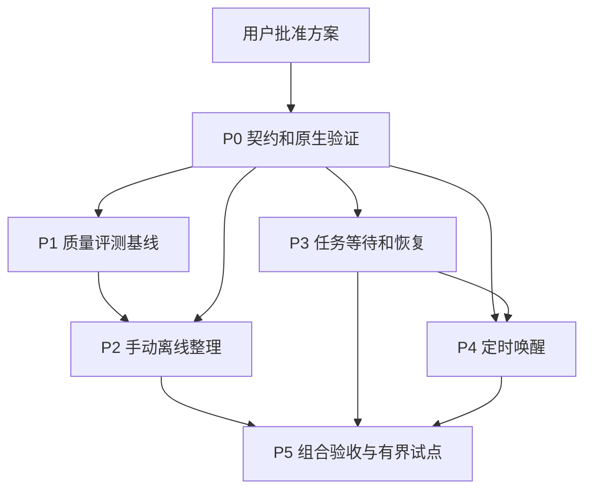

# 记忆质量与持续任务分阶段实施计划

日期：2026-11-16（America/Los_Angeles）。状态：**已按批准的能力边界实现并安装本地；未通过项见实施验收**。
分支：`codex/agent-memory-reliability`；起点：`main@3b1c32c2a7c9fb1f4959bdc80f68c0c0c92a23a0`。
用户已明确批准依次实施全部阶段，并授权完成后安装到本地 DSH 服务、自验，再由用户统一验证。部署授权覆盖此前本计划的“另行授权部署”限制；后续用户已追加授权本地提交；保留真实模型、推送与发布的原边界。

## 1 共同执行合同

每项任务先读根 [AGENTS.md](../../AGENTS.md)、[API 核实记录](../../docs/dsh-api-notes.md)、[项目计划](../../docs/PLAN.md)及本期对应分项设计。原 T06 仅作历史背景，当前记忆按 V2 动态 context 实现。

- 只在本仓库写入，保留他人修改。DSH 固定 tag `dsh-v0.2.1-rc.2` 只读；运行使用仓库根 `DSH_HOME="$PWD/.dsh-dev"`，CLI 经 `scripts/dsh`，pnpm 经 `scripts/pnpm`。
- 规划/设计使用 `gpt-6-astra`、high；实现/返工/打包使用 `gpt-6.1-sol`、high。CLI 派发每次用 `-c` 指定，stdin 为 `</dev/null`，不改全局配置；子代理按同一角色规则配置。
- 本次审批前不改产品代码。批准后每个实现增量控制在可独立验收的小任务；表中较大任务可拆为多次 15–45 分钟 run，每个增量尽量不超过约 800 行改动，不删减验收来凑范围。
- 不安装全局包，不修改日常 `~/.dsh` 或桌面，不提交/推送/发布；不启动需要真实 API key 的模型会话。后续具体用户授权只覆盖其明确范围。
- 注册、订阅、资源和异步注销归所属 `ctx.effect`；原生 API 用公开入口；可调值进导出 Config 和 schema；UI 复用公开组件/slot、主题 token 和中英 locale。
- 每个任务记录改动文件、命令结果、逐项 PASS/FAIL、未执行/受阻原因及建议。源码/fixture/实际 Host/Browser/真实模型结果分别记，不以一种替代另一种。

## 2 阶段顺序

P0 的来源、日程、恢复三个实验可并行，但不能同时占用同一 profile 或改相同状态文件。P1 与 P3 在接口冻结后可并行。P2 不依赖定时；P4 不依赖记忆整理。集成构建、打包和同包运行验证由主编排串行执行。

| 阶段 | 任务 | 阶段产物 | 退出条件 |
| --- | --- | --- | --- |
| P0 | CA00–CA03 | 精确能力矩阵、协议、迁移与失败路径 | 每项有可重复实验结论；不支持能力继续 FAIL，明确后续可实施范围 |
| P1 | CA10–CA12 | 冻结数据、三臂运行器、评分与报告 | 机制与公平性验证通过；质量结论保持独立 |
| P2 | CA20–CA22 | 来源与候选底座、受控整理、记忆页采用 | 清理/恢复先通过，再开放手动候选入口 |
| P3 | CA30–CA32 | 等待投影、准确恢复、原生审批兼容 | 不串单、不丢消息、不重放未知执行 |
| P4 | CA40–CA41 | 原生日程窄桥、漏期策略与入口 | 所有适用日程门槛通过，否则保持关闭 |
| P5 | CA50–CA52 | 同包机制验收、质量试点、发布候选说明 | 运行、质量与能力缺口分别判定；不提前日常部署 |

## 3 P0 契约与原生能力验证

| 任务 | 实施内容与预期落点 | 交付 |
| --- | --- | --- |
| CA00 基线和合同 | 当前 package/依赖/工作区、已知隔离 rc.2/rc.3 runtime；核对 memory、Work/Supergroup、FollowUp、notice 的权威状态和身份 | 一份基线清单；各合同说明已有字段、拟新增字段、唯一提交点、未知结果和回退 |
| CA01 记忆来源及执行 spike | [整理 M0](../../docs/design/continuous-agent/memory-consolidation.md)；只读公开 SessionQuery/Persistence、GroupRecall、V2 lineage、原生受限 Agent；独立 `spikes/` 或既有测试设施 | 热/冷/压缩/撤权的来源证明；同步 context 与异步准入边界；工具、请求预算和副本清理证据 |
| CA02 定时能力 spike | [唤醒 G1–G4/G6](../../docs/design/continuous-agent/wakeup-recovery.md)；原生 schedule/history/Session/maintenance 与现有 native-schedule 聚合 | occurrence 身份、零额外模型、自然冷恢复、混批、重复和就绪顺序矩阵 |
| CA03 等待恢复 spike | [唤醒 G5](../../docs/design/continuous-agent/wakeup-recovery.md)及当前 task-support；真实原生审批/拒绝/取消、同原工作续办 | 工作级等待与精确延期工具各自的支持结论、资源占用和冷恢复证据 |

验收：

1. 每个新组合至少有成功、拒绝和中断恢复例；记录精确包/宿主、输入、会话、请求计数和实际清理结果。
2. 原生公开接口不存在或语义不足时记录 FAIL（CAPABILITY），不得使用内部导入、伪 user 来源或第二调度器修补。
3. 来源引用不完整时只开放可证明且可清理的来源。异步来源验证不能塞进同步 memory context provider。
4. 定时不得用“人工新建一个日程”刺激恢复；真正延期工具不得用工作卡/延迟通知冒充。
5. rc.2 和 rc.3 分别给结论；不同结果明确形成能力矩阵，不编造全版本 fallback。
6. 冻结 schema/migration 草案后才能进入相应产品任务；未知字段/旧数据/降级路径必须明确拒绝或正确迁移。

P0 实验执行完成可以 PASS；实验发现的能力不支持仍是 FAIL，不能将“完成研究”写成“功能已通过”。若需越出总方案新增运行时、数据库或时钟，先形成具体变更交用户审批。

## 4 P1 记忆质量评测基线

详细规范以[记忆质量评估](../../docs/design/continuous-agent/memory-quality.md)为准。

| 任务 | 实施内容与预期落点 | 交付 |
| --- | --- | --- |
| CA10 冻结时间线 | `evals/` 新评估 manifest/场景；Gold 与 worker 输入隔离；参考现有失败集和 unseen 冻结方法 | 24 质量场景，开发/验证/最终各 8；另备 24 个独立机制夹具；八类问题、权限与时间截点及成功/无行动条件固定 |
| CA11 三臂运行器 | 评估适配层复用原生会话、实际检索、预算和收据；不修改现有四臂 `compareMethods` 合同 | A 原始搜索、B 当前记忆加搜索、C 整理加搜索；隔离会话/记忆副本，完整哈希与固定分母 |
| CA12 评分与基线报告 | 复用 `evals/scorers`、outcomes/task-cost；增加任务语义、成本和通知影子报告 | 自动事实评分、人工盲评 rubric、成本预算表、未测项目和逐题失败原因 |

验收：

1. 24 个独立机制夹具的三臂记录齐全；最终留出只校验 manifest/schema/hash，不开放事实或 Gold 用于调试。C 在 P2 前用显式标记的确定性整理夹具，只验证接线，不计收益。
2. 跨臂污染、Gold 泄漏、未来信息和权限越界各至少两个反例全部被检测；返回伪造 PASS 不算完成。
3. 失败/超时/unknown/预算拒绝/未启动仍在原分母；重复操作不增加样本；最终集只允许登记的完整批次。
4. 真实产品检索代码被实际调用，至少一次隔离真实 Host 验证加载、来源、权限和请求摘要，不能只接 mock 排名。
5. 手算评分/摊销 fixture 100% 一致；token 缺失保留 unknown；整理、初始化和人工审阅成本可单独追溯。
6. 机制通过与真实质量分开。未获得真实模型授权时，后者 FAIL（NOT_RUN），不虚构基线分数。

P1 完成可交付评测基础，不据此更改默认记忆选择策略。

## 5 P2 手动离线记忆整理

详细协议以[离线整理方案](../../docs/design/continuous-agent/memory-consolidation.md)为准。首版默认关闭，一次一个 Bot、一份候选；不自动共享或置顶。

| 任务 | 实施内容与预期落点 | 交付 |
| --- | --- | --- |
| CA20 来源与候选底座 | `src/host/memory/`、共享契约、现有内核/领域迁移、history/forget；只新增 P0 已证明必需的窄记录 | proposed 候选、来源证据、稳定 opId、采用 CAS、依赖反向索引与清理库存 |
| CA21 原生受控整理 | 原生 Agent 接入现有执行/预算能力；Host 供给有限数据，模型不具有写记忆/连接器/递归派工工具 | 一次有界生成、“无值得保留内容”、失败/取消/unknown 和可追溯用量 |
| CA22 原记忆页闭环 | MemoryPanel、MemoryChanges、原 owner Remote 与 locale；不新增管理中心 | 明确来源选择、候选差异、编辑/拒绝/采用、采用后变更历史；C 臂改接实际整理流程 |

验收：

1. 未采用 proposed 在 search/context 中不可见；一次采用只有一个内核提交，旧按钮、重复请求和跨窗口并发不会覆盖新版本。
2. 来源原文/事件身份/摘要/权限全部可核对；助手推测不被提升为已验证事实；编辑候选不能借旧证据证明新主张。
3. 重复生成可复用准确既有结果；超时或提交结果未知不换 opId 重试，不自动再次请求模型。
4. 源权限撤销、源记忆遗忘、原文不可用、Bot 重建时，候选和已采用派生内容的读取/注入/恢复均受阻；不能只在 UI 隐藏。
5. 遗忘覆盖控制记录、证据、候选、执行输入输出及缓存；强杀重启后库存核验通过。未过清理门槛不开放该来源。
6. 真正原生 Host＋本地模拟模型完成“选择→生成→审阅→采用→新请求读取”；执行中取消、卸载及迟到结果无补提交、无残留执行。
7. 实际 Browser 中英/亮暗/窄屏、键盘操作及双窗口冲突通过；关功能后原聊天、原记忆和配置不受影响。
8. 单次/每日/并发上限真实拒绝超限请求；缺 usage 显示未知，不表示免费；人工采用只授权该候选。

采用质量的真实增益留给 P5。M4 小型索引/自动晋升不在本期实现任务内。

## 6 P3 任务等待与恢复

详细协议及 W11–W22 见[恢复方案](../../docs/design/continuous-agent/wakeup-recovery.md)。

| 任务 | 实施内容与预期落点 | 交付 |
| --- | --- | --- |
| CA30 持久等待合同 | 按原后端扩展 `coordinator/work.ts`、FollowUp、Supergroup work/task-support 的必要字段；原生审批保持权威 | 缺资料/待确认/待核对的可恢复引用；原工作不搬家，不复制完整状态机 |
| CA31 恢复与对账 | 稳定操作 ID、原会话输入、版本/权限/期限/预算重核；实际 Session 结果与工作收据对账 | 同工作准确继续、已知未执行与unknown的区分；等待不占协调串行队列 |
| CA32 原入口展示 | 原工作卡、pending-work、task-support、FollowUp；原生 pendingInteraction 入口 | 返回准确原对话；无关消息可正常处理；多待办只在歧义时选择 |

验收：

1. 等待期间无模型轮询，其他 Bot 的工作可继续；原生 pending 占用某个 Agent 时如实显示，不承诺该 Agent 已释放。
2. 答复前后、派发前中后、排队后回执前分别强杀；恢复只推进有准确证据的原工作，不产生第二次未知执行。
3. 同一答复重复 100 次只产生一次恢复准入；相同 operationId 不同内容拒绝；旧批准遇参数/权限/目标变化失效。
4. 无关新消息不被吞；两项等待不串单；原会话替换/归档、Bot 重建、资料撤销/遗忘都拒绝旧恢复。
5. 续办保留尝试历史及原预算，不因重开清零；queued、已执行、已交付、已接受分别有证据。
6. G5 若通过，真实原生 call 跨重启批准/拒绝/取消/重复答复均通过；G5 若失败，该能力明确 FAIL（CAPABILITY），交付工作级等待和现有原生审批入口，不补执行缓存参数。
7. 热关闭/重开、卸载、晚到回包、两 Host 写者竞争与新旧数据迁移通过；旧工作不因升级自动重新执行。

## 7 P4 定时唤醒

前置：P0 G1–G4/G6 和 P3 的相关恢复门槛通过。任何关键能力不支持，本阶段只交付验证结果、不可用说明与已有关注的手工核对，不开放时间来源。

| 任务 | 实施内容与预期落点 | 交付 |
| --- | --- | --- |
| CA40 原生日程业务桥 | `native-schedule`、原生输入/就绪桥、coordinator准入收据；不另起时钟 | 原 schedule/规则代际/occurrence 到原关注的精确映射和一次业务准入 |
| CA41 恢复与现有入口 | 原 FollowUp 时间设置、现有通知合并/静默/限额；复用原维护循环 | 支持范围内一次/周期提醒、有效漏期合并、过期/缺史待核对和可见时区 |

验收：

1. W01–W10 全部适用项通过：正常/提前、并发重复乱序、同名重建、混批、自然冷启动、跨到期、DST、时间跳变和强杀。
2. 同 occurrence 100 次输入仅一条业务准入；对两条不同日程不误去重；unknown不代表可再次执行。
3. 纯观察/提醒使用零额外模型请求；混批真实用户输入和原生管理消息不丢失、不变来源。
4. 停机期间执行数零；自然启动后无需人为创建另一日程即可恢复。统计恢复耗时从原生依赖 ready 起算。
5. 错过提醒仅在同授权/读者/目标范围内合并；过期不执行；不能枚举原生事实就不编造“漏了几次”。
6. 到期不扩大执行权限、不补跑工程写入；关闭/撤销及时停止新准入，已有原生日程行为保持原合同。
7. 同包 Browser 验证创建/修改/取消、时区展示、无支持时不可用提示；原有条件跟进不回归。

一次性/周期/DST 各自报告支持范围；不能把一次性 PASS 扩大为全部规则 PASS。

## 8 P5 组合验收与有界真实试点

| 任务 | 内容 | 交付 |
| --- | --- | --- |
| CA50 同包机制矩阵 | 冻结新包，隔离 rc.2/rc.3；原始 0.7.0候选→新 schema，冷启/卸载重装；实际 Host＋Browser | 精确包/hash、迁移数据保留、适用故障矩阵、资源清理和能力限制 |
| CA51 真实质量和通知影子试点 | 在明确模型/数据/预算授权后执行冻结三臂、最终留出和通知机会回放 | 逐题结果、未知/失败、全部成本及人工审阅、阈值判断；不自动外发 |
| CA52 交付与回退说明 | 源码/依赖/包一致性、功能开关、数据兼容、用户操作、未通过项 | 可评审候选和验证记录；另行授权才提交/部署/发布 |

组合链路至少覆盖“已有关注→新事实→短执行→等待资料→重启→准确答复→原任务继续→一次原对话交付→手动整理→采用→下一任务使用”。定时链路仅在能力通过时加入；未通过则单列缺口，不能改名称掩盖。

机制验收要求所有适用 W01–W22 与记忆 M0–M2 验收有实际结果；历史旧包收据不得替代新包。W16 的原生能力失败可形成收窄版本，但总报告仍保留该 FAIL。

质量门槛以[评估方案第 6 节](../../docs/design/continuous-agent/memory-quality.md)为准：每模型最终各臂 24 次回答。B/A 是现状诊断；C/B 才是本次改动放行判断，且 C 总成功数不得低于 A、不得出现 A 的 3/3 退化为 C 的 0/3。

C 至少 18/24 成功；质量路径较 B 增加至少 3/24 且无场景从 B 的 3/3 退化为 C 的 0/3，或效率路径逐场景不低于 B、N=1 总计费成本降低至少 15%、人工纠正与可核验人工总耗时不增加。两条路径都要求 C 零权限/遗忘泄漏、零禁止动作、三臂完整收据且 unknown=0；基线缺陷单列。重复运行不用于生产摊销，保留所有负结果。

这些是小样本试点阈值，不能据此宣传普遍增益。没有成本证据则效率路径不成立；质量路径通过也要保留成本未知。真实模型授权不足时 CA51 为 FAIL（NOT_RUN），可交付机制候选，不能将全部 P5 标 PASS。

通知影子试点 24 个机会，12 应通知/12 应静默；建议 TP≥10、FP≤1、重复=0、撤销后通知=0、unknown=0。用户真实打扰感需后续反馈；影子回放不向日常用户/外部渠道发送通知。

最终运行相关定向检查、`scripts/pnpm check`、`scripts/pnpm check:docs`、`scripts/pnpm check:format` 和 `git diff --check`。新 schema 的旧二进制拒绝/备份回退路径要实测，不靠“关掉开关”代表可降级。

## 9 本轮设计交付记录

本节保留审批前的历史设计验证，不代表当前状态。获批后的实现、运行证据和限制见[实施验收](../../docs/reports/continuous-agent/implementation.md)。

- 新建设计分支，从干净 main 开始；只新增本计划、四份设计文档并在 PLAN 增加待审批入口。
- PASS：当前源码、历史运行边界和原生复用路径核对；三个分项独立设计后统一阶段和合同。
- PASS：`scripts/pnpm check`，225 测试文件、1879 passed、3 expected fail，build/typecheck/lint 退出 0；保留 241 warnings、4 infos，无自动修复。
- PASS：`scripts/pnpm check:docs`、`scripts/pnpm check:format`、`git diff --check`；本地文档链接与空白检查通过，Git 范围仅五份新文档和 PLAN 入口。外链及锚点不属于本地检查器范围。
- FAIL（NOT_RUN）：本方案新能力实际 Host/Browser、真实模型质量、外部渠道、部署。当前仅待审批设计。

后续用户已批准按该范围依次实施，并授权本地安装及自验。保留原生能力不足时的收窄路径及真实模型预算边界。
