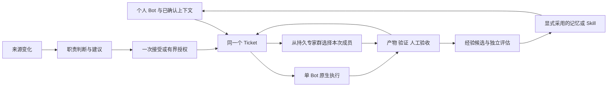

# DSH-Bot 下一步落地清单

> 2026-11-09：用户在 P0 后确认 0.6.6 先交付非定时跟进，定时后续补齐。本地候选与当前验证见[验收报告](../../docs/verification/v066-local-follow-up.md)，P1–P5 已实现，见[实施记录](V066-implementation.md)。下方 N01–N17 保留为前轮任务与历史范围。

> 后续修复：用户指出首次开启缺少入口，现已补齐原页面开关、来源引导和原生配置持久化；本地部署授权沿用当前连续验收任务，详见[修复记录](../../docs/verification/proactive-setup.md)。下文“未授权桌面升级”保留为当时开发阶段边界。

日期：2026-11-08。起始代码基线：`codex/proactive-bot-implementation@e9bcdcf`。状态：用户已批准 D1–D6，A 批 N01–N05 的基础修复范围与简化侧栏已通过隔离验收；本轮继续补齐 A 的业务分页与维护演练，实现 B（N06–N11）的 CI 个人质量 Bot 范围；最终检查见 [A+B 验收记录](../../docs/verification/proactive-optimization-ab.md)。用户随后已批准继续完成 C/D；当前实现和验证范围见 [C/D 验收记录](../../docs/verification/proactive-optimization-cd.md)，真实质量试点仍单列为未执行。未授权真实模型会话、外部账号接入、发布或桌面升级。

整体产品形态、保留/重构决策和分批实施见[优化与重构方案](../../docs/design/proactive-bot/optimization-proposal.md)，状态与迁移细节见[技术合同](../../docs/design/proactive-bot/optimization-contracts.md)。用户后续明确要求减少复杂度：复用现有 Bot 右侧栏的概览/任务/消息，摘要点开才进已有工作详情；该收敛约束优先于早期全景页面展开。

## 1 目标与基线

下一阶段的目标是让用户能把一件事持续交给自己的 Bot：它了解经过确认的个人背景，在需要时提出建议，按授权选择独立完成或调用专家群，保留跨会话进展，交付可验收成果，并把经过验证的方法用于后续任务。

路线是：**先修复已有闭环，再形成个人日常使用入口，随后扩展协作范围，最后用实际任务验证收益。** 保留 DSH 执行基础和现有任务核心；不新建 Agent runtime、通用调度器、群运行系统或第二套任务状态库。

依据包括[原产品方案](../../docs/design/proactive-bot/product.md)、[原架构](../../docs/design/proactive-bot/architecture.md)、[原生复用矩阵](../../docs/design/proactive-bot/native-reuse.md)、[当前实现记录](../../docs/verification/proactive-gap-completion.md)，以及关联的个人 Agent 研究讨论。关联分析第 2、6、9、10、11 章提供了概念、共建和评测思路；其中 DSH-Bot 的代码核查止于 `main@1a27600`、方案分支 `2917262`，其“PB 尚未实施”的结论已被当前代码取代。

关联分析原文保存在本地知识库。本清单只读引用其中的历史行业快照，产品当前状态以本仓库的实现和验收记录为准。

前轮代码 review 的完整证据保存在 `.dsh-dev/reviews/proactive-20261108/review.md`，复现材料位于同仓库 `.dsh-dev/review-proactive-core/`、`.dsh-dev/review-proactive-host/`、`.dsh-dev/proactive-bot/review-delivery-20261108/`。以下保留 R01–R08 标识，不要求开发者重新猜测缺陷范围。派发前应把相关反例转为正式回归测试，不让验收依赖临时目录永久存在。

## 2 四个概念在产品中如何衔接

| 维度 | 负责的问题 | DSH-Bot 对应对象 | 下一步重点 |
| --- | --- | --- | --- |
| Personal Agent | 长期为谁服务，怎样少让用户重复解释 | 长期 Bot、主会话、偏好/事实/方法记忆、项目引用 | 个人入口、上下文确认、项目接续 |
| 主动式 Agent | 何时值得介入、提醒还是行动 | Source、Responsibility、Suggestion、授权与注意力预算 | 可用的观察模式、真实只读来源、反馈实际生效 |
| Superagent | 一件工作如何跨会话、等待、失败与返工持续负责 | 一个 Ticket，多次 Assignment，证据与验收 | 状态一致、交接、等待和未知结果的对账 |
| Bot Group | 复杂工作由哪些长期 Bot 共同完成 | 持久 Group/Member，本任务选择的成员和角色，已有 turn/delivery/session | 专家群按需选人、角色模型、有限协作与成本 |

Bot Group 是持久组织；一次任务只选择其中必要成员。Ticket 表示业务责任；群轮次和 Session 表示执行。个人主管可以是现有的一个长期 Bot，不需要新增 PersonalAgent 类或另一种运行时。

项目引用只组织多个 Ticket、职责、会话和资料，不再维护任务完成状态。普通人设描述不等于结构化职责授权；记忆不存放可复用的行动许可；主管发言不替代验收决定。

## 3 本轮启动时的能力与缺口基线

本节保留启动 review 时的对照，不代表 A+B 完成后的剩余状态；当前逐项结论以开头链接的 A+B、C/D 验收记录为准。

| 能力 | 当前已实现 | 本轮校正后的缺口 |
| --- | --- | --- |
| 个人身份与记忆 | Bot 代际、持久主会话、live persona；记忆来源/时态/冲突/确认/共享/遗忘 | 日常管理与正确使用的体验、跨项目关联和收益验证；不重建画像库 |
| 主动协作 | CI 收件箱、职责模式/条件/期限/预算、建议、接受与自动准入 | 来源仍是本地输入；观察模式 UI 被执行开关阻断；通知反馈未实际消费 |
| 持续任务 | 固定上游 Engine/Store/Ticket/Assignment、结果 journal、验收与返工 | 已复现终态脱节；对账和用户交接仍需完善 |
| 群协作 | 2–16 人持久群、选择成员、并发/暂停/跟进、三阶段工程修复 | 主动修复仅对恰好两人群开放；阶段模型统一用 work.target |
| 反馈采用 | 七类反馈、规则冻结评估、采用/撤销，Memory/Skill CAS 写入 | Skill 的新旧行为效果尚无独立评估；不能把写入成功算成自优化收益 |
| 外部执行 | 受管进程、JSON CLI 协议、准确产物/身份/费用未知表达 | 第三方执行器的实际效果、取消与恢复兼容性尚未证明 |

源码锚点：[主会话](../../packages/dsh-bot/src/host/main-session.ts)、[个人记忆模型](../../packages/dsh-bot/src/shared/memory-v2.ts)、[实际上下文装配](../../packages/dsh-bot/src/host/memory/context.ts)、[职责范围](../../packages/dsh-bot/src/shared/proactive/responsibility.ts)、[群授权组合](../../packages/dsh-bot/src/host/proactive/service.ts)、[阶段执行](../../packages/dsh-bot/src/host/proactive/group-repair.ts)、[反馈评估](../../packages/dsh-bot/coordinator/feedback.ts)。

## 4 第一批 必须先完成的修复

这一批是发布和自动执行扩展的前置。P0 表示本清单的实施优先级，不改写原 review 的 P1/P2 严重度。每项以独立可审阅增量交付，最终使用同一构建产物复验。

### N01 执行隔离与撤权时序 P0

- **对应问题**：R01（P1，验证器可读范围外文件并联网）、R06（P2，撤权后仍可新启动 baseline）。
- **复用与增量**：复用原生 subprocess、sandbox 和 TaskGrant 校验。实测所选隔离机制的可读范围、写入范围和网络边界，不能将 `enforcement=full` 当作所有边界均受限。每次 baseline/verification/外部命令实际 spawn 前复查授权；来源或任务撤权同步取消受影响执行。原生或现有部署能力不足时，关闭所有无法落实该边界的模型产物执行路径，包括人工接受和自动接单；只读分析可继续，不增加宽松回退。
- **落点**：[workspace-process](../../packages/dsh-bot/src/host/proactive/workspace-process.ts)、[workspace-repair](../../packages/dsh-bot/src/host/proactive/workspace-repair.ts)、[execution](../../packages/dsh-bot/src/host/proactive/execution.ts)、[service](../../packages/dsh-bot/src/host/proactive/service.ts)。
- **验收**：未授权的合成 marker 读取和回环网络传输为零；授权内正常检查仍成功；claim/prepare/spawn 各点撤权均阻止新的副作用；确认取消不能仅看 work 状态。补完整 Host 反例，不能仅沿用执行器替身结果。
- **依赖**：无。隔离方式先做限时能力验证；失败则以关闭对应能力验收，不阻塞只读建议路径。

### N02 有界列表与可恢复 IPC P0

本批收敛：先以现有 IPC 的透明字节分页消除 R02，再以 20 条业务分页和按任务版本加载详情补齐常用查询。4 MiB 总读取预算外的响应明确拒绝、核心继续服务；超出该预算的任意单条证据流不在本次支持范围。详见[当前实现边界](../../docs/design/proactive-bot/optimization-contracts.md#4-命令与查询协议)。

- **对应问题**：R02（P1，合法大列表使协调器退出）。
- **复用与增量**：在现有协议增加稳定游标和按字节预算分页；列表只返回摘要，大证据按引用读取。检查 suggestions、work、history、group evidence 等所有出口。可预期超限不得 poison 协调器，写命令仍保留事务/unknown 语义。
- **落点**：[commands](../../packages/dsh-bot/coordinator/commands.ts)、[main](../../packages/dsh-bot/coordinator/main.ts)、[wire](../../packages/dsh-bot/src/host/proactive/wire.ts)及 Remote/Client 消费端。
- **验收**：原 70 条、每条 1800 字符反例不导致退出；多页无漏项/重复/跨 Bot 混入，过期游标能明确重取；重连后可继续读取；大型单条证据可通过受限独立入口查看。
- **依赖**：无；与 N01 可并行，协议集成由一个负责人合并。

### N03 任务终态与跨代际遗忘 P0

- **对应问题**：R04（P2，失败/返工的原生状态与 work 投影脱节）、R03（P2，遗忘完成但旧评估集正文保留）。
- **复用与增量**：在现有 SQLite 事务中统一 Engine 与 work 的终态不变量；明确旧 Assignment 已被返工替代。统一来源 <= generation 的清理范围，核查候选、冻结集、受管产物和通知副本。为已存在坏状态提供可验证、幂等的修复/对账；不粗暴清除 unknown 或独立采用后的 Memory/Skill。
- **落点**：[work](../../packages/dsh-bot/coordinator/work.ts)、[governance](../../packages/dsh-bot/coordinator/governance.ts)、[feedback](../../packages/dsh-bot/coordinator/feedback.ts)、现有 Host 治理适配。
- **验收**：分别跑失败、拒绝、返工后接受，再执行遗忘与磁盘正文核查；既不永久 blocked，也不提前宣告 complete；跨代际正文清理可证；重复维护与重启结果一致；旧证据仍有准确墓碑。
- **依赖**：无；与 N02 共享 commands/protocol 的改动需串行集成。

### N04 让减少打扰反馈真正生效 P0

- **对应问题**：R05（P2，mute 已采用但无人消费）。
- **复用与增量**：在通知准入、延后合并和真正发送前读取最新反馈规则，保持现有 Notifications 唯一运输权威；记录采用版本与后续行为引用。
- **落点**：[feedback](../../packages/dsh-bot/coordinator/feedback.ts)、[commands](../../packages/dsh-bot/coordinator/commands.ts)、[deferred-notices](../../packages/dsh-bot/src/host/proactive/deferred-notices.ts)。
- **验收**：采用后新 run/new decision 和已排队通知均符合 mute；撤销后按既有策略恢复；unknown 不因规则切换重发；断言真实通知副作用次数，而不只测 helper 或“建议仍可见”。
- **依赖**：N03 的数据与代际约定；可先完成局部接线，最终联合回归。

### N05 观察配置与工作页实时性 P0

- **对应问题**：R07（P2，执行关闭不能保存 off/suggest）、R08（P2，持续可见页面不刷新）。
- **复用与增量**：拆分配置/观察上下文与执行许可；接现有共享前台轮询或订阅，复用分页与请求序号保护。保持原 Bot 工作页，不建平行工作台。
- **落点**：[ResponsibilityWorkspace](../../packages/dsh-bot/src/client/proactive/ResponsibilityWorkspace.tsx)、[SuggestionPanel](../../packages/dsh-bot/src/client/proactive/SuggestionPanel.tsx)、[共享 polling scheduler](../../packages/dsh-bot/src/client/polling-scheduler.ts)。
- **验收**：执行关闭或全局暂停时仍可保存 off/suggest；auto 与实际派工仍受限；页面保持可见可看到新建议/交付/撤权，建议目标为一个现有刷新周期内；隐藏/卸载停止刷新，旧响应不覆盖新 Bot；中英、亮暗、窄屏浏览器验证。
- **依赖**：N02 的列表合同；UI 状态拆分可先做。

**第一批退出门槛**：R01–R08 全部有正式回归和对应层级的运行证据；同一最终 tgz 完成必要隔离 Host/浏览器测试；执行 `scripts/pnpm check`、`check:docs`、`check:format` 和差异检查。能力关闭是明确的降级，不应写成完整支持。72 小时长跑已取消，不重新加入门槛。

## 5 第二批 个人工作闭环与专家群

本轮实现边界：N06/N08 以已有 CI 来源、职责与 Ticket 构成项目接续，不新建通用 Project 库；N07 复用现有 memory-v2；N09 使用协议替身验收，真实账号未接入；N10/N11 的真实 Host 验证覆盖只读审阅与明确授权的后续跟进，工程产物执行因 N01 能力不足保持关闭。逐项证据见 [A+B 验收记录](../../docs/verification/proactive-optimization-ab.md)。

### N06 接通个人主管与待办入口 P1

- **用户结果**：从自己常用 Bot 的主会话或现有工作页，能回答“哪些事情要我决定、上次做到哪里、成果在哪里”，并进入准确的任务与证据。
- **复用与增量**：复用 MainSessions、Bot 列表、工作页、ReviewPanel、原生会话导航；增加用户可见的聚合读投影、待决定/阻塞/交付入口和受限上下文交接。首版只承接现有 CI Ticket，聊天中的新委托可引导到配置/接受草稿，不把任意聊天自动改造成任务。
- **最小交接内容**：Ticket/Assignment、目标、当前证据版本、未决事项、允许范围、来源引用；原生会话仍保存执行轨迹。Bot 私聊全文和私有记忆不随交接复制；另一个 Bot 接收时仍经过既有数据边界。
- **验收**：主会话→群→工作页对应同一 Ticket；重复点击/交接不重复派工；主管说“完成”不替代用户验收；跨 Bot 权限不因聚合视图扩大。
- **依赖**：N02、N03、N05；扩展执行动作依赖 N01。

### N07 完成个人背景的确认 修订与使用流程 P1

- **用户结果**：可查看和更正“关于我、工作偏好、最近变化”，知道当前生效值、来源和使用范围。
- **复用与增量**：复用 memory-v2、ManagementPanel、已有确认/冲突处理/检索/上下文装配。补日常入口和版本可解释性；不建个人画像副本，不将 `trusted-ingress`/auto-share 的未验证入口直接打开。
- **验收**：明确确认的共享偏好能在获准 Bot 的后续上下文中正确使用；私有记忆不泄漏；修订、过期、冲突、遗忘影响后续检索与上下文；第三方引用和模型猜测不自动成为用户事实。运行中提示缓存的生效时点明确显示。
- **依赖**：现有记忆能力；完整治理回归依赖 N03。可与 N06 并行。

### N08 为同一个个人项目建立引用与接续 P1

- **用户结果**：“继续项目 A”能找到相关职责、任务、已验收产物和待处理问题，不必重讲全部背景。
- **复用与增量**：优先引用原生 Workspace、现有 Bot/记忆标识及 Ticket；必要时在已有存储领域增加最小项目元数据和关联。项目可以含多个 CI run/Ticket，不把它们强行合并成一个任务。上下文包按任务、用途、可读者、来源版本和有效期选择资料。
- **验收**：两个项目并行不串资料；同项目多次工作能追到上次接受成果；重启关联保留；修改目标/资料后旧验收不套用；跨任务接续不继承一次性授权。
- **依赖**：N03、N06；N07 提供已确认背景。

### N09 接入首个真实只读 CI 来源 P1

- **用户结果**：在明确的仓库/分支范围内自动看到值得处理的 CI 变化和来源健康状态。
- **复用与增量**：复用 connectors 的凭据引用与范围检查、现有 CI 观察页、cursor、来源代际、去重与职责过滤。新增受限传输适配，首先固定一个提供者。原生事件入口不可用时沿既有窄 Source poller 摄取；不得另建 cron，不能声称 rc.2 schedule 提供零模型 Source callback。
- **验收**：协议替身覆盖分页、重跑、乱序、断网/限流、凭据撤销、重启游标；摄取失败不越过未提交页；纯观察零模型/零执行/零通知；重复事件不生成重复工作；来源延迟与断连可见。真实账号只读试点另行授权。
- **依赖**：N02–N05；真实执行仍以 N01 为前置。传输实现可先在合成服务上独立验证。

### N10 从长期专家群选择本次成员 P1

- **用户结果**：一个四人专家群可只选择主管 A 和实施者 B 处理任务，其他专家保留在群中。
- **复用与增量**：复用 GroupMember、orderedMemberIds、GroupRepairGrant、群队列和已有“规划→实施→复核”三阶段；解除主动修复仅接受恰好两人群的 UI/授权组合限制。产物群审阅入口也有两人群限制，应同步使用准确的任务成员子集，后续跟进仍需其独立、明确的授权。长期角色标签仅提供建议，本次授权冻结选定成员、Bot 代际、群版本与范围；不能只删除人数判断而默认批准其余成员。
- **验收**：四人群选 A/B 仅产生获准三阶段调用，C/D 请求为零；主管和实施者必须不同；同一成员子集可完成修复→产物审阅→明确授权的指定成员跟进，未授权跟进不执行；成员删除重建/范围变化使旧批准失效；普通群讨论和暂停/停止行为不回归。
- **依赖**：N01、N03、N05。不需要先建设任意 DAG 或多人并行改同一工程。

### N11 接受前说明协作成本并绑定角色模型 P1

- **用户结果**：接受前知道为什么选单 Bot 或两人协作、各角色实际使用哪个模型以及增加多少阶段预算。
- **复用与增量**：沿用现有单人/群选项和普通群模型解析规则。先默认单人，按需要的独立检查或专长提供解释，不额外调用路由模型。若允许角色模型，则把解析后的快照写入 grant/证据/预算，逐阶段核对实际请求；现有统一模型模式也应明确展示。
- **验收**：未选群时群请求为零；切换模式/模型必须更新批准摘要；成员模型变化不静默影响已接受任务；实际 provider/model 对应批准快照；usage 缺失显示 unknown，外部费用不伪装原生 token；各角色费用计入同一任务总成本。
- **依赖**：N10，复用现有 group-budget/model-budget。先交单人优先和成本说明，角色模型作为独立增量。

**第二批最小可用场景**：个人质量 Bot 获得一项只读 CI 职责；变化进入建议；用户在现有入口接受单 Bot 或专家群的指定两人；检查交付并返工/接受；后续能从主会话找到同一项目成果。真实来源和真实模型验收与合成机制验收分开。

## 6 第三批 持续工作与有效方法

### N12 让等待 跟进与 unknown 有可操作的出口 P1

当前落地：已有任务详情与 journal 核对入口，不提供 unknown 安全重跑按钮。 以 [C/D 验收记录](../../docs/verification/proactive-optimization-cd.md) 的实际证据为准。

- **复用与增量**：先把已有 CI 精确事实跟进呈现为“等什么、谁负责、到期时间、剩余预算、下一步”；复用事实 claim/settle、群预算、journal 和运行引用。增加 owner 对账入口，分清可证明未执行、已执行有结果、仍不可确定。只有有凭据的对账可更新状态；人工确认不能凭空把未知外部效果改成安全重试。
- **验收**：重复/无实质变化事件零新请求；取消后不跟进；前序执行忙时正确等待；重启不重复派工；迟到证据只能回填准确 Assignment；未知项能显示核查依据和下一步，不能一键“重试”绕过未知副作用。
- **依赖**：N01、N03、N06；真实事实输入依赖 N09。首轮仍限现有 CI 路径。

### N13 用第二种任务验证通用性 P2

当前落地：document-analysis/v1 已复用同一任务和原生执行路径；独立 owner 验收。 以 [C/D 验收记录](../../docs/verification/proactive-optimization-cd.md) 的实际证据为准。

- **范围**：在 CI 个人闭环可用之后，选择“指定资料更新→影响分析→研究报告验收”一种非编码任务；同时支持用户明确提交的任务草稿。
- **复用与增量**：复用 Engine、TaskGrant、Assignment、artifact/evidence/review；将目前 `ci:*`、CI 条件和四类 repair 动作背后的公共协议提取为有类型、可版本化的合同，保留 CI 适配器。先接受已授权资料快照/更新事件，不同时建设全网研究平台。
- **验收**：CI 和资料任务使用相同生命周期与审批/恢复不变量；资料报告有引用、来源版本、交付标准和独立审阅；旧来源替换使证据失效；新增任务不能获得 CI 修复或外发权限；旧库数据可迁移。
- **依赖**：N08、N12 和第二批退出。先提交合同设计再实施，不把新增所有任务类型压进第一次修复。

### N14 把任务经验归因到可核查的候选 P1

当前落地：候选归因与精确来源追踪已实现；分类默认是待验证判断。 以 [C/D 验收记录](../../docs/verification/proactive-optimization-cd.md) 的实际证据为准。

- **复用与增量**：扩展现有 FeedbackProposal.origin 和证据引用，记录问题、复现锚、适用边界、反例、归因结论。区分偏好、单 Bot 方法、团队交接、工具/环境问题和无法归因；团队引用已有成员、角色、turn/delivery、产物与模型版本。
- **验收**：同一失败不重复造候选；人工补救/换模型/环境修复不能直接归功于 Skill；证据不足保持 unknown；未经授权的跨 Bot 引用、错配 Bot 代际或群成员版本引用拒绝，允许准确关联本任务获准成员的证据；候选提出与长期采用仍分开。
- **依赖**：N03；团队经验依赖 N10/N11 的角色证据。可先只处理已有 CI 任务。

### N15 增加 Skill 改版的独立效果评估 P1

当前落地：首轮实现无工具结构化文本 exact-json-v1 的原生加载及四臂独立评估；真实开放式质量未验证。 以 [C/D 验收记录](../../docs/verification/proactive-optimization-cd.md) 的实际证据为准。

- **当前差别**：现有 compareCandidate 只覆盖误报/漏报/打扰规则；Skill 的写入/撤回 CAS 已有，不能证明方法有效。
- **复用与增量**：扩展既有 feedback evaluation 类型，记录旧/新 Skill、模型、输入快照、预算、执行和判据版本。复用原生执行和证据链，分别检查“应否触发、实际是否按方法执行、成果是否改善”。普通手工编辑可保留并标记效果未验证；以自优化名义晋升的版本必须经过独立评估。
- **验收**：开发案例与未见评估集隔离，预先固定评估次数/预算，另保留不向归因和候选生成反馈的最终测试集，避免多轮候选间接拟合保留集；判据或最终组合 digest 改变须重新验证，不能沿用旧候选成绩。未激活 Skill 不记改进；环境失败记 inconclusive；负控制能识别无效或退化候选；验证依赖交接和整条任务结果；无收益保留旧版；采用/回滚不能覆盖后来的手动修改。
- **依赖**：N01、N03、N14；规则行为闭环继续由 N04 负责。真实模型效果实验单独授权。

这些属于评测约束下的持续改进。RSI 若作为研究目标，另立实验验证“上一轮改进是否提升下一轮产生有效改进的能力”，将归因/搜索/选择策略版本化并在未见优化问题上对照。多轮修 Skill、写记忆和人工回滚不自动构成 RSI 证据。

## 7 第四批 共建与收益验收

### N16 先共享方法和证据 再考虑运行互联 P2

当前落地：公共方法包/本地候选导入及回执摘要已实现；实际跨团队试验未执行。 以 [C/D 验收记录](../../docs/verification/proactive-optimization-cd.md) 的实际证据为准。

- **复用与增量**：与九问、ArkTS-Core 共建可移植方法包：Skill 正文/diff、父版 hash、输入输出约定、依赖、适用/禁用边界、可公开案例、判据和运行收据。接收侧重新绑定本地身份，作为候选显式采用。
- **验收**：导入零执行、零发信、零扩权；篡改/依赖不兼容拒绝；不包含个人私密原文、凭据、活动 TaskGrant、租约、待发通知或运行中状态；双方能独立跑同案例、返回可对照证据。模型/工具/权限无法对齐时说明差异。
- **依赖**：N14、N15；首轮可提前共建 schema/公开夹具。运行时互联不属首轮；需要时一次任务只能有一个状态/重试组织方，另一方返回受限执行收据。

### N17 建立同任务对照与有限个人试点 P1

当前落地：观察性结果统计与合成个人/后台/交接样本机制已实现；真实效率、打扰与 3–5 人试点未测量。 以 [C/D 验收记录](../../docs/verification/proactive-optimization-cd.md) 的实际证据为准。

- **实施时点**：指标口径和合成采样在第一批修复时并行准备，不等待 N13–N16 全部完成；每批按已支持配置补样本。
- **复用与增量**：从既有任务、usage、通知和人工验收收据生成报告。分开比较：现有执行对主动流程、单 Bot 对团队、旧 Skill 对新 Skill。避免模型升级、更多 Token 和任务难度差异混入架构收益。
- **建议试点**：先覆盖个人背景变化、协作交接、等待/返工三类固定场景；每类至少包含成功与失败/取消/unknown 反例。真实阶段建议 3–5 名用户、小范围任务和预设预算，样本量由实际成本确定；这不是已获真实模型或账号授权。
- **验收**：报告已验收任务/全部纳入任务、人工介入次数和分钟、重复解释、返工、有效/误报/漏报建议、无效通知、总费用、完成时间与恢复；失败/取消/未知单列且不偷偷移出分母；展示样本量与不确定性。质量相同而群成本更高时保留单 Bot 默认；Skill 无迁移收益不晋升。
- **依赖**：每个被测路径的前置缺陷关闭；同一冻结安装包验证。真实质量试点需单独授权，合成模型只验机制。

## 8 批次与派发顺序

| 交付批次 | 核心任务 | 用户能看到的结果 | 退出判断 |
| --- | --- | --- | --- |
| A 修复版 | N01–N05，N17 指标口径 | 观察可配置，建议/交付可更新，权限和清理结果可信 | 八类 review 反例关闭，同包必要回归通过 |
| B 个人质量 Bot | N06–N11，N17 第一条闭环 | 个人入口、项目背景、只读 CI、按需专家群 | 固定 CI 场景从观察到验收可连续使用；真实效果单列 |
| C 持续工作与方法改进 | N12、N14、N15；N13 随第二场景需要推进 | 可等待/核对/接续，候选效果可解释 | 同一任务接续与新旧方法对照成立 |
| D 可移植与扩展 | N16、N17 扩展评估 | 方法/证据可复用，知道哪些增强值得启用 | 独立同题结果先成立，再决定是否互联 |

首个开发周期建议只派发 N01–N05 和 N17 的指标合同。不要把 17 项当作一次发布的强制大包；N06、N07 的界面草图与 N09 的合成传输可并行准备，执行扩展等待修复门槛。

并行建议：执行/沙箱负责人做 N01；协调核心负责人做 N02→N03→N04；Client 负责人按冻结协议做 N05；集成验证负责人维护反例与同包收据。`commands.ts`、`service.ts`、Remote/schema、locale、package/lock 等共享文件由集成者串行收敛，避免多任务同时改同一区域。之后再分个人体验、来源、群协作、评估四条增量线。

每项派发继续遵循根 AGENTS：设计用规定的设计模型/推理参数，实现用规定的实现参数；只写本仓库，原生 API 优先；运行资源受 `ctx.effect` 管理；参数进入 Config/schema；公开 API、精确依赖、双语和主题要求保持；真实凭据/外部消息/发布/桌面操作不由本清单自动授权。

## 9 暂不提前投入的部分

- 不重建 Bot、记忆、群并发、通知、定时、Ticket 或反馈采用系统；现有模块的修复与接线优先。
- 不默认让全部专家参与每次任务；任意 DAG、多团队层级和多人并行改同一工作区，等待单人/两人收益对照。
- 不同时接入多个商业 CLI、DeerFlow/OpenHands 或九问运行时；先复用现有 executor 合同做一个有明确收益的适配验证。
- 不把模型从资料中归纳的偏好自动共享，也不以一条正面反馈扩大权限。
- 不把桌面关闭等同常驻执行。已有 supervisor/deployment 能力先按实际环境验证；跨机器、移动端、全天在线和 IM 多渠道作为后续独立部署项。
- 不用已有格式/单测/合成模型 PASS 替代个人体验、真实模型质量或整个领域 RSI 的证明。

## 10 本次规划交付与验证

- 文件：本清单、任务总表入口。未修改产品代码、正式测试、配置、依赖、安装包或桌面；未 commit/push。
- 已核对：目标讨论近期结论及其完整分析文档、当前 HEAD 与工作区、相关源码、原方案和前轮 review，均用于识别实际增量。
- 本轮文档链接检查 `PASS`（279 份 Markdown、726 个本地链接），格式检查 `PASS`（1349 个文本文件），差异检查 `PASS`；相关源码与增量清单交叉复核 `PASS`。新增任务实现/运行验收均为 `FAIL(NOT_RUN)`，不得将计划项标为已完成。
- 最初设计阶段同 HEAD 的 `scripts/pnpm check` 为 175 文件、1478 passed、3 expected fail；该结果仅作为历史基线。用户批准后的 A 批实现、最终完整检查和同包 Host/浏览器证据见[当前验收](../../docs/verification/proactive-optimization-a.md)，不使用旧结果替代。
