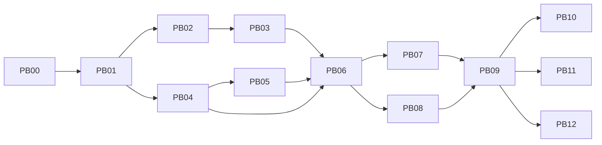

# 主动式 Bot + Superagent：可派发任务计划

> 2026-11-08 本轮收口：A01–A08 和补充的职责、工程/群修复、完整产物、命令桥、反馈流程已开发并通过最终包隔离验收。同一 0.6.5 包已更新到正式 desktop profile，原 Bot/会话保留及实际桌面检查通过。完整范围、命令、PASS/FAIL 和剩余操作见[交付记录](../../docs/verification/proactive-gap-completion.md)。以下原始任务与早期状态用于追溯。

> 2026-11-08 完整性复核：PB00–PB12 尚未全部开发完成。已有受限合成闭环，具体已实现范围、开发缺口及最新运行结果见[方案检查](../../docs/verification/proactive-plan-audit.md)。用户已取消的长时间运行要求不再纳入本次收口条件。下文各阶段原始交付要求和历史状态保留供逐项核对。

状态：PB00 验证已交付，按受限范围进入实施。PB01 已有核心接线，PB02 已有本地 CI 来源路径。完整验收、执行与后续阶段仍在推进。 [PB00 验证](../../docs/spikes/proactive-bot-compatibility.md) · [当前实施记录](../../docs/verification/proactive-pb01-pb02.md)

## 当前准备状态

实现分支为 `codex/proactive-bot-implementation`，设计提交为 `2917262`。当前阶段使用固定合成来源和隔离 Host。各任务的运行验收、能力缺口与后续依赖以实施记录为准。

## 共同派发契约

- 开始读根 `AGENTS.md`、`docs/dsh-api-notes.md`、`docs/PLAN.md`、本任务及相关设计；核对 Git 状态和实际 DSH CLI 版本。只写派发工作树，保留已有文件；参考 DSH rc.2 源码只读。
- 实现/返工运行显式指定 `-c model=gpt-6.1-sol -c model_reasoning_effort=high`；设计运行 `-c model=gpt-6-astra -c model_reasoning_effort=high`；stdin 用 `</dev/null`。不改全局配置。shell 命令使用 `scripts/pnpm` / `scripts/dsh`，Host 只用 `DSH_HOME="$PWD/.dsh-dev"`。
- 正式代码的拟定位置是 `packages/dsh-bot/src/{host,shared,client}/proactive/`；首选私有 `packages/proactive-coordinator/` 独立协调进程，PB00 验证后固定；不建第二套任务服务。表中的新路径是未来任务写入范围，不代表当前已存在或已批准新增依赖。
- 原型 Engine 为 Trigger/Thread/Decision/Mandate/Ticket/Assignment/effect/outbox 的唯一业务写入者；Host 的派工收据只是准确运行关联。复用现有 Bot、groups、delegate、native-schedule、notifications、connectors、memory。禁止并行建设 timer、Agent runtime、群 UI 或任务事实账本。
- 新注册、订阅、进程与连接均纳入所属 `ctx.effect`，Config/schema 有默认值和界限；仅公开入口；中英同键和主题 token。依赖遵守 rc.2/框架版本及 peer 规则。
- 每项交付包含变更文件、命令/退出码、逐项 PASS/FAIL、证据路径和遗留项。未执行写 `FAIL(NOT_RUN)`，环境阻断写 `FAIL(ENVIRONMENT)`；不支持写 `FAIL(CAPABILITY)`。不得把 UNIT/合成模型/静态检查升级为业务或真实模型通过。
- 所有任务禁止 `git commit/push/merge`、修改桌面安装或 `~/.dsh`、真实模型请求、自动发布评论、云端发布证据。后续真实试点是单独授权项，当前没有该授权。

## 依赖与并行边界

PB00 未关闭时只允许不依赖未决 API 的静态准备，不可先做生产 UI 再反推状态。PB01 后 PB02 与 PB04 可并行，但共用已冻结的协议/schema；PB03 与 PB05 可并行，PB06 必须集成二者。PB07 与 PB08 可并行，共用权限版本与 operationId；PB07 拥有 authorization/config，PB08 仅调用其冻结合同，不并行改同文件。PB10/11/12 可分别交付，不把所有 M4 能力捆绑为一次发布。

共享 `src/host/index.ts`、现有 `src/host/registry.ts` 的 Config/schema 接线、Remote schema、locale、package/lock 和 `docs/dsh-api-notes.md` 由当批集成者串行修改；并行任务先提供局部模块及准确接线补丁说明。实际文件名以派发前仓库检查为准。集成者跑完整 `scripts/pnpm check`，各任务仍需自己的针对性验证。

## M0：适配和语义门槛

### PB00 — 固定原型、公开入口与 rc.2 兼容 spike

- **依赖**：无；详见[完整任务](PB00-compatibility-spike.md)。
- **目标文件**：`spikes/proactive-bot/`、`docs/spikes/proactive-bot-compatibility.md`、`docs/dsh-api-notes.md`；隔离数据 `.dsh-dev/proactive-bot/`。不改生产包。
- **交付**：upstream SHA/许可证/依赖清单；核心入口和 SQLite 事务证据；真实 rc.2 Host 合成接线；source 无额外 LLM 触发能力表；review、结束、人工验收映射；后台授权拒绝路径；唯一状态/恢复协议决策。
- **退出**：PB00 硬门槛逐项通过，或明确缩小下一任务范围并记录被阻断能力。源码发现“不支持”只能支持停止/降级决策，不能把执行能力标为通过。
- **不允许**：安装完整原型到正式 profile、换成 alpha DSH 消除问题、为过关删递归门禁、私有 deep import、用异步队列冒充同步跨表事务。

### PB01 — 最小核心封装和 Host 协议

- **依赖**：PB00 的入口/进程/事务/授权决策已签定。
- **目标文件**：`src/shared/proactive/protocol.ts`、`src/host/proactive/coordinator-client.ts`、`src/host/proactive/index.ts`、`config.ts`、`service.ts`、`remote.ts`、对应 tests；协调 package 的 manifest/main/engine-adapter/repositories/commands 按[架构文件树](../../docs/design/proactive-bot/architecture.md)列入派发，构建受管产物随单 bundle 分发。
- **交付**：提交来源事件、读取建议、接受/撤销、承接派工、结果/对账的版本化窄协议；协议身份认证、请求摘要、稳定幂等 ID；核心单写者和启动/关闭顺序；只读可重建视图；能力协商失败时拒绝。
- **验收**：相同键同载荷返回同结果，异载荷冲突；旧协议/未知字段/跨实例凭证拒绝；两个协调实例仅一个可写；重启保持 ID；SQLite 失败不派副作用；卸载清空监听/连接且不接新请求。运行版本分别列出。
- **退出**：UNIT + 真实 rc.2 Host 合成握手/关闭/重启通过；签定后的 schema 作为后续任务唯一契约；可分发 tgz 在无 workspace 源码/链接依赖的隔离目录中启动协调服务，SQLite 驱动和解释器平台要求可验证。
- **不允许**：管理 HTTP 现有 stop/retry 冒充完整协议、Host 直接写核心 DB、第二个候选库或 TaskService。

## M1：只读来源与建议

### PB02 — 首个 CI 只读 Source 与可回放过滤

- **依赖**：PB01；PB00 已决定定时 Source 支持形式。
- **目标文件**：`src/host/proactive/sources/ci.ts`、`src/shared/proactive/source.ts`、source tests/fixtures；现有 `native-schedule/service.ts` 仅在已验证桥接需要时增量接线。
- **交付**：单仓库 CI failure 事件的稳定 eventId/revision、范围验证、分页 cursor 和收据；重复/过期/回声过滤、Thread 关联；固定 fixture 回放入口；来源断开/凭据撤销可见状态。首轮用脱敏固定 CI fixture，无真实仓库接入。
- **验收**：至少覆盖分页中断、游标提交前后强杀、重复乱序、CI 重跑、成功替代失败、正文注入、空页/限流；cursor 不越过未受理事件；observer 产生建议而零 Assignment/执行/出站；成本为 0 的无模型过滤单独计数。
- **退出**：摄取故障矩阵通过，支持的触发方式和不支持方式对用户可见。若 native schedule 只能唤醒模型，不能声称“无模型定时检查”；使用已核验事件驱动或明确人工刷新，定时能力保留 FAIL。只有来源缺事件入口且原生无非模型 hook，经 PB00 记录必要性与生命周期决策后，才可做仅负责摄取的 Source poller；不能演变为通用 timer。
- **不允许**：新建重复通用轮询 timer、隐含启用原型真实 Sources、读真实私密 CI 作为 fixture、每次事件自动群发。

### PB03 — 建议呈现、合并、关闭与过期

- **依赖**：PB02；使用 PB01 投影契约。
- **目标文件**：`src/client/proactive/`、已存在 Bot 详情/群管理入口的小范围接线、`locale/{en,zh}.json`、Client tests。
- **交付**：建议理由、证据、精确 BotKey、范围/策略版本、估计成本和失效时间；合并/忽略/继续观察；接受按钮可用性与授权预览。沿用现有详情与群 View，不复制群任务页。
- **验收**：中英×亮暗×宽窄浏览器矩阵；建议更新/过期/断线/reset/页面失活不被旧读覆盖；同一 Thread 不重复卡片；忽略不增权限；观察操作不触发模型或执行；取消动作与“结果未知”文字不混淆。
- **退出**：真实 Host 合成数据 + 浏览器行为通过。建议接受率与研判质量仍须真实试点，不以 UI 通过关闭质量门槛。
- **不允许**：Client 自行创建 Ticket/修改策略状态、把 would-accept 显示为已授权、调用云端发布报告。

## M2：人接受、执行、证据和返工

### PB04 — 明确接受与单 Bot 后台执行桥

- **依赖**：PB01；可以先用固定建议与 PB02 并行。
- **目标文件**：`src/host/proactive/authorization.ts`、`execution.ts`、`receipts.ts`、共享授权/派工 schema 和 tests；复用现有 delegate/subagent 底层。
- **交付**：精确一次接受决定，核验建议/策略/Bot 代际/目标/预算/过期；持久 dispatch intent → Host receipt → 实际 child/run 的关联；自动来源保留；取消与 unknown 对账。
- **验收**：双击和跨 Client 接受只承接一次；接受到启动间撤权/目标变更被拒绝；无人值守不等待不存在的 live approval；单 Bot 完成合成 CI 修复 fixture、输出测试证据；强杀后不盲重建 child；coldResume 无 caller delivery 时旧 child 不自动恢复派工；旧回报不能覆盖新 assignment。
- **退出**：真实 Host + 合成模型通过准确归属、撤权、拒绝、取消及派工故障点。人工点击只授权显示的动作和数据范围，不等于以后永久自动执行。
- **不允许**：调用交互式 `GroupTurns.send` 来伪装自动来源、清除 `assertInteractiveOrigin`、把原生 `source.kind=user` 当可信人工签名、真实修复生产仓库。

### PB05 — 现有群承接与有限跟进

- **依赖**：PB04。
- **目标文件**：`src/host/proactive/group-adapter.ts`、现有 `groups/{turns,turn-runner,data-flow}.ts` 必要桥接点、tests；展示复用现有群执行视图。
- **交付**：Ticket→现有群 turn/delivery/session 的引用；独立非交互受限入口；保留 membershipRevision/成员 BotKey/能力校验；有用后续输入只唤醒需要的成员；每次追加受限预算。
- **验收**：群成员变更、删除/重建 Bot、部分失败、晚到结果、重复 followup、旧 generation、恢复期间输入；每个 delivery 只计一次；感谢/重复进度不触发新轮次；无原生 provider 能力时明确拒绝。
- **退出**：同一合成任务单 Bot/群的事实及费用分别可追溯，现有交互群回归通过；不得默认宣称群优于单 Bot。
- **不允许**：第二套群 UI/调度器/任务板、外部 provider 无能力却冒充 spawn、用群总 token 代替本任务成本。

### PB06 — 独立验收记录与原任务返工闭环

- **依赖**：PB03、PB04、PB05。
- **目标文件**：`src/shared/proactive/evidence.ts`（DTO/schema）、`src/host/proactive/evidence.ts`（读取/授权/版本校验）、核心验收关联扩展、`src/client/proactive/ReviewPanel.tsx`、fixture/e2e scripts；遵循 PB00 的单一核心归属。
- **交付**：版本化证据索引、检查命令/退出码/产物 digest、独立人工接受/返工决定；返工仍属于原 Ticket，新增 assignment/证据版本。展示 runtime review 与产品验收的区别。
- **验收**：CI失败→建议→接受→修复fixture→测试证据→人工验收全程可追溯；缺证据、测试失败、拿旧产物证据、模型自称成功均不能自动验收；返工后旧接受记录不覆盖新交付；二次接受幂等。
- **退出**：单 Bot 与群两条合成闭环均完成；业务试点仍 FAIL(NOT_AUTHORIZED)。M2 可交付“机制验证版”，不可对外称真实自主修复已验收。
- **不允许**：ready/ended、reviewer verdict 或 turn/end 直接映射 accepted；Acceptance CLI 默认云发布、自动评论/commit/push/merge。

## M3：有限自动处理、通知和恢复

### PB07 — 白名单与跨重启预算

- **依赖**：PB06。
- **目标文件**：`src/host/proactive/authorization.ts` 和 `config.ts`、核心授权/预算扩展、Config/schema 和 tests。
- **交付**：默认关闭的 per-rule 白名单，精确动作/目标/数据范围、期限、模型/执行/注意力三类预算，跨重启扣账；派发前与每次新副作用前重验；一键关闭及取消回执。
- **验收**：策略过期/时钟回拨/同 id Bot 重建/并发耗额/重启/成员权限变更；无有效授权零新副作用；撤权时在途操作展示“已发出/未知”，禁止假称撤回；budget reservation 结算未知不能退款后重花。
- **退出**：全部权限矩阵通过且默认 OFF；允许自动动作清单逐项有独立证据。真实自动执行仍未授权。
- **不允许**：模型置信度提权、忽略/反馈扩大权限、失败后降沙箱/重试到更宽工具。

### PB08 — 唯一重试责任的通知桥

- **依赖**：PB06；对接 PB07 的权限契约。
- **目标文件**：`src/host/proactive/notification-bridge.ts`、现有 `notifications/{service,data-flow}.ts` 必要桥接、tests。
- **交付**：Outbox ID→现有 notification intent/operationId→attempt/receipt 持久关联；明确唯一重试方；站内先行、外部传输 fixture；静默、合并、过期和注意力预算。
- **验收**：成功回执丢失/发送超时/冷恢复 sending/重复 Outbox/目标撤销/正文变化；record tombstone/intent 非原子窗口需对账；unknown 不盲重发，failed/suppressed 不默认自动重试；只有可证明未发送才能按策略重试；正文和目标的数据授权不被通知策略替代。
- **退出**：真实 Host + fake transport 严格副作用计数通过；真实 IM/邮件写入为单独授权项。无后台数据批准桥时相应外部能力 FAIL(CAPABILITY)，站内建议可继续。
- **不允许**：直接调用 NotificationPort 跳过 intent，Outbox 与 Notifications 双重重试，自动发布未经审核正文。

### PB09 — 崩溃矩阵、72h 合成 soak 与受控试点包

- **依赖**：PB07、PB08。
- **目标文件**：`scripts/proactive-bot-recovery.mjs`、`scripts/proactive-bot-soak.mjs`、验收文档及 `.dsh-dev` 结果。
- **交付**：[验证计划](../../docs/design/proactive-bot/validation.md)全部故障点、资源/性能基线、72 小时真实进程合成 soak；另备真实试点动作/成本上限/停止条件/独立业务验收表。
- **验收**：核心/Host 单独和同时退出、强杀、重复恢复、版本不兼容、存储锁、队列压力均有收据；副作用计数=授权次数；数据无静默丢失；unknown 保守停放；无运行泄漏。
- **退出**：合成 soak 门槛与恢复全通过方可提出真实试点；真实试点获明确授权后另派发并记录。当前 PB09 可交付“待授权试点包”，M3 真实质量仍未通过。
- **不允许**：加速虚拟时钟冒充 72h soak、沿用旧 binary 截图验新版本、watchdog 盲重放、自动开放真实 Source。

## M4：按证据选择增强能力

### PB10 — 单一外部执行器适配

- **依赖**：PB09；选定执行器确有原生执行无法满足的需求及相同任务比较依据。
- **目标文件**：`src/host/proactive/executors/`、能力 schema、external adapter tests/docs。
- **交付**：submit/get/events/cancel/artifacts 窄协议、externalRunId、真实能力协商、独立成本来源；首先 fixture，再单独授权外部试点。
- **验收/退出**：缺 agentPreset/agentOptions/depthLimit/续聊能力明确拒绝；断线/取消/未知/晚到/产物版本归属通过；同任务有效交付/成本优于或补足原生能力才建议启用。
- **不允许**：把 MCP client 宣称 MCP server、伪造原生 Session usage、将可执行代码正文作为可信授权。

### PB11 — 常驻部署与升级恢复

- **依赖**：PB09。
- **目标文件**：`docs/deployment/proactive-bot.md`、仓库内隔离监督进程样例和升级/恢复测试；正式部署另行授权。
- **交付**：核心/Host 生命周期、健康/就绪/能力版本、单写者锁、备份/恢复/迁移与保留策略；本地/常驻部署的可用性说明。
- **验收/退出**：正常关闭/强杀/断网/休眠恢复/磁盘满/迁移失败/旧新版本同时启动；旧 schema 拒绝写入，无跨版本重复副作用；72h 合成部署矩阵。恢复保留审计 ID 与去重 tombstone。
- **不允许**：未经授权装系统 daemon、桌面关闭时谎称本机仍运行、失败迁移自动覆盖数据库、清理未过保留期的 unknown 收据。

### PB12 — 反馈候选与冻结回归采用

- **依赖**：PB09；PB10/11 不作前置。
- **目标文件**：`src/host/proactive/feedback.ts`、版本化规则候选 schema、冻结评估 fixtures/scripts/docs；记忆写入复用现有入口。
- **交付**：本任务返工/规则误报/稳定偏好/Skill提案/权限设置分流；候选→独立评估→显式采用/撤销；采用版与无反馈版公平比较。
- **验收/退出**：冻结 held-out 一次评估、三批回放、标注分歧与例外公开；误报降低且 recall/交付不越过预设退化界限；权限集合不扩大；恢复前版可追溯。
- **不允许**：自动训练或递归改进宣传、将 evaluator 修改过的测试集当 held-out、把忽略反馈写为永久偏好、静默改权限。

## 里程碑退出摘要

| 里程碑 | 必须交付 | 不能省略的门槛 | 当前状态 |
| --- | --- | --- | --- |
| M0 | PB00–PB01 的单写核心和可运行协议 | 固定 SHA、rc.2 Host、SQLite 回滚、review/授权/Source 决策 | PASS（固定核心、rc.2 Host、收据与恢复） |
| M1 | PB02–PB03 的只读建议 | 摄取重启/游标、零执行、浏览器、独立质量评估 | 部分 PASS（本地定时 CI 收件箱与工作台通过，真实 Source 和质量待验） |
| M2 | PB04–PB06 接受到交付/返工 | 单 Bot 后群、精确证据、独立验收、崩溃恢复 | 部分 PASS（单 Bot 合成修复、产物验收、双 Bot 只读审阅和 CI 定向跟进通过隔离验收，真实试点待验） |
| M3 | PB07–PB09 有界自动机制 | 撤权/预算/通知 unknown、72h soak、获授权真实试点 | 部分 PASS（站内通知与人工确认的外发夹具通过，72h 测试进行中，真实试点待验） |
| M4 | PB10–PB12 逐项可选增强 | 能力/成本、常驻恢复、held-out 反馈比较 | 部分 PASS（本机外部执行器、反馈采用与撤销、隔离备份恢复通过；真实试点待验） |

M0 中 PB00 是探索门槛，PB01 是其通过后的生产最小封装。M1/M2 可分别实现机制，但第一条真实业务闭环仍须独立试点授权。所有模式默认不允许发布评论、提交、推送或合并。

当前实现的逐项运行记录与缺口见[主动 Bot 验证记录](../../docs/verification/proactive-pb03-pb12.md)。

修复、外部执行器、反馈采用与定时来源的补充结果见[本阶段验收](../../docs/verification/proactive-repair-and-feedback.md)。

双 Bot 群审阅、精确外发确认、v4 恢复及独立长跑见[后续验收](../../docs/verification/proactive-reviewed-dispatch.md)。

CI 事实定向跟进、撤权和 v5 长跑见[群跟进验收](../../docs/verification/proactive-group-follow-up.md)。

v6 补齐来源撤销界面、产物群审阅、外部运行额度和仓库内监督样例。交付范围及用户验收入口见[开发交付](../../docs/verification/proactive-development-handoff.md)。
